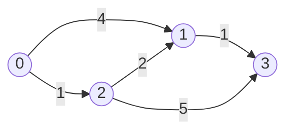
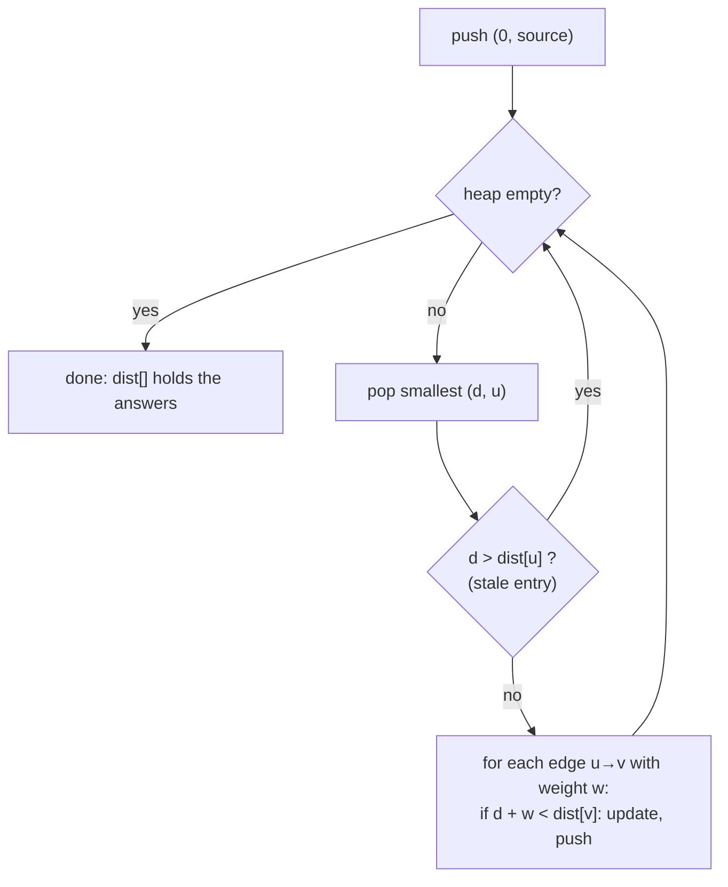

# Dijkstra's Algorithm: Shortest Path, Non-Negative Weights

> Repeatedly take the closest unfinished node, then try to shorten the paths of its neighbours. A min-heap makes it `O((V + E) log V)`. It only works when no edge weight is negative.

#### 1. What Is It?

**Single-source shortest path** on a weighted graph: the cheapest route from one start node to every other node.

| Graph | Algorithm |
|---|---|
| Unweighted (every edge costs 1) | BFS, `O(V + E)` |
| Weights `≥ 0` | **Dijkstra**, `O((V + E) log V)` |
| Some weights negative | Bellman-Ford (note 04) |

**Signals:** "shortest / cheapest / fastest path", "minimum time to reach all", "minimum cost from A to B", "network delay", weights on edges or grid cells, all non-negative.

A fuller treatment with the same code idea is in `DS Graph` note 18. This note adds the algorithm-level view: why it works, when it breaks, and the O(V²) version.

#### 2. How It Works

**Greedy rule.** The unfinished node with the smallest known distance cannot be improved: any other route to it would have to pass through a node that is already at least as far, and weights are non-negative.

Graph: `0→1 (4)`, `0→2 (1)`, `2→1 (2)`, `1→3 (1)`, `2→3 (5)`.



```text
dist = [0, ∞, ∞, ∞]            heap: (0, node 0)
pop (0, 0): relax 1 → 4, relax 2 → 1             dist [0, 4, 1, ∞]
pop (1, 2): relax 1 → 1+2 = 3 (better), 3 → 6   dist [0, 3, 1, 6]
pop (3, 1): relax 3 → 3+1 = 4 (better)          dist [0, 3, 1, 4]
pop (4, 1)... (4,1) is stale (dist[1] is 3) → skip
pop (4, 3): final.  (6, 3) is stale → skip
answer: [0, 3, 1, 4]   path to 3: 0 → 2 → 1 → 3
```



**Lazy deletion.** Java's `PriorityQueue` cannot lower a key, so we push a new entry and skip the old one when it comes out (`d > dist[u]`).

**Why negative weights break it.** Once a node is finished we never look at it again. A later negative edge could make it cheaper, and everything computed from it stays wrong.

```text
0→1 (2), 0→2 (3), 2→1 (−2), 1→3 (1)
true: 0→2→1→3 = 3 − 2 + 1 = 2
array-style Dijkstra finishes node 1 at 2, sets dist[3] = 3, never fixes it → answer 3 (wrong)
```

**Dense graphs.** Replace the heap with an array scan: pick the closest unfinished node in `O(V)`. Total `O(V²)`, which beats `O(E log V)` when `E ≈ V²`.

#### 3. Brute Force vs Optimized

| Approach | Time | Notes |
|---|---|---|
| Try every path (DFS) | exponential | only for tiny graphs |
| Bellman-Ford (relax all edges `V − 1` times) | `O(V · E)` | works with negative weights |
| Dijkstra, array scan | `O(V²)` | good for dense graphs |
| **Dijkstra, min-heap** | **`O((V + E) log V)`** | the default |
| BFS | `O(V + E)` | only when all weights are equal |

```kotlin
// Array-scan Dijkstra (O(V²)): no heap
fun dijkstraArray(g: List<List<IntArray>>, src: Int): IntArray {
    val n = g.size
    val dist = IntArray(n) { INF }
    val done = BooleanArray(n)
    dist[src] = 0
    for (round in 0 until n) {
        var u = -1
        for (i in 0 until n) if (!done[i] && dist[i] != INF && (u == -1 || dist[i] < dist[u])) u = i
        if (u == -1) break                                   // the rest is unreachable
        done[u] = true
        for ((v, w) in g[u]) if (dist[u] + w < dist[v]) dist[v] = dist[u] + w
    }
    return dist
}
```

#### 4. Kotlin Code

```kotlin
import java.util.PriorityQueue

const val INF = Int.MAX_VALUE

// Adjacency list: g[u] = list of [v, weight]. Edges are [u, v, w].
fun buildGraph(n: Int, edges: Array<IntArray>, directed: Boolean = true): List<MutableList<IntArray>> {
    val g = List(n) { mutableListOf<IntArray>() }
    for ((u, v, w) in edges) {
        g[u].add(intArrayOf(v, w))
        if (!directed) g[v].add(intArrayOf(u, w))
    }
    return g
}

// Returns (dist, parent). dist[v] == INF means unreachable.
fun dijkstra(g: List<List<IntArray>>, src: Int): Pair<IntArray, IntArray> {
    val n = g.size
    val dist = IntArray(n) { INF }
    val parent = IntArray(n) { -1 }
    dist[src] = 0
    val pq = PriorityQueue<IntArray>(compareBy<IntArray> { it[0] })   // [distance, node]
    pq.add(intArrayOf(0, src))
    while (pq.isNotEmpty()) {
        val (d, u) = pq.poll()
        if (d > dist[u]) continue                                    // stale entry
        for ((v, w) in g[u]) {
            if (d + w < dist[v]) {
                dist[v] = d + w
                parent[v] = u
                pq.add(intArrayOf(d + w, v))
            }
        }
    }
    return dist to parent
}

// Rebuild the path from the parent array
fun pathTo(parent: IntArray, dist: IntArray, target: Int): List<Int> {
    if (dist[target] == INF) return emptyList()
    val path = ArrayList<Int>()
    var cur = target
    while (cur != -1) { path.add(cur); cur = parent[cur] }
    return path.reversed()
}

// Network Delay Time (LeetCode 743): nodes are 1..n
fun networkDelayTime(times: Array<IntArray>, n: Int, k: Int): Int {
    val edges = Array(times.size) { intArrayOf(times[it][0] - 1, times[it][1] - 1, times[it][2]) }
    val (dist, _) = dijkstra(buildGraph(n, edges), k - 1)
    val worst = dist.max()
    return if (worst == INF) -1 else worst
}
```

Checks, with `edges = [[0,1,4],[0,2,1],[2,1,2],[1,3,1],[2,3,5]]` and `g = buildGraph(4, edges)`: `dijkstra(g, 0).first` → `[0, 3, 1, 4]`. `pathTo` for node 3 → `[0, 2, 1, 3]`. `dijkstraArray(g, 0)` → `[0, 3, 1, 4]`. An unreachable node has `dist = INF` and `pathTo` is `[]`. `networkDelayTime([[2,1,1],[2,3,1],[3,4,1]], 4, 2)` → `2`; `([[1,2,1]], 2, 1)` → `1`; `([[1,2,1]], 2, 2)` → `-1`. Negative-edge failure: with edges `[[0,1,2],[0,2,3],[2,1,-2],[1,3,1]]`, `dijkstraArray(buildGraph(4, edges), 0)[3]` → `3`, but the true shortest distance is `2` (Bellman-Ford in note 04 gets it right).

#### 5. Complexity

| | Time | Space |
|---|---|---|
| Heap version | `O((V + E) log V)` (each edge pushes at most one entry: `O(E log E) = O(E log V)`) | `O(V + E)` |
| Array-scan version | `O(V²)` | `O(V)` |
| Path reconstruction | `O(V)` | `O(V)` |

#### 6. Common Mistakes

1. **Negative edge weights.** Use Bellman-Ford.
2. **Missing the stale check** (`if (d > dist[u]) continue`): correct but slower, can be much slower.
3. **`INF + w` overflow** (`Int.MAX_VALUE + w` wraps negative). Only relax from nodes with finite distance, or use `Long`.
4. **Using BFS on a weighted graph.**
5. **Marking visited when pushing** (as in BFS) instead of when popping.
6. **Comparator on `Pair` or arrays written wrongly** (compare by distance only).
7. **Forgetting unreachable nodes** (return `-1`).
8. **Dijkstra for "fewest edges with a cost limit".** The state needs both the node and the stops used.

#### 7. Say This in the Interview

1. "Weights are non-negative, so Dijkstra applies. I use a min-heap keyed by distance and skip stale entries."
2. "Each edge is relaxed once, so it's `O((V + E) log V)`."
3. "With negative edges the greedy 'finished' assumption fails; I'd use Bellman-Ford instead."
4. "To print the path I store each node's parent and walk back from the target."

#### 8. Quick Check

1. Why does Dijkstra fail on negative edges?
2. Complexity with a binary heap?
3. Why skip an entry when `d > dist[u]`?

<details>
<summary>Answers</summary>

1. A finished node can later become cheaper, but is never revisited.
2. `O((V + E) log V)`.
3. It is an outdated entry: a shorter path to `u` was already found and processed.

</details>

#### 9. Related LeetCode Questions

| # | Question | Idea |
|---|---|---|
| 743 | [Network Delay Time](https://leetcode.com/problems/network-delay-time/) (Medium) | Dijkstra, take the max |
| 1514 | [Path with Maximum Probability](https://leetcode.com/problems/path-with-maximum-probability/) (Medium) | max-heap, multiply |
| 1631 | [Path With Minimum Effort](https://leetcode.com/problems/path-with-minimum-effort/) (Medium) | minimise the max edge |
| 778 | [Swim in Rising Water](https://leetcode.com/problems/swim-in-rising-water/) (Hard) | minimise the max cell |
| 1976 | [Number of Ways to Arrive at Destination](https://leetcode.com/problems/number-of-ways-to-arrive-at-destination/) (Medium) | count shortest paths |
| 787 | [Cheapest Flights Within K Stops](https://leetcode.com/problems/cheapest-flights-within-k-stops/) (Medium) | extra state (stops) |
