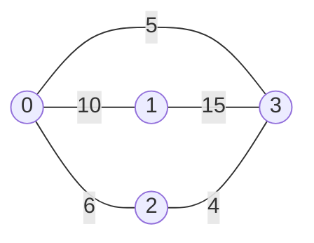
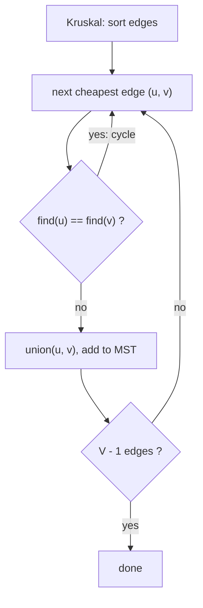

# Kruskal's and Prim's Algorithms: Minimum Spanning Tree

> A **minimum spanning tree (MST)** connects all nodes with the least total edge weight and no cycles. Kruskal adds the cheapest edges that do not form a cycle. Prim grows one tree outward.

#### 1. What Is It?

For a connected, undirected, weighted graph with `V` nodes, a **spanning tree** uses exactly `V − 1` edges, connects every node and has no cycle. The **MST** is the one with minimum total weight.

| | Kruskal | Prim |
|---|---|---|
| Idea | sort all edges, take the cheapest that joins two different components | start at one node, repeatedly add the cheapest edge leaving the tree |
| Needs | Union-Find (DSU) | min-heap |
| Time | `O(E log E)` | `O(E log V)` (heap), `O(V²)` (array) |
| Best for | sparse graphs, edge list input | dense graphs, adjacency input |
| Greedy proof | **cut property** | **cut property** |

**Cut property.** For any split of the nodes into two groups, the cheapest edge crossing the split belongs to some MST. Both algorithms rely on it.

**Signals:** "connect all with minimum cost", "minimum total length of cable / road / pipe", "remove edges to leave a tree", "redundant connection", "all cities reachable".

Related notes in `DS Graph`: 26 (MST), 27 (Kruskal), 28 (Prim), 23 to 25 (Union-Find).

#### 2. How It Works

Graph (undirected): `0-1 (10)`, `0-2 (6)`, `0-3 (5)`, `1-3 (15)`, `2-3 (4)`.



**Kruskal**, edges sorted by weight:

```text
(2-3, 4)  join {2} and {3}              take   total 4
(0-3, 5)  join {0} and {2,3}            take   total 9
(0-2, 6)  0 and 2 already connected     skip   (would form a cycle)
(0-1, 10) join {1} and {0,2,3}          take   total 19      V−1 = 3 edges: stop
(1-3, 15) not needed
MST edges: 2-3, 0-3, 0-1   total weight 19
```

**Prim** from node 0:

```text
tree {0}:  candidate edges 0-1(10), 0-2(6), 0-3(5)        take 0-3 (5)
tree {0,3}: candidates 0-1(10), 0-2(6), 2-3(4), 1-3(15)  take 2-3 (4)
tree {0,3,2}: candidates 0-1(10), 1-3(15)                take 0-1 (10)
total 19
```



**Cycle test with Union-Find.** `find(x)` returns the component's representative; `union` merges two components. With path compression and union by size, each operation is almost `O(1)`.

**Disconnected graph.** If fewer than `V − 1` edges get used, no spanning tree exists (the result is a spanning forest).

**Is it unique?** If all weights are distinct, yes. With ties there may be several MSTs of the same total weight.

#### 3. Brute Force vs Optimized

| Approach | Time |
|---|---|
| Try every subset of `V − 1` edges, check tree + weight | `O(C(E, V − 1))`, exponential |
| **Kruskal** | `O(E log E)` |
| **Prim** with a heap | `O(E log V)` |
| Prim with an array scan | `O(V²)` (best for dense graphs, e.g. points in a plane) |

```kotlin
// Brute-force flavour: repeatedly pick the cheapest edge that does not close a cycle,
// checking connectivity with DFS each time (O(E · (V + E))). Kruskal replaces the DFS with Union-Find.
fun connectedDfs(adj: List<MutableList<Int>>, a: Int, b: Int): Boolean {
    val seen = BooleanArray(adj.size)
    fun dfs(u: Int) { seen[u] = true; for (v in adj[u]) if (!seen[v]) dfs(v) }
    dfs(a)
    return seen[b]
}
```

#### 4. Kotlin Code

```kotlin
import java.util.PriorityQueue

// Union-Find with path compression and union by size
class DSU(n: Int) {
    private val parent = IntArray(n) { it }
    private val size = IntArray(n) { 1 }
    var components = n
        private set

    fun find(x: Int): Int {
        var root = x
        while (parent[root] != root) root = parent[root]
        var cur = x
        while (parent[cur] != root) { val next = parent[cur]; parent[cur] = root; cur = next }   // compress
        return root
    }

    fun union(a: Int, b: Int): Boolean {                 // false if already in the same component
        var ra = find(a)
        var rb = find(b)
        if (ra == rb) return false
        if (size[ra] < size[rb]) { val t = ra; ra = rb; rb = t }
        parent[rb] = ra
        size[ra] += size[rb]
        components--
        return true
    }
}

// Kruskal: edges are [u, v, w]; returns the MST weight, or -1 if the graph is disconnected
fun kruskal(n: Int, edges: Array<IntArray>): Int {
    val dsu = DSU(n)
    var total = 0
    var used = 0
    for (e in edges.sortedBy { it[2] }) {
        if (dsu.union(e[0], e[1])) {
            total += e[2]
            used++
            if (used == n - 1) break
        }
    }
    return if (used == n - 1) total else -1
}

// Prim with a heap
fun prim(n: Int, edges: Array<IntArray>): Int {
    val g = List(n) { mutableListOf<IntArray>() }
    for ((u, v, w) in edges) { g[u].add(intArrayOf(v, w)); g[v].add(intArrayOf(u, w)) }
    val inTree = BooleanArray(n)
    val pq = PriorityQueue<IntArray>(compareBy<IntArray> { it[0] })      // [weight, node]
    pq.add(intArrayOf(0, 0))
    var total = 0
    var count = 0
    while (pq.isNotEmpty() && count < n) {
        val (w, u) = pq.poll()
        if (inTree[u]) continue
        inTree[u] = true
        total += w
        count++
        for ((v, wt) in g[u]) if (!inTree[v]) pq.add(intArrayOf(wt, v))
    }
    return if (count == n) total else -1
}

// Min Cost to Connect All Points (LeetCode 1584): dense Prim, O(V²), no edge list needed
fun minCostConnectPoints(points: Array<IntArray>): Int {
    val n = points.size
    val dist = IntArray(n) { Int.MAX_VALUE }
    val inTree = BooleanArray(n)
    dist[0] = 0
    var total = 0
    repeat(n) {
        var u = -1
        for (i in 0 until n) if (!inTree[i] && (u == -1 || dist[i] < dist[u])) u = i
        inTree[u] = true
        total += dist[u]
        for (v in 0 until n) if (!inTree[v]) {
            val d = Math.abs(points[u][0] - points[v][0]) + Math.abs(points[u][1] - points[v][1])
            if (d < dist[v]) dist[v] = d
        }
    }
    return total
}

// Redundant Connection (LeetCode 684): the edge that closes a cycle (nodes are 1..n)
fun findRedundantConnection(edges: Array<IntArray>): IntArray {
    val dsu = DSU(edges.size + 1)
    for (e in edges) if (!dsu.union(e[0], e[1])) return e
    return intArrayOf()
}
```

Checks, with `edges = [[0,1,10],[0,2,6],[0,3,5],[1,3,15],[2,3,4]]`: `kruskal(4, edges)` → `19`; `prim(4, edges)` → `19`. A disconnected graph, `kruskal(3, [[0,1,5]])` → `-1`; `prim(3, [[0,1,5]])` → `-1`. `kruskal(1, [])` → `0`. `minCostConnectPoints([[0,0],[2,2],[3,10],[5,2],[7,0]])` → `20`; `([[3,12],[-2,5],[-4,1]])` → `18`. `findRedundantConnection([[1,2],[1,3],[2,3]])` → `[2, 3]`; `([[1,2],[2,3],[3,4],[1,4],[1,5]])` → `[1, 4]`.

#### 5. Complexity

| | Time | Space |
|---|---|---|
| Kruskal | `O(E log E)` sort + `O(E α(V))` unions | `O(V)` (DSU) |
| Prim (heap) | `O(E log V)` | `O(V + E)` |
| Prim (array) | `O(V²)` | `O(V)` |

`α(V)` is the inverse Ackermann function, below 5 for any real input.

#### 6. Common Mistakes

1. **Running MST on a directed graph.** MST is for undirected graphs (directed needs Edmonds / Chu-Liu).
2. **Forgetting to check connectivity** (`used == V − 1`).
3. **Sorting by the wrong field.**
4. **Prim: not skipping nodes already in the tree** (double counting).
5. **Union-Find without path compression** (slow on long chains).
6. **Mixing 0-based and 1-based node numbers.**
7. **Confusing MST with the shortest path tree.** The MST minimises total weight, not distances from a root.
8. **Building all `O(V²)` edges** for points when dense Prim needs none.

#### 7. Say This in the Interview

1. "I need the cheapest way to connect everything: a minimum spanning tree. Kruskal sorts edges and uses Union-Find to skip any edge that would form a cycle: `O(E log E)`."
2. "For a complete graph of points I'd use Prim in `O(V²)` and compute distances on the fly."
3. "If the result uses fewer than `V − 1` edges, the graph is disconnected."

#### 8. Quick Check

1. How many edges does an MST of `V` nodes have?
2. Why does Kruskal need Union-Find?
3. Which algorithm for `V = 1000` points on a plane, no explicit edges?

<details>
<summary>Answers</summary>

1. `V − 1`.
2. To tell in near-constant time whether an edge joins two different components (no cycle).
3. Prim with an array scan, `O(V²)` ≈ 10⁶ steps.

</details>

#### 9. Related LeetCode Questions

| # | Question | Idea |
|---|---|---|
| 684 | [Redundant Connection](https://leetcode.com/problems/redundant-connection/) (Medium) | Union-Find cycle edge |
| 1584 | [Min Cost to Connect All Points](https://leetcode.com/problems/min-cost-to-connect-all-points/) (Medium) | Prim or Kruskal |
| 1135 | [Connecting Cities With Minimum Cost](https://leetcode.com/problems/connecting-cities-with-minimum-cost/) (Medium, premium) | Kruskal |
| 1168 | [Optimize Water Distribution in a Village](https://leetcode.com/problems/optimize-water-distribution-in-a-village/) (Hard, premium) | virtual node + MST |
| 261 | [Graph Valid Tree](https://leetcode.com/problems/graph-valid-tree/) (Medium, premium) | `V − 1` edges, no cycle |
| 1489 | [Find Critical and Pseudo-Critical Edges in Minimum Spanning Tree](https://leetcode.com/problems/find-critical-and-pseudo-critical-edges-in-minimum-spanning-tree/) (Hard) | MST with forced / banned edges |
