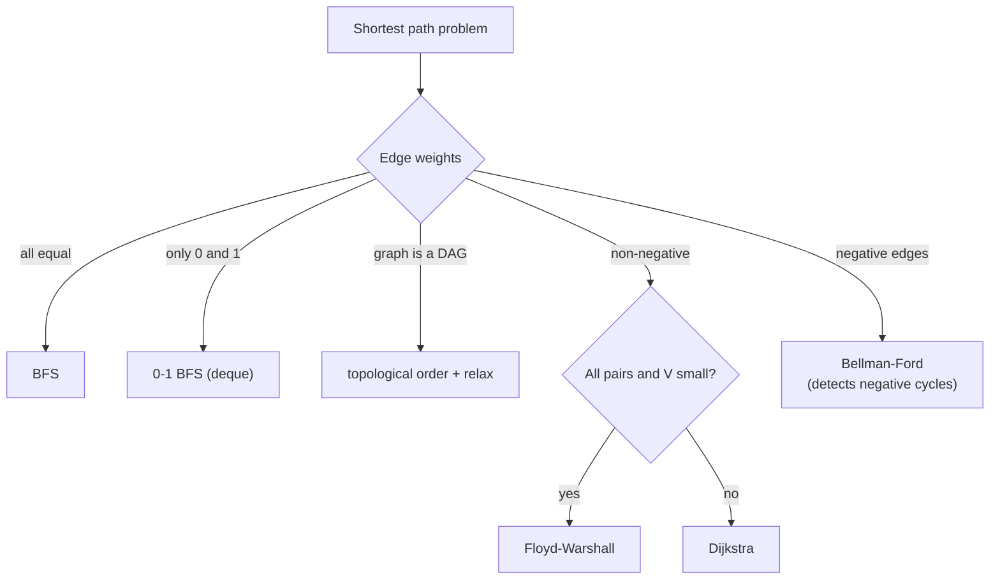

# Choosing the Right Algorithm for the Weights You Have

> The weights on the edges decide the algorithm. Match them, and the problem is a known template. Mismatch them, and you get wrong answers or time-outs.

#### 1. What Is It?

| What you have | Use | Time |
|---|---|---|
| **No weights** (each edge counts 1) | BFS | `O(V + E)` |
| Weights are only **0 or 1** | 0-1 BFS (deque) | `O(V + E)` |
| Weights **non-negative** | Dijkstra | `O((V + E) log V)` |
| **Negative** weights, no negative cycle | Bellman-Ford | `O(V · E)` |
| Possible **negative cycle** (detect it) | Bellman-Ford | `O(V · E)` |
| **DAG** (no cycles), any weights | topological order + relax | `O(V + E)` |
| **All pairs**, `V` small (≤ ~400) | Floyd-Warshall | `O(V³)` |
| **At most K edges** | Bellman-Ford limited to K rounds, or BFS by levels | `O(K · E)` |
| One target + a good estimate of remaining distance | A* | depends on the heuristic |
| **Minimise the largest edge** on a path | Dijkstra with `max`, or Union-Find + sorted edges | `O(E log V)` |
| **Connect everything cheaply** (not a path) | MST: Kruskal / Prim | `O(E log E)` |

**Signals to read from the problem:** Does it say "weighted"? Can costs be negative (profit, discount, refund)? Is there a limit on edges or stops? Is it one source, one target, or all pairs? How big are `V` and `E`?

#### 2. How It Works



**0-1 BFS.** A normal queue gives BFS. With weights 0 and 1, push a 0-cost neighbour to the **front** and a 1-cost neighbour to the **back** of a deque. The deque stays sorted by distance, so no heap is needed.

**DAG shortest path.** In a topological order, every node is processed after all its predecessors, so one pass of relaxations is enough. This also works with negative weights, in `O(V + E)`.

**Common wrong choices**

| Mistake | What happens |
|---|---|
| BFS on a weighted graph | finds the fewest edges, not the least cost |
| Dijkstra with negative edges | wrong distances |
| Floyd-Warshall for `V = 10⁵` | `10¹⁵` steps, time-out |
| Bellman-Ford when Dijkstra applies | `O(VE)` instead of `O(E log V)`, time-out |
| Dijkstra for "at most K stops" without extra state | may discard a pricier path that uses fewer stops |

#### 3. Brute Force vs Optimized

| Situation | Brute force | Better |
|---|---|---|
| 0/1 weights | Dijkstra `O(E log V)` | 0-1 BFS `O(V + E)` |
| DAG | Bellman-Ford `O(V · E)` | topological relax `O(V + E)` |
| Many queries on a small graph | Dijkstra per query | Floyd-Warshall once `O(V³)`, then `O(1)` per query |
| Unweighted | Dijkstra | BFS |

```kotlin
// Safe but slow for a DAG: relax every edge V - 1 times (O(V · E)); the topological version below is O(V + E)
fun relaxAll(n: Int, edges: Array<IntArray>, src: Int): IntArray {
    val dist = IntArray(n) { Int.MAX_VALUE }
    dist[src] = 0
    repeat(n - 1) {
        for ((u, v, w) in edges) if (dist[u] != Int.MAX_VALUE && dist[u] + w < dist[v]) dist[v] = dist[u] + w
    }
    return dist
}
```

#### 4. Kotlin Code

```kotlin
const val INF = Int.MAX_VALUE

// 0-1 BFS on a grid: Minimum Obstacle Removal to Reach Corner (LeetCode 2290)
// Entering a cell costs grid[r][c] (0 empty, 1 obstacle).
fun minimumObstacles(grid: Array<IntArray>): Int {
    val m = grid.size
    val n = grid[0].size
    val dist = Array(m) { IntArray(n) { INF } }
    val dq = ArrayDeque<IntArray>()
    dist[0][0] = 0
    dq.addFirst(intArrayOf(0, 0))
    val dirs = arrayOf(intArrayOf(1, 0), intArrayOf(-1, 0), intArrayOf(0, 1), intArrayOf(0, -1))
    while (dq.isNotEmpty()) {
        val (r, c) = dq.removeFirst()
        for (d in dirs) {
            val nr = r + d[0]
            val nc = c + d[1]
            if (nr !in 0 until m || nc !in 0 until n) continue
            val cost = grid[nr][nc]
            if (dist[r][c] + cost < dist[nr][nc]) {
                dist[nr][nc] = dist[r][c] + cost
                if (cost == 0) dq.addFirst(intArrayOf(nr, nc)) else dq.addLast(intArrayOf(nr, nc))
            }
        }
    }
    return dist[m - 1][n - 1]
}

// Shortest paths in a DAG (negative weights allowed): Kahn order + relaxation
fun dagShortest(n: Int, edges: Array<IntArray>, src: Int): IntArray {
    val g = List(n) { mutableListOf<IntArray>() }
    val indeg = IntArray(n)
    for ((u, v, w) in edges) { g[u].add(intArrayOf(v, w)); indeg[v]++ }
    val queue = ArrayDeque<Int>()
    for (i in 0 until n) if (indeg[i] == 0) queue.addLast(i)
    val dist = IntArray(n) { INF }
    dist[src] = 0
    while (queue.isNotEmpty()) {
        val u = queue.removeFirst()
        for ((v, w) in g[u]) {
            if (dist[u] != INF && dist[u] + w < dist[v]) dist[v] = dist[u] + w
            if (--indeg[v] == 0) queue.addLast(v)
        }
    }
    return dist
}

// Shortest Path in Binary Matrix (LeetCode 1091): unweighted grid, 8 directions → BFS
fun shortestPathBinaryMatrix(grid: Array<IntArray>): Int {
    val n = grid.size
    if (grid[0][0] == 1 || grid[n - 1][n - 1] == 1) return -1
    val dist = Array(n) { IntArray(n) { -1 } }
    val queue = ArrayDeque<IntArray>()
    dist[0][0] = 1
    queue.addLast(intArrayOf(0, 0))
    while (queue.isNotEmpty()) {
        val (r, c) = queue.removeFirst()
        if (r == n - 1 && c == n - 1) return dist[r][c]
        for (dr in -1..1) for (dc in -1..1) {
            val nr = r + dr
            val nc = c + dc
            if (nr in 0 until n && nc in 0 until n && grid[nr][nc] == 0 && dist[nr][nc] == -1) {
                dist[nr][nc] = dist[r][c] + 1
                queue.addLast(intArrayOf(nr, nc))
            }
        }
    }
    return -1
}
```

Checks: `minimumObstacles(arrayOf(intArrayOf(0,1,1), intArrayOf(1,1,0), intArrayOf(1,1,0)))` → `2`; `minimumObstacles(arrayOf(intArrayOf(0,1,0,0,0), intArrayOf(0,1,0,1,0), intArrayOf(0,0,0,1,0)))` → `0`. `dagShortest(4, [[0,1,2],[0,2,6],[1,2,3],[2,3,1]], 0)` → `[0, 2, 5, 6]`; `relaxAll` gives the same `[0, 2, 5, 6]`; adding the edge `[1,3,-4]` gives `[0, 2, 5, -2]`. `shortestPathBinaryMatrix([[0,1],[1,0]])` → `2`; `([[0,0,0],[1,1,0],[1,1,0]])` → `4`; `([[1,0,0],[1,1,0],[1,1,0]])` → `-1`.

#### 5. Complexity

| Algorithm | Time | Space |
|---|---|---|
| BFS / 0-1 BFS | `O(V + E)` | `O(V)` |
| Dijkstra | `O((V + E) log V)` | `O(V + E)` |
| Bellman-Ford | `O(V · E)` | `O(V)` |
| Floyd-Warshall | `O(V³)` | `O(V²)` |
| DAG shortest path | `O(V + E)` | `O(V + E)` |
| Kruskal / Prim | `O(E log E)` / `O(E log V)` | `O(V)` |

#### 6. Common Mistakes

1. **Choosing by habit** (always Dijkstra) without checking for negative weights.
2. **Using BFS when weights differ.**
3. **Ignoring the DAG special case**, or running Dijkstra on negative DAG weights.
4. **Forgetting to ask** whether weights can be zero or negative.
5. **Mixing up "shortest path" and "MST".**
6. **0-1 BFS: pushing zero-cost moves to the back.**
7. **Not reading `V`, `E` limits** (Floyd-Warshall needs `V ≤ ~400`).

#### 7. Say This in the Interview

1. "Before choosing an algorithm I'll check the weights: unweighted → BFS; non-negative → Dijkstra; negative → Bellman-Ford."
2. "The edges are only 0 or 1, so a deque gives 0-1 BFS in `O(V + E)`."
3. "The graph is a DAG, so one pass in topological order is enough, even with negative edges."
4. "There's a limit on the number of stops, so I keep that in the state or run Bellman-Ford for K rounds."

#### 8. Quick Check

1. Best algorithm for edge weights in `{0, 1}`?
2. Shortest path in a DAG with negative weights?
3. Which fails with negative edges: BFS, Dijkstra, Bellman-Ford?

<details>
<summary>Answers</summary>

1. 0-1 BFS with a deque.
2. Topological order and relax each edge once: `O(V + E)`.
3. Dijkstra (BFS ignores weights altogether).

</details>

#### 9. Related LeetCode Questions

| # | Question | Idea |
|---|---|---|
| 1091 | [Shortest Path in Binary Matrix](https://leetcode.com/problems/shortest-path-in-binary-matrix/) (Medium) | BFS |
| 2290 | [Minimum Obstacle Removal to Reach Corner](https://leetcode.com/problems/minimum-obstacle-removal-to-reach-corner/) (Hard) | 0-1 BFS |
| 743 | [Network Delay Time](https://leetcode.com/problems/network-delay-time/) (Medium) | Dijkstra |
| 787 | [Cheapest Flights Within K Stops](https://leetcode.com/problems/cheapest-flights-within-k-stops/) (Medium) | K rounds of Bellman-Ford |
| 1334 | [Find the City With the Smallest Number of Neighbors at a Threshold Distance](https://leetcode.com/problems/find-the-city-with-the-smallest-number-of-neighbors-at-a-threshold-distance/) (Medium) | Floyd-Warshall |
| 1631 | [Path With Minimum Effort](https://leetcode.com/problems/path-with-minimum-effort/) (Medium) | Dijkstra with `max` |
