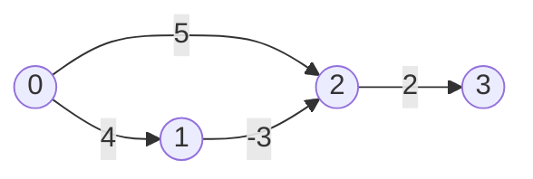
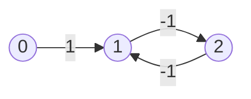
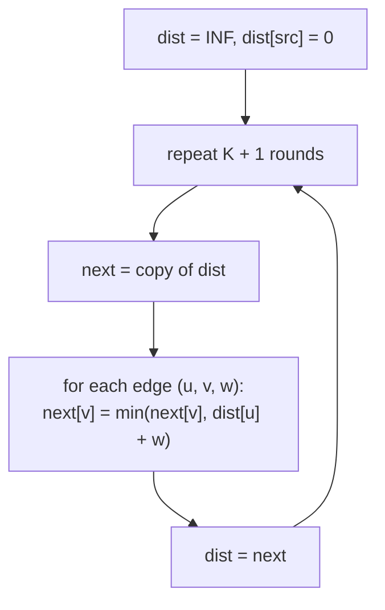

# Bellman-Ford: Handles Negative Weights, Detects Negative Cycles

> Relax every edge, `V − 1` times. After round `k`, all shortest paths that use at most `k` edges are correct. One extra round tells you whether a negative cycle exists.

#### 1. What Is It?

**Relaxing an edge** `u → v` with weight `w` means: if `dist[u] + w < dist[v]`, update `dist[v]`.

Bellman-Ford simply relaxes **all** edges, over and over:

| Fact | Why |
|---|---|
| A shortest path has at most `V − 1` edges (no repeated node) | otherwise it contains a cycle, and a non-negative cycle can be dropped |
| Round `k` fixes all shortest paths of at most `k` edges | induction on `k` |
| So `V − 1` rounds are enough | |
| A change in round `V` means a **negative cycle** is reachable | the distances could keep shrinking forever |

| | Dijkstra | Bellman-Ford |
|---|---|---|
| Negative edges | no | **yes** |
| Negative cycle detection | no | **yes** |
| Time | `O((V + E) log V)` | `O(V · E)` |
| "At most `K` edges" | needs extra state | **natural** (stop after `K` rounds) |

**Signals:** "negative weights", "discounts / refunds / profit", "detect arbitrage / negative cycle", "at most `K` stops / edges", "currency exchange".

#### 2. How It Works

Edges: `0→1 (4)`, `0→2 (5)`, `1→2 (−3)`, `2→3 (2)`. Source 0.



```text
start:   dist = [0, ∞, ∞, ∞]
round 1: 0→1: 4;  0→2: 5;  1→2: 4−3 = 1;  2→3: 1+2 = 3        dist = [0, 4, 1, 3]
round 2: nothing improves → can stop early
answer:  [0, 4, 1, 3]
```

Dijkstra would be wrong here: it would finish node 2 at 5 before finding the cheaper route through the negative edge.

**Negative cycle.** Edges `0→1 (1)`, `1→2 (−1)`, `2→1 (−1)`: the cycle `1→2→1` costs `−2` each lap.



After `V − 1` rounds, if any edge can still be relaxed, a negative cycle is reachable from the source, and "shortest path" is undefined.

**At most `K` edges (Cheapest Flights Within K Stops).** Run exactly `K + 1` rounds. In each round, relax using a **copy** of the previous round's distances, so a path cannot use more than one new edge per round.



**Early exit.** If a full round changes nothing, stop. This makes typical cases much faster than `V · E`.

**SPFA** is a queue-based speed-up of Bellman-Ford (relax only from nodes whose distance changed). Same worst case, usually faster. Mention only.

#### 3. Brute Force vs Optimized

| Approach | Time | Handles negatives? |
|---|---|---|
| Enumerate all paths | exponential | yes |
| **Bellman-Ford** | `O(V · E)` | yes |
| SPFA (queue) | `O(V · E)` worst, often near `O(E)` | yes |
| Dijkstra | `O((V + E) log V)` | no |
| DAG relax in topological order | `O(V + E)` | yes (needs a DAG) |

```kotlin
// Brute force flavour: DFS over all simple paths, keep the cheapest (exponential, tiny graphs only)
fun cheapestByDfs(g: List<List<IntArray>>, u: Int, target: Int, seen: BooleanArray): Int {
    if (u == target) return 0
    seen[u] = true
    var best = Int.MAX_VALUE
    for ((v, w) in g[u]) if (!seen[v]) {
        val rest = cheapestByDfs(g, v, target, seen)
        if (rest != Int.MAX_VALUE) best = minOf(best, w + rest)
    }
    seen[u] = false
    return best
}
```

#### 4. Kotlin Code

```kotlin
const val INF = Int.MAX_VALUE

// Returns distances, or null if a negative cycle is reachable from src
fun bellmanFord(n: Int, edges: Array<IntArray>, src: Int): IntArray? {
    val dist = IntArray(n) { INF }
    dist[src] = 0
    for (round in 1..n - 1) {
        var changed = false
        for ((u, v, w) in edges) {
            if (dist[u] != INF && dist[u] + w < dist[v]) {
                dist[v] = dist[u] + w
                changed = true
            }
        }
        if (!changed) return dist                         // early exit: already stable
    }
    for ((u, v, w) in edges) {                            // V-th round: any improvement → negative cycle
        if (dist[u] != INF && dist[u] + w < dist[v]) return null
    }
    return dist
}

// Cheapest Flights Within K Stops (LeetCode 787)
fun findCheapestPrice(n: Int, flights: Array<IntArray>, src: Int, dst: Int, k: Int): Int {
    var dist = IntArray(n) { INF }
    dist[src] = 0
    repeat(k + 1) {                                       // at most k + 1 flights
        val next = dist.copyOf()                          // read the old round, write the new one
        for ((u, v, w) in flights) {
            if (dist[u] != INF && dist[u] + w < next[v]) next[v] = dist[u] + w
        }
        dist = next
    }
    return if (dist[dst] == INF) -1 else dist[dst]
}

// Detect an arbitrage loop: currency rates r(u→v); a cycle with product > 1 is a negative cycle on -ln(rate)
fun hasArbitrage(n: Int, rates: Array<DoubleArray>): Boolean {
    // rates rows: [u, v, rate]
    val dist = DoubleArray(n)                             // start every node at 0 so all cycles are reachable
    repeat(n) {
        var changed = false
        for (r in rates) {
            val u = r[0].toInt(); val v = r[1].toInt()
            val w = -Math.log(r[2])
            if (dist[u] + w < dist[v] - 1e-12) { dist[v] = dist[u] + w; changed = true }
        }
        if (!changed) return false
    }
    return true
}
```

Checks: `bellmanFord(4, [[0,1,4],[0,2,5],[1,2,-3],[2,3,2]], 0)` → `[0, 4, 1, 3]`. `bellmanFord(3, [[0,1,1],[1,2,-1],[2,1,-1]], 0)` → `null` (negative cycle). `bellmanFord(3, [[0,1,5]], 0)` → `[0, 5, INF]`. `cheapestByDfs` on the first graph from 0 to 3 → `3`. `findCheapestPrice(4, [[0,1,100],[1,2,100],[2,0,100],[1,3,600],[2,3,200]], 0, 3, 1)` → `700`; with `k = 2` → `400`. `findCheapestPrice(3, [[0,1,100],[1,2,100],[0,2,500]], 0, 2, 1)` → `200`; with `k = 0` → `500`; unreachable target → `-1`. `hasArbitrage(3, [[0,1,2.0],[1,2,3.0],[2,0,0.2]])` → `true` (`2 × 3 × 0.2 = 1.2 > 1`); with the last rate `0.1` (product `0.6`) → `false`.

#### 5. Complexity

| | Time | Space |
|---|---|---|
| Bellman-Ford | `O(V · E)` | `O(V)` |
| With early exit | `O(E)` best case | |
| K-stops version | `O(K · E)` | `O(V)` |
| Negative-cycle check | one more `O(E)` round | |

#### 6. Common Mistakes

1. **`INF + w` overflow.** Skip edges whose source is `INF`.
2. **Relaxing in place in the K-stops version.** A path may then use more than `K` edges in one round. Use a copy.
3. **Off-by-one on rounds:** `K` stops means `K + 1` edges.
4. **Running `V` rounds without a check** and never telling the caller about the negative cycle.
5. **Negative cycle not reachable from the source** is harmless; only reachable ones matter (for all cycles, start every node at 0).
6. **Undirected edges with a negative weight** are a negative cycle (`u→v→u`).
7. **Using it when Dijkstra applies** (slower).

#### 7. Say This in the Interview

1. "There are negative edges, so Dijkstra is out. Bellman-Ford relaxes all edges `V − 1` times: `O(V·E)`."
2. "If an edge can still be relaxed on round `V`, there's a negative cycle."
3. "'At most K stops' maps directly onto Bellman-Ford: run `K + 1` rounds, using a copy of the previous distances each round."

#### 8. Quick Check

1. Rounds needed for `V` nodes?
2. Why use a copy per round in the K-stops problem?
3. What does a change in round `V` mean?

<details>
<summary>Answers</summary>

1. `V − 1`.
2. So each round extends paths by exactly one edge, never more.
3. A negative cycle is reachable from the source.

</details>

#### 9. Related LeetCode Questions

| # | Question | Idea |
|---|---|---|
| 787 | [Cheapest Flights Within K Stops](https://leetcode.com/problems/cheapest-flights-within-k-stops/) (Medium) | `K + 1` rounds |
| 743 | [Network Delay Time](https://leetcode.com/problems/network-delay-time/) (Medium) | also solvable with Bellman-Ford |
| 1514 | [Path with Maximum Probability](https://leetcode.com/problems/path-with-maximum-probability/) (Medium) | Bellman-Ford variant |
| 399 | [Evaluate Division](https://leetcode.com/problems/evaluate-division/) (Medium) | ratio graph |
| 1334 | [Find the City With the Smallest Number of Neighbors at a Threshold Distance](https://leetcode.com/problems/find-the-city-with-the-smallest-number-of-neighbors-at-a-threshold-distance/) (Medium) | all-pairs alternative |
| 1631 | [Path With Minimum Effort](https://leetcode.com/problems/path-with-minimum-effort/) (Medium) | Dijkstra/Bellman-Ford variant |
