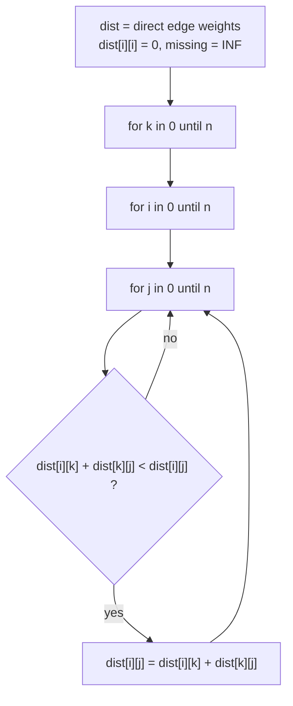

# Floyd-Warshall: All-Pairs Shortest Path

> Three nested loops that compute the shortest distance between **every pair** of nodes. Allow one more intermediate node `k` at a time. `O(V³)`, so only for small graphs.

#### 1. What Is It?

`dist[i][j]` = shortest distance from `i` to `j`. Start with direct edges, then ask for each node `k`: *is it cheaper to go `i → k → j`?*

```text
dist[i][j] = min(dist[i][j], dist[i][k] + dist[k][j])
```

| | Value |
|---|---|
| Time | `O(V³)` |
| Space | `O(V²)` |
| Negative edges | yes |
| Negative cycles | detected: `dist[i][i] < 0` |
| Best when | `V ≤ ~400`, many queries, dense graph, transitive closure |

**Signals:** "shortest distance between all pairs", "for each city, how many reachable within X", "can A reach B" (many queries), "small `n` (≤ 100–400)", ratio / conversion tables.

#### 2. How It Works

**The invariant.** After processing nodes `0..k`, `dist[i][j]` is the shortest path from `i` to `j` that uses only nodes `0..k` as intermediate stops. When `k` runs through all nodes, every path is covered.

**The loop order matters:** `k` must be the **outermost** loop.



Example (undirected): `0-1 (3)`, `1-2 (1)`, `1-3 (4)`, `2-3 (1)`.

```text
start:      0-3 = INF         (no direct edge)
k = 1:      0-2 = 3+1 = 4,    0-3 = 3+4 = 7
k = 2:      0-3 = min(7, 4+1) = 5,   1-3 = min(4, 1+1) = 2
final 0→3 = 5   (0 → 1 → 2 → 3)
```

**Transitive closure (Warshall).** Replace distances with booleans: `reach[i][j] = reach[i][j] or (reach[i][k] and reach[k][j])`. Answers "can `i` reach `j`" for all pairs.

**Path reconstruction.** Keep `next[i][j]` (the first step on the best path) and update it together with `dist`.

**Floyd-Warshall vs running Dijkstra from every node**

| | Floyd-Warshall | Dijkstra × V |
|---|---|---|
| Time | `O(V³)` | `O(V · E log V)` |
| Negative edges | yes | no |
| Code | 5 lines | longer |
| Better for | dense or small graphs | sparse, large graphs |

#### 3. Brute Force vs Optimized

| Approach | Time |
|---|---|
| DFS all paths for every pair | exponential |
| Dijkstra from every node | `O(V · E log V)` |
| **Floyd-Warshall** | `O(V³)` |
| Matrix multiplication ideas | `O(V³ log V)` or more (not used) |

```kotlin
// Brute force: run a single-source shortest path from each node (Bellman-Ford style, V × V × E)
fun allPairsBrute(n: Int, edges: Array<IntArray>): Array<IntArray> {
    val INF = 1_000_000_000
    return Array(n) { src ->
        val d = IntArray(n) { INF }
        d[src] = 0
        repeat(n - 1) {
            for ((u, v, w) in edges) {
                if (d[u] + w < d[v]) d[v] = d[u] + w
                if (d[v] + w < d[u]) d[u] = d[v] + w          // undirected
            }
        }
        d
    }
}
```

#### 4. Kotlin Code

```kotlin
const val BIG = 1_000_000_000                              // BIG + BIG still fits in an Int

fun floydWarshall(n: Int, edges: Array<IntArray>, directed: Boolean = false): Array<IntArray> {
    val d = Array(n) { i -> IntArray(n) { j -> if (i == j) 0 else BIG } }
    for ((u, v, w) in edges) {
        d[u][v] = minOf(d[u][v], w)
        if (!directed) d[v][u] = minOf(d[v][u], w)
    }
    for (k in 0 until n)                                   // k outermost
        for (i in 0 until n)
            for (j in 0 until n)
                if (d[i][k] + d[k][j] < d[i][j]) d[i][j] = d[i][k] + d[k][j]
    return d
}

fun hasNegativeCycle(d: Array<IntArray>): Boolean = d.indices.any { d[it][it] < 0 }

// Find the City With the Smallest Number of Neighbors at a Threshold Distance (LeetCode 1334)
fun findTheCity(n: Int, edges: Array<IntArray>, threshold: Int): Int {
    val d = floydWarshall(n, edges)
    var best = -1
    var bestCount = Int.MAX_VALUE
    for (i in 0 until n) {
        var count = 0
        for (j in 0 until n) if (i != j && d[i][j] <= threshold) count++
        if (count <= bestCount) { bestCount = count; best = i }      // ties: larger index wins
    }
    return best
}

// Course Schedule IV (LeetCode 1462): transitive closure
fun checkIfPrerequisite(numCourses: Int, prerequisites: Array<IntArray>, queries: Array<IntArray>): List<Boolean> {
    val reach = Array(numCourses) { BooleanArray(numCourses) }
    for ((a, b) in prerequisites) reach[a][b] = true
    for (k in 0 until numCourses)
        for (i in 0 until numCourses)
            for (j in 0 until numCourses)
                if (reach[i][k] && reach[k][j]) reach[i][j] = true
    return queries.map { reach[it[0]][it[1]] }
}
```

Checks: `floydWarshall(4, [[0,1,3],[1,2,1],[1,3,4],[2,3,1]])[0][3]` → `5`; `[1][3]` → `2`; the matrix is symmetric. `allPairsBrute` gives the same matrix. `findTheCity(4, [[0,1,3],[1,2,1],[1,3,4],[2,3,1]], 4)` → `3`; `findTheCity(5, [[0,1,2],[0,4,8],[1,2,3],[1,4,2],[2,3,1],[3,4,1]], 2)` → `0`. `hasNegativeCycle(floydWarshall(2, [[0,1,-1],[1,0,-1]], directed = true))` → `true`. `checkIfPrerequisite(2, [[1,0]], [[0,1],[1,0]])` → `[false, true]`; `checkIfPrerequisite(3, [[1,2],[1,0],[2,0]], [[1,0],[1,2]])` → `[true, true]`.

#### 5. Complexity

| | Time | Space |
|---|---|---|
| Floyd-Warshall | `O(V³)` | `O(V²)` |
| 400 nodes | about 64 million steps | 160,000 cells |
| 5,000 nodes | 1.25 × 10¹¹ steps: too slow | |

#### 6. Common Mistakes

1. **Wrong loop order** (`k` must be the outer loop).
2. **`INF + INF` overflow** with `Int.MAX_VALUE`. Use a "big" value like `10⁹` (or `Long`).
3. **`dist[i][i]` not set to 0.**
4. **Multiple edges between the same pair:** keep the minimum weight.
5. **Forgetting the reverse edge** for undirected graphs.
6. **Using it for large `V`.**
7. **Tie-breaking in "smallest count" problems** (LeetCode 1334 wants the largest index).
8. **Negative cycle ignored:** distances become meaningless; check the diagonal.

#### 7. Say This in the Interview

1. "There are at most a few hundred nodes and I need all pairs, so Floyd-Warshall at `O(V³)` is simple and fast enough."
2. "The outer loop is the intermediate node `k`; after processing it, `dist[i][j]` is the best path using nodes `0..k` as stops."
3. "For reachability only, I'll use the boolean version (transitive closure)."

#### 8. Quick Check

1. Which loop is outermost?
2. How do you detect a negative cycle?
3. Time for `V = 100`?

<details>
<summary>Answers</summary>

1. The intermediate node `k`.
2. After the run, some `dist[i][i] < 0`.
3. About 10⁶ steps.

</details>

#### 9. Related LeetCode Questions

| # | Question | Idea |
|---|---|---|
| 1334 | [Find the City With the Smallest Number of Neighbors at a Threshold Distance](https://leetcode.com/problems/find-the-city-with-the-smallest-number-of-neighbors-at-a-threshold-distance/) (Medium) | all-pairs distances |
| 1462 | [Course Schedule IV](https://leetcode.com/problems/course-schedule-iv/) (Medium) | transitive closure |
| 399 | [Evaluate Division](https://leetcode.com/problems/evaluate-division/) (Medium) | multiplicative closure |
| 2976 | [Minimum Cost to Convert String I](https://leetcode.com/problems/minimum-cost-to-convert-string-i/) (Medium) | letter graph, 26 nodes |
| 743 | [Network Delay Time](https://leetcode.com/problems/network-delay-time/) (Medium) | alternative on small `n` |
| 1971 | [Find if Path Exists in Graph](https://leetcode.com/problems/find-if-path-exists-in-graph/) (Easy) | reachability |
