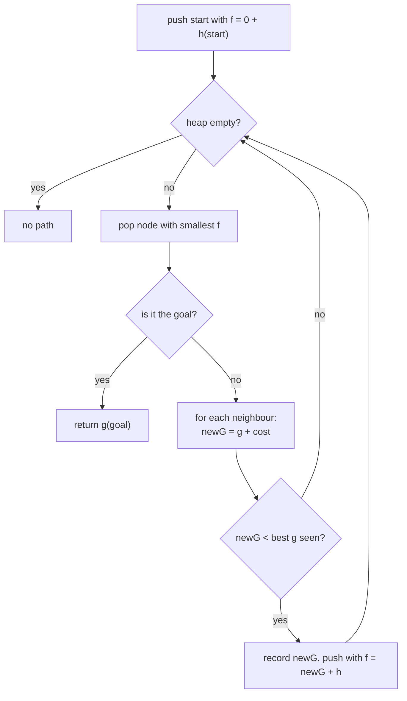

# A* Search: Dijkstra Plus a Heuristic

> Dijkstra explores in all directions. A* adds a guess of the distance still to go, so it heads toward the goal first. It is still optimal if the guess never overestimates.

#### 1. What Is It?

A* picks the next node by **`f(n) = g(n) + h(n)`**:

| Term | Meaning |
|---|---|
| `g(n)` | exact cost from the start to `n` (what Dijkstra uses) |
| `h(n)` | **heuristic**: estimated cost from `n` to the goal |
| `f(n)` | estimated total cost of the best path through `n` |

| Property of `h` | Meaning | Effect |
|---|---|---|
| **Admissible** | never overestimates the true remaining cost | A* returns an optimal path |
| **Consistent** | `h(u) ≤ w(u, v) + h(v)` for every edge | each node is expanded at most once |
| `h = 0` | no information | A* becomes Dijkstra |
| `h` too large | overestimates | faster, but may return a non-optimal path |

**Common heuristics on a grid**

| Moves allowed | Heuristic |
|---|---|
| 4 directions, cost 1 | Manhattan: `|dr| + |dc|` |
| 8 directions, cost 1 | Chebyshev: `max(|dr|, |dc|)` |
| any direction, Euclidean cost | straight-line distance |

**Signals:** "shortest path to one target", a grid or map with coordinates, "sliding puzzle", "minimum moves to reach a state" with a natural distance estimate. For most interview problems BFS or Dijkstra is enough; mention A* as an optimisation.

#### 2. How It Works

The algorithm is Dijkstra with a different priority.



**Example.** Empty 3 × 3 grid, 8 moves, from `(0,0)` to `(2,2)`, `h = max(|dr|, |dc|)`:

```text
pop (0,0)  f = 1 + 2 = 3
pop (1,1)  f = 2 + 1 = 3    (neighbours (0,1), (1,0) have f = 4: worse)
pop (2,2)  f = 3 + 0 = 3    goal → path length 3 cells
A* expanded 3 nodes.  BFS expands all 9 cells before it pops the goal.
```

**Where A* helps.** The heuristic narrows the search toward the goal. With walls and mazes the gain depends on how informative `h` is. In the worst case it expands as many nodes as Dijkstra.

**Bidirectional search** is the other common speed-up: run BFS from both ends and stop when they meet (Word Ladder). It reduces `bᵈ` to `2 · b^(d/2)`.

#### 3. Brute Force vs Optimized

| Approach | Explores | Time (grid `N × N`) |
|---|---|---|
| DFS (all paths) | exponential | exponential |
| BFS | everything within distance `d` | `O(N²)` |
| Dijkstra | everything cheaper than the goal | `O(N² log N)` |
| **A*** | mostly toward the goal | `O(N² log N)` worst, often far fewer expansions |

```kotlin
import java.util.PriorityQueue

// Plain BFS for comparison: returns (path length in cells, nodes expanded)
fun bfsGrid(grid: Array<IntArray>): Pair<Int, Int> {
    val n = grid.size
    if (grid[0][0] == 1 || grid[n - 1][n - 1] == 1) return -1 to 0
    val dist = Array(n) { IntArray(n) { -1 } }
    val queue = ArrayDeque<IntArray>()
    dist[0][0] = 1
    queue.addLast(intArrayOf(0, 0))
    var expanded = 0
    while (queue.isNotEmpty()) {
        val (r, c) = queue.removeFirst()
        expanded++
        if (r == n - 1 && c == n - 1) return dist[r][c] to expanded
        for (dr in -1..1) for (dc in -1..1) {
            val nr = r + dr
            val nc = c + dc
            if (nr in 0 until n && nc in 0 until n && grid[nr][nc] == 0 && dist[nr][nc] == -1) {
                dist[nr][nc] = dist[r][c] + 1
                queue.addLast(intArrayOf(nr, nc))
            }
        }
    }
    return -1 to expanded
}
```

#### 4. Kotlin Code

```kotlin
// A* on an n x n grid, 8 directions, unit cost; 0 = open, 1 = wall (LeetCode 1091)
// Returns (path length in cells, nodes expanded)
fun aStarGrid(grid: Array<IntArray>): Pair<Int, Int> {
    val n = grid.size
    if (grid[0][0] == 1 || grid[n - 1][n - 1] == 1) return -1 to 0
    fun h(r: Int, c: Int) = maxOf(n - 1 - r, n - 1 - c)                // Chebyshev distance to the goal
    val best = Array(n) { IntArray(n) { Int.MAX_VALUE } }               // best g found so far
    val pq = PriorityQueue<IntArray>(compareBy<IntArray> { it[0] })     // [f, g, r, c]
    best[0][0] = 1
    pq.add(intArrayOf(1 + h(0, 0), 1, 0, 0))
    var expanded = 0
    while (pq.isNotEmpty()) {
        val (_, g, r, c) = pq.poll()
        if (g > best[r][c]) continue                                    // stale entry
        expanded++
        if (r == n - 1 && c == n - 1) return g to expanded
        for (dr in -1..1) for (dc in -1..1) {
            val nr = r + dr
            val nc = c + dc
            if (nr in 0 until n && nc in 0 until n && grid[nr][nc] == 0 && g + 1 < best[nr][nc]) {
                best[nr][nc] = g + 1
                pq.add(intArrayOf(g + 1 + h(nr, nc), g + 1, nr, nc))
            }
        }
    }
    return -1 to expanded
}

// Manhattan distance heuristic (4-direction grids)
fun manhattan(r: Int, c: Int, gr: Int, gc: Int): Int = Math.abs(r - gr) + Math.abs(c - gc)
```

Checks: with the open 3 × 3 grid `[[0,0,0],[0,0,0],[0,0,0]]`: `aStarGrid(grid)` → `(3, 3)` and `bfsGrid(grid)` → `(3, 9)`. `aStarGrid([[0,1],[1,0]])` → length `2`; `([[0,0,0],[1,1,0],[1,1,0]])` → length `4`; `([[1,0,0],[1,1,0],[1,1,0]])` → `-1`. Both functions return the same path length on every grid. `manhattan(0, 0, 2, 3)` → `5`.

#### 5. Complexity

| | Time | Space |
|---|---|---|
| A* | `O(E log V)` worst case (like Dijkstra) | `O(V)` |
| Number of expansions | depends on `h`; can be a small fraction of `V` | |
| BFS | `O(V + E)` | `O(V)` |

#### 6. Common Mistakes

1. **A heuristic that overestimates** (e.g. Manhattan when diagonal moves are allowed): the result may not be shortest.
2. **Forgetting to update `g` when a cheaper path is found.**
3. **Returning when the goal is first *pushed*** instead of when it is *popped* (not optimal).
4. **Ordering the heap by `h` only** (that is greedy best-first search, not A*).
5. **Using A* when BFS is enough** (unweighted, no good heuristic).
6. **Heuristic expensive to compute**, costing more than it saves.
7. **Using it with negative edges.**

#### 7. Say This in the Interview

1. "A* is Dijkstra ordered by `g + h`, where `h` is an estimate of the remaining distance. If `h` never overestimates, the path is still optimal."
2. "On a 4-direction grid I'd use Manhattan distance. With diagonal moves, Manhattan overestimates, so I'd use Chebyshev."
3. "Here all steps cost 1 and there's no strong heuristic, so BFS is simpler and just as good."

#### 8. Quick Check

1. A* with `h = 0` is which algorithm?
2. Why can an overestimating `h` give a wrong answer?
3. When do you test for the goal?

<details>
<summary>Answers</summary>

1. Dijkstra.
2. It can make a cheaper path look more expensive, so a worse path is popped first.
3. When it is popped from the heap, not when it is pushed.

</details>

#### 9. Related LeetCode Questions

| # | Question | Idea |
|---|---|---|
| 1091 | [Shortest Path in Binary Matrix](https://leetcode.com/problems/shortest-path-in-binary-matrix/) (Medium) | BFS or A* with Chebyshev |
| 752 | [Open the Lock](https://leetcode.com/problems/open-the-lock/) (Medium) | BFS over states |
| 127 | [Word Ladder](https://leetcode.com/problems/word-ladder/) (Hard) | BFS, bidirectional BFS |
| 773 | [Sliding Puzzle](https://leetcode.com/problems/sliding-puzzle/) (Hard) | BFS or A* with Manhattan sums |
| 1293 | [Shortest Path in a Grid with Obstacles Elimination](https://leetcode.com/problems/shortest-path-in-a-grid-with-obstacles-elimination/) (Hard) | state `(r, c, k)` |
| 864 | [Shortest Path to Get All Keys](https://leetcode.com/problems/shortest-path-to-get-all-keys/) (Hard) | state `(r, c, keys mask)` |
