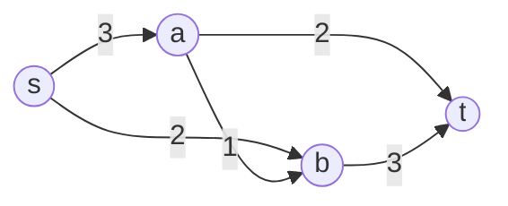
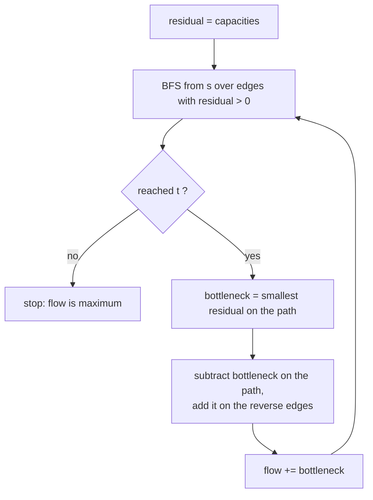

# Network Flow (Max Flow / Min Cut): Name and Problem Shape Only

> Push as much "stuff" as possible from a source to a sink through edges with capacities. Rare in coding interviews; know the name, the theorem, and the problems that turn into it (matching, disjoint paths).

#### 1. What Is It?

A **flow network** is a directed graph where each edge has a **capacity**, with a **source** `s` and a **sink** `t`. A **flow** sends units along edges so that:

- no edge carries more than its capacity, and
- for every node except `s` and `t`, flow in = flow out.

| Term | Meaning |
|---|---|
| **Max flow** | the largest total flow from `s` to `t` |
| **Min cut** | the smallest total capacity of edges whose removal separates `s` from `t` |
| **Max-flow min-cut theorem** | the two values are **equal** |
| **Residual graph** | remaining capacity on each edge, plus a reverse edge for the flow already sent (so the algorithm can undo bad choices) |
| **Augmenting path** | an `s → t` path with spare capacity in the residual graph |

**Algorithms (names)**

| Algorithm | Idea | Time |
|---|---|---|
| Ford-Fulkerson | keep finding augmenting paths with DFS | `O(E · f)`, `f` = max flow value |
| **Edmonds-Karp** | augmenting paths found by BFS (shortest first) | `O(V · E²)` |
| Dinic | BFS levels + blocking flows | `O(V² · E)` |

**Problems that become flow**

| Problem shape | Reduction |
|---|---|
| Maximum **bipartite matching** (jobs to workers, students to rooms) | source → left (cap 1), left → right (cap 1), right → sink (cap 1) |
| Edge-disjoint paths from `s` to `t` | every edge has capacity 1 |
| Minimum number of edges/cables to cut to disconnect | min cut |
| Project selection, image segmentation, baseball elimination | min cut formulation |

**Signals:** "assign each A to at most one B", "maximum number of pairs", "how many independent routes", "minimum number of links to cut", capacities on edges.

#### 2. How It Works

Network: `s → a (3)`, `s → b (2)`, `a → b (1)`, `a → t (2)`, `b → t (3)`.



**Edmonds-Karp, step by step**

```text
find a shortest augmenting path with BFS, push the bottleneck, repeat:
path s→a→t     bottleneck 2   flow 2
path s→b→t     bottleneck 2   flow 4
path s→a→b→t   bottleneck 1   flow 5      (a→b has 1, s→a has 1 left, b→t has 1 left)
no more paths  → max flow = 5
min cut: edges a→t (2) + b→t (3) = 5   (equals the max flow)
```



**Bipartite matching as flow.** Left nodes `L`, right nodes `R`, edges for allowed pairs. Add `s → each L` and `each R → t`, all capacity 1. The max flow is the size of the maximum matching.

**Interview reality.** Most "matching" questions have a simpler solution (greedy, DFS-based Kuhn's algorithm, or bitmask DP). If asked about flow directly, state the theorem, name Edmonds-Karp, and describe the residual graph.

#### 3. Brute Force vs Optimized

| Approach | Time |
|---|---|
| Try all subsets of edges for a cut | exponential |
| Try all matchings | exponential |
| Ford-Fulkerson (DFS) | `O(E · f)` |
| **Edmonds-Karp** | `O(V E²)`, independent of capacities |
| Dinic | `O(V² E)`, `O(E √V)` on unit-capacity bipartite graphs |

```kotlin
// Brute force maximum matching: try every way to pick one right node per left node (exponential)
fun matchingBrute(adj: List<List<Int>>, rightCount: Int): Int {
    fun go(i: Int, used: BooleanArray): Int {
        if (i == adj.size) return 0
        var best = go(i + 1, used)                       // leave left node i unmatched
        for (r in adj[i]) if (!used[r]) {
            used[r] = true
            best = maxOf(best, 1 + go(i + 1, used))
            used[r] = false
        }
        return best
    }
    return go(0, BooleanArray(rightCount))
}
```

#### 4. Kotlin Code

```kotlin
// Edmonds-Karp on a capacity matrix
fun maxFlow(cap: Array<IntArray>, s: Int, t: Int): Int {
    val n = cap.size
    val residual = Array(n) { cap[it].copyOf() }
    var flow = 0
    while (true) {
        val parent = IntArray(n) { -1 }
        parent[s] = s
        val queue = ArrayDeque<Int>()
        queue.addLast(s)
        while (queue.isNotEmpty() && parent[t] == -1) {      // BFS for an augmenting path
            val u = queue.removeFirst()
            for (v in 0 until n) if (parent[v] == -1 && residual[u][v] > 0) {
                parent[v] = u
                queue.addLast(v)
            }
        }
        if (parent[t] == -1) break                           // no augmenting path left
        var bottleneck = Int.MAX_VALUE
        var v = t
        while (v != s) { val u = parent[v]; bottleneck = minOf(bottleneck, residual[u][v]); v = u }
        v = t
        while (v != s) {
            val u = parent[v]
            residual[u][v] -= bottleneck                     // use capacity
            residual[v][u] += bottleneck                     // allow undoing it later
            v = u
        }
        flow += bottleneck
    }
    return flow
}

// Maximum bipartite matching via max flow: nodes are 0 = source, 1..left, left+1..left+right, last = sink
fun maxBipartiteMatching(left: Int, right: Int, pairs: Array<IntArray>): Int {
    val n = left + right + 2
    val s = 0
    val t = n - 1
    val cap = Array(n) { IntArray(n) }
    for (i in 0 until left) cap[s][1 + i] = 1
    for (j in 0 until right) cap[1 + left + j][t] = 1
    for ((a, b) in pairs) cap[1 + a][1 + left + b] = 1
    return maxFlow(cap, s, t)
}
```

Checks: the small network above (`s=0, a=1, b=2, t=3`; `cap[0][1]=3, cap[0][2]=2, cap[1][2]=1, cap[1][3]=2, cap[2][3]=3`): `maxFlow(cap, 0, 3)` → `5`. The classic textbook network with 6 nodes (`0→1:16, 0→2:13, 1→2:10, 2→1:4, 1→3:12, 3→2:9, 2→4:14, 4→3:7, 3→5:20, 4→5:4`): `maxFlow(cap, 0, 5)` → `23`. Disconnected sink → `0`. `maxBipartiteMatching(3, 3, [[0,0],[0,1],[1,0],[2,1],[2,2]])` → `3`; `([[0,0],[1,0],[2,0]])` with `3, 3` → `1`. `matchingBrute(listOf(listOf(0, 1), listOf(0), listOf(1, 2)), 3)` → `3`.

#### 5. Complexity

| | Time | Space |
|---|---|---|
| Edmonds-Karp | `O(V E²)` (with a matrix BFS: `O(V³ E)` as written above) | `O(V²)` matrix |
| Dinic | `O(V² E)` | `O(V + E)` |
| Unit-capacity bipartite matching (Hopcroft-Karp) | `O(E √V)` | |

#### 6. Common Mistakes

1. **Forgetting the reverse (residual) edge**, so greedy choices cannot be undone.
2. **Using DFS augmenting paths with large capacities** (Ford-Fulkerson can be slow).
3. **Wrong source / sink** or multiple sources without a super-source.
4. **Confusing min cut value with the number of cut edges.**
5. **Using flow when simple bipartite DFS or greedy matching is enough.**
6. **Treating undirected edges as one directed edge** (add both directions).

#### 7. Say This in the Interview

1. "This is a maximum-flow problem: the maximum flow equals the minimum cut."
2. "I'd model matching as a flow network with unit capacities and run Edmonds-Karp, whose BFS gives `O(V E²)`."
3. "The residual graph includes reverse edges, so the algorithm can reroute earlier choices."

#### 8. Quick Check

1. What does the max-flow min-cut theorem say?
2. How do you model bipartite matching?
3. Why reverse edges?

<details>
<summary>Answers</summary>

1. The value of the maximum flow equals the capacity of the minimum cut.
2. Source → left (1), left → right (1 per allowed pair), right → sink (1); max flow = matching size.
3. They let later augmenting paths cancel part of the earlier flow.

</details>

#### 9. Related LeetCode Questions

Flow itself is rarely required on LeetCode. These involve matching, bipartite structure, or flow-like reasoning.

| # | Question | Idea |
|---|---|---|
| 785 | [Is Graph Bipartite?](https://leetcode.com/problems/is-graph-bipartite/) (Medium) | two-colouring |
| 886 | [Possible Bipartition](https://leetcode.com/problems/possible-bipartition/) (Medium) | bipartite check |
| 1349 | [Maximum Students Taking Exam](https://leetcode.com/problems/maximum-students-taking-exam/) (Hard) | matching / bitmask DP |
| 1820 | [Maximum Number of Accepted Invitations](https://leetcode.com/problems/maximum-number-of-accepted-invitations/) (Medium, premium) | bipartite matching |
| 1595 | [Minimum Cost to Connect Two Groups of Points](https://leetcode.com/problems/minimum-cost-to-connect-two-groups-of-points/) (Hard) | assignment, bitmask DP |
| 1066 | [Campus Bikes II](https://leetcode.com/problems/campus-bikes-ii/) (Medium, premium) | assignment, bitmask DP |
