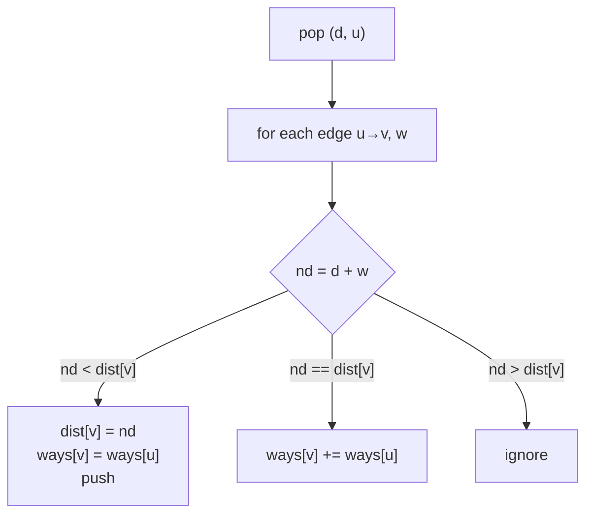

# Shortest-Path Variants in Interviews: Minimax, Probability, Counting

> Most interview "shortest path" questions are Dijkstra with one small change: how a path's cost is **combined**, or what extra information is stored per node.

#### 1. What Is It?

The Dijkstra loop stays the same. Change the rule that turns "cost so far + this edge" into "new cost":

| Question asks for | Combine rule | Heap order | Example |
|---|---|---|---|
| Least total cost | `d + w` | smallest first | Network Delay Time |
| Path whose **largest edge** is smallest (minimax / bottleneck) | `max(d, w)` | smallest first | Path With Minimum Effort, Swim in Rising Water |
| Path with the **highest probability** | `p * q` | largest first | Path with Maximum Probability |
| **Number of** shortest paths | keep `ways[v]` | smallest first | Number of Ways to Arrive at Destination |
| Shortest path with a **limit** (stops, keys, removals) | state `(node, used)` | smallest first | Cheapest Flights Within K Stops |

**Why the combine rule still works.** Dijkstra needs the cost to be **monotone**: extending a path never makes it better. `d + w` (w ≥ 0), `max(d, w)`, and `p * q` (q ≤ 1) all satisfy that.

**Signals:** "minimise the maximum", "least effort / risk", "maximum probability / reliability", "number of ways to take the fastest route", grid with heights or times, "at most K".

#### 2. How It Works

**Minimax on a grid (Path With Minimum Effort).** The cost of a route is the largest height difference between consecutive cells. Dijkstra on cells, with `newEffort = max(effort so far, |height difference|)`.

```text
heights = [[1,2,2],
           [3,8,2],
           [5,3,5]]
route 1→3→5→3→5 has differences 2,2,2,2 → effort 2   (best)
route along the top and right has differences 1,0,0,3 → effort 3
answer 2
```

**Max probability.** Use a max-heap, start at probability `1.0`, multiply by each edge probability. Since every factor is at most 1, a longer path can never be better than its prefix, so the greedy rule holds.

**Counting shortest paths.** Besides `dist[v]`, keep `ways[v]`:

- found a **strictly shorter** route to `v` → `dist[v] = nd`, `ways[v] = ways[u]`
- found an **equal** route → `ways[v] += ways[u]`

When `u` is popped, `ways[u]` is final, because all its shortest-path predecessors have smaller distance and were popped earlier (this needs positive weights).



**Extra state.** For "at most K stops", Dijkstra on just the node is not enough: a costlier route with fewer stops may be needed later. Use states `(node, stops)` (or use Bellman-Ford with K rounds, note 04). The same idea handles keys collected (bitmask), obstacles removed, fuel left.

**Alternative for minimax:** sort the edges and use Union-Find until `start` and `end` are connected; the last edge added is the answer. Or binary search the limit and BFS (note on Searching, binary search on the answer).

#### 3. Brute Force vs Optimized

| Problem | Brute force | Optimized |
|---|---|---|
| Minimum effort path | DFS all paths `O(3^(mn))` | Dijkstra with `max` `O(mn log mn)` |
| Minimum effort path | | binary search on the effort + BFS `O(mn log H)` |
| Max probability | all paths | Dijkstra, max-heap `O(E log V)` |
| Count shortest paths | enumerate all paths | Dijkstra + `ways[]` `O(E log V)` |

```kotlin
// Brute force minimum effort: DFS over simple paths (tiny grids only)
fun minEffortBrute(h: Array<IntArray>): Int {
    val m = h.size
    val n = h[0].size
    val seen = Array(m) { BooleanArray(n) }
    var best = Int.MAX_VALUE
    fun dfs(r: Int, c: Int, effort: Int) {
        if (effort >= best) return
        if (r == m - 1 && c == n - 1) { best = effort; return }
        seen[r][c] = true
        for ((dr, dc) in listOf(1 to 0, -1 to 0, 0 to 1, 0 to -1)) {
            val nr = r + dr
            val nc = c + dc
            if (nr in 0 until m && nc in 0 until n && !seen[nr][nc])
                dfs(nr, nc, maxOf(effort, Math.abs(h[nr][nc] - h[r][c])))
        }
        seen[r][c] = false
    }
    dfs(0, 0, 0)
    return if (m == 1 && n == 1) 0 else best
}
```

#### 4. Kotlin Code

```kotlin
import java.util.PriorityQueue

private val DIRS = arrayOf(intArrayOf(1, 0), intArrayOf(-1, 0), intArrayOf(0, 1), intArrayOf(0, -1))

// Path With Minimum Effort (LeetCode 1631): minimise the largest height difference
fun minimumEffortPath(heights: Array<IntArray>): Int {
    val m = heights.size
    val n = heights[0].size
    val effort = Array(m) { IntArray(n) { Int.MAX_VALUE } }
    val pq = PriorityQueue<IntArray>(compareBy<IntArray> { it[0] })      // [effort, r, c]
    effort[0][0] = 0
    pq.add(intArrayOf(0, 0, 0))
    while (pq.isNotEmpty()) {
        val (e, r, c) = pq.poll()
        if (r == m - 1 && c == n - 1) return e
        if (e > effort[r][c]) continue
        for (d in DIRS) {
            val nr = r + d[0]
            val nc = c + d[1]
            if (nr in 0 until m && nc in 0 until n) {
                val ne = maxOf(e, Math.abs(heights[nr][nc] - heights[r][c]))   // combine with max
                if (ne < effort[nr][nc]) { effort[nr][nc] = ne; pq.add(intArrayOf(ne, nr, nc)) }
            }
        }
    }
    return 0
}

// Swim in Rising Water (LeetCode 778): minimise the largest cell value on the path
fun swimInWater(grid: Array<IntArray>): Int {
    val n = grid.size
    val best = Array(n) { IntArray(n) { Int.MAX_VALUE } }
    val pq = PriorityQueue<IntArray>(compareBy<IntArray> { it[0] })      // [time, r, c]
    best[0][0] = grid[0][0]
    pq.add(intArrayOf(grid[0][0], 0, 0))
    while (pq.isNotEmpty()) {
        val (t, r, c) = pq.poll()
        if (r == n - 1 && c == n - 1) return t
        if (t > best[r][c]) continue
        for (d in DIRS) {
            val nr = r + d[0]
            val nc = c + d[1]
            if (nr in 0 until n && nc in 0 until n) {
                val nt = maxOf(t, grid[nr][nc])
                if (nt < best[nr][nc]) { best[nr][nc] = nt; pq.add(intArrayOf(nt, nr, nc)) }
            }
        }
    }
    return -1
}

// Path with Maximum Probability (LeetCode 1514): max-heap, multiply
fun maxProbability(n: Int, edges: Array<IntArray>, succProb: DoubleArray, start: Int, end: Int): Double {
    val g = List(n) { mutableListOf<Pair<Int, Double>>() }
    for (i in edges.indices) {
        g[edges[i][0]].add(edges[i][1] to succProb[i])
        g[edges[i][1]].add(edges[i][0] to succProb[i])
    }
    val best = DoubleArray(n)
    best[start] = 1.0
    val pq = PriorityQueue<Pair<Double, Int>>(compareByDescending<Pair<Double, Int>> { it.first })
    pq.add(1.0 to start)
    while (pq.isNotEmpty()) {
        val (p, u) = pq.poll()
        if (u == end) return p
        if (p < best[u]) continue
        for ((v, q) in g[u]) {
            val np = p * q
            if (np > best[v]) { best[v] = np; pq.add(np to v) }
        }
    }
    return 0.0
}

// Number of Ways to Arrive at Destination (LeetCode 1976): count shortest paths
fun countPaths(n: Int, roads: Array<IntArray>): Int {
    val mod = 1_000_000_007L
    val g = List(n) { mutableListOf<LongArray>() }
    for ((u, v, w) in roads) {
        g[u].add(longArrayOf(v.toLong(), w.toLong()))
        g[v].add(longArrayOf(u.toLong(), w.toLong()))
    }
    val dist = LongArray(n) { Long.MAX_VALUE }
    val ways = LongArray(n)
    dist[0] = 0
    ways[0] = 1
    val pq = PriorityQueue<LongArray>(compareBy<LongArray> { it[0] })    // [distance, node]
    pq.add(longArrayOf(0, 0))
    while (pq.isNotEmpty()) {
        val (d, uL) = pq.poll()
        val u = uL.toInt()
        if (d > dist[u]) continue
        for ((vL, w) in g[u]) {
            val v = vL.toInt()
            val nd = d + w
            if (nd < dist[v]) { dist[v] = nd; ways[v] = ways[u]; pq.add(longArrayOf(nd, vL)) }
            else if (nd == dist[v]) ways[v] = (ways[v] + ways[u]) % mod
        }
    }
    return (ways[n - 1] % mod).toInt()
}
```

Checks: `minimumEffortPath([[1,2,2],[3,8,2],[5,3,5]])` → `2`; `([[1,2,3],[3,8,4],[5,3,5]])` → `1`; `([[1,2,1,1,1],[1,2,1,2,1],[1,2,1,2,1],[1,2,1,2,1],[1,1,1,2,1]])` → `0`. `minEffortBrute([[1,2,2],[3,8,2],[5,3,5]])` → `2`. `swimInWater([[0,2],[1,3]])` → `3`; `([[0,1,2,3,4],[24,23,22,21,5],[12,13,14,15,16],[11,17,18,19,20],[10,9,8,7,6]])` → `16`. `maxProbability(3, [[0,1],[1,2],[0,2]], [0.5, 0.5, 0.2], 0, 2)` → `0.25`; `(3, [[0,1]], [0.5], 0, 2)` → `0.0`. `countPaths(7, [[0,6,7],[0,1,2],[1,2,3],[1,3,3],[6,3,3],[3,5,1],[6,5,1],[2,5,1],[0,4,5],[4,6,2]])` → `4`; `countPaths(2, [[1,0,10]])` → `1`.

#### 5. Complexity

| | Time | Space |
|---|---|---|
| Minimax / swim (grid `m × n`) | `O(mn log(mn))` | `O(mn)` |
| Max probability | `O(E log V)` | `O(V + E)` |
| Count shortest paths | `O(E log V)` | `O(V + E)` |
| State `(node, k)` Dijkstra | `O(k · E log(kV))` | `O(k · V)` |

#### 6. Common Mistakes

1. **Using `+` where the problem wants `max`** (or the other way round).
2. **Min-heap for probabilities** (use a max-heap, or Dijkstra on `−ln p`).
3. **Not pushing the new `ways`** when a strictly shorter route is found (reset, do not add).
4. **Counting paths with zero-weight edges** (the "predecessors popped first" argument fails).
5. **`Int` overflow** for distances in count problems (use `Long`) and forgetting `mod`.
6. **Dropping the extra state** (stops, keys) and getting wrong answers.
7. **Stale entries** processed twice, doubling `ways`.

#### 7. Say This in the Interview

1. "This is Dijkstra, but the cost of a path is the maximum edge, not the sum. Taking the max never makes a path better as it grows, so the greedy rule still holds."
2. "For probabilities I use a max-heap and multiply. Every factor is at most 1, so extending a path never improves it."
3. "To count shortest paths, I keep `ways[v]`: reset it on a strictly shorter route, add to it on an equal one."
4. "With a stop limit I carry the stops in the state, or use Bellman-Ford with `K + 1` rounds."

#### 8. Quick Check

1. Combine rule for "minimise the largest edge"?
2. Which heap for the maximum probability?
3. When do you add to `ways[v]`?

<details>
<summary>Answers</summary>

1. `newCost = max(costSoFar, edgeWeight)`.
2. A max-heap.
3. When the new distance equals `dist[v]`.

</details>

#### 9. Related LeetCode Questions

| # | Question | Idea |
|---|---|---|
| 1631 | [Path With Minimum Effort](https://leetcode.com/problems/path-with-minimum-effort/) (Medium) | minimax, Dijkstra with `max` |
| 778 | [Swim in Rising Water](https://leetcode.com/problems/swim-in-rising-water/) (Hard) | minimax on cell values |
| 1514 | [Path with Maximum Probability](https://leetcode.com/problems/path-with-maximum-probability/) (Medium) | max-heap, multiply |
| 1976 | [Number of Ways to Arrive at Destination](https://leetcode.com/problems/number-of-ways-to-arrive-at-destination/) (Medium) | count shortest paths |
| 787 | [Cheapest Flights Within K Stops](https://leetcode.com/problems/cheapest-flights-within-k-stops/) (Medium) | state or Bellman-Ford |
| 743 | [Network Delay Time](https://leetcode.com/problems/network-delay-time/) (Medium) | plain Dijkstra |
