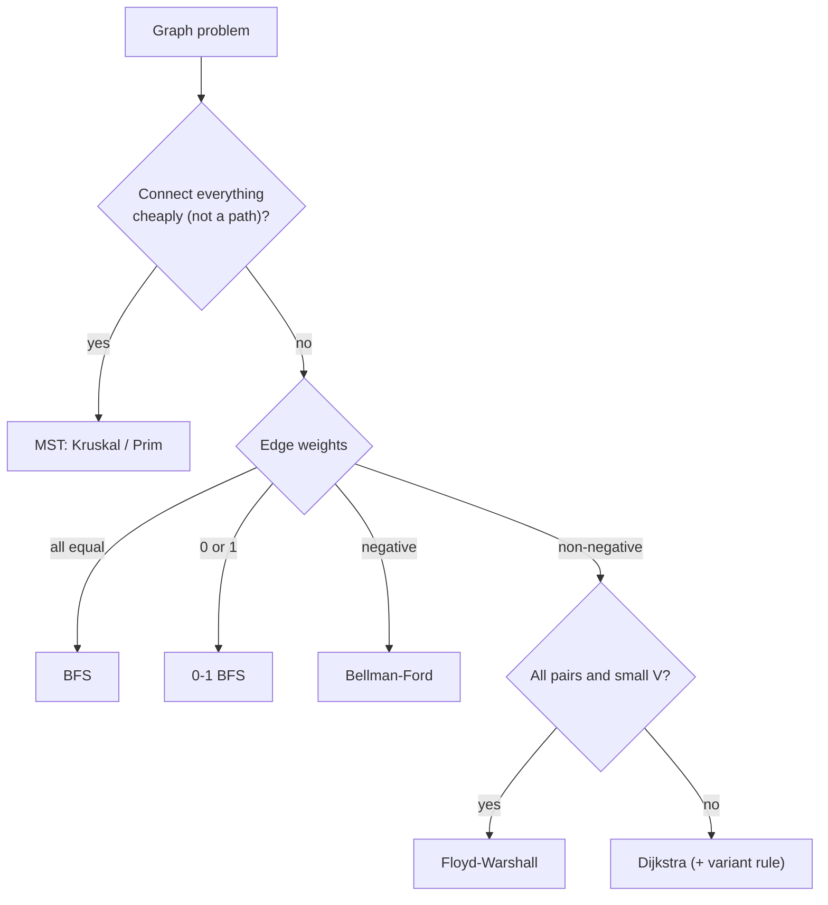

# Graph Algorithms Cheat Sheet

> One-page revision for the night before an interview. The full explanations are in notes 01–08. Traversal, cycle detection, topological sort and Union-Find are in `DS Graph`.

#### 1. Key Takeaways

1. **The weights choose the algorithm.** Unweighted → BFS. Weights 0/1 → 0-1 BFS. Non-negative → **Dijkstra**. Negative → **Bellman-Ford**. DAG → topological relax. All pairs, small `V` → **Floyd-Warshall**.
2. **Dijkstra:** min-heap of `(distance, node)`, skip stale entries (`d > dist[u]`), `O((V + E) log V)`. **Never** with negative edges.
3. **Bellman-Ford:** relax all edges `V − 1` times. A change in round `V` = negative cycle. "At most K edges/stops" = `K + 1` rounds with a **copy** of the previous distances.
4. **Floyd-Warshall:** `k` outermost, `O(V³)`, `V ≤ ~400`. The diagonal `< 0` reveals a negative cycle. The boolean version is transitive closure.
5. **MST** (connect everything cheaply): **Kruskal** = sort edges + Union-Find; **Prim** = grow a tree with a heap, or `O(V²)` for dense/point sets. Result must have `V − 1` edges.
6. **A\***: Dijkstra ordered by `g + h`. Optimal if `h` never overestimates. Test for the goal when you **pop** it.
7. **Variants are Dijkstra with a different combine rule:** `max` (bottleneck), multiply with a max-heap (probability), `ways[]` (count), extra state (K stops, keys).
8. **Max flow = min cut.** Matching = flow with unit capacities. Name only.
9. Use `Long` (or a safe INF) so `INF + w` never overflows.

#### 2. Complexity Table

| Algorithm | Time | Space | Negative edges | Use for |
|---|---|---|---|---|
| BFS | `O(V + E)` | `O(V)` | n/a (unweighted) | fewest edges |
| 0-1 BFS | `O(V + E)` | `O(V)` | no | weights 0 / 1 |
| Dijkstra (heap) | `O((V + E) log V)` | `O(V + E)` | **no** | non-negative weights |
| Dijkstra (array) | `O(V²)` | `O(V)` | no | dense graphs |
| Bellman-Ford | `O(V · E)` | `O(V)` | **yes**, detects cycles | negative weights, K edges |
| DAG relax | `O(V + E)` | `O(V + E)` | yes | DAG |
| Floyd-Warshall | `O(V³)` | `O(V²)` | yes | all pairs, small `V` |
| Kruskal | `O(E log E)` | `O(V)` | n/a | MST, sparse |
| Prim (heap / array) | `O(E log V)` / `O(V²)` | `O(V)` | n/a | MST, dense |
| A\* | `O(E log V)` worst | `O(V)` | no | one target + heuristic |
| Edmonds-Karp | `O(V E²)` | `O(V²)` | n/a | max flow |

#### 3. Patterns and How to Identify Them

| Signal in the question | Pattern | Note |
|---|---|---|
| "shortest / cheapest path", non-negative weights | Dijkstra | 01 |
| "minimum time for all nodes to receive the signal" | Dijkstra, take the max | 01 |
| "connect all cities / points with minimum cost" | MST (Kruskal / Prim) | 02 |
| "extra edge that forms a cycle" | Union-Find | 02 |
| weights only 0 / 1 | 0-1 BFS | 03 |
| "negative edges", "arbitrage", "detect negative cycle" | Bellman-Ford | 04 |
| "at most K stops / edges" | Bellman-Ford `K + 1` rounds, or state Dijkstra | 04, 08 |
| "distance between every pair", small `n` | Floyd-Warshall | 05 |
| "can `A` reach `B`" for many queries, small `n` | transitive closure | 05 |
| one target on a grid / map, sliding puzzle | A\* / BFS | 06 |
| "maximum pairs", "assign each to one" | bipartite matching / flow | 07 |
| "minimise the maximum edge / effort" | Dijkstra with `max` | 08 |
| "maximum probability" | max-heap Dijkstra, multiply | 08 |
| "number of shortest paths" | Dijkstra + `ways[]` | 08 |



#### 4. Templates to Memorise

**Dijkstra**

```kotlin
val dist = IntArray(n) { Int.MAX_VALUE }
dist[src] = 0
val pq = PriorityQueue<IntArray>(compareBy<IntArray> { it[0] })     // [distance, node]
pq.add(intArrayOf(0, src))
while (pq.isNotEmpty()) {
    val (d, u) = pq.poll()
    if (d > dist[u]) continue
    for ((v, w) in g[u]) if (d + w < dist[v]) { dist[v] = d + w; pq.add(intArrayOf(d + w, v)) }
}
```

**Bellman-Ford (with K rounds)**

```kotlin
var dist = IntArray(n) { INF }; dist[src] = 0
repeat(k + 1) {
    val next = dist.copyOf()
    for ((u, v, w) in edges) if (dist[u] != INF && dist[u] + w < next[v]) next[v] = dist[u] + w
    dist = next
}
```

**Kruskal with Union-Find**

```kotlin
for (e in edges.sortedBy { it[2] }) {
    if (dsu.union(e[0], e[1])) { total += e[2]; if (++used == n - 1) break }
}
// find: path compression; union: by size
```

**Prim (heap)**

```kotlin
pq.add(intArrayOf(0, 0))                                            // [weight, node]
while (pq.isNotEmpty() && count < n) {
    val (w, u) = pq.poll()
    if (inTree[u]) continue
    inTree[u] = true; total += w; count++
    for ((v, wt) in g[u]) if (!inTree[v]) pq.add(intArrayOf(wt, v))
}
```

**Floyd-Warshall**

```kotlin
for (k in 0 until n) for (i in 0 until n) for (j in 0 until n)
    if (d[i][k] + d[k][j] < d[i][j]) d[i][j] = d[i][k] + d[k][j]
```

**0-1 BFS**

```kotlin
if (cost == 0) dq.addFirst(next) else dq.addLast(next)
```

**Minimax Dijkstra (change one line)**

```kotlin
val ne = maxOf(e, edgeValue)          // instead of e + edgeValue
```

**Count shortest paths**

```kotlin
if (nd < dist[v]) { dist[v] = nd; ways[v] = ways[u]; pq.add(...) }
else if (nd == dist[v]) ways[v] = (ways[v] + ways[u]) % MOD
```

**A\* priority**

```kotlin
pq.add(intArrayOf(g + h(nr, nc), g, nr, nc))      // order by f = g + h
```

#### 5. Brute Force to Optimized

| Problem | Brute force | Better |
|---|---|---|
| Shortest path, weighted | all paths (exponential) | Dijkstra `O(E log V)` |
| Shortest path, weights 0/1 | Dijkstra | 0-1 BFS `O(V + E)` |
| Shortest path with negative edges | Dijkstra (wrong) | Bellman-Ford `O(VE)` |
| Shortest path in a DAG | Bellman-Ford `O(VE)` | topological relax `O(V + E)` |
| All pairs, small `V` | `V` × Bellman-Ford | Floyd-Warshall `O(V³)` |
| MST | try all subsets of edges | Kruskal / Prim |
| Minimum effort path | DFS all paths | Dijkstra with `max` |
| Count shortest paths | enumerate all paths | Dijkstra + `ways[]` |
| Max matching | try all assignments | flow / Hopcroft-Karp |

#### 6. Common Mistakes and Edge Cases

1. **Dijkstra with negative weights.**
2. **`INF + w` overflow.** Use `Long` or skip unreachable sources.
3. **Marking nodes visited when pushing** (BFS habit) instead of when popping.
4. **K-stops: relaxing in place** instead of from a copy; `K` stops = `K + 1` edges.
5. **Floyd-Warshall loop order** (`k` outside) and `INF + INF` overflow.
6. **MST on a disconnected graph:** check `used == V − 1`.
7. **Using MST when a shortest path is asked.**
8. **A\* heuristic that overestimates;** returning when the goal is pushed.
9. **Probabilities with a min-heap.**
10. **Edge cases:** source equals target, unreachable target, self loops, parallel edges, `V = 1`, zero-weight edges, undirected edges (add both directions).

#### 7. What to Say Out Loud

1. "The weights are non-negative, so Dijkstra with a min-heap: `O((V + E) log V)`."
2. "There are negative edges, so I'll use Bellman-Ford: `V − 1` rounds, and one more to detect a negative cycle."
3. "'At most K stops' means K + 1 edges: I run K + 1 rounds, relaxing from a copy of the previous distances."
4. "I need the cheapest way to connect everything: that's a minimum spanning tree. Kruskal with Union-Find, `O(E log E)`."
5. "The cost is the largest edge, not the sum, and that's still monotone, so Dijkstra works with `max` as the combine rule."
6. "With a few hundred nodes and all-pairs queries, Floyd-Warshall at `O(V³)` is fine."

#### 8. Practice Order (Easy → Medium)

| Level | Question | Pattern |
|---|---|---|
| Easy | [Find if Path Exists in Graph](https://leetcode.com/problems/find-if-path-exists-in-graph/) | traversal / DSU |
| Medium | [Network Delay Time](https://leetcode.com/problems/network-delay-time/) | Dijkstra |
| Medium | [Shortest Path in Binary Matrix](https://leetcode.com/problems/shortest-path-in-binary-matrix/) | BFS / A\* |
| Medium | [Path With Minimum Effort](https://leetcode.com/problems/path-with-minimum-effort/) | Dijkstra with `max` |
| Medium | [Cheapest Flights Within K Stops](https://leetcode.com/problems/cheapest-flights-within-k-stops/) | Bellman-Ford K rounds |
| Medium | [Path with Maximum Probability](https://leetcode.com/problems/path-with-maximum-probability/) | max-heap Dijkstra |
| Medium | [Number of Ways to Arrive at Destination](https://leetcode.com/problems/number-of-ways-to-arrive-at-destination/) | Dijkstra + counts |
| Medium | [Redundant Connection](https://leetcode.com/problems/redundant-connection/) | Union-Find |
| Medium | [Min Cost to Connect All Points](https://leetcode.com/problems/min-cost-to-connect-all-points/) | Prim / Kruskal |
| Medium | [Find the City With the Smallest Number of Neighbors at a Threshold Distance](https://leetcode.com/problems/find-the-city-with-the-smallest-number-of-neighbors-at-a-threshold-distance/) | Floyd-Warshall |
| Medium | [Course Schedule IV](https://leetcode.com/problems/course-schedule-iv/) | transitive closure |
| Medium | [Evaluate Division](https://leetcode.com/problems/evaluate-division/) | weighted graph |
| Hard | [Swim in Rising Water](https://leetcode.com/problems/swim-in-rising-water/) | minimax Dijkstra |
| Hard | [Minimum Obstacle Removal to Reach Corner](https://leetcode.com/problems/minimum-obstacle-removal-to-reach-corner/) | 0-1 BFS |
| Hard | [Word Ladder](https://leetcode.com/problems/word-ladder/) | BFS / bidirectional |
