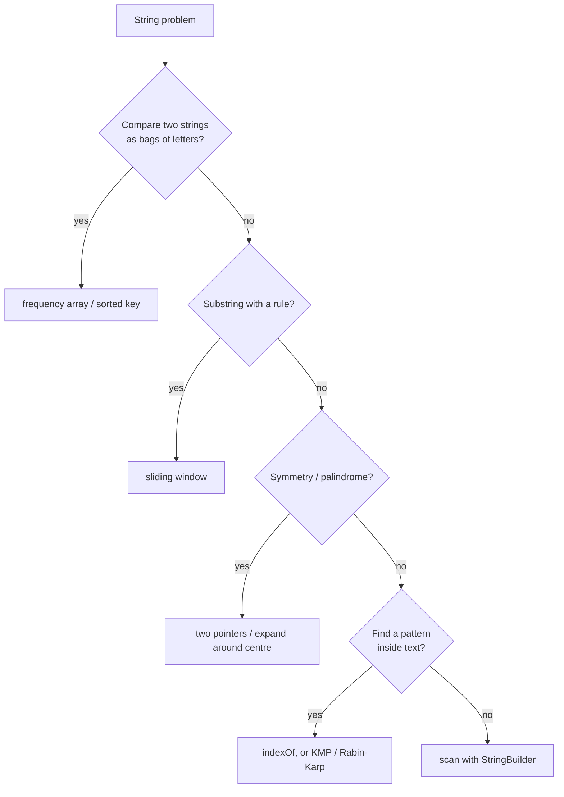

# String Basics in Kotlin

> Know how strings behave before you solve string problems: they are **immutable**, `+=` in a loop is slow, and characters are numbers you can do arithmetic on.

#### 1. What Is It?

A Kotlin `String` is an **immutable** sequence of characters (`Char`). You cannot change a character in place; every "change" creates a new string.

| Operation | Kotlin | Time |
|---|---|---|
| Length | `s.length` | `O(1)` |
| Character at index | `s[i]` | `O(1)` |
| Substring | `s.substring(i, j)` (end exclusive) | `O(j − i)` (copies) |
| Concatenate | `a + b` | `O(a + b)` (copies) |
| Compare content | `a == b` | `O(min length)` |
| Search | `s.indexOf(t)`, `s.contains(t)` | about `O(n · m)` worst |
| Mutable builder | `StringBuilder` (`append`, `reverse`, `insert`) | `O(1)` amortised append |
| To / from array | `s.toCharArray()`, `String(chars)` | `O(n)` |

**Characters are numbers.** `'c' - 'a'` is `2`, so lowercase letters map to indexes `0..25`. `c.code` gives the ASCII/Unicode value (`'a'.code == 97`).

**Signals:** any problem that says "string", "substring", "anagram", "palindrome", "characters", "words", "pattern".

#### 2. How It Works

**Why `s += x` in a loop is `O(n²)`.** Each `+=` copies the whole string built so far: `1 + 2 + 3 + ... + n` characters copied.

```text
s = ""
s += "a"    copies 1
s += "b"    copies 2
s += "c"    copies 3  ...  total ≈ n²/2
```

`StringBuilder` keeps a growable array, so each `append` is `O(1)` on average and the total is `O(n)`.

**Core techniques**

| Technique | Use when | Example |
|---|---|---|
| **Frequency array** `IntArray(26)` or `IntArray(128)` | compare character counts, anagrams | Valid Anagram |
| **Two pointers** | palindromes, reversing, in-place edits | Valid Palindrome |
| **Sliding window** | longest/shortest substring with a rule | Longest Substring Without Repeating |
| **HashMap of char → index/count** | first/last occurrence, mapping | Isomorphic Strings |
| **StringBuilder** | building results | Add Binary, Reverse Words |
| **Sort the characters** | a canonical key for anagram groups | Group Anagrams |
| **Prefix/suffix scan** | common prefix, compression | Longest Common Prefix |



**Unicode note.** `Char` is a 16-bit UTF-16 unit. Interview problems assume ASCII or lowercase letters; ask. If the alphabet is unknown, use a `HashMap<Char, Int>`.

#### 3. Brute Force vs Optimized

| Task | Brute force | Optimized |
|---|---|---|
| Build a long string | `+=` in a loop `O(n²)` | `StringBuilder` `O(n)` |
| Is it a palindrome? | reverse and compare (`O(n)` extra space) | two pointers `O(1)` space |
| Are two strings anagrams? | sort both `O(n log n)` | count 26 letters `O(n)` |
| Reverse words | manual loops | `split`, `reversed`, `joinToString` |
| First unique character | for each char scan the rest `O(n²)` | count once, scan once `O(n)` |

```kotlin
// Brute force: repeated concatenation (O(n²))
fun buildSlow(n: Int): String { var s = ""; for (i in 0 until n) s += "x"; return s }

// Optimised: StringBuilder (O(n))
fun buildFast(n: Int): String { val sb = StringBuilder(); repeat(n) { sb.append('x') }; return sb.toString() }
```

#### 4. Kotlin Code

```kotlin
// Valid Anagram (LeetCode 242): count 26 letters
fun isAnagram(s: String, t: String): Boolean {
    if (s.length != t.length) return false
    val count = IntArray(26)
    for (i in s.indices) { count[s[i] - 'a']++; count[t[i] - 'a']-- }
    return count.all { it == 0 }
}

// Reverse Words in a String (LeetCode 151)
fun reverseWords(s: String): String =
    s.trim().split(Regex("\\s+")).reversed().joinToString(" ")

// Longest Common Prefix (LeetCode 14)
fun longestCommonPrefix(strs: Array<String>): String {
    if (strs.isEmpty()) return ""
    var prefix = strs[0]
    for (s in strs) while (!s.startsWith(prefix)) prefix = prefix.dropLast(1)
    return prefix
}

// Roman to Integer (LeetCode 13): subtract when a smaller value precedes a larger one
fun romanToInt(s: String): Int {
    val v = mapOf('I' to 1, 'V' to 5, 'X' to 10, 'L' to 50, 'C' to 100, 'D' to 500, 'M' to 1000)
    var total = 0
    for (i in s.indices) {
        val cur = v[s[i]]!!
        if (i + 1 < s.length && cur < v[s[i + 1]]!!) total -= cur else total += cur
    }
    return total
}

// Add Binary (LeetCode 67): digit by digit from the right
fun addBinary(a: String, b: String): String {
    val sb = StringBuilder()
    var i = a.length - 1
    var j = b.length - 1
    var carry = 0
    while (i >= 0 || j >= 0 || carry > 0) {
        var sum = carry
        if (i >= 0) sum += a[i--] - '0'
        if (j >= 0) sum += b[j--] - '0'
        sb.append(sum % 2)
        carry = sum / 2
    }
    return sb.reverse().toString()
}

// Isomorphic Strings (LeetCode 205): a one-to-one mapping in both directions
fun isIsomorphic(s: String, t: String): Boolean {
    if (s.length != t.length) return false
    val st = HashMap<Char, Char>()
    val ts = HashMap<Char, Char>()
    for (i in s.indices) {
        if (st.getOrPut(s[i]) { t[i] } != t[i]) return false
        if (ts.getOrPut(t[i]) { s[i] } != s[i]) return false
    }
    return true
}
```

Checks: `isAnagram("anagram", "nagaram")` → `true`; `("rat", "car")` → `false`. `reverseWords("  hello   world  ")` → `"world hello"`; `reverseWords("a good   example")` → `"example good a"`. `longestCommonPrefix(arrayOf("flower", "flow", "flight"))` → `"fl"`; `(arrayOf("dog", "racecar", "car"))` → `""`. `romanToInt("MCMXCIV")` → `1994`; `("III")` → `3`; `("LVIII")` → `58`. `addBinary("11", "1")` → `"100"`; `("1010", "1011")` → `"10101"`; `("0", "0")` → `"0"`. `isIsomorphic("egg", "add")` → `true`; `("foo", "bar")` → `false`; `("paper", "title")` → `true`; `("badc", "baba")` → `false`. `buildSlow(5)` and `buildFast(5)` → `"xxxxx"`.

#### 5. Complexity

| | Time | Space |
|---|---|---|
| Single scan with an array/map | `O(n)` | `O(1)` for a fixed alphabet |
| Sorting each string | `O(n log n)` | `O(n)` |
| `+=` in a loop | `O(n²)` | `O(n)` |
| `StringBuilder` | `O(n)` | `O(n)` |

#### 6. Common Mistakes

1. **`s += x` in a loop** (quadratic).
2. **Off-by-one with `substring(i, j)`**: `j` is exclusive.
3. **Treating strings as mutable** (`s[i] = 'x'` does not compile). Use `toCharArray()` or `StringBuilder`.
4. **Using `==` on `CharArray`** (compares identity). Use `contentEquals`.
5. **Forgetting empty strings and single characters.**
6. **Case and spaces:** ask whether `A` equals `a` and whether spaces count.
7. **Assuming `a`–`z`** when the input may have uppercase, digits or Unicode.
8. **Counting `substring` as `O(1)`.** It copies.

#### 7. Say This in the Interview

1. "Can I assume lowercase letters only? Then a 26-slot count array is enough."
2. "Strings are immutable, so I'll build the answer in a `StringBuilder` to keep it `O(n)`."
3. "I'll use two pointers so I don't need an extra reversed copy: `O(1)` space."
4. "`substring` copies, so I pass indexes instead of slicing in the loop."

#### 8. Quick Check

1. Cost of building a string with `+=` `n` times?
2. Index of `'e'` in a 26-letter array?
3. Why does `isAnagram` need equal lengths first?

<details>
<summary>Answers</summary>

1. `O(n²)`.
2. `'e' - 'a' = 4`.
3. It is a quick exit, and it makes the "all counts zero" check valid.

</details>

#### 9. Related LeetCode Questions

| # | Question | Idea |
|---|---|---|
| 242 | [Valid Anagram](https://leetcode.com/problems/valid-anagram/) (Easy) | frequency array |
| 14 | [Longest Common Prefix](https://leetcode.com/problems/longest-common-prefix/) (Easy) | shrink the prefix |
| 13 | [Roman to Integer](https://leetcode.com/problems/roman-to-integer/) (Easy) | subtract rule |
| 67 | [Add Binary](https://leetcode.com/problems/add-binary/) (Easy) | carry + `StringBuilder` |
| 205 | [Isomorphic Strings](https://leetcode.com/problems/isomorphic-strings/) (Easy) | two-way map |
| 151 | [Reverse Words in a String](https://leetcode.com/problems/reverse-words-in-a-string/) (Medium) | split and join |
| 387 | [First Unique Character in a String](https://leetcode.com/problems/first-unique-character-in-a-string/) (Easy) | counts |
