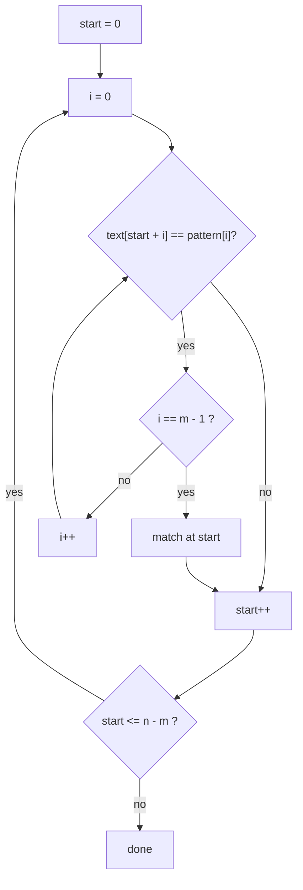

# Naive Substring Search: O(n·m)

> Try every starting position in the text and compare the pattern character by character. Simple, always correct, and fast enough for most interview inputs. The baseline that KMP and Rabin-Karp improve on.

#### 1. What Is It?

Find where a **pattern** (length `m`) occurs in a **text** (length `n`).

| | Value |
|---|---|
| Start positions to try | `n − m + 1` |
| Work per position | up to `m` comparisons (stops at the first mismatch) |
| Total | `O(n · m)` worst case, usually much faster |

**Signals:** "find the first occurrence of a substring", "does `t` appear in `s`", "implement `strStr()` / `indexOf`".

In practice, Kotlin's `s.indexOf(t)` does this for you. In an interview, write it yourself when asked, and say when you'd use something faster.

#### 2. How It Works

Text `"ABABDABACDABABCABAB"`, pattern `"ABABCABAB"`:

```text
start 0:  ABABD...   vs ABABC...   mismatch at position 4
start 1:  BABDA...   vs ABABC...   mismatch at position 0
start 2:  ABDAB...   vs ABABC...   mismatch at position 2
...
start 10: ABABCABAB  vs ABABCABAB  all 9 match → found at index 10
```



**Worst case.** Text `"aaaaaaaa"` (8), pattern `"aaab"` (4): at each of the 5 starts it matches 3 letters and fails on the 4th, so 20 comparisons. This wasted re-comparing of the same characters is exactly what KMP removes.

**Early exits:** if `m > n` there is no match; if `m == 0`, the answer is `0` by convention (`strStr`).

#### 3. Brute Force vs Optimized

| Approach | Time | Space | Idea |
|---|---|---|---|
| **Naive** (this note) | `O(n · m)` | `O(1)` | try every start |
| Rabin-Karp (note 06) | `O(n + m)` average | `O(1)` | compare hashes first |
| KMP (note 05) | `O(n + m)` worst | `O(m)` | never re-compare matched characters |
| Z-algorithm (note 07) | `O(n + m)` | `O(n + m)` | prefix matches of the combined string |

For interview-sized inputs (`n, m ≤ 10⁴`), naive is usually accepted. Mention the faster options unprompted.

```kotlin
// Library version
fun strStrLibrary(text: String, pattern: String): Int = text.indexOf(pattern)
```

#### 4. Kotlin Code

```kotlin
// All start positions where the pattern occurs
fun naiveSearch(text: String, pattern: String): List<Int> {
    val n = text.length
    val m = pattern.length
    val result = ArrayList<Int>()
    for (start in 0..n - m) {                       // empty range if m > n
        var i = 0
        while (i < m && text[start + i] == pattern[i]) i++
        if (i == m) result.add(start)
    }
    return result
}

// Find the Index of the First Occurrence in a String (LeetCode 28)
fun strStr(haystack: String, needle: String): Int {
    if (needle.isEmpty()) return 0
    for (start in 0..haystack.length - needle.length) {
        var i = 0
        while (i < needle.length && haystack[start + i] == needle[i]) i++
        if (i == needle.length) return start        // stop at the first match
    }
    return -1
}

// Count character comparisons (to see the cost)
fun countCompares(text: String, pattern: String): Int {
    var compares = 0
    for (start in 0..text.length - pattern.length) {
        var i = 0
        while (i < pattern.length) {
            compares++
            if (text[start + i] != pattern[i]) break
            i++
        }
    }
    return compares
}

// Rotate String (LeetCode 796): b is a rotation of a if it appears in a + a
fun rotateString(a: String, b: String): Boolean = a.length == b.length && (a + a).contains(b)
```

Checks: `naiveSearch("ABABDABACDABABCABAB", "ABABCABAB")` → `[10]`. `naiveSearch("aaaaa", "aa")` → `[0, 1, 2, 3]` (overlapping matches). `naiveSearch("abc", "d")` → `[]`. `naiveSearch("ab", "abc")` → `[]`. `strStr("sadbutsad", "sad")` → `0`; `strStr("leetcode", "leeto")` → `-1`; `strStr("hello", "ll")` → `2`; `strStr("a", "")` → `0`. `countCompares("aaaaaaaa", "aaab")` → `20`. `rotateString("abcde", "cdeab")` → `true`; `("abcde", "abced")` → `false`.

#### 5. Complexity

| | Time | Space |
|---|---|---|
| Best (mismatch at the first letter each time) | `O(n)` | `O(1)` |
| Worst (`"aaaa…"` text, `"aaa…b"` pattern) | `O(n · m)` | `O(1)` |
| Random text | about `O(n)` | `O(1)` |

#### 6. Common Mistakes

1. **Loop bound `n − m`** instead of `n − m + 1` (misses a match at the end).
2. **Negative range** when `m > n` (in Kotlin `0..negative` is empty, which is fine, but check in other languages).
3. **Not stopping at the first mismatch.**
4. **Using `substring(start, start + m) == pattern`** (copies `m` characters at every start, which allocates a lot).
5. **Empty pattern:** decide the answer (`0` for `strStr`).
6. **Forgetting overlapping matches** when the problem wants all of them.

#### 7. Say This in the Interview

1. "The simple approach checks each start position: `O(n·m)` worst case, `O(1)` space."
2. "It degrades on repetitive input like `aaaa…b`. For that I'd use KMP, which is `O(n + m)`, or Rabin-Karp with a rolling hash."
3. "For normal sizes, I'd just use `indexOf`."

#### 8. Quick Check

1. How many starts for `n = 10`, `m = 3`?
2. Worst-case input shape?
3. What does KMP save?

<details>
<summary>Answers</summary>

1. 8 (`n − m + 1`).
2. A repetitive text and a pattern that matches almost everywhere before failing, such as `aaaa…a` and `aaa…ab`.
3. Re-comparing characters that were already matched.

</details>

#### 9. Related LeetCode Questions

| # | Question | Idea |
|---|---|---|
| 28 | [Find the Index of the First Occurrence in a String](https://leetcode.com/problems/find-the-index-of-the-first-occurrence-in-a-string/) (Easy) | the naive search |
| 796 | [Rotate String](https://leetcode.com/problems/rotate-string/) (Easy) | search in `a + a` |
| 459 | [Repeated Substring Pattern](https://leetcode.com/problems/repeated-substring-pattern/) (Easy) | search in `s + s` |
| 686 | [Repeated String Match](https://leetcode.com/problems/repeated-string-match/) (Medium) | repeat then search |
| 1392 | [Longest Happy Prefix](https://leetcode.com/problems/longest-happy-prefix/) (Hard) | KMP follow-up |
| 187 | [Repeated DNA Sequences](https://leetcode.com/problems/repeated-dna-sequences/) (Medium) | fixed-length substrings |
