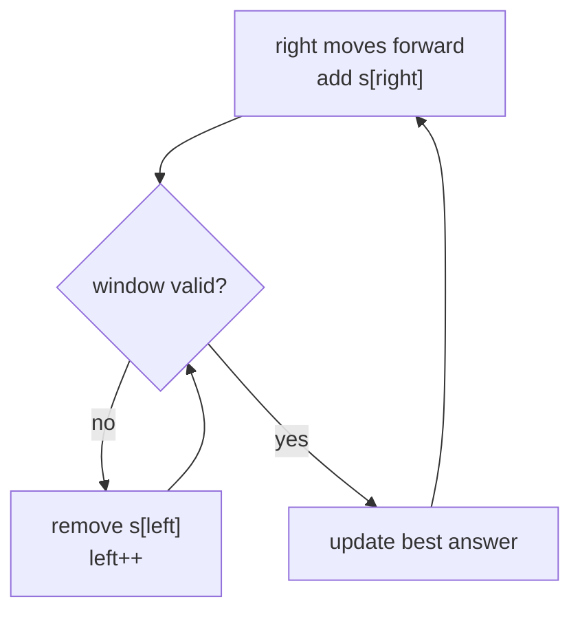

# Two Pointers, Sliding Window and Frequency Maps on Strings

> The three tools behind most string questions in interviews: **count letters**, **walk two indexes**, and **slide a window** that grows on the right and shrinks on the left.

#### 1. What Is It?

| Tool | Idea | Typical questions |
|---|---|---|
| **Frequency map** | count each character once, compare counts | Valid Anagram, Ransom Note, Group Anagrams |
| **Two pointers** | one index at each end, or one slow and one fast | Valid Palindrome, Reverse Words III |
| **Fixed-size window** | window of length `k` slides by one | Permutation in String, Find All Anagrams |
| **Variable-size window** | grow `right`; while the rule is broken, move `left` | Longest Substring Without Repeating, Minimum Window Substring |

**Signals**

| Phrase in the question | Tool |
|---|---|
| "longest substring such that ..." | variable window (maximise) |
| "shortest substring that contains ..." | variable window (minimise) |
| "substring of length `k`", "anagram of `p` in `s`" | fixed window + counts |
| "at most `k` replacements / distinct" | variable window with a counter |
| "same letters, any order" | frequency map or sorted key |

#### 2. How It Works

**Variable window (the template).**

1. Move `right` one step and add `s[right]` to the window state.
2. While the window is **invalid**, remove `s[left]` and move `left`.
3. Record the answer from the (now valid) window.



**Longest Substring Without Repeating Characters** on `"abcabcbb"`:

```text
right=0 a   window "a"      best 1
right=1 b   window "ab"     best 2
right=2 c   window "abc"    best 3
right=3 a   a seen at 0 → left jumps to 1   window "bca"   best 3
right=4 b   b seen at 1 → left = 2          window "cab"
...                                         answer 3
```

Each index enters the window once and leaves at most once → `O(n)`, even though there is a loop inside the loop.

**Minimum Window Substring** (`s = "ADOBECODEBANC"`, `t = "ABC"`). Track how many needed letters are still missing. When `missing == 0` the window is valid, so shrink from the left as far as possible and record the smallest.

```text
window grows until "ADOBEC" has A, B, C   → shrink: "DOBEC" lost A → stop
...                                          smallest valid window: "BANC"
```

**Fixed window with counts.** Keep `need[26]` for the pattern and `win[26]` for the window. Slide: add the new right letter, remove the letter that left. Windows match when the arrays are equal. Comparing two arrays of 26 is `O(26)`, so total `O(26 n)` = `O(n)`.

#### 3. Brute Force vs Optimized

| Problem | Brute force | Optimized |
|---|---|---|
| Longest substring without repeats | every substring + a set `O(n²)`–`O(n³)` | window + last-seen index `O(n)` |
| Minimum window substring | every substring, check counts `O(n² · 128)` | window with a missing counter `O(n)` |
| Find all anagrams of `p` | sort every window `O(n · m log m)` | sliding counts `O(n)` |
| Group anagrams | compare all pairs | sorted-key map `O(n · k log k)` |

```kotlin
// Brute force: every substring, check for repeats with a set
fun lengthBrute(s: String): Int {
    var best = 0
    for (i in s.indices) {
        val seen = HashSet<Char>()
        for (j in i until s.length) {
            if (!seen.add(s[j])) break
            best = maxOf(best, j - i + 1)
        }
    }
    return best
}
```

#### 4. Kotlin Code

```kotlin
// Longest Substring Without Repeating Characters (LeetCode 3), ASCII input
fun lengthOfLongestSubstring(s: String): Int {
    val last = IntArray(128) { -1 }                  // last index of each character
    var left = 0
    var best = 0
    for (right in s.indices) {
        val c = s[right].code
        if (last[c] >= left) left = last[c] + 1      // jump past the previous copy
        last[c] = right
        best = maxOf(best, right - left + 1)
    }
    return best
}

// Longest Repeating Character Replacement (LeetCode 424)
fun characterReplacement(s: String, k: Int): Int {
    val count = IntArray(26)
    var left = 0
    var maxFreq = 0
    var best = 0
    for (right in s.indices) {
        count[s[right] - 'A']++
        maxFreq = maxOf(maxFreq, count[s[right] - 'A'])
        if (right - left + 1 - maxFreq > k) {        // more than k letters to replace: shrink
            count[s[left] - 'A']--
            left++
        }
        best = maxOf(best, right - left + 1)
    }
    return best
}

// Minimum Window Substring (LeetCode 76)
fun minWindow(s: String, t: String): String {
    if (t.isEmpty() || s.length < t.length) return ""
    val need = IntArray(128)
    for (c in t) need[c.code]++
    var missing = t.length
    var left = 0
    var bestStart = 0
    var bestLen = Int.MAX_VALUE
    for (right in s.indices) {
        if (need[s[right].code]-- > 0) missing--             // this letter was still needed
        while (missing == 0) {
            if (right - left + 1 < bestLen) { bestLen = right - left + 1; bestStart = left }
            if (++need[s[left].code] > 0) missing++          // dropping a needed letter
            left++
        }
    }
    return if (bestLen == Int.MAX_VALUE) "" else s.substring(bestStart, bestStart + bestLen)
}

// Find All Anagrams in a String (LeetCode 438): fixed window
fun findAnagrams(s: String, p: String): List<Int> {
    val result = ArrayList<Int>()
    if (s.length < p.length) return result
    val need = IntArray(26)
    val window = IntArray(26)
    for (c in p) need[c - 'a']++
    for (i in s.indices) {
        window[s[i] - 'a']++
        if (i >= p.length) window[s[i - p.length] - 'a']--   // letter leaving the window
        if (i >= p.length - 1 && window.contentEquals(need)) result.add(i - p.length + 1)
    }
    return result
}

// Permutation in String (LeetCode 567)
fun checkInclusion(s1: String, s2: String): Boolean = findAnagrams(s2, s1).isNotEmpty()

// Group Anagrams (LeetCode 49): sorted letters are the key
fun groupAnagrams(strs: Array<String>): List<List<String>> =
    strs.groupBy { it.toCharArray().sorted().joinToString("") }.values.toList()

// Ransom Note (LeetCode 383)
fun canConstruct(ransomNote: String, magazine: String): Boolean {
    val count = IntArray(26)
    for (c in magazine) count[c - 'a']++
    for (c in ransomNote) if (--count[c - 'a'] < 0) return false
    return true
}
```

Checks: `lengthOfLongestSubstring("abcabcbb")` → `3`; `("bbbbb")` → `1`; `("pwwkew")` → `3`; `("")` → `0`; `lengthBrute("pwwkew")` → `3`. `characterReplacement("ABAB", 2)` → `4`; `("AABABBA", 1)` → `4`. `minWindow("ADOBECODEBANC", "ABC")` → `"BANC"`; `("a", "a")` → `"a"`; `("a", "aa")` → `""`. `findAnagrams("cbaebabacd", "abc")` → `[0, 6]`; `("abab", "ab")` → `[0, 1, 2]`. `checkInclusion("ab", "eidbaooo")` → `true`; `("ab", "eidboaoo")` → `false`. `groupAnagrams(arrayOf("eat", "tea", "tan", "ate", "nat", "bat"))` → `[[eat, tea, ate], [tan, nat], [bat]]`. `canConstruct("aa", "aab")` → `true`; `("aa", "ab")` → `false`.

#### 5. Complexity

| | Time | Space |
|---|---|---|
| Variable window | `O(n)` (each index enters and leaves once) | `O(alphabet)` |
| Fixed window with counts | `O(n · alphabet)` = `O(n)` | `O(alphabet)` |
| Group anagrams (sorted key) | `O(n · k log k)` | `O(n · k)` |
| Group anagrams (count key) | `O(n · k)` | `O(n · k)` |

#### 6. Common Mistakes

1. **Moving `left` backwards** (`left = last[c] + 1` must not go below the current `left`; the `last[c] >= left` check handles it).
2. **Updating the answer before the window is valid.**
3. **Minimum-window: `missing` logic** (decrement only when the letter was still needed; increment only when a needed letter is dropped).
4. **Comparing `IntArray`s with `==`.** Use `contentEquals`.
5. **Shrinking with `if` instead of `while`** in the minimum-window problem.
6. **Assuming lowercase** when the input has uppercase or spaces (use size 128).
7. **Recomputing the window counts from scratch** each step (`O(n·m)`).

#### 7. Say This in the Interview

1. "This asks for the longest substring satisfying a rule, so I'll use a sliding window: expand the right end, and shrink from the left while the rule is broken."
2. "Each character enters and leaves the window once, so it's `O(n)`."
3. "I keep a 26-slot count of the pattern and the window and slide by one: add the new letter, remove the old one."
4. "For anagram grouping, the sorted word is a canonical key for a `HashMap`."

#### 8. Quick Check

1. Why is a window with a `while` inside a `for` still `O(n)`?
2. Fixed or variable window for "find all anagrams of `p`"?
3. What do you store to jump `left` directly in the no-repeat problem?

<details>
<summary>Answers</summary>

1. `left` only moves forward and never exceeds `n`, so total moves are at most `n`.
2. Fixed (the window length is `p.length`).
3. The last index of each character.

</details>

#### 9. Related LeetCode Questions

| # | Question | Idea |
|---|---|---|
| 242 | [Valid Anagram](https://leetcode.com/problems/valid-anagram/) (Easy) | frequency count |
| 383 | [Ransom Note](https://leetcode.com/problems/ransom-note/) (Easy) | frequency count |
| 49 | [Group Anagrams](https://leetcode.com/problems/group-anagrams/) (Medium) | canonical key |
| 3 | [Longest Substring Without Repeating Characters](https://leetcode.com/problems/longest-substring-without-repeating-characters/) (Medium) | variable window |
| 424 | [Longest Repeating Character Replacement](https://leetcode.com/problems/longest-repeating-character-replacement/) (Medium) | window + max frequency |
| 567 | [Permutation in String](https://leetcode.com/problems/permutation-in-string/) (Medium) | fixed window |
| 438 | [Find All Anagrams in a String](https://leetcode.com/problems/find-all-anagrams-in-a-string/) (Medium) | fixed window |
| 76 | [Minimum Window Substring](https://leetcode.com/problems/minimum-window-substring/) (Hard) | window + missing counter |
