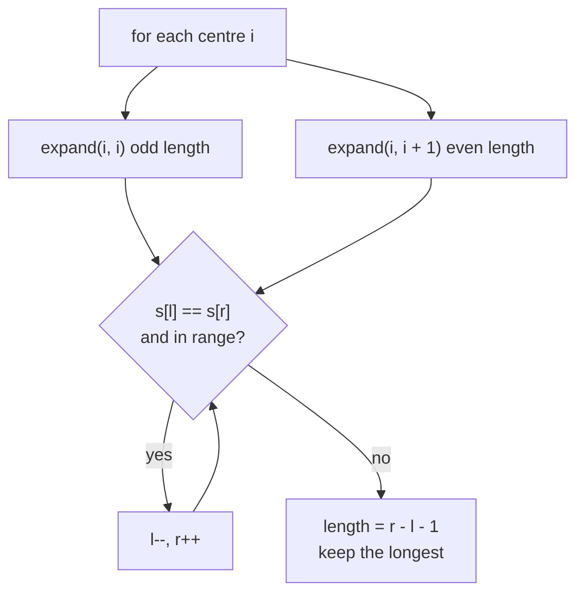

# Palindrome Checks and Palindrome-Related DP

> A palindrome reads the same forwards and backwards. Three tools cover almost every question: **two pointers** (check), **expand around the centre** (find), and a **DP table** (count, subsequences).

#### 1. What Is It?

| Task | Tool | Time |
|---|---|---|
| Is this string a palindrome? | two pointers from both ends | `O(n)`, `O(1)` space |
| Palindrome after deleting at most one letter | two pointers + one retry | `O(n)` |
| Longest palindromic **substring** | expand around each centre | `O(n²)`, `O(1)` space |
| Count palindromic substrings | expand around each centre | `O(n²)` |
| Longest palindromic **subsequence** | 2D DP | `O(n²)` |
| Longest palindromic substring in linear time | Manacher (⚪ name only) | `O(n)` |

**Substring** = contiguous. **Subsequence** = letters in order, gaps allowed. This difference changes the algorithm.

**Signals:** "palindrome", "reads the same", "mirror", "reverse equals itself".

#### 2. How It Works

**Two pointers.** Compare `s[l]` and `s[r]`, move inward. Skip non-alphanumeric characters if asked.

**Expand around the centre.** A palindrome mirrors around its centre. There are `2n − 1` centres: `n` single letters (odd length) and `n − 1` gaps between letters (even length). From each centre, grow while both sides match.

```text
s = "babad"
centre 'a'(index 1): b a b → matches; next: out of range / 'a' vs 'd' stops   → "bab" (length 3)
centre between 0,1 ('b','a'): not equal → length 0
```



**DP for substrings.** `isPal[i][j]` is true when `s[i] == s[j]` and the inside `s[i+1..j-1]` is a palindrome (or has length ≤ 1).

**DP for subsequences (Longest Palindromic Subsequence).** `dp[i][j]` = answer for `s[i..j]`.

```text
if s[i] == s[j]:   dp[i][j] = dp[i+1][j-1] + 2
else:              dp[i][j] = max(dp[i+1][j], dp[i][j-1])
```

Example `"bbbab"`: the best subsequence is `"bbbb"` → 4.

**Related:** Palindrome Partitioning (all ways to cut into palindromes) is backtracking (`6` Backtracking, note 11). Shortest Palindrome (prepend letters) uses KMP (note 05).

#### 3. Brute Force vs Optimized

| Task | Brute force | Optimized |
|---|---|---|
| Is palindrome | reverse + compare, `O(n)` extra space | two pointers, `O(1)` |
| Longest palindromic substring | check every substring `O(n³)` | expand around centres `O(n²)` |
| Count palindromic substrings | every substring `O(n³)` | expand `O(n²)` |
| Longest palindromic subsequence | all subsequences `O(2ⁿ)` | DP `O(n²)` |

```kotlin
// Brute force: every substring, check it
fun longestPalindromeBrute(s: String): String {
    var best = ""
    for (i in s.indices) for (j in i until s.length) {
        val sub = s.substring(i, j + 1)
        if (sub.length > best.length && sub == sub.reversed()) best = sub
    }
    return best
}
```

#### 4. Kotlin Code

```kotlin
// Valid Palindrome (LeetCode 125): ignore case, skip non-alphanumeric
fun isPalindrome(s: String): Boolean {
    var l = 0
    var r = s.length - 1
    while (l < r) {
        while (l < r && !s[l].isLetterOrDigit()) l++
        while (l < r && !s[r].isLetterOrDigit()) r--
        if (s[l].lowercaseChar() != s[r].lowercaseChar()) return false
        l++; r--
    }
    return true
}

// Valid Palindrome II (LeetCode 680): may delete one character
fun validPalindrome(s: String): Boolean {
    fun check(l0: Int, r0: Int): Boolean {
        var l = l0; var r = r0
        while (l < r) { if (s[l] != s[r]) return false; l++; r-- }
        return true
    }
    var l = 0
    var r = s.length - 1
    while (l < r) {
        if (s[l] != s[r]) return check(l + 1, r) || check(l, r - 1)   // skip one side
        l++; r--
    }
    return true
}

// Longest Palindromic Substring (LeetCode 5): expand around centres
fun longestPalindrome(s: String): String {
    if (s.isEmpty()) return ""
    var start = 0
    var maxLen = 1
    fun expand(l0: Int, r0: Int) {
        var l = l0; var r = r0
        while (l >= 0 && r < s.length && s[l] == s[r]) { l--; r++ }
        val len = r - l - 1                                  // after the loop l and r are one step too far
        if (len > maxLen) { maxLen = len; start = l + 1 }
    }
    for (i in s.indices) { expand(i, i); expand(i, i + 1) }
    return s.substring(start, start + maxLen)
}

// Palindromic Substrings (LeetCode 647): count them
fun countSubstrings(s: String): Int {
    var count = 0
    fun expand(l0: Int, r0: Int) {
        var l = l0; var r = r0
        while (l >= 0 && r < s.length && s[l] == s[r]) { count++; l--; r++ }
    }
    for (i in s.indices) { expand(i, i); expand(i, i + 1) }
    return count
}

// Longest palindromic substring with a DP table
fun longestPalindromeDP(s: String): String {
    val n = s.length
    if (n == 0) return ""
    val isPal = Array(n) { BooleanArray(n) }
    var start = 0
    var best = 1
    for (i in n - 1 downTo 0) for (j in i until n) {
        if (s[i] == s[j] && (j - i < 3 || isPal[i + 1][j - 1])) {
            isPal[i][j] = true
            if (j - i + 1 > best) { best = j - i + 1; start = i }
        }
    }
    return s.substring(start, start + best)
}

// Longest Palindromic Subsequence (LeetCode 516)
fun longestPalindromeSubseq(s: String): Int {
    val n = s.length
    if (n == 0) return 0
    val dp = Array(n) { IntArray(n) }
    for (i in n - 1 downTo 0) {
        dp[i][i] = 1
        for (j in i + 1 until n) {
            dp[i][j] = if (s[i] == s[j]) dp[i + 1][j - 1] + 2 else maxOf(dp[i + 1][j], dp[i][j - 1])
        }
    }
    return dp[0][n - 1]
}
```

Checks: `isPalindrome("A man, a plan, a canal: Panama")` → `true`; `("race a car")` → `false`; `(" ")` → `true`. `validPalindrome("aba")` → `true`; `("abca")` → `true`; `("abc")` → `false`. `longestPalindrome("babad")` → `"bab"` (`"aba"` is also correct); `("cbbd")` → `"bb"`; `("a")` → `"a"`. `longestPalindromeDP("babad")` → `"aba"`; `("cbbd")` → `"bb"`. `longestPalindromeBrute("cbbd")` → `"bb"`. `countSubstrings("abc")` → `3`; `("aaa")` → `6`. `longestPalindromeSubseq("bbbab")` → `4`; `("cbbd")` → `2`; `("a")` → `1`.

#### 5. Complexity

| | Time | Space |
|---|---|---|
| Two pointers check | `O(n)` | `O(1)` |
| Expand around centres | `O(n²)` | `O(1)` |
| DP table (substring / subsequence) | `O(n²)` | `O(n²)` |
| Manacher | `O(n)` | `O(n)` |

#### 6. Common Mistakes

1. **Only odd centres** (missing even-length palindromes like `"bb"`).
2. **Wrong length after the loop:** `r − l − 1`, with `start = l + 1`.
3. **Confusing substring and subsequence.**
4. **Case and punctuation** in Valid Palindrome (use `isLetterOrDigit`, `lowercaseChar`).
5. **DP fill order:** `dp[i][j]` depends on `dp[i+1][j-1]`, so `i` must go **downwards**.
6. **Index out of range** at `dp[i+1][j-1]` when `j − i < 2`. Handle short ranges separately.
7. **Building new strings** (`reversed()`) inside loops.

#### 7. Say This in the Interview

1. "A palindrome has a centre. There are `2n − 1` centres, odd and even, and I expand each while the ends match. `O(n²)` time, `O(1)` space."
2. "For a subsequence, the answer for `i..j` depends on whether the ends match, so it's a 2D DP, `O(n²)`."
3. "Manacher's algorithm does the longest palindromic substring in `O(n)`, but I wouldn't expect it in an interview."

#### 8. Quick Check

1. Number of centres in a string of length 5?
2. Palindromic substrings of `"aaa"`?
3. Subsequence or substring: which uses `max(dp[i+1][j], dp[i][j-1])`?

<details>
<summary>Answers</summary>

1. 9 (`2n − 1`).
2. 6: `a`, `a`, `a`, `aa`, `aa`, `aaa`.
3. Subsequence.

</details>

#### 9. Related LeetCode Questions

| # | Question | Idea |
|---|---|---|
| 125 | [Valid Palindrome](https://leetcode.com/problems/valid-palindrome/) (Easy) | two pointers |
| 680 | [Valid Palindrome II](https://leetcode.com/problems/valid-palindrome-ii/) (Easy) | one retry |
| 9 | [Palindrome Number](https://leetcode.com/problems/palindrome-number/) (Easy) | reverse half |
| 5 | [Longest Palindromic Substring](https://leetcode.com/problems/longest-palindromic-substring/) (Medium) | expand around centres |
| 647 | [Palindromic Substrings](https://leetcode.com/problems/palindromic-substrings/) (Medium) | expand and count |
| 516 | [Longest Palindromic Subsequence](https://leetcode.com/problems/longest-palindromic-subsequence/) (Medium) | 2D DP |
| 131 | [Palindrome Partitioning](https://leetcode.com/problems/palindrome-partitioning/) (Medium) | backtracking |
| 214 | [Shortest Palindrome](https://leetcode.com/problems/shortest-palindrome/) (Hard) | KMP |
