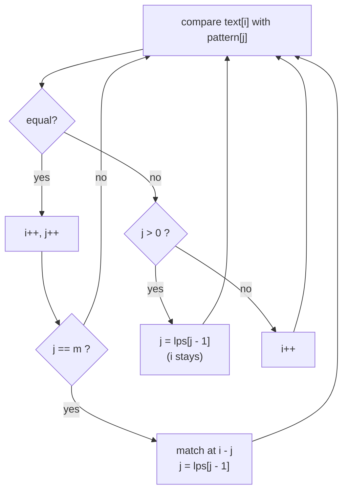

# KMP (Knuth-Morris-Pratt): the Failure Function, O(n + m)

> Search for a pattern in a text **without ever moving backwards in the text**. After a mismatch, use what you already matched to skip ahead. Worst case `O(n + m)`.

#### 1. What Is It?

Naive search throws away what it learned on a mismatch and restarts. KMP remembers it using a table built from the pattern alone: the **LPS array** (longest proper prefix that is also a suffix), also called the failure function.

| | Meaning |
|---|---|
| **Prefix** of `P` | `P[0..k]`, starts at the beginning |
| **Suffix** of `P` | `P[k..end]`, ends at the end |
| **Proper** | not the whole string |
| `lps[i]` | length of the longest proper prefix of `P[0..i]` that is also a suffix of `P[0..i]` |

Example `P = "ABABCABAB"`:

```text
index:  0 1 2 3 4 5 6 7 8
char:   A B A B C A B A B
lps:    0 0 1 2 0 1 2 3 4
```

`lps[8] = 4` means `"ABAB"` is both a prefix and a suffix of the whole pattern.

**Signals:** "find a pattern in text in linear time", "repeated substring", "longest prefix that is also a suffix", "shortest palindrome by adding in front", "periodic string".

#### 2. How It Works

Walk through the text with `i`, keep `j` = number of pattern characters currently matched.

- `text[i] == pattern[j]` → advance both. If `j == m`, record a match and set `j = lps[j − 1]` (so overlapping matches are found).
- Mismatch and `j > 0` → set `j = lps[j − 1]` **without moving `i`**.
- Mismatch and `j == 0` → advance `i`.



**Why it works.** Suppose we matched `ABAB` and then fail on the next letter. The last two matched letters `AB` are also a prefix of the pattern (`lps = 2`), so we can continue as if we had just matched `AB`, with no need to re-read the text.

**Building the LPS table** uses the same idea on the pattern itself: `len` is the length of the current matched prefix.

```text
P = "ABABCABAB"
i=1: B vs A → no, len=0           lps[1] = 0
i=2: A vs A → len=1               lps[2] = 1
i=3: B vs B → len=2               lps[3] = 2
i=4: C vs A → no; len = lps[1] = 0 → still no   lps[4] = 0
i=5..8: A B A B match the prefix  lps = 1, 2, 3, 4
```

**Why `O(n + m)`:** `i` never goes back. `j` only increases by 1 per step, and each fallback reduces it, so total fallbacks ≤ total increases ≤ `n`. Same argument for building the table in `O(m)`.

#### 3. Brute Force vs Optimized

| | Naive (note 02) | KMP |
|---|---|---|
| Time | `O(n · m)` | `O(n + m)` |
| Extra space | `O(1)` | `O(m)` for `lps` |
| Moves back in the text? | yes | never |
| Code size | tiny | medium |

When to use: long text with repetitive structure, streaming text (never rewinds), or when the problem is really about **prefix = suffix** structure (the LPS table is the answer).

```kotlin
// Naive for comparison
fun naiveIndex(text: String, p: String): Int {
    for (s in 0..text.length - p.length) if (text.regionMatches(s, p, 0, p.length)) return s
    return -1
}
```

#### 4. Kotlin Code

```kotlin
// LPS table
fun buildLps(p: String): IntArray {
    val lps = IntArray(p.length)
    var len = 0                                   // length of the current matched prefix
    var i = 1
    while (i < p.length) {
        if (p[i] == p[len]) {
            len++
            lps[i] = len
            i++
        } else if (len > 0) {
            len = lps[len - 1]                    // fall back, do not advance i
        } else {
            lps[i] = 0
            i++
        }
    }
    return lps
}

// All match positions (overlapping allowed)
fun kmpSearch(text: String, pattern: String): List<Int> {
    if (pattern.isEmpty()) return emptyList()
    val lps = buildLps(pattern)
    val result = ArrayList<Int>()
    var i = 0
    var j = 0
    while (i < text.length) {
        if (text[i] == pattern[j]) {
            i++; j++
            if (j == pattern.length) {
                result.add(i - j)
                j = lps[j - 1]
            }
        } else if (j > 0) {
            j = lps[j - 1]
        } else {
            i++
        }
    }
    return result
}

// Repeated Substring Pattern (LeetCode 459): the period is n - lps[n-1]
fun repeatedSubstringPattern(s: String): Boolean {
    val n = s.length
    val lps = buildLps(s)
    val period = n - lps[n - 1]
    return lps[n - 1] > 0 && n % period == 0
}

// Longest Happy Prefix (LeetCode 1392): prefix that is also a suffix
fun longestPrefix(s: String): String = s.substring(0, buildLps(s).last())

// Shortest Palindrome (LeetCode 214): longest palindromic prefix via lps of s + '#' + reverse(s)
fun shortestPalindrome(s: String): String {
    if (s.isEmpty()) return s
    val lps = buildLps(s + "#" + s.reversed())
    val keep = lps.last()                         // length of the longest palindromic prefix
    return s.substring(keep).reversed() + s
}
```

Checks: `buildLps("ABABCABAB")` → `[0, 0, 1, 2, 0, 1, 2, 3, 4]`; `buildLps("AAAA")` → `[0, 1, 2, 3]`; `buildLps("AABAAB")` → `[0, 1, 0, 1, 2, 3]`. `kmpSearch("ABABDABACDABABCABAB", "ABABCABAB")` → `[10]`; `("aaaaa", "aa")` → `[0, 1, 2, 3]`; `("abc", "d")` → `[]`. `naiveIndex("hello", "ll")` → `2`. `repeatedSubstringPattern("abab")` → `true`; `("aba")` → `false`; `("abcabcabcabc")` → `true`; `("a")` → `false`. `longestPrefix("level")` → `"l"`; `("ababab")` → `"abab"`; `("abc")` → `""`. `shortestPalindrome("aacecaaa")` → `"aaacecaaa"`; `("abcd")` → `"dcbaabcd"`.

#### 5. Complexity

| | Time | Space |
|---|---|---|
| Build `lps` | `O(m)` | `O(m)` |
| Search | `O(n)` | |
| Total | `O(n + m)` worst case | `O(m)` |

#### 6. Common Mistakes

1. **Advancing `i` on a fallback.** On mismatch with `j > 0`, only `j` changes.
2. **`j = 0` on mismatch** (that is the naive restart).
3. **After a full match, forgetting `j = lps[j − 1]`** (infinite loop or missed overlaps).
4. **Reading `lps[j]` instead of `lps[j − 1]`.**
5. **Building the table with an off-by-one**: start at `i = 1`, `len = 0`.
6. **Empty pattern** (`pattern[0]` crashes).
7. **Deriving the period from `lps` without the divisibility check** (`n % period == 0`).
8. **Separator character** in combined strings that also appears in the text (use one that cannot).

#### 7. Say This in the Interview

1. "The naive approach is `O(n·m)` because it re-reads text after a mismatch. KMP precomputes, for each pattern prefix, the longest border (proper prefix that is also a suffix), so after a mismatch I jump to that border and never move back in the text."
2. "The table is built in `O(m)` and the search is `O(n)`, because `j` can only fall back as many times as it advanced."
3. "For Repeated Substring Pattern the answer comes straight from the table: the string repeats if `n % (n − lps[n−1]) == 0` and `lps[n−1] > 0`."

#### 8. Quick Check

1. `lps` of `"AAAA"`?
2. After a mismatch with `j = 4` in `"ABABCABAB"`, what is `j`?
3. Why `O(n)` and not `O(n·m)`?

<details>
<summary>Answers</summary>

1. `[0, 1, 2, 3]`.
2. `lps[3] = 2`.
3. The text index never goes back, and fallbacks are paid for by earlier advances of `j`.

</details>

#### 9. Related LeetCode Questions

| # | Question | Idea |
|---|---|---|
| 28 | [Find the Index of the First Occurrence in a String](https://leetcode.com/problems/find-the-index-of-the-first-occurrence-in-a-string/) (Easy) | KMP search |
| 459 | [Repeated Substring Pattern](https://leetcode.com/problems/repeated-substring-pattern/) (Easy) | period from `lps` |
| 1392 | [Longest Happy Prefix](https://leetcode.com/problems/longest-happy-prefix/) (Hard) | `lps` of the string |
| 214 | [Shortest Palindrome](https://leetcode.com/problems/shortest-palindrome/) (Hard) | `lps` of `s#reverse(s)` |
| 686 | [Repeated String Match](https://leetcode.com/problems/repeated-string-match/) (Medium) | repeat + search |
| 796 | [Rotate String](https://leetcode.com/problems/rotate-string/) (Easy) | search in `a + a` |
