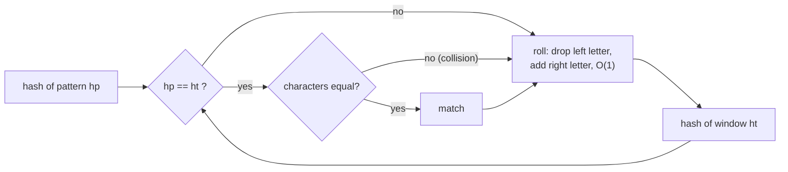

# Rabin-Karp: Rolling Hash, O(n + m) Average

> Compare **numbers** instead of strings. Compute a hash for the pattern and for each window of the text, updating the window hash in `O(1)` as it slides. Only compare characters when the hashes match.

#### 1. What Is It?

A **rolling hash** treats a string as a number in some base, modulo a big prime:

```text
hash("abc") = ('a' × B²  +  'b' × B  +  'c')  mod M
```

Sliding the window by one character updates the hash in `O(1)`: drop the leftmost letter's contribution, multiply by `B`, add the new letter.

| | Value |
|---|---|
| Average time | `O(n + m)` |
| Worst time | `O(n · m)` (many hash collisions or a bad hash) |
| Space | `O(1)` |
| Strength | **many patterns** at once, or fixed-length substring problems (duplicates, DNA) |

**Signals:** "find repeated substrings of length `k`", "compare many windows", "search multiple patterns", "longest duplicate substring" (with binary search).

#### 2. How It Works

1. Compute `hp` = hash of the pattern, `ht` = hash of the first window of the text.
2. For each window: if `hp == ht`, **verify** the characters (hashes can collide). Then roll to the next window.
3. Roll: `ht = ((ht − out · B^(m−1)) · B + in) mod M`.

```text
text = "abcd", m = 3, B = 10 (digits as letters for illustration: a=1,b=2,c=3,d=4)
window "abc" = 1·100 + 2·10 + 3 = 123
roll to "bcd": remove 'a' → 123 − 100 = 23 → ×10 = 230 → + 4 = 234 ✓ (= "bcd")
```



**Choosing the numbers.** Base `B` ≥ alphabet size (256 for bytes, 31 for lowercase). Modulus `M` a large prime (`1_000_000_007`). Use `Long`, and keep each intermediate under `~9·10¹⁸`. For adversarial inputs, use two moduli (double hashing) or a random base.

**Why verify on a match?** Two different strings can have the same hash (a collision). Verifying makes the answer always correct; only the running time depends on luck.

**A cheap special case: 2 bits per letter.** DNA letters `A, C, G, T` fit in 2 bits, so a window of 10 letters is a 20-bit integer, rolled with shifts. No collisions at all.

#### 3. Brute Force vs Optimized

| Approach | Time | Space |
|---|---|---|
| Naive (note 02) | `O(n · m)` | `O(1)` |
| Hash every substring with `substring` + `HashSet` | `O(n · k)` | `O(n · k)` |
| **Rabin-Karp rolling hash** | `O(n + m)` average | `O(1)` |
| KMP (note 05) | `O(n + m)` worst | `O(m)` |

```kotlin
// Straightforward but memory heavy: store every length-10 substring
fun repeatedDnaStrings(s: String): List<String> {
    val seen = HashSet<String>()
    val repeated = HashSet<String>()
    for (i in 0..s.length - 10) {
        val sub = s.substring(i, i + 10)
        if (!seen.add(sub)) repeated.add(sub)
    }
    return repeated.toList()
}
```

#### 4. Kotlin Code

```kotlin
// Rabin-Karp: all match positions
fun rabinKarp(text: String, pattern: String): List<Int> {
    val n = text.length
    val m = pattern.length
    if (m == 0 || m > n) return emptyList()
    val base = 256L
    val mod = 1_000_000_007L
    var highest = 1L                               // base^(m-1)
    repeat(m - 1) { highest = highest * base % mod }
    var hp = 0L
    var ht = 0L
    for (i in 0 until m) {
        hp = (hp * base + pattern[i].code) % mod
        ht = (ht * base + text[i].code) % mod
    }
    val result = ArrayList<Int>()
    for (i in 0..n - m) {
        if (hp == ht && text.regionMatches(i, pattern, 0, m)) result.add(i)    // verify on equal hashes
        if (i < n - m) {
            val removed = text[i].code * highest % mod
            ht = ((ht - removed + mod) * base + text[i + m].code) % mod
        }
    }
    return result
}

// Repeated DNA Sequences (LeetCode 187): 2 bits per letter, 20-bit rolling value (no collisions)
fun findRepeatedDnaSequences(s: String): List<String> {
    if (s.length < 10) return emptyList()
    val code = mapOf('A' to 0, 'C' to 1, 'G' to 2, 'T' to 3)
    val mask = (1 shl 20) - 1
    val seen = HashSet<Int>()
    val added = HashSet<Int>()
    val result = ArrayList<String>()
    var h = 0
    for (i in s.indices) {
        h = ((h shl 2) or code[s[i]]!!) and mask
        if (i >= 9 && !seen.add(h) && added.add(h)) result.add(s.substring(i - 9, i + 1))
    }
    return result
}
```

Checks: `rabinKarp("ABABDABACDABABCABAB", "ABABCABAB")` → `[10]`; `("aaaaa", "aa")` → `[0, 1, 2, 3]`; `("abc", "d")` → `[]`; `("ab", "abc")` → `[]`. `findRepeatedDnaSequences("AAAAACCCCCAAAAACCCCCCAAAAAGGGTTT")` → `["AAAAACCCCC", "CCCCCAAAAA"]`; `("AAAAAAAAAAAAA")` → `["AAAAAAAAAA"]`; `("ACGT")` → `[]`. `repeatedDnaStrings("AAAAAAAAAAAAA")` → `["AAAAAAAAAA"]`.

#### 5. Complexity

| | Time | Space |
|---|---|---|
| Hash pattern + first window | `O(m)` | `O(1)` |
| Roll across the text | `O(n)` | |
| Verification on equal hashes | `O(m)` each, rare | |
| Average total | `O(n + m)` | `O(1)` |
| Worst total (many collisions) | `O(n · m)` | |

#### 6. Common Mistakes

1. **Not verifying** the characters when hashes match.
2. **Negative hash after subtraction.** Add `mod` before taking `% mod`.
3. **Overflow:** multiply as `Long`, reduce after every multiplication.
4. **Wrong `highest`:** it is `base^(m−1)`, not `base^m`.
5. **Weak parameters:** a small modulus or base causes frequent collisions.
6. **Forgetting `m > n`** and empty patterns.
7. **Comparing `substring` strings** each step (that defeats the point).

#### 7. Say This in the Interview

1. "I'll hash the pattern and each window with a rolling hash, updating the window hash in `O(1)`, and compare characters only when hashes are equal. Average `O(n + m)`."
2. "Collisions are possible, so I verify on a hash match. For adversarial input I'd use two moduli or a random base."
3. "This shines for fixed-length substring problems like repeated DNA sequences, or for many patterns at once."

#### 8. Quick Check

1. Why verify when hashes match?
2. How do you roll the hash?
3. Worst case?

<details>
<summary>Answers</summary>

1. Different strings can share a hash (a collision).
2. Subtract the leaving letter times `B^(m−1)`, multiply by `B`, add the new letter, take `mod`.
3. `O(n·m)`, if almost every window collides.

</details>

#### 9. Related LeetCode Questions

| # | Question | Idea |
|---|---|---|
| 28 | [Find the Index of the First Occurrence in a String](https://leetcode.com/problems/find-the-index-of-the-first-occurrence-in-a-string/) (Easy) | rolling hash search |
| 187 | [Repeated DNA Sequences](https://leetcode.com/problems/repeated-dna-sequences/) (Medium) | 2-bit rolling value |
| 1044 | [Longest Duplicate Substring](https://leetcode.com/problems/longest-duplicate-substring/) (Hard) | binary search length + rolling hash |
| 718 | [Maximum Length of Repeated Subarray](https://leetcode.com/problems/maximum-length-of-repeated-subarray/) (Medium) | DP, or binary search + hash |
| 1062 | [Longest Repeating Substring](https://leetcode.com/problems/longest-repeating-substring/) (Medium, premium) | binary search + hash |
| 49 | [Group Anagrams](https://leetcode.com/problems/group-anagrams/) (Medium) | hashing as a key |
