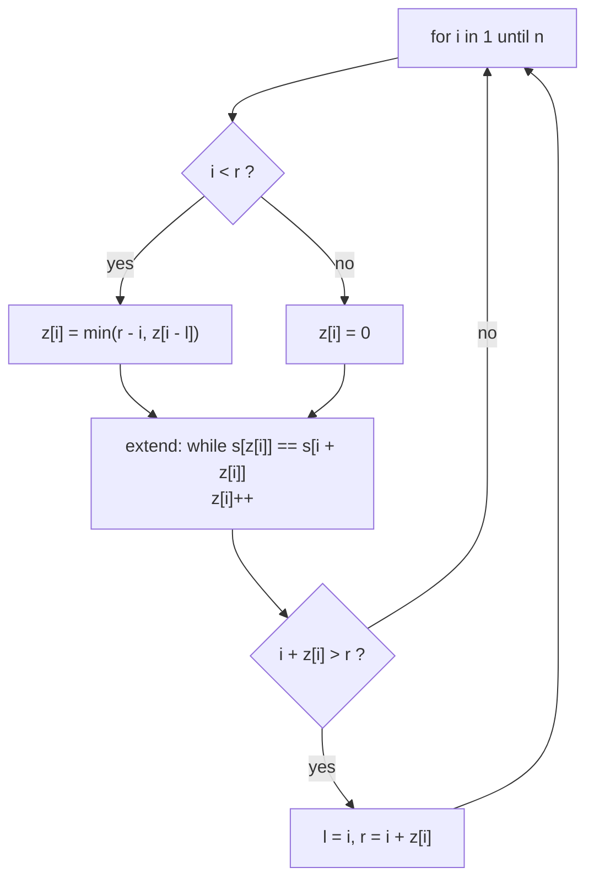

# Z-Algorithm: Longest Common Prefix with Itself

> For every position `i` in a string, compute how many characters starting at `i` match the **start** of the string. Linear time, and an alternative to KMP for pattern search.

#### 1. What Is It?

The **Z-array** of a string `s`: `z[i]` = length of the longest substring starting at `i` that is also a **prefix** of `s`. By convention `z[0] = n`.

Example `s = "aabxaab"`:

```text
index:  0 1 2 3 4 5 6
char:   a a b x a a b
z:      7 1 0 0 3 1 0
```

`z[4] = 3` because `"aab"` starting at 4 equals the prefix `"aab"`.

| Use | How |
|---|---|
| Pattern search | build `pattern + separator + text`; positions with `z == m` are matches |
| Periodic strings | `s` has period `p` if `z[p] == n − p` |
| Sum of scores of all suffixes | `sum(z)` |

**Signals:** "how much does each suffix match the prefix", "find all occurrences in linear time", "string prefix structure".

#### 2. How It Works

Maintain a **Z-box** `[l, r)`: the rightmost segment found so far that matches a prefix.

For each `i`:

1. If `i` is inside the box (`i < r`), start with `z[i] = min(r − i, z[i − l])`. The part inside the box mirrors an earlier position, so we already know a lower bound.
2. Extend by comparing characters directly: `while s[z[i]] == s[i + z[i]]`, increase `z[i]`.
3. If the new match goes past `r`, move the box to `[i, i + z[i])`.

```text
s = "aabxaab"
i=1: compare a/a ✓, a/b ✗      → z=1, box [1,2)
i=2: b vs a ✗                  → z=0
i=3: x vs a ✗                  → z=0
i=4: a a b match "aab"         → z=3, box [4,7)
i=5: inside the box: min(7−5, z[1]=1) = 1; next compare s[1]=a vs s[6]=b ✗ → z=1
i=6: inside the box: min(1, z[2]=0) = 0 → z=0
```



**Why linear.** `r` only moves right, and each comparison either extends `r` or ends the extension. Total comparisons `O(n)`.

**Pattern search with Z.** Make `t = pattern + "\u0001" + text` (a separator not in either string). Any `z[i] == m` for `i > m` means the pattern occurs at text index `i − m − 1`. The separator guarantees `z` never exceeds `m`.

#### 3. Brute Force vs Optimized

| Approach | Time | Space |
|---|---|---|
| Compute every `z[i]` by direct comparison | `O(n²)` | `O(n)` |
| **Z-algorithm** | `O(n)` | `O(n)` |
| KMP `lps` (note 05) | `O(n)` | `O(m)` |

Z and KMP solve the same family of problems. Z is easier to reason about ("matches with the prefix"); KMP uses less memory when searching. Learn one well; know the other exists.

```kotlin
// Brute force Z-array: compare directly at each position
fun zBrute(s: String): IntArray {
    val z = IntArray(s.length)
    for (i in s.indices) {
        var k = 0
        while (i + k < s.length && s[k] == s[i + k]) k++
        z[i] = k
    }
    return z
}
```

#### 4. Kotlin Code

```kotlin
fun zArray(s: String): IntArray {
    val n = s.length
    val z = IntArray(n)
    if (n == 0) return z
    z[0] = n
    var l = 0
    var r = 0                                          // Z-box [l, r)
    for (i in 1 until n) {
        if (i < r) z[i] = minOf(r - i, z[i - l])       // reuse the mirror position
        while (i + z[i] < n && s[z[i]] == s[i + z[i]]) z[i]++
        if (i + z[i] > r) { l = i; r = i + z[i] }
    }
    return z
}

// Pattern search with the Z-array
fun zSearch(text: String, pattern: String): List<Int> {
    if (pattern.isEmpty()) return emptyList()
    val m = pattern.length
    val z = zArray(pattern + "\u0001" + text)
    val result = ArrayList<Int>()
    for (i in m + 1 until z.size) if (z[i] == m) result.add(i - m - 1)
    return result
}

// Sum of Scores of Built Strings (LeetCode 2223): score of each suffix = z value; z[0] = n
fun sumScores(s: String): Long = zArray(s).sumOf { it.toLong() }

// Smallest period of a string (works for any string), or n if it never repeats
fun smallestPeriod(s: String): Int {
    val z = zArray(s)
    for (p in 1 until s.length) if (s.length % p == 0 && z[p] == s.length - p) return p
    return s.length
}
```

Checks: `zArray("aabxaab")` → `[7, 1, 0, 0, 3, 1, 0]`; `zArray("aaaaa")` → `[5, 4, 3, 2, 1]`; `zArray("abc")` → `[3, 0, 0]`; `zArray("")` → `[]`. `zBrute("aabxaab")` equals `zArray("aabxaab")` (with `z[0] = 7` since `s` matches itself). `zSearch("ABABDABACDABABCABAB", "ABABCABAB")` → `[10]`; `("aaaaa", "aa")` → `[0, 1, 2, 3]`; `("abc", "d")` → `[]`. `sumScores("babab")` → `9` (`5 + 0 + 3 + 0 + 1`); `sumScores("azbazbzaz")` → `14`. `smallestPeriod("abcabcabc")` → `3`; `("abab")` → `2`; `("abc")` → `3`.

#### 5. Complexity

| | Time | Space |
|---|---|---|
| Z-array | `O(n)` | `O(n)` |
| Pattern search | `O(n + m)` | `O(n + m)` |

#### 6. Common Mistakes

1. **Using a separator that can appear in the text.**
2. **Using `z[i − l]` without the `min(r − i, ...)` cap** (reading past the box).
3. **Forgetting to update `[l, r)`** after extending.
4. **Setting `z[0]` wrongly** (`n` by convention; skip index 0 in searches).
5. **Off-by-one converting a Z-index to a text index:** `i − m − 1`.
6. **Confusing with KMP's `lps`** (`lps[i]` = border of the prefix ending at `i`; `z[i]` = match starting at `i`).

#### 7. Say This in the Interview

1. "`z[i]` is the length of the longest substring starting at `i` that matches the prefix. I compute all of them in `O(n)` by reusing a window `[l, r)` of known matches."
2. "To search, I run Z on `pattern + separator + text` and report positions where `z` equals the pattern length."
3. "KMP and Z solve the same problems in linear time. I'll use whichever I can write cleanly."

#### 8. Quick Check

1. `z` of `"aaaa"`?
2. Why the separator in pattern search?
3. What does the Z-box store?

<details>
<summary>Answers</summary>

1. `[4, 3, 2, 1]`.
2. So that matches cannot run across from the pattern into the text and `z` never exceeds `m`.
3. The rightmost interval `[l, r)` that matches a prefix of the string.

</details>

#### 9. Related LeetCode Questions

| # | Question | Idea |
|---|---|---|
| 28 | [Find the Index of the First Occurrence in a String](https://leetcode.com/problems/find-the-index-of-the-first-occurrence-in-a-string/) (Easy) | Z search |
| 459 | [Repeated Substring Pattern](https://leetcode.com/problems/repeated-substring-pattern/) (Easy) | period via Z |
| 1392 | [Longest Happy Prefix](https://leetcode.com/problems/longest-happy-prefix/) (Hard) | border via Z |
| 214 | [Shortest Palindrome](https://leetcode.com/problems/shortest-palindrome/) (Hard) | prefix match |
| 2223 | [Sum of Scores of Built Strings](https://leetcode.com/problems/sum-of-scores-of-built-strings/) (Hard) | sum of `z` |
| 686 | [Repeated String Match](https://leetcode.com/problems/repeated-string-match/) (Medium) | pattern in repeated text |
