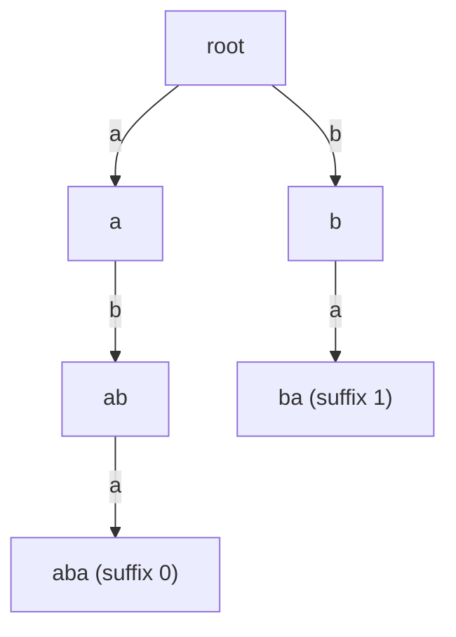

# Suffix Array and Suffix Tree: Name and Idea Only

> Index **all suffixes** of a string so that substring questions become fast lookups. Interviews rarely ask you to build one; know what they are and what they solve.

#### 1. What Is It?

Every substring is a prefix of some suffix. So if all suffixes are stored in sorted order, substring problems turn into searches.

| Structure | What it is | Build time |
|---|---|---|
| **Suffix array** | the starting indexes of all suffixes, sorted alphabetically | `O(n log n)` (or `O(n)` with SA-IS) |
| **LCP array** | longest common prefix of each suffix with the previous one in the sorted order | `O(n)` (Kasai) |
| **Suffix tree** | a compressed trie of all suffixes | `O(n)` (Ukkonen) |
| **Suffix automaton** | smallest automaton accepting all suffixes (⚪ even rarer) | `O(n)` |

**Problems they solve**

| Problem | How |
|---|---|
| Does `p` occur in `s`? | binary search in the suffix array: `O(m log n)` |
| Longest repeated substring | maximum value in the LCP array |
| Number of distinct substrings | `n(n+1)/2 − sum(LCP)` |
| Longest common substring of two strings | build on `a#b`, use LCP across the boundary |

**Signals:** "many queries on the same big text", "count distinct substrings", "longest repeated substring". In an interview you can usually use **binary search + rolling hash** or **DP** instead.

#### 2. How It Works

`s = "banana"`. All suffixes, then sorted:

```text
index  suffix            sorted order
0      banana            5  a
1      anana             3  ana
2      nana              1  anana
3      ana               0  banana
4      na                4  na
5      a                 2  nana

suffix array = [5, 3, 1, 0, 4, 2]
LCP between neighbours   =    [-, 1, 3, 0, 0, 2]
```

- Longest repeated substring = max LCP = 3 → `"ana"`.
- Distinct substrings = `6·7/2 − (1+3+0+0+2) = 21 − 6 = 15`.

**Suffix trie** of `"aba"` (a suffix tree compresses the single-child chains):



The suffix `"a"` (index 2) ends at node `a`. Every path from the root spells a substring, so "is `p` a substring?" is "can I walk `p` from the root?".

**Why it is "name only" for most roles:** building them correctly takes real code (Ukkonen, SA-IS). Naive construction by sorting suffixes is fine for small `n`.

#### 3. Brute Force vs Optimized

| Question | Brute force | With a suffix array |
|---|---|---|
| Is `p` in `s`? (one query) | scan `O(n · m)` or KMP `O(n + m)` | `O(m log n)` after `O(n log n)` build |
| `q` queries on the same text | `O(q · n)` | `O(n log n + q · m log n)` |
| Longest repeated substring | all pairs of positions `O(n³)` | `O(n log n)` |
| Distinct substrings | put all substrings in a set `O(n³)` | `O(n log n)` |

```kotlin
// Brute force distinct substrings: store all of them
fun distinctSubstringsBrute(s: String): Int {
    val set = HashSet<String>()
    for (i in s.indices) for (j in i + 1..s.length) set.add(s.substring(i, j))
    return set.size
}
```

#### 4. Kotlin Code

```kotlin
// Naive suffix array: sort suffix start positions by the suffix text (fine for small n)
fun suffixArray(s: String): IntArray =
    (0 until s.length).sortedBy { s.substring(it) }.toIntArray()

// LCP of neighbours in the suffix array (naive comparison)
fun lcpArray(s: String, sa: IntArray): IntArray {
    val lcp = IntArray(sa.size)
    for (k in 1 until sa.size) {
        var a = sa[k - 1]
        var b = sa[k]
        var len = 0
        while (a < s.length && b < s.length && s[a] == s[b]) { a++; b++; len++ }
        lcp[k] = len
    }
    return lcp
}

fun longestRepeatedSubstring(s: String): String {
    if (s.isEmpty()) return ""
    val sa = suffixArray(s)
    val lcp = lcpArray(s, sa)
    var bestLen = 0
    var bestPos = 0
    for (k in 1 until sa.size) if (lcp[k] > bestLen) { bestLen = lcp[k]; bestPos = sa[k] }
    return s.substring(bestPos, bestPos + bestLen)
}

fun countDistinctSubstrings(s: String): Long {
    val n = s.length.toLong()
    val lcp = lcpArray(s, suffixArray(s))
    return n * (n + 1) / 2 - lcp.sumOf { it.toLong() }
}

// Is `p` a substring of `s`? Binary search on the suffix array
fun containsSubstring(s: String, sa: IntArray, p: String): Boolean {
    var lo = 0
    var hi = sa.size - 1
    while (lo <= hi) {
        val mid = lo + (hi - lo) / 2
        val suffix = s.substring(sa[mid])
        val prefix = suffix.take(p.length)
        when {
            prefix == p -> return true
            prefix < p -> lo = mid + 1
            else -> hi = mid - 1
        }
    }
    return false
}
```

Checks: `suffixArray("banana")` → `[5, 3, 1, 0, 4, 2]`. `lcpArray("banana", suffixArray("banana"))` → `[0, 1, 3, 0, 0, 2]`. `longestRepeatedSubstring("banana")` → `"ana"`; `("abcd")` → `""`. `countDistinctSubstrings("banana")` → `15`; `distinctSubstringsBrute("banana")` → `15`; `countDistinctSubstrings("aaa")` → `3`. With `sa = suffixArray("banana")`: `containsSubstring("banana", sa, "nan")` → `true`; `("banana", sa, "nab")` → `false`.

#### 5. Complexity

| | Time | Space |
|---|---|---|
| Naive suffix array (sort strings) | `O(n² log n)` | `O(n²)` for the substrings (a smarter comparator avoids it) |
| Prefix-doubling | `O(n log² n)` or `O(n log n)` | `O(n)` |
| SA-IS / Ukkonen | `O(n)` | `O(n)` |
| Substring query | `O(m log n)` (array), `O(m)` (tree) | |

#### 6. Common Mistakes

1. **Using `substring` copies in a comparator** for big `n` (quadratic memory).
2. **Mixing up the suffix array** (indexes) with the sorted suffixes (strings).
3. **LCP off-by-one** (`lcp[0]` has no previous suffix).
4. **Forgetting the terminator** (`$`) in suffix trees.
5. **Reaching for a suffix tree** when a rolling hash or DP is enough.
6. **Case and separator problems** when concatenating two strings for the common substring.

#### 7. Say This in the Interview

1. "A suffix array is the sorted list of all suffixes by start index. With the LCP array it answers longest repeated substring and distinct substring count."
2. "I wouldn't build one from scratch here. Binary search on the length plus a rolling hash gives the longest duplicate substring in `O(n log n)`."
3. "A suffix tree answers 'is `p` a substring?' in `O(m)` after an `O(n)` build, using Ukkonen's algorithm."

#### 8. Quick Check

1. Suffix array of `"aba"`?
2. What does the maximum LCP value represent?
3. Query time with a suffix array?

<details>
<summary>Answers</summary>

1. Suffixes: `a`(2), `aba`(0), `ba`(1) → `[2, 0, 1]`.
2. The length of the longest repeated substring.
3. `O(m log n)` by binary search.

</details>

#### 9. Related LeetCode Questions

| # | Question | Idea |
|---|---|---|
| 1044 | [Longest Duplicate Substring](https://leetcode.com/problems/longest-duplicate-substring/) (Hard) | suffix array, or binary search + rolling hash |
| 1163 | [Last Substring in Lexicographical Order](https://leetcode.com/problems/last-substring-in-lexicographical-order/) (Hard) | the largest suffix |
| 718 | [Maximum Length of Repeated Subarray](https://leetcode.com/problems/maximum-length-of-repeated-subarray/) (Medium) | common substring |
| 1062 | [Longest Repeating Substring](https://leetcode.com/problems/longest-repeating-substring/) (Medium, premium) | LCP / binary search |
| 5 | [Longest Palindromic Substring](https://leetcode.com/problems/longest-palindromic-substring/) (Medium) | related substring structure |
| 208 | [Implement Trie (Prefix Tree)](https://leetcode.com/problems/implement-trie-prefix-tree/) (Medium) | the trie behind suffix trees |
