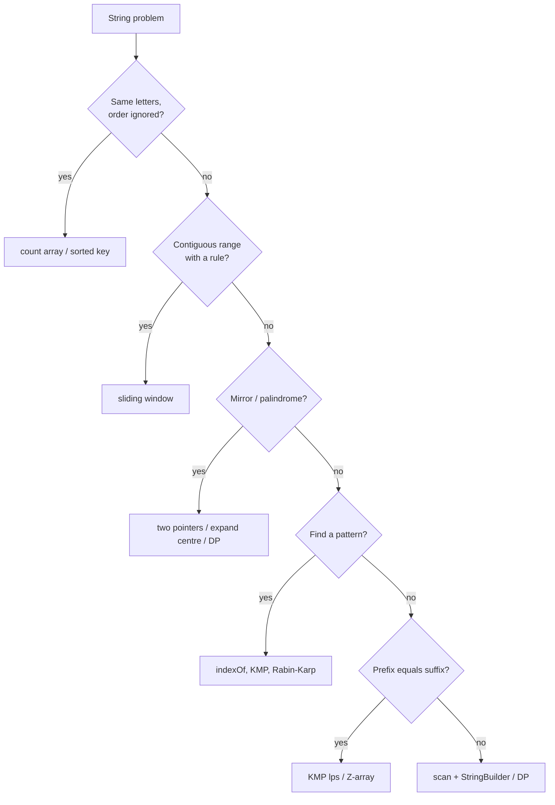

# String Algorithms Cheat Sheet

> One-page revision for the night before an interview. The full explanations are in notes 01–08.

#### 1. Key Takeaways

1. Strings are **immutable**. Build results with `StringBuilder`; `s += x` in a loop is `O(n²)`. `substring` copies.
2. Ask the **alphabet**: lowercase only → `IntArray(26)`; ASCII → `IntArray(128)`; unknown → `HashMap<Char, Int>`.
3. **Compare as bags of letters** (anagrams) → count array or sorted key. `O(n)` beats sorting `O(n log n)`.
4. **Substring with a rule** → sliding window. Variable window: grow `right`, shrink `left` while invalid. Fixed window: add one, remove one.
5. **Palindromes:** two pointers to check; **expand around the `2n − 1` centres** to find; 2D DP for subsequences.
6. **Pattern search:** `indexOf` / naive `O(n·m)` is fine for interviews; mention **KMP** `O(n + m)` (never moves back in the text) and **Rabin-Karp** (rolling hash, verify on match).
7. **Prefix = suffix structure** (period, repeated pattern, shortest palindrome) → KMP `lps` or **Z-array**.
8. **Suffix array / tree:** name and use only. Prefer binary search + rolling hash.
9. Always handle: empty string, one character, all equal characters, case, spaces.

#### 2. Complexity Table

| Problem / algorithm | Time | Space |
|---|---|---|
| Frequency array scan | `O(n)` | `O(1)` (fixed alphabet) |
| Sort-based anagram check | `O(n log n)` | `O(n)` |
| Sliding window | `O(n)` | `O(alphabet)` |
| Two-pointer palindrome | `O(n)` | `O(1)` |
| Expand around centres | `O(n²)` | `O(1)` |
| Palindrome DP | `O(n²)` | `O(n²)` |
| Naive substring search | `O(n·m)` worst | `O(1)` |
| KMP | `O(n + m)` | `O(m)` |
| Rabin-Karp | `O(n + m)` average, `O(n·m)` worst | `O(1)` |
| Z-algorithm | `O(n + m)` | `O(n + m)` |
| Suffix array (query) | `O(m log n)` | `O(n)` |
| Manacher (longest palindrome) | `O(n)` | `O(n)` |

#### 3. Patterns and How to Identify Them

| Signal in the question | Pattern | Note |
|---|---|---|
| "anagram", "same letters", "group by letters" | count array / sorted key | 01, 03 |
| "longest substring without / with at most k" | variable window | 03 |
| "substring of length k", "permutation in string" | fixed window + counts | 03 |
| "shortest substring containing all of" | window + missing counter | 03 |
| "palindrome", "reads the same" | two pointers / expand around centre | 04 |
| "longest palindromic subsequence" | 2D DP | 04 |
| "find pattern in text" | `indexOf`, KMP, Rabin-Karp | 02, 05, 06 |
| "repeated substring", "longest prefix that is also a suffix" | KMP `lps` / Z | 05, 07 |
| "repeated sequences of length k" | rolling hash / 2-bit encoding | 06 |
| "sum of scores of suffixes", "period" | Z-array | 07 |
| "distinct substrings", "longest repeated substring" | suffix array + LCP (or binary search + hash) | 08 |
| "add / compare numbers as strings" | digit loop + carry + `StringBuilder` | 01 |



#### 4. Templates to Memorise

**Frequency array**

```kotlin
val count = IntArray(26)
for (c in s) count[c - 'a']++
```

**Variable window (longest)**

```kotlin
var left = 0; var best = 0
for (right in s.indices) {
    /* add s[right] to the window */
    while (/* window invalid */) { /* remove s[left] */ left++ }
    best = maxOf(best, right - left + 1)
}
```

**Longest substring without repeats (ASCII)**

```kotlin
val last = IntArray(128) { -1 }
var left = 0; var best = 0
for (right in s.indices) {
    if (last[s[right].code] >= left) left = last[s[right].code] + 1
    last[s[right].code] = right
    best = maxOf(best, right - left + 1)
}
```

**Fixed window anagram check**

```kotlin
for (i in s.indices) {
    window[s[i] - 'a']++
    if (i >= m) window[s[i - m] - 'a']--
    if (i >= m - 1 && window.contentEquals(need)) result.add(i - m + 1)
}
```

**Expand around centre**

```kotlin
fun expand(l0: Int, r0: Int) {
    var l = l0; var r = r0
    while (l >= 0 && r < s.length && s[l] == s[r]) { l--; r++ }
    val len = r - l - 1                      // start = l + 1
}
for (i in s.indices) { expand(i, i); expand(i, i + 1) }
```

**KMP lps**

```kotlin
val lps = IntArray(p.length); var len = 0; var i = 1
while (i < p.length) {
    if (p[i] == p[len]) { len++; lps[i] = len; i++ }
    else if (len > 0) len = lps[len - 1]
    else { lps[i] = 0; i++ }
}
```

**KMP search loop**

```kotlin
var i = 0; var j = 0
while (i < text.length) {
    if (text[i] == pattern[j]) { i++; j++; if (j == pattern.length) { result.add(i - j); j = lps[j - 1] } }
    else if (j > 0) j = lps[j - 1]
    else i++
}
```

**Rolling hash step**

```kotlin
ht = ((ht - text[i].code * highest % mod + mod) * base + text[i + m].code) % mod   // highest = base^(m-1)
// verify with regionMatches when hp == ht
```

**Z-array**

```kotlin
var l = 0; var r = 0
for (i in 1 until n) {
    if (i < r) z[i] = minOf(r - i, z[i - l])
    while (i + z[i] < n && s[z[i]] == s[i + z[i]]) z[i]++
    if (i + z[i] > r) { l = i; r = i + z[i] }
}
```

#### 5. Brute Force to Optimized

| Problem | Brute force | Better |
|---|---|---|
| Anagram | sort both `O(n log n)` | count `O(n)` |
| Longest substring without repeats | all substrings `O(n²)` | window `O(n)` |
| Minimum window substring | all substrings | window + missing counter `O(n)` |
| Longest palindromic substring | all substrings `O(n³)` | expand `O(n²)` (Manacher `O(n)`) |
| Pattern search | naive `O(n·m)` | KMP / Rabin-Karp / Z `O(n + m)` |
| Repeated substring pattern | try every period | `lps` check `O(n)` |
| Repeated length-k substrings | store all substrings `O(n·k)` | rolling hash `O(n)` |
| Reverse words / build strings | `+=` `O(n²)` | `StringBuilder` `O(n)` |

#### 6. Common Mistakes and Edge Cases

1. **`+=` in a loop** → `O(n²)`.
2. **`substring(i, j)`** has `j` exclusive; it also copies.
3. **Only odd palindrome centres** (missing `"bb"`).
4. **Window shrinking with `if` instead of `while`** (where `while` is required).
5. **`IntArray == IntArray`** compares identity; use `contentEquals`.
6. **KMP:** advancing `i` on a fallback, or reading `lps[j]` instead of `lps[j − 1]`.
7. **Rabin-Karp:** no verification, negative modulo, `Int` overflow.
8. **Case / spaces / punctuation** not clarified.
9. **Edge cases:** empty string, single character, all identical characters, pattern longer than text, empty pattern, repeated overlapping matches.

#### 7. What to Say Out Loud

1. "Can I assume lowercase letters only? Then a 26-slot array replaces a map."
2. "I'll use a sliding window: expand right, and shrink left while the window is invalid. Each index enters and leaves once, so `O(n)`."
3. "A palindrome has a centre. There are `2n − 1` centres, and I expand each in `O(n)`: `O(n²)` total with `O(1)` space."
4. "Naive search is `O(n·m)`. KMP precomputes the longest border for each prefix so the text pointer never moves back: `O(n + m)`."
5. "I'll build the answer with a `StringBuilder` to avoid quadratic concatenation."
6. "I'll verify on a hash match, since two different strings can collide."

#### 8. Practice Order (Easy → Medium)

| Level | Question | Pattern |
|---|---|---|
| Easy | [Valid Anagram](https://leetcode.com/problems/valid-anagram/) | count array |
| Easy | [Valid Palindrome](https://leetcode.com/problems/valid-palindrome/) | two pointers |
| Easy | [Longest Common Prefix](https://leetcode.com/problems/longest-common-prefix/) | shrink prefix |
| Easy | [Roman to Integer](https://leetcode.com/problems/roman-to-integer/) | scan rule |
| Easy | [Add Binary](https://leetcode.com/problems/add-binary/) | carry + builder |
| Easy | [Isomorphic Strings](https://leetcode.com/problems/isomorphic-strings/) | two-way map |
| Easy | [Find the Index of the First Occurrence in a String](https://leetcode.com/problems/find-the-index-of-the-first-occurrence-in-a-string/) | naive / KMP |
| Easy | [Repeated Substring Pattern](https://leetcode.com/problems/repeated-substring-pattern/) | `lps` |
| Medium | [Group Anagrams](https://leetcode.com/problems/group-anagrams/) | sorted key |
| Medium | [Longest Substring Without Repeating Characters](https://leetcode.com/problems/longest-substring-without-repeating-characters/) | variable window |
| Medium | [Longest Repeating Character Replacement](https://leetcode.com/problems/longest-repeating-character-replacement/) | window + max frequency |
| Medium | [Permutation in String](https://leetcode.com/problems/permutation-in-string/) | fixed window |
| Medium | [Find All Anagrams in a String](https://leetcode.com/problems/find-all-anagrams-in-a-string/) | fixed window |
| Medium | [Longest Palindromic Substring](https://leetcode.com/problems/longest-palindromic-substring/) | expand around centres |
| Medium | [Palindromic Substrings](https://leetcode.com/problems/palindromic-substrings/) | expand and count |
| Medium | [Repeated DNA Sequences](https://leetcode.com/problems/repeated-dna-sequences/) | rolling hash |
| Medium | [Reverse Words in a String](https://leetcode.com/problems/reverse-words-in-a-string/) | split and join |
| Hard | [Minimum Window Substring](https://leetcode.com/problems/minimum-window-substring/) | window + missing counter |
