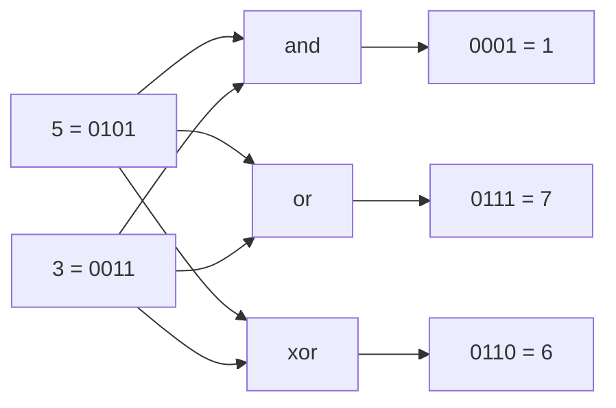

# AND, OR, XOR, NOT, Left Shift, Right Shift

> Bit operations work on the binary digits of a number directly. They are fast, use no extra memory, and a few simple tricks replace loops and hash maps.

#### 1. What Is It?

An `Int` in Kotlin is **32 bits** (a `Long` is 64). Bit operators combine or move those bits.

| Operator | Kotlin | Rule per bit | Example (`5 = 0101`, `3 = 0011`) |
|---|---|---|---|
| AND | `a and b` | 1 only if **both** are 1 | `0101 and 0011 = 0001` → `1` |
| OR | `a or b` | 1 if **either** is 1 | `0101 or 0011 = 0111` → `7` |
| XOR | `a xor b` | 1 if the bits **differ** | `0101 xor 0011 = 0110` → `6` |
| NOT | `a.inv()` | flip every bit | `5.inv() = -6` |
| Shift left | `a shl k` | move bits left, fill with 0 | `5 shl 2 = 20` |
| Shift right (signed) | `a shr k` | move right, copy the sign bit | `-8 shr 1 = -4` |
| Shift right (unsigned) | `a ushr k` | move right, fill with 0 | `-8 ushr 28 = 15` |

**Why bother**

| Need | Bit trick | Instead of |
|---|---|---|
| Is `n` odd? | `n and 1` | `n % 2` |
| Multiply / divide by `2^k` | `n shl k`, `n shr k` | `n * 2^k`, `n / 2^k` |
| Find the one unpaired number | XOR everything | a `HashMap` |
| Store a set of up to 32 flags | one `Int` | `Set<Int>` / `BooleanArray` |

**Signals:** "without extra space", "single number", "powers of two", "subsets of a small set", "flags", "parity", "swap without a temp", "32-bit integer".

#### 2. How It Works

Think of each bit as an independent column. Truth table:

| a | b | `and` | `or` | `xor` |
|---|---|---|---|---|
| 0 | 0 | 0 | 0 | 0 |
| 0 | 1 | 0 | 1 | 1 |
| 1 | 0 | 0 | 1 | 1 |
| 1 | 1 | 1 | 1 | 0 |



**What each operator is good for**

| Operator | Typical use |
|---|---|
| `and` | **mask** (keep only some bits), test a bit, clear low bits |
| `or` | **set** a bit, combine flags |
| `xor` | **toggle** a bit, find differences, cancel equal values (`a xor a = 0`) |
| `inv()` | build "all bits except" masks: `x and mask.inv()` |
| `shl` | build masks `1 shl i`, multiply by `2^k` |
| `shr` / `ushr` | read bit `i` as `(x shr i) and 1`, divide by `2^k` |

**Shift facts**

- `x shl k` = `x × 2^k` (until it overflows 32 bits).
- `x shr k` = `floor(x / 2^k)`, so `-7 shr 1 = -4` (rounds down, not toward zero).
- `ushr` ignores the sign: use it when you treat the number as raw bits (reverse bits, hashing).
- **The shift count is taken modulo 32 for `Int`** (modulo 64 for `Long`): `1 shl 32 == 1`. Use `1L shl 32` for bit 32.

**Precedence trap.** In Kotlin, `and`, `or`, `xor`, `shl` are named **infix functions**. They bind *looser* than `+ - * /` and *tighter* than `==` / `<`:

```text
1 shl i + 1        means  1 shl (i + 1)        ← arithmetic first
x and 1 == 0       means  (x and 1) == 0       ← infix before ==
a or b shl c       means  (a or b) shl c       ← infix calls group left to right
```

When in doubt, add parentheses.

#### 3. Brute Force vs Optimized

| Task | Without bits | With bits |
|---|---|---|
| Parity / odd check | `n % 2 == 1` (wrong for negatives: `-3 % 2 == -1`) | `(n and 1) == 1` (correct) |
| Number of differing bits | compare digit by digit in a loop | `(x xor y).countOneBits()` |
| Store 20 yes/no flags | `BooleanArray(20)` | one `Int` mask |
| Swap two values | temp variable (clearer, preferred) | `a = a xor b` ... (trick only) |
| Multiply by 8 | `n * 8` | `n shl 3` (the compiler does the same; use what reads best) |

```kotlin
// Without bit tricks: count differing bits one digit at a time
fun hammingBrute(x: Int, y: Int): Int {
    var a = x; var b = y; var count = 0
    repeat(32) { if (a % 2 != b % 2) count++; a /= 2; b /= 2 }
    return count
}
```

(For non-negative inputs this matches the bit version; negative numbers need `and 1` and `ushr`.)

#### 4. Kotlin Code

```kotlin
// Show the operators
fun demo(): List<Int> = listOf(
    5 and 3,        // 1
    5 or 3,         // 7
    5 xor 3,        // 6
    5.inv(),        // -6
    5 shl 2,        // 20
    20 shr 2,       // 5
    -8 shr 1,       // -4  (sign kept)
    -8 ushr 28      // 15  (zeros shifted in)
)

fun toBinary(n: Int): String = Integer.toBinaryString(n)          // "101" for 5, 32 characters for negatives

// Hamming Distance (LeetCode 461)
fun hammingDistance(x: Int, y: Int): Int = (x xor y).countOneBits()

// Number Complement (LeetCode 476): flip only the bits up to the highest set bit
fun findComplement(num: Int): Int {
    val mask = (Integer.highestOneBit(num) shl 1) - 1              // 101 -> 111
    return num xor mask
}

// Odd / even without % (works for negatives)
fun isOdd(n: Int): Boolean = (n and 1) == 1

// Multiply and divide by powers of two
fun times8(n: Int): Int = n shl 3
fun divBy4(n: Int): Int = n shr 2          // floors for negatives
```

Checks: `demo()` → `[1, 7, 6, -6, 20, 5, -4, 15]`. `toBinary(5)` → `"101"`; `toBinary(-1)` → 32 ones. `hammingDistance(1, 4)` → `2`; `hammingDistance(3, 1)` → `1`; `hammingBrute(1, 4)` → `2`. `findComplement(5)` → `2`; `findComplement(1)` → `0`. `isOdd(7)` → `true`; `isOdd(-3)` → `true`; `isOdd(4)` → `false`. `times8(5)` → `40`. `divBy4(-7)` → `-2`. `1 shl 32` → `1`; `1L shl 32` → `4294967296`.

#### 5. Complexity

| | Time | Space |
|---|---|---|
| Any single bit operator on an `Int` | `O(1)` | `O(1)` |
| Loop over all 32 bits | `O(32)` = `O(1)` | `O(1)` |
| Operations on `n`-bit numbers (`BigInteger`) | `O(n)` | `O(n)` |

#### 6. Common Mistakes

1. **Precedence:** `1 shl i + 1` is `1 shl (i + 1)`, and `a or b shl c` is `(a or b) shl c`. Parenthesise.
2. **Using `shr` when you need `ushr`** (negative numbers keep their sign bit).
3. **Shifting by 32 or more** on an `Int` (the count wraps modulo 32).
4. **`n % 2 == 1` for negatives** (it is `-1`, so the test fails).
5. **Overflow** from `shl` into the sign bit (`1 shl 31` is negative).
6. **Mixing `Int` and `Long`** (`1 shl 40` is `256`, not `2^40`).
7. **Writing clever bit code** where a plain expression is clearer. Explain the trick when you use it.

#### 7. Say This in the Interview

1. "I'll treat the number as a 32-bit signed integer, so I use `ushr` when I want zeros shifted in."
2. "XOR is its own inverse: `a xor a = 0` and `a xor 0 = a`, so paired values cancel."
3. "`n and 1` checks parity and works for negative numbers, unlike `n % 2`."
4. "I'll parenthesise the bit expressions because Kotlin's infix functions have unusual precedence."

#### 8. Quick Check

1. `6 xor 3`?
2. `-16 shr 2` vs `-16 ushr 28`?
3. Why is `-3 % 2 == 1` false in Kotlin?

<details>
<summary>Answers</summary>

1. `0110 xor 0011 = 0101` → `5`.
2. `-4` (sign kept) and `15` (`0xFFFFFFF0 ushr 28 = 0xF`).
3. The remainder takes the sign of the dividend, so `-3 % 2 == -1`. Use `(n and 1) == 1`.

</details>

#### 9. Related LeetCode Questions

| # | Question | Idea |
|---|---|---|
| 461 | [Hamming Distance](https://leetcode.com/problems/hamming-distance/) (Easy) | `xor` then count bits |
| 476 | [Number Complement](https://leetcode.com/problems/number-complement/) (Easy) | mask + `xor` |
| 191 | [Number of 1 Bits](https://leetcode.com/problems/number-of-1-bits/) (Easy) | count set bits |
| 136 | [Single Number](https://leetcode.com/problems/single-number/) (Easy) | `xor` everything |
| 190 | [Reverse Bits](https://leetcode.com/problems/reverse-bits/) (Easy) | shift and `ushr` |
| 231 | [Power of Two](https://leetcode.com/problems/power-of-two/) (Easy) | one set bit |
