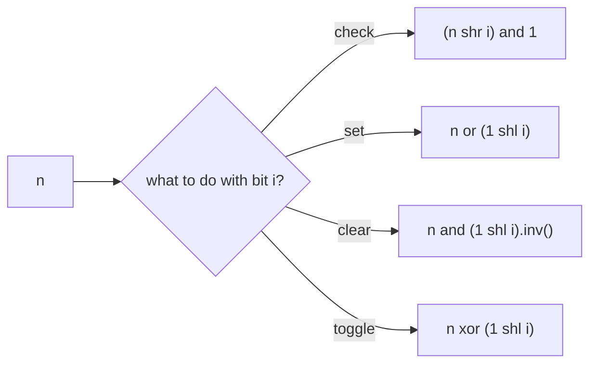

# Check, Set, Clear and Toggle a Bit

> Four one-line operations on bit `i` of a number. Everything else in bit manipulation is built from them.

#### 1. What Is It?

Bit positions count from the **right**, starting at `0`. For `n = 10 = 1010`:

```text
position:  3 2 1 0
bits:      1 0 1 0
```

Make a **mask** with only bit `i` set: `1 shl i`. Combine it with `n`:

| Operation | Formula | Why |
|---|---|---|
| **Check** bit `i` | `(n shr i) and 1` or `(n and (1 shl i)) != 0` | `and` keeps only bit `i` |
| **Set** bit `i` to 1 | `n or (1 shl i)` | `or` with a 1 forces 1 |
| **Clear** bit `i` to 0 | `n and (1 shl i).inv()` | `and` with a 0 forces 0 |
| **Toggle** bit `i` | `n xor (1 shl i)` | `xor` with a 1 flips |
| **Write** bit `i` = `v` (0 or 1) | `(n and (1 shl i).inv()) or (v shl i)` | clear, then set |

**Signals:** "set the ith bit", "is the bit on", flags and permissions, "turn on/off", building a mask, "get bits from `a` to `b`".

#### 2. How It Works

`n = 10 = 1010`, `i = 1`, mask `1 shl 1 = 0010`:

```text
check:   1010 and 0010 = 0010 ≠ 0     → bit 1 is ON
set 0:   1010 or  0001 = 1011 = 11
clear 1: 1010 and 1101 = 1000 = 8      (mask.inv() = ...11111101)
toggle 2:1010 xor 0100 = 1110 = 14
```



**Useful masks**

| Goal | Expression |
|---|---|
| Lowest `k` bits set | `(1 shl k) - 1` |
| Keep the lowest `k` bits of `n` | `n and ((1 shl k) - 1)` |
| Clear the lowest `k` bits | `n and ((1 shl k) - 1).inv()` |
| Bits `from` to `from + len − 1` | `(n shr from) and ((1 shl len) - 1)` |
| Clear the lowest set bit | `n and (n - 1)` |
| Isolate the lowest set bit | `n and -n` |

**Flags example.** Permissions: `READ = 1`, `WRITE = 2`, `EXEC = 4`. `perm = READ or EXEC = 5`. Has write? `(perm and WRITE) != 0` → false. Remove exec: `perm and EXEC.inv() = 1`.

#### 3. Brute Force vs Optimized

| Task | Without bits | With bits |
|---|---|---|
| Store 3 flags | 3 `Boolean`s | one `Int` |
| Check the ith digit in binary | convert to a string, index it | `(n shr i) and 1` |
| Clear the lowest set bit | loop to find it | `n and (n - 1)` |
| Check a bit in a `BooleanArray` of a set | array lookup | shift and mask, same `O(1)`, 32× less memory |

```kotlin
// Slow way: through a string
fun bitViaString(n: Int, i: Int): Int {
    val s = Integer.toBinaryString(n).reversed()
    return if (i < s.length && s[i] == '1') 1 else 0
}
```

#### 4. Kotlin Code

```kotlin
fun isBitSet(n: Int, i: Int): Boolean = ((n shr i) and 1) == 1
fun setBit(n: Int, i: Int): Int = n or (1 shl i)
fun clearBit(n: Int, i: Int): Int = n and (1 shl i).inv()
fun toggleBit(n: Int, i: Int): Int = n xor (1 shl i)
fun writeBit(n: Int, i: Int, v: Int): Int = (n and (1 shl i).inv()) or (v shl i)

// Extract `len` bits starting at position `from`
fun getBits(n: Int, from: Int, len: Int): Int = (n shr from) and ((1 shl len) - 1)

// Binary Gap (LeetCode 868): largest distance between two adjacent 1 bits
fun binaryGap(n: Int): Int {
    var last = -1
    var best = 0
    for (i in 0 until 32) {
        if (((n shr i) and 1) == 1) {
            if (last != -1) best = maxOf(best, i - last)
            last = i
        }
    }
    return best
}

// Permission flags
const val READ = 1
const val WRITE = 2
const val EXEC = 4
fun hasPermission(perm: Int, flag: Int): Boolean = (perm and flag) != 0
```

Checks (`n = 10`): `isBitSet(10, 1)` → `true`; `isBitSet(10, 0)` → `false`. `setBit(10, 0)` → `11`. `clearBit(10, 1)` → `8`. `toggleBit(10, 2)` → `14`; `toggleBit(10, 3)` → `2`. `writeBit(10, 0, 1)` → `11`; `writeBit(10, 1, 0)` → `8`. `getBits(0b110110, 1, 3)` → `3`. `binaryGap(22)` → `2`; `binaryGap(8)` → `0`; `binaryGap(5)` → `2`. `hasPermission(READ or EXEC, WRITE)` → `false`; `(READ or EXEC) and EXEC.inv()` → `1`. `bitViaString(10, 1)` → `1`.

#### 5. Complexity

| | Time | Space |
|---|---|---|
| Check / set / clear / toggle | `O(1)` | `O(1)` |
| Scan all bits (`binaryGap`) | `O(32)` | `O(1)` |

#### 6. Common Mistakes

1. **Counting positions from the left.** Bit 0 is the least significant bit (right).
2. **Forgetting `.inv()` when clearing** (`n and (1 shl i)` keeps only that bit).
3. **Operator precedence:** Kotlin infix calls group left to right, so `n or 1 shl i` is `(n or 1) shl i`, which is wrong. Write `n or (1 shl i)`.
4. **Shifting by `i ≥ 32`** on an `Int`.
5. **Treating the sign bit** (bit 31) as ordinary: `1 shl 31` is negative.
6. **Using `n shr i == 1`** to test a bit (it checks the whole shifted value, not just the last bit). Always `and 1`.
7. **Using `Int` flags for more than 31 items.** Use `Long`.

#### 7. Say This in the Interview

1. "To test bit `i` I shift it down and mask with 1. To set it I `or` with `1 shl i`, to clear I `and` with the inverted mask, and to toggle I `xor`."
2. "`n and (n − 1)` clears the lowest set bit, and `n and -n` isolates it."
3. "I'll store the flags in one `Int`: `O(1)` memory and `O(1)` operations."

#### 8. Quick Check

1. Set bit 3 of `0`?
2. Clear bit 0 of `7`?
3. What does `n and (n − 1)` do?

<details>
<summary>Answers</summary>

1. `0 or (1 shl 3) = 8`.
2. `7 and 1.inv() = 6`.
3. It clears the lowest set bit.

</details>

#### 9. Related LeetCode Questions

| # | Question | Idea |
|---|---|---|
| 191 | [Number of 1 Bits](https://leetcode.com/problems/number-of-1-bits/) (Easy) | check each bit |
| 868 | [Binary Gap](https://leetcode.com/problems/binary-gap/) (Easy) | scan bits |
| 476 | [Number Complement](https://leetcode.com/problems/number-complement/) (Easy) | toggle with a mask |
| 190 | [Reverse Bits](https://leetcode.com/problems/reverse-bits/) (Easy) | read and write bits |
| 405 | [Convert a Number to Hexadecimal](https://leetcode.com/problems/convert-a-number-to-hexadecimal/) (Easy) | extract 4 bits at a time |
| 342 | [Power of Four](https://leetcode.com/problems/power-of-four/) (Easy) | mask of even positions |
