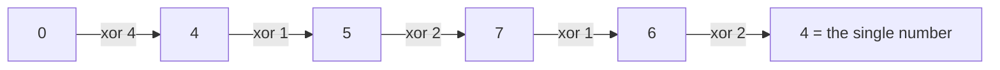

# XOR Tricks: Single Number and Cancelling Pairs

> XOR cancels equal values: `a xor a = 0`. XOR a whole array and everything that appears twice vanishes, leaving the one that does not.

#### 1. What Is It?

**XOR properties**

| Property | Meaning |
|---|---|
| `a xor a = 0` | a value cancels itself |
| `a xor 0 = a` | zero changes nothing |
| `a xor b = b xor a` | order does not matter |
| `(a xor b) xor c = a xor (b xor c)` | grouping does not matter |

So the XOR of a list is the same in any order, and every value that appears an even number of times disappears.

**Signals:** "every element appears twice except one", "find the missing / extra number", "without extra space", `O(1)` space and `O(n)` time, "find the difference between two strings".

#### 2. How It Works

`[4, 1, 2, 1, 2]`:

```text
0 xor 4 = 4
4 xor 1 = 5
5 xor 2 = 7
7 xor 1 = 6
6 xor 2 = 4        ← the 1s and 2s cancelled; 4 is left
```



**Common patterns**

| Problem | Trick |
|---|---|
| Single Number (others twice) | XOR all values |
| Missing Number in `0..n` | XOR all indexes `0..n` with all values |
| Find the Difference (string `t` = `s` + one letter) | XOR all characters of both |
| Two single numbers (others twice) | XOR all → `a xor b`; split by one differing bit (note 10) |
| XOR of `1..n` | pattern by `n % 4` (below) |
| Subarray XOR | prefix XOR: `xor(l..r) = prefix[r+1] xor prefix[l]` |

**XOR of `0..n` in `O(1)`**

| `n % 4` | `0 xor 1 xor ... xor n` |
|---|---|
| 0 | `n` |
| 1 | `1` |
| 2 | `n + 1` |
| 3 | `0` |

Check: `1 xor 2 xor 3 xor 4 xor 5 = 1` (5 % 4 = 1) ✓.

**Swap without a temporary variable** (a trick to recognise, not to use):

```text
a = a xor b;  b = a xor b;  a = a xor b
```

It fails when both names refer to the same memory location (`a xor a = 0`), and a temp is clearer.

#### 3. Brute Force vs Optimized

| Problem | Brute force | XOR |
|---|---|---|
| Single Number | `HashMap` counts `O(n)` time, `O(n)` space | `O(n)` time, `O(1)` space |
| Single Number | sort and compare neighbours `O(n log n)` | `O(n)` |
| Missing Number | `HashSet`, or sum formula | XOR (no overflow) |
| Find the Difference | count letters `O(n)`, `O(1)` space | XOR, no table |

```kotlin
// Brute force: count with a map
fun singleNumberMap(nums: IntArray): Int {
    val count = HashMap<Int, Int>()
    for (x in nums) count[x] = (count[x] ?: 0) + 1
    return count.entries.first { it.value == 1 }.key
}
```

#### 4. Kotlin Code

```kotlin
// Single Number (LeetCode 136)
fun singleNumber(nums: IntArray): Int {
    var result = 0
    for (x in nums) result = result xor x
    return result
}

// Missing Number (LeetCode 268): numbers 0..n with one missing
fun missingNumber(nums: IntArray): Int {
    var result = nums.size                              // start with n
    for (i in nums.indices) result = result xor i xor nums[i]
    return result
}

// Find the Difference (LeetCode 389)
fun findTheDifference(s: String, t: String): Char {
    var x = 0
    for (c in s) x = x xor c.code
    for (c in t) x = x xor c.code
    return x.toChar()
}

// XOR of 0..n in O(1)
fun xorUpTo(n: Int): Int = when (n % 4) {
    0 -> n
    1 -> 1
    2 -> n + 1
    else -> 0
}

// XOR Queries of a Subarray (LeetCode 1310): prefix XOR
fun xorQueries(arr: IntArray, queries: Array<IntArray>): IntArray {
    val prefix = IntArray(arr.size + 1)
    for (i in arr.indices) prefix[i + 1] = prefix[i] xor arr[i]
    return IntArray(queries.size) { prefix[queries[it][1] + 1] xor prefix[queries[it][0]] }
}

// Swap two array elements with XOR (only when i != j)
fun swapXor(a: IntArray, i: Int, j: Int) {
    if (i == j) return
    a[i] = a[i] xor a[j]
    a[j] = a[i] xor a[j]
    a[i] = a[i] xor a[j]
}
```

Checks: `singleNumber(intArrayOf(4, 1, 2, 1, 2))` → `4`; `(intArrayOf(2, 2, 1))` → `1`; `(intArrayOf(7))` → `7`. `singleNumberMap(intArrayOf(4, 1, 2, 1, 2))` → `4`. `missingNumber(intArrayOf(3, 0, 1))` → `2`; `(intArrayOf(0, 1))` → `2`; `(intArrayOf(9, 6, 4, 2, 3, 5, 7, 0, 1))` → `8`. `findTheDifference("abcd", "abcde")` → `'e'`; `("", "y")` → `'y'`. `xorUpTo(5)` → `1`; `xorUpTo(6)` → `7`; `xorUpTo(7)` → `0`; `xorUpTo(8)` → `8`. `xorQueries(intArrayOf(1, 3, 4, 8), arrayOf(intArrayOf(0, 1), intArrayOf(1, 2), intArrayOf(0, 3), intArrayOf(3, 3)))` → `[2, 7, 14, 8]`. `swapXor` on `[3, 5]` indexes `0, 1` → `[5, 3]`.

#### 5. Complexity

| | Time | Space |
|---|---|---|
| Single Number, Missing Number, Find the Difference | `O(n)` | `O(1)` |
| `xorUpTo` | `O(1)` | `O(1)` |
| `xorQueries` | `O(n + q)` | `O(n)` |

#### 6. Common Mistakes

1. **Using XOR when values may appear an odd number of times other than once** (it only cancels pairs). Use bit counting (note 10).
2. **Starting with `n` for Missing Number** forgotten (the index `n` has no matching element).
3. **XOR swap with `i == j`** zeroes the value.
4. **Using `+`/sum for Missing Number** and overflowing for huge `n`.
5. **Assuming the XOR of all values** identifies the answer when there are *two* singles (it gives `a xor b`).
6. **Converting the XOR result back** wrongly (`x.toChar()` for characters).

#### 7. Say This in the Interview

1. "XOR is its own inverse, so paired numbers cancel and the unpaired one remains: `O(n)` time and `O(1)` space with no hash map."
2. "For the missing number I XOR every index and every value together; everything cancels except the missing number."
3. "XOR of a range is a difference of prefix XORs, like prefix sums."

#### 8. Quick Check

1. `7 xor 7 xor 3`?
2. Why start `missingNumber` with `nums.size`?
3. Does XOR work if every number appears 3 times except one?

<details>
<summary>Answers</summary>

1. `3`.
2. The indexes run `0..n−1` but the values are from `0..n`; the extra `n` accounts for the top value.
3. No. Three equal values XOR to the value itself. Count bits modulo 3 instead (note 10).

</details>

#### 9. Related LeetCode Questions

| # | Question | Idea |
|---|---|---|
| 136 | [Single Number](https://leetcode.com/problems/single-number/) (Easy) | XOR all |
| 268 | [Missing Number](https://leetcode.com/problems/missing-number/) (Easy) | XOR indexes and values |
| 389 | [Find the Difference](https://leetcode.com/problems/find-the-difference/) (Easy) | XOR characters |
| 1310 | [XOR Queries of a Subarray](https://leetcode.com/problems/xor-queries-of-a-subarray/) (Medium) | prefix XOR |
| 260 | [Single Number III](https://leetcode.com/problems/single-number-iii/) (Medium) | split by one bit |
| 137 | [Single Number II](https://leetcode.com/problems/single-number-ii/) (Medium) | bits mod 3 |
