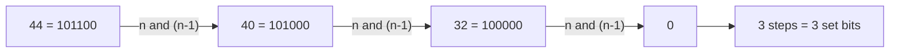

# Counting Set Bits: bitCount and Brian Kernighan's Trick

> Count how many bits in a number are `1` (the "population count" or Hamming weight). Brian Kernighan's trick does it in one loop step per set bit.

#### 1. What Is It?

`popcount(n)` = number of `1` bits in `n`. For `n = 44 = 101100`, the answer is `3`.

| Method | Time | Notes |
|---|---|---|
| Check all 32 bits | `O(32)` | simple |
| **Kernighan: `n = n and (n − 1)`** | `O(k)`, `k` = number of set bits | clears the lowest set bit each step |
| Lookup table (e.g. 8 bits at a time) | `O(4)` | precomputed table |
| Built-in `n.countOneBits()` | `O(1)` | hardware instruction; use it in real code |
| DP for `0..n` | `O(n)` total | `bits[i] = bits[i shr 1] + (i and 1)` |

**Signals:** "number of 1 bits", "Hamming weight / distance", "count bits for every number up to `n`", "parity of a number", "number of subsets", bitmask DP sizes.

#### 2. How It Works

**Why `n and (n − 1)` clears the lowest set bit.** Subtracting 1 flips the lowest `1` to `0` and all the zeros below it to `1`. AND-ing with the original wipes out exactly that bit.

```text
n     = 101100   (44)
n - 1 = 101011
n&n-1 = 101000   (40)     lowest set bit gone
```



**Counting bits for all numbers `0..n` (DP).** The count of `i` is the count of `i / 2` plus its last bit:

```text
bits[i] = bits[i shr 1] + (i and 1)
i:     0 1 2 3 4 5
bits:  0 1 1 2 1 2
```

Alternative: `bits[i] = bits[i and (i − 1)] + 1` (clear the lowest bit, add one).

**Total Hamming distance trick.** Do not compare every pair (`O(n²)`). For each bit position, if `ones` numbers have a 1 there and `n − ones` have a 0, that bit contributes `ones × (n − ones)` pairs.

#### 3. Brute Force vs Optimized

| Task | Brute force | Optimized |
|---|---|---|
| Count bits of one number | check 32 positions `O(32)` | Kernighan `O(k)`, or `countOneBits()` `O(1)` |
| Counting Bits for `0..n` | popcount each `O(n · 32)` | DP `O(n)` |
| Total Hamming Distance | all pairs `O(n² · 32)` | per bit `ones × zeros`: `O(32 n)` |
| Parity of a number | count then `% 2` | `countOneBits() and 1` |

```kotlin
// Brute force: test all 32 positions
fun popcountLoop(n: Int): Int {
    var count = 0
    for (i in 0 until 32) if (((n shr i) and 1) == 1) count++
    return count
}
```

#### 4. Kotlin Code

```kotlin
// Number of 1 Bits (LeetCode 191): Kernighan
fun hammingWeight(n: Int): Int {
    var x = n
    var count = 0
    while (x != 0) {
        x = x and (x - 1)                    // drop the lowest set bit
        count++
    }
    return count
}

// Built-in
fun popcount(n: Int): Int = n.countOneBits()

// Counting Bits (LeetCode 338): DP
fun countBits(n: Int): IntArray {
    val bits = IntArray(n + 1)
    for (i in 1..n) bits[i] = bits[i shr 1] + (i and 1)
    return bits
}

// Total Hamming Distance (LeetCode 477): per-bit counting
fun totalHammingDistance(nums: IntArray): Int {
    var total = 0
    for (bit in 0 until 32) {
        var ones = 0
        for (x in nums) ones += (x shr bit) and 1
        total += ones * (nums.size - ones)
    }
    return total
}

// Parity: true if the number of set bits is odd
fun hasOddParity(n: Int): Boolean = (n.countOneBits() and 1) == 1
```

Checks: `hammingWeight(11)` → `3`; `hammingWeight(128)` → `1`; `hammingWeight(0)` → `0`; `hammingWeight(-1)` → `32` (all bits set; the loop ends because `x` reaches 0 after 32 steps). `popcountLoop(44)` → `3`; `popcount(44)` → `3`; `popcount(2147483645)` → `30`. `countBits(5)` → `[0, 1, 1, 2, 1, 2]`; `countBits(0)` → `[0]`. `totalHammingDistance(intArrayOf(4, 14, 2))` → `6`; `(intArrayOf(4, 14, 4))` → `4`. `hasOddParity(7)` → `true`; `hasOddParity(3)` → `false`.

#### 5. Complexity

| | Time | Space |
|---|---|---|
| Kernighan | `O(k)`, at most 32 | `O(1)` |
| `countBits(n)` DP | `O(n)` | `O(n)` output |
| `totalHammingDistance` | `O(32 · n)` | `O(1)` |

#### 6. Common Mistakes

1. **`while (x > 0)`** instead of `x != 0` (loses negative numbers, whose sign bit is set).
2. **Using `shr` in a loop for negatives**: it never reaches 0 (it fills with 1s). Use `ushr`, or Kernighan.
3. **Comparing all pairs** for Hamming distance totals.
4. **`bits[i / 2]`** is fine, but `i and (i − 1)` needs `i ≥ 1`.
5. **Off-by-one in the DP array size** (`n + 1`).
6. **Forgetting that `countOneBits()` exists** and writing a loop in simple cases (fine in an interview if asked; mention the built-in).

#### 7. Say This in the Interview

1. "Each `n and (n − 1)` removes the lowest set bit, so the loop runs once per set bit: `O(k)`, at most 32."
2. "For counts of every number up to `n` I reuse the answer for `i shr 1`: `O(n)` total."
3. "For the total Hamming distance I count per bit position: `ones × zeros` pairs differ there. That's `O(32 n)` instead of `O(n²)`."
4. "In production I'd call `countOneBits()`, which compiles to a single CPU instruction."

#### 8. Quick Check

1. Steps Kernighan takes for `0b1011`?
2. `bits[6]`?
3. Why does the loop with `x != 0` work for `-1`?

<details>
<summary>Answers</summary>

1. 3 (one per set bit).
2. `bits[3] + 0 = 2` (6 = 110).
3. `-1` has 32 set bits; each step clears one, so after 32 steps `x == 0`.

</details>

#### 9. Related LeetCode Questions

| # | Question | Idea |
|---|---|---|
| 191 | [Number of 1 Bits](https://leetcode.com/problems/number-of-1-bits/) (Easy) | Kernighan |
| 338 | [Counting Bits](https://leetcode.com/problems/counting-bits/) (Easy) | DP on `i shr 1` |
| 461 | [Hamming Distance](https://leetcode.com/problems/hamming-distance/) (Easy) | `xor` + popcount |
| 477 | [Total Hamming Distance](https://leetcode.com/problems/total-hamming-distance/) (Medium) | per-bit counting |
| 762 | [Prime Number of Set Bits in Binary Representation](https://leetcode.com/problems/prime-number-of-set-bits-in-binary-representation/) (Easy) | popcount in a range |
| 1356 | [Sort Integers by The Number of 1 Bits](https://leetcode.com/problems/sort-integers-by-the-number-of-1-bits/) (Easy) | custom sort key |
