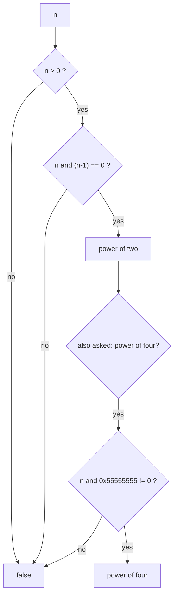

# Power-of-Two Check

> A positive number is a power of two exactly when it has **one** set bit. Then `n and (n − 1) == 0`.

#### 1. What Is It?

Powers of two in binary:

```text
1  = 0001
2  = 0010
4  = 0100
8  = 1000
```

Each has a single `1`. So the test is: `n > 0` and clearing the lowest set bit leaves nothing.

| Question | Test |
|---|---|
| Is `n` a power of 2? | `n > 0 && (n and (n − 1)) == 0` |
| Is `n` a power of 4? | power of 2 **and** the bit is at an even position: `(n and 0x55555555) != 0` |
| Is `n` a power of 3? | no bit trick; divide repeatedly, or `1162261467 % n == 0` for 32-bit `Int` |
| Smallest power of 2 `≥ n` | `Integer.highestOneBit(n − 1) shl 1` (for `n > 1`) |
| Is `n` a power of 2 (alt.) | `(n and -n) == n` |

**Signals:** "power of two", "round up to the next power of two" (hash table sizes, buffers), "only one bit set", "bit position".

#### 2. How It Works

**Why `n and (n − 1) == 0`.**

```text
n = 8:  1000
n−1:    0111
and:    0000   → power of two

n = 6:  0110
n−1:    0101
and:    0100   → not zero → not a power of two
```

**Why `n > 0` is needed.** `0 and -1 == 0`, so `0` would wrongly pass. Negative numbers: `Int.MIN_VALUE = 1000...0` has one set bit, so `MIN and (MIN − 1)` is `0`. Hence the `n > 0` check.

**Power of four.** Powers of 4 have their one bit at positions 0, 2, 4, ... The mask `0x55555555 = 0101 0101 ... 0101` has 1s exactly at the even positions.

```text
n = 16 = 10000   (position 4, even)  and 0x55555555 ≠ 0  → power of 4
n = 8  =  1000   (position 3, odd)   and 0x55555555 = 0  → not
```



**Round up to the next power of two.** Let `m = n − 1`. Its highest set bit, shifted left once, is the next power of two. (`n = 5`: `m = 4 = 100`, highest `100`, shifted `1000 = 8`.) Special-case `n ≤ 1` → `1`.

#### 3. Brute Force vs Optimized

| Approach | Time |
|---|---|
| Loop: divide by 2 while even | `O(log n)` |
| Loop: multiply `p *= 2` until `p ≥ n` | `O(log n)` |
| **Bit test** `n and (n − 1) == 0` | `O(1)` |
| Count set bits `== 1` | `O(1)` with `countOneBits()` |

```kotlin
// Brute force: keep dividing by 2
fun isPowerOfTwoLoop(n: Int): Boolean {
    if (n <= 0) return false
    var x = n
    while (x % 2 == 0) x /= 2
    return x == 1
}
```

#### 4. Kotlin Code

```kotlin
// Power of Two (LeetCode 231)
fun isPowerOfTwo(n: Int): Boolean = n > 0 && (n and (n - 1)) == 0

// Alternative: exactly one set bit
fun isPowerOfTwoCount(n: Int): Boolean = n > 0 && n.countOneBits() == 1

// Power of Four (LeetCode 342)
fun isPowerOfFour(n: Int): Boolean = n > 0 && (n and (n - 1)) == 0 && (n and 0x55555555) != 0

// Power of Three (LeetCode 326): 3^19 = 1162261467 is the largest power of 3 in an Int
fun isPowerOfThree(n: Int): Boolean = n > 0 && 1162261467 % n == 0

// Next power of two >= n
fun nextPowerOfTwo(n: Int): Int = if (n <= 1) 1 else Integer.highestOneBit(n - 1) shl 1

// Reordered Power of 2 (LeetCode 869): compare digit multisets
fun reorderedPowerOf2(n: Int): Boolean {
    fun key(x: Int) = x.toString().toCharArray().sorted().joinToString("")
    val target = key(n)
    for (i in 0..30) if (key(1 shl i) == target) return true
    return false
}
```

Checks: `isPowerOfTwo(1)` → `true`; `(16)` → `true`; `(3)` → `false`; `(0)` → `false`; `(-8)` → `false`; `(Int.MIN_VALUE)` → `false`. `isPowerOfTwoLoop(64)` → `true`; `(12)` → `false`. `isPowerOfTwoCount(1024)` → `true`. `isPowerOfFour(16)` → `true`; `(8)` → `false`; `(1)` → `true`; `(5)` → `false`. `isPowerOfThree(27)` → `true`; `(45)` → `false`; `(1)` → `true`; `(0)` → `false`. `nextPowerOfTwo(5)` → `8`; `(8)` → `8`; `(1)` → `1`; `(17)` → `32`; `(0)` → `1`. `reorderedPowerOf2(1)` → `true`; `(10)` → `false`; `(46)` → `true`.

#### 5. Complexity

| | Time | Space |
|---|---|---|
| Bit test | `O(1)` | `O(1)` |
| Loop version | `O(log n)` | `O(1)` |
| `reorderedPowerOf2` | `O(31 · digits)` | `O(digits)` |

#### 6. Common Mistakes

1. **Forgetting `n > 0`** (`0` and `Int.MIN_VALUE` slip through).
2. **Missing parentheses.** Write `(n and (n - 1)) == 0`. It parses the same without them, but the intent is clearer with them.
3. **Power of four with only the mask check** (also true for non-powers like `5`).
4. **Using `Int` for values up to `2^31`** (use `Long`).
5. **`nextPowerOfTwo(0)` or `(1)`** with `highestOneBit(−1)` problems; special-case them.
6. **Using the `1162261467` trick for other bases** (it works because 3 is prime).

#### 7. Say This in the Interview

1. "A power of two has exactly one set bit, so `n and (n − 1)` clears it and gives zero. I also check `n > 0`."
2. "For a power of four I add a mask `0x55555555` that keeps only even bit positions."
3. "Powers of three have no bit trick; I divide, or check that `3^19` is divisible by `n`."

#### 8. Quick Check

1. Is `0` a power of two? What does the bit test say without `n > 0`?
2. `nextPowerOfTwo(33)`?
3. Bit position of 64?

<details>
<summary>Answers</summary>

1. No. Without `n > 0`, `0 and -1 == 0` says yes (wrong).
2. `64`.
3. Position 6 (`2^6`).

</details>

#### 9. Related LeetCode Questions

| # | Question | Idea |
|---|---|---|
| 231 | [Power of Two](https://leetcode.com/problems/power-of-two/) (Easy) | `n and (n − 1)` |
| 342 | [Power of Four](https://leetcode.com/problems/power-of-four/) (Easy) | mask `0x55555555` |
| 326 | [Power of Three](https://leetcode.com/problems/power-of-three/) (Easy) | divisibility |
| 869 | [Reordered Power of 2](https://leetcode.com/problems/reordered-power-of-2/) (Medium) | digit multiset |
| 191 | [Number of 1 Bits](https://leetcode.com/problems/number-of-1-bits/) (Easy) | one set bit |
