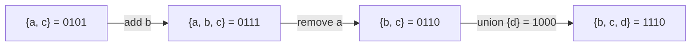

# Bitmask: Representing a Set of Up to ~20 Items

> Use the bits of one integer as a set: bit `i` is `1` if item `i` is in the set. Union, intersection and membership become single operations, and a set becomes a number you can use as an array index or a map key.

#### 1. What Is It?

With `n ≤ 31` items (use `Long` up to 63), a whole subset fits in one `Int`.

| Set operation | Bitmask |
|---|---|
| Empty set | `0` |
| Full set of `n` items | `(1 shl n) - 1` |
| Add item `i` | `mask or (1 shl i)` |
| Remove item `i` | `mask and (1 shl i).inv()` |
| Toggle item `i` | `mask xor (1 shl i)` |
| Contains `i`? | `((mask shr i) and 1) == 1` |
| Union | `a or b` |
| Intersection | `a and b` |
| Difference `a − b` | `a and b.inv()` |
| Complement within `n` items | `full xor mask` |
| Size of the set | `mask.countOneBits()` |
| Is `a` a subset of `b`? | `(a and b) == a` |
| Disjoint? | `(a and b) == 0` |

**Why only ~20 items?** When you enumerate *all subsets*, there are `2ⁿ` of them. `2²⁰ ≈ 10⁶` is fine; `2³⁰ ≈ 10⁹` is not. So the pattern appears when `n ≤ 15–20` in the constraints.

**Signals:** constraints say `n ≤ 15` / `16` / `20`, "visited set of cities", "which letters are used", "assign tasks to workers", "minimum / maximum over all subsets", "can we partition into k groups", "unique characters".

#### 2. How It Works

Items `a=0, b=1, c=2, d=3`. The set `{a, c}`:

```text
bit:   3 2 1 0
item:  d c b a
mask:  0 1 0 1   = 5
```



**Masks as keys.** Because a mask is an integer, `dp[mask]` or `memo[mask]` stores an answer per subset. This is **bitmask DP** (names and use: `5` Dynamic Programming note 12). The visited set in a Travelling Salesman search is exactly a mask.

**Letters.** For lowercase letters, `1 shl (c - 'a')` gives one bit per letter, so a word becomes a 26-bit mask. Two words share no letter if `maskA and maskB == 0`.

**Backtracking with a mask.** Instead of a `used` array and undoing, pass `used or bit` into the recursive call. The caller's mask is unchanged, so there is nothing to undo.

#### 3. Brute Force vs Optimized

| Task | Without masks | With masks |
|---|---|---|
| Visited set in a search over subsets | `HashSet<Set<Int>>` (slow, big) | `BooleanArray(1 shl n)` |
| Two words share a letter? | compare 26 letters or build sets `O(26)` | `maskA and maskB != 0`, `O(1)` |
| Count items in a set | loop over the set | `countOneBits()` |
| Memoize on the set of used items | map keyed by a collection | `IntArray(1 shl n)` |

```kotlin
// Brute force: letters of a word as a Set<Char>
fun shareLetterSets(a: String, b: String): Boolean = a.toSet().intersect(b.toSet()).isNotEmpty()
```

#### 4. Kotlin Code

```kotlin
// Mask of lowercase letters in a word, or -1 if a letter repeats
fun letterMask(word: String): Int {
    var m = 0
    for (c in word) {
        val bit = 1 shl (c - 'a')
        if ((m and bit) != 0) return -1                 // duplicate letter
        m = m or bit
    }
    return m
}

fun shareLetter(a: String, b: String): Boolean {
    var ma = 0
    for (c in a) ma = ma or (1 shl (c - 'a'))
    var mb = 0
    for (c in b) mb = mb or (1 shl (c - 'a'))
    return (ma and mb) != 0
}

// Set helpers
fun contains(mask: Int, i: Int): Boolean = ((mask shr i) and 1) == 1
fun add(mask: Int, i: Int): Int = mask or (1 shl i)
fun remove(mask: Int, i: Int): Int = mask and (1 shl i).inv()
fun isSubset(a: Int, b: Int): Boolean = (a and b) == a
fun fullMask(n: Int): Int = (1 shl n) - 1

// Maximum Length of a Concatenated String with Unique Characters (LeetCode 1239)
fun maxLength(arr: List<String>): Int {
    val items = ArrayList<Pair<Int, Int>>()                 // (mask, length) of words with unique letters
    for (w in arr) {
        val m = letterMask(w)
        if (m != -1) items.add(m to w.length)
    }
    var best = 0
    fun go(from: Int, used: Int, len: Int) {
        best = maxOf(best, len)
        for (j in from until items.size) {
            val (m, l) = items[j]
            if ((used and m) == 0) go(j + 1, used or m, len + l)   // no letter overlap: take it
        }
    }
    go(0, 0, 0)
    return best
}

// Maximum Product of Word Lengths (LeetCode 318): words with no common letter
fun maxProductWords(words: Array<String>): Int {
    val masks = IntArray(words.size) { i ->
        var m = 0
        for (c in words[i]) m = m or (1 shl (c - 'a'))
        m
    }
    var best = 0
    for (i in words.indices) for (j in i + 1 until words.size) {
        if ((masks[i] and masks[j]) == 0) best = maxOf(best, words[i].length * words[j].length)
    }
    return best
}

// Is Unique: does a string of lowercase letters have all distinct characters?
fun hasAllUnique(s: String): Boolean = letterMask(s) != -1
```

Checks: `letterMask("abc")` → `7`; `letterMask("aa")` → `-1`. `shareLetter("abc", "cde")` → `true`; `("abc", "xyz")` → `false`; `shareLetterSets("abc", "cde")` → `true`. `contains(5, 0)` → `true`; `contains(5, 1)` → `false`. `add(5, 1)` → `7`. `remove(5, 0)` → `4`. `isSubset(0b0101, 0b1101)` → `true`; `(0b0111, 0b0101)` → `false`. `fullMask(4)` → `15`. `maxLength(listOf("un", "iq", "ue"))` → `4`; `(listOf("cha", "r", "act", "ers"))` → `6`; `(listOf("abcdefghijklmnopqrstuvwxyz"))` → `26`. `hasAllUnique("abcd")` → `true`; `("hello")` → `false`. `maxProductWords(arrayOf("abcw", "baz", "foo", "bar", "xtfn", "abcdef"))` → `16`; `(arrayOf("a", "ab", "abc", "d", "cd", "bcd", "abcd"))` → `4`; `(arrayOf("a", "aa", "aaa", "aaaa"))` → `0`.

#### 5. Complexity

| | Time | Space |
|---|---|---|
| Any set operation | `O(1)` | `O(1)` |
| Enumerate all subsets | `O(2ⁿ)` | |
| `dp` over masks | `O(2ⁿ · n)` typical | `O(2ⁿ)` |
| `maxLength` | `O(2^words)` worst | `O(words)` |

#### 6. Common Mistakes

1. **`1 shl n` with `n ≥ 31`** on an `Int` (overflow). Use `Long`, or reduce `n`.
2. **Forgetting parentheses** around `mask and bit` before comparing.
3. **Mixing 0-based and 1-based item numbering.**
4. **Allocating `IntArray(1 shl n)` with big `n`** (memory).
5. **Mutating a shared mask** in backtracking instead of passing `used or bit` down.
6. **Complement without limiting to `n` bits**: `mask.inv()` flips all 32 bits. Use `full xor mask`.
7. **Assuming a bitmask is always better.** If `n` is large, use a `HashSet`.

#### 7. Say This in the Interview

1. "`n` is at most 16, so I can represent a subset as a bitmask and use it as a DP index. There are `2ⁿ` states."
2. "Two words share a letter exactly when their letter masks have a non-zero AND: `O(1)` instead of comparing letters."
3. "I pass `used or bit` into the recursion, so there is no state to undo."

#### 8. Quick Check

1. Mask of `{0, 2, 3}`?
2. Union of masks `0110` and `0011`?
3. Why must `n` be small for subset enumeration?

<details>
<summary>Answers</summary>

1. `1 + 4 + 8 = 13` (`1101`).
2. `0111`.
3. There are `2ⁿ` subsets; `n = 30` is already a billion.

</details>

#### 9. Related LeetCode Questions

| # | Question | Idea |
|---|---|---|
| 1239 | [Maximum Length of a Concatenated String with Unique Characters](https://leetcode.com/problems/maximum-length-of-a-concatenated-string-with-unique-characters/) (Medium) | letter masks |
| 318 | [Maximum Product of Word Lengths](https://leetcode.com/problems/maximum-product-of-word-lengths/) (Medium) | letter masks, disjoint test |
| 78 | [Subsets](https://leetcode.com/problems/subsets/) (Medium) | each mask is a subset |
| 526 | [Beautiful Arrangement](https://leetcode.com/problems/beautiful-arrangement/) (Medium) | used-mask DP |
| 464 | [Can I Win](https://leetcode.com/problems/can-i-win/) (Medium) | memo on the used mask |
| 847 | [Shortest Path Visiting All Nodes](https://leetcode.com/problems/shortest-path-visiting-all-nodes/) (Hard) | BFS on (node, visited mask) |
