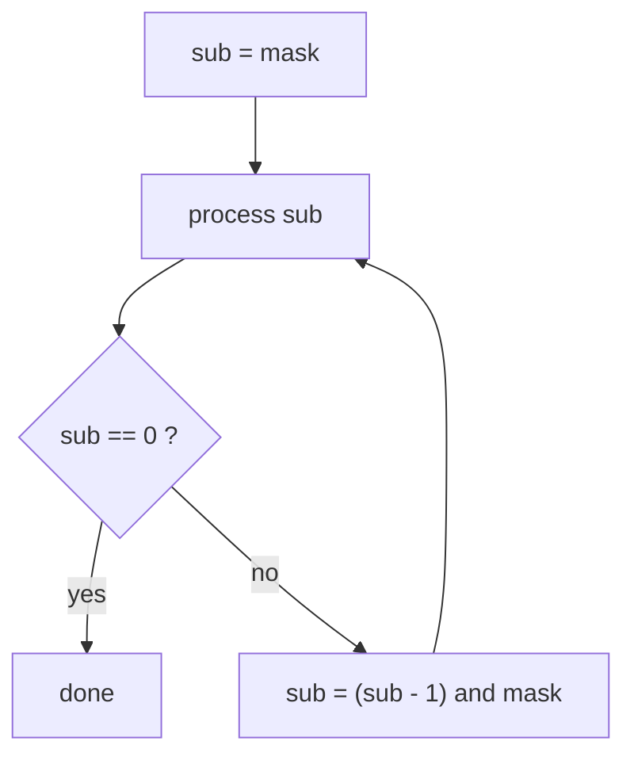

# Iterating All Subsets of a Bitmask

> Count `mask` from `0` to `2ⁿ − 1`: every number is a different subset. To walk the **sub-subsets** of one mask, use `sub = (sub − 1) and mask`.

#### 1. What Is It?

Two loops you should know by heart:

| Goal | Loop | Count |
|---|---|---|
| All subsets of `n` items | `for (mask in 0 until (1 shl n))` | `2ⁿ` |
| All subsets of a given mask | `sub = mask; ...; sub = (sub − 1) and mask` | `2^popcount(mask)` |
| Subsets of every mask | the nested loop above | `3ⁿ` total |
| Subsets of exactly `k` items | masks with `countOneBits() == k` | `C(n, k)` |

**Signals:** "all subsets", `n ≤ 20`, "choose a subset that ...", "split into two groups", "minimum cost over subsets", "partition into `k` groups".

#### 2. How It Works

For items `[a, b, c]` (bit 0 = `a`, bit 1 = `b`, bit 2 = `c`), counting `0..7` lists every subset once:

```text
mask  bits  subset
0     000   {}
1     001   {a}
2     010   {b}
3     011   {a, b}
4     100   {c}
5     101   {a, c}
6     110   {b, c}
7     111   {a, b, c}
```

To **build** the subset for a mask, test each bit `i`: if it is 1, include `items[i]`.

**Submasks of a mask.** `sub = (sub − 1) and mask` jumps to the next smaller subset of `mask`: subtracting 1 would change bits outside `mask`, and the AND removes them.

```text
mask = 0101 (5)
sub = 0101 → (0100 and 0101) = 0100 → (0011 and 0101) = 0001 → (0000) = 0000
submasks: 5, 4, 1, 0
```



**Why `3ⁿ` for all masks and their submasks.** Each item is in one of three states: not in the mask, in the mask but not in the submask, or in both. `3ⁿ` is far smaller than `2ⁿ · 2ⁿ = 4ⁿ`.

**Bitmask vs recursion.** Both enumerate `2ⁿ` subsets. The mask loop is iterative (no stack), and the mask itself is the key for `dp[mask]`. Recursion is easier when you need pruning (backtracking, `6` Backtracking).

#### 3. Brute Force vs Optimized

| Task | Naive | Bitmask |
|---|---|---|
| List all subsets | recursion include / exclude (also `O(n · 2ⁿ)`) | loop over masks, same cost, no stack |
| Count subsets with sum `S` | build each subset and sum it `O(n · 2ⁿ)` | `sum[mask] = sum[mask without lowest bit] + item` → `O(2ⁿ)` |
| Partition into `k` equal-sum groups | try all assignments `O(kⁿ)` | DP over masks `O(2ⁿ · n)` |

```kotlin
// Brute force: recompute the sum of each subset from scratch (O(n · 2^n))
fun countSubsetsBrute(nums: IntArray, target: Int): Int {
    var count = 0
    for (mask in 0 until (1 shl nums.size)) {
        var sum = 0
        for (i in nums.indices) if (((mask shr i) and 1) == 1) sum += nums[i]
        if (sum == target) count++
    }
    return count
}
```

#### 4. Kotlin Code

```kotlin
// Subsets (LeetCode 78) with bitmasks
fun subsets(nums: IntArray): List<List<Int>> {
    val result = ArrayList<List<Int>>()
    for (mask in 0 until (1 shl nums.size)) {
        val subset = ArrayList<Int>()
        for (i in nums.indices) if (((mask shr i) and 1) == 1) subset.add(nums[i])
        result.add(subset)
    }
    return result
}

// All submasks of a mask (including 0)
fun submasks(mask: Int): List<Int> {
    val result = ArrayList<Int>()
    var sub = mask
    while (true) {
        result.add(sub)
        if (sub == 0) break
        sub = (sub - 1) and mask
    }
    return result
}

// Count subsets with a given sum in O(2^n): reuse the sum of the mask without its lowest bit
fun countSubsetsWithSum(nums: IntArray, target: Int): Int {
    val sums = IntArray(1 shl nums.size)
    var count = if (target == 0) 1 else 0              // the empty subset
    for (mask in 1 until sums.size) {
        val low = mask.countTrailingZeroBits()         // index of the lowest set bit
        sums[mask] = sums[mask and (mask - 1)] + nums[low]
        if (sums[mask] == target) count++
    }
    return count
}

// Partition to K Equal Sum Subsets (LeetCode 698): dp[mask] = (sum of chosen items) % target, or -1 if unreachable
fun canPartitionKSubsets(nums: IntArray, k: Int): Boolean {
    val total = nums.sum()
    if (total % k != 0) return false
    val target = total / k
    if (nums.max() > target) return false
    val n = nums.size
    val dp = IntArray(1 shl n) { -1 }
    dp[0] = 0
    for (mask in 0 until (1 shl n)) {
        if (dp[mask] == -1) continue
        for (i in 0 until n) {
            if ((mask and (1 shl i)) == 0 && dp[mask] + nums[i] <= target) {
                dp[mask or (1 shl i)] = (dp[mask] + nums[i]) % target     // start a new group when a group is full
            }
        }
    }
    return dp[(1 shl n) - 1] == 0
}
```

Checks: `subsets(intArrayOf(1, 2, 3))` → `[[], [1], [2], [1, 2], [3], [1, 3], [2, 3], [1, 2, 3]]`. `subsets(intArrayOf())` → `[[]]`. `submasks(5)` → `[5, 4, 1, 0]`; `submasks(6)` → `[6, 4, 2, 0]`; `submasks(0)` → `[0]`. `countSubsetsWithSum(intArrayOf(1, 2, 3, 4), 5)` → `2`; `countSubsetsBrute(intArrayOf(1, 2, 3, 4), 5)` → `2`; `countSubsetsWithSum(intArrayOf(1, 2), 0)` → `1`. `canPartitionKSubsets(intArrayOf(4, 3, 2, 3, 5, 2, 1), 4)` → `true`; `(intArrayOf(1, 2, 3, 4), 3)` → `false`.

#### 5. Complexity

| | Time | Space |
|---|---|---|
| All subsets | `O(n · 2ⁿ)` to build each one | `O(2ⁿ)` for the output |
| `countSubsetsWithSum` | `O(2ⁿ)` | `O(2ⁿ)` |
| Submasks of one mask | `O(2^popcount)` | `O(1)` |
| All masks and submasks | `O(3ⁿ)` | |
| `canPartitionKSubsets` | `O(2ⁿ · n)` | `O(2ⁿ)` |

#### 6. Common Mistakes

1. **`for (mask in 0..(1 shl n))`**: the upper bound must be exclusive (`until`).
2. **Submask loop that stops at `sub == 0` before processing it** (the empty submask is missed, or the loop is infinite if written as `while (sub >= 0)`).
3. **Forgetting the AND with `mask`** (`sub − 1` alone visits unrelated numbers).
4. **`n` too large** (`1 shl 25` is fine for memory but slow with an inner `n` loop).
5. **Using `Int` masks for `n ≥ 31`.**
6. **Recomputing subset sums from scratch** instead of using the lowest-bit recurrence.

#### 7. Say This in the Interview

1. "`n` is at most 16, so I can enumerate every subset as a bitmask from `0` to `2ⁿ − 1`."
2. "I get each mask's sum from the mask without its lowest bit, so all sums cost `O(2ⁿ)` instead of `O(n · 2ⁿ)`."
3. "For partition into `k` equal groups, `dp[mask]` stores the current fill modulo the target. It's `O(2ⁿ · n)` against `O(kⁿ)` for brute force."

#### 8. Quick Check

1. Number of subsets of 5 items?
2. Submasks of `0b110`?
3. Cost of enumerating all submasks of all masks of `n` bits?

<details>
<summary>Answers</summary>

1. `2⁵ = 32`.
2. `110, 100, 010, 000` (6, 4, 2, 0).
3. `O(3ⁿ)`.

</details>

#### 9. Related LeetCode Questions

| # | Question | Idea |
|---|---|---|
| 78 | [Subsets](https://leetcode.com/problems/subsets/) (Medium) | each mask is a subset |
| 698 | [Partition to K Equal Sum Subsets](https://leetcode.com/problems/partition-to-k-equal-sum-subsets/) (Medium) | DP over masks |
| 526 | [Beautiful Arrangement](https://leetcode.com/problems/beautiful-arrangement/) (Medium) | mask of used numbers |
| 1125 | [Smallest Sufficient Team](https://leetcode.com/problems/smallest-sufficient-team/) (Hard) | mask of skills |
| 464 | [Can I Win](https://leetcode.com/problems/can-i-win/) (Medium) | memo over used masks |
| 1986 | [Minimum Number of Work Sessions to Finish the Tasks](https://leetcode.com/problems/minimum-number-of-work-sessions-to-finish-the-tasks/) (Medium) | submask DP |
