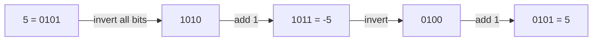

# Two's Complement: Why Negative Numbers Behave the Way They Do

> Computers store negative integers in **two's complement**: to negate a number, invert all bits and add 1. This explains `shr` vs `ushr`, why `n and -n` isolates a bit, and why `Int.MIN_VALUE` is odd.

#### 1. What Is It?

In an `n`-bit signed integer, the top bit has weight `−2^(n−1)`. So a 32-bit `Int` ranges from `−2³¹` to `2³¹ − 1`.

4-bit illustration (range `−8..7`):

| Bits | Value | Bits | Value |
|---|---|---|---|
| `0000` | 0 | `1000` | −8 |
| `0001` | 1 | `1001` | −7 |
| `0010` | 2 | `1010` | −6 |
| `0011` | 3 | `1011` | −5 |
| `0100` | 4 | `1100` | −4 |
| `0101` | 5 | `1101` | −3 |
| `0110` | 6 | `1110` | −2 |
| `0111` | 7 | `1111` | −1 |

**Negate:** `−x = x.inv() + 1`.

```text
 5 = 0101
inv  1010
+1   1011 = −5 ✓
```

**Why this design?** Addition and subtraction use the same hardware as for unsigned numbers, and there is only one zero.

**Signals:** "negative numbers and bit shifts", "unsigned right shift", "Int overflow", "reverse integer", "add without `+`", "hex string of a negative number", "why does `abs(Int.MIN_VALUE)` return a negative number".

#### 2. How It Works



**Consequences**

| Fact | Explanation |
|---|---|
| `shr` keeps the sign | arithmetic shift copies the top bit into the new top bits: `−8 shr 1 = −4` |
| `ushr` fills with 0 | logical shift treats the bits as unsigned: `−1 ushr 28 = 15` |
| `x shr 1` **floors**; `x / 2` **truncates** | `−7 shr 1 = −4`, but `−7 / 2 = −3` |
| `n and -n` = lowest set bit | `−n = ~n + 1`; the +1 carries up to the lowest set bit, so only that bit (and zeros below it) match |
| `Int.MIN_VALUE` has no positive twin | `−Int.MIN_VALUE == Int.MIN_VALUE`, `abs(Int.MIN_VALUE)` is negative |
| Overflow wraps | `Int.MAX_VALUE + 1 == Int.MIN_VALUE` |
| `Byte` is signed | `200.toByte() == −56`; get the unsigned value with `b.toInt() and 0xFF` |
| Hex literals | `0xFF` is `255`; `0xFFFFFFFF` is a **Long** in Kotlin, so use `-1` or `0xFFFFFFFF.toInt()` |

**`n and -n`, worked.**

```text
n  = 12 = 01100
-n =      10100       (invert 10011, add 1)
and      00100 = 4    ← the lowest set bit of 12
```

**Safe midpoint trick.** `(lo + hi) / 2` overflows when `lo + hi > 2³¹ − 1`. `(lo + hi) ushr 1` still gives the right answer for non-negative `lo`, `hi`, because the sum is read as an unsigned 32-bit number. The common form is `lo + (hi − lo) / 2`.

#### 3. Brute Force vs Optimized

| Task | Naive | With two's complement knowledge |
|---|---|---|
| Show the 32-bit pattern of a negative number | string tricks | `Integer.toBinaryString(n)` |
| Lowest set bit | loop over bits | `n and -n` |
| Negate | `0 - n` or `-n` | `n.inv() + 1` (same result; useful to explain) |
| Unsigned byte value | write a custom conversion | `b.toInt() and 0xFF` |
| Safe `(lo + hi) / 2` | cast to `Long` | `(lo + hi) ushr 1` or `lo + (hi − lo) / 2` |

```kotlin
// Slow way to find the lowest set bit
fun lowestSetBitLoop(n: Int): Int {
    for (i in 0 until 32) if (((n shr i) and 1) == 1) return 1 shl i
    return 0
}
```

#### 4. Kotlin Code

```kotlin
fun negate(n: Int): Int = n.inv() + 1                       // same as -n

fun toBinary32(n: Int): String = Integer.toBinaryString(n).padStart(32, '0')

fun lowestSetBit(n: Int): Int = n and -n

fun unsignedByte(b: Byte): Int = b.toInt() and 0xFF

// Midpoint without overflow for non-negative lo, hi
fun midpoint(lo: Int, hi: Int): Int = (lo + hi) ushr 1

// Reverse Integer (LeetCode 7): detect overflow before it happens.
// For inputs inside the Int range this check is enough: the leading digit of a 10-digit input is at most 2.
fun reverseInt(x: Int): Int {
    var n = x
    var result = 0
    while (n != 0) {
        val digit = n % 10
        if (result > Int.MAX_VALUE / 10 || result < Int.MIN_VALUE / 10) return 0
        result = result * 10 + digit
        n /= 10
    }
    return result
}

// Convert a Number to Hexadecimal (LeetCode 405): works for negatives by reading raw bits
fun toHex(num: Int): String {
    if (num == 0) return "0"
    val digits = "0123456789abcdef"
    val sb = StringBuilder()
    var n = num
    while (n != 0) {
        sb.append(digits[n and 0xF])                       // lowest 4 bits
        n = n ushr 4                                       // logical shift so negatives end
    }
    return sb.reverse().toString()
}
```

Checks: `negate(5)` → `-5`; `negate(0)` → `0`; `negate(Int.MIN_VALUE)` → `Int.MIN_VALUE`. `toBinary32(5)` → `"00000000000000000000000000000101"`; `toBinary32(-5)` → `"11111111111111111111111111111011"`. `lowestSetBit(12)` → `4`; `(8)` → `8`; `(0)` → `0`; `lowestSetBitLoop(12)` → `4`. `unsignedByte(-1)` → `255`; `unsignedByte(200.toByte())` → `200`. `midpoint(1_500_000_000, 2_000_000_000)` → `1750000000`, while `(1_500_000_000 + 2_000_000_000) / 2` → a negative number. `-16 shr 2` → `-4`; `-16 ushr 2` → `1073741820`; `-7 shr 1` → `-4`; `-7 / 2` → `-3`. `Int.MAX_VALUE + 1 == Int.MIN_VALUE` → `true`. `Math.abs(Int.MIN_VALUE)` → `-2147483648`. `reverseInt(123)` → `321`; `(-123)` → `-321`; `(120)` → `21`; `(1534236469)` → `0`. `toHex(26)` → `"1a"`; `toHex(-1)` → `"ffffffff"`; `toHex(0)` → `"0"`.

#### 5. Complexity

| | Time | Space |
|---|---|---|
| `negate`, `lowestSetBit`, `midpoint` | `O(1)` | `O(1)` |
| `toHex` | `O(8)` | `O(8)` |
| `reverseInt` | `O(digits)` | `O(1)` |

#### 6. Common Mistakes

1. **Using `shr` on a value you treat as unsigned** (hash codes, bit reversal). Use `ushr`.
2. **Assuming `abs(Int.MIN_VALUE)` is positive.**
3. **`x / 2` vs `x shr 1` for negatives** (truncation vs floor).
4. **Checking overflow after it happened.** Check before the multiply or add, or use `Long`.
5. **`0xFFFFFFFF` as an `Int`** (it is a `Long` literal).
6. **Treating `Byte` values as 0–255.**
7. **Loop `while (n > 0)`** where negatives must also be handled.

#### 7. Say This in the Interview

1. "Negative integers are stored in two's complement: invert the bits and add one. That's why `n and -n` isolates the lowest set bit."
2. "I'll use `ushr` so zeros are shifted in, because the sign bit would otherwise be copied."
3. "`Int.MIN_VALUE` has no positive counterpart, so negating or taking `abs` of it overflows. I handle it up front."

#### 8. Quick Check

1. `−1` in 8 bits?
2. `-1 shr 5` vs `-1 ushr 28`?
3. Why can `Int.MIN_VALUE` not be negated?

<details>
<summary>Answers</summary>

1. `11111111` (invert `00000001` = `11111110`, add 1).
2. `-1` (sign copied) and `15`.
3. `+2³¹` does not fit in a 32-bit signed integer.

</details>

#### 9. Related LeetCode Questions

| # | Question | Idea |
|---|---|---|
| 7 | [Reverse Integer](https://leetcode.com/problems/reverse-integer/) (Medium) | overflow awareness |
| 405 | [Convert a Number to Hexadecimal](https://leetcode.com/problems/convert-a-number-to-hexadecimal/) (Easy) | `ushr` and 4-bit masks |
| 371 | [Sum of Two Integers](https://leetcode.com/problems/sum-of-two-integers/) (Medium) | add with `xor` and carry |
| 190 | [Reverse Bits](https://leetcode.com/problems/reverse-bits/) (Easy) | `ushr` |
| 29 | [Divide Two Integers](https://leetcode.com/problems/divide-two-integers/) (Medium) | shifts and `MIN_VALUE` |
| 1009 | [Complement of Base 10 Integer](https://leetcode.com/problems/complement-of-base-10-integer/) (Easy) | mask + `xor` |
