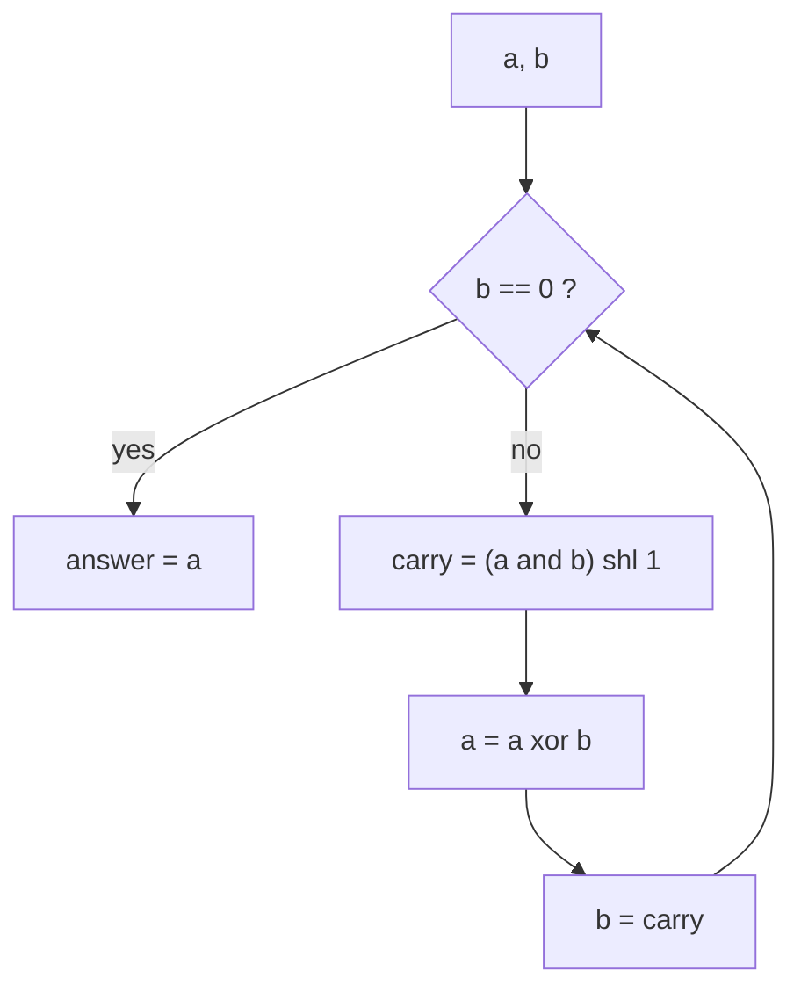

# More Bit Tricks: Reverse Bits, Add Without Plus, Range AND

> A short toolbox of classic bit puzzles. Each one is a small loop built from the basics in notes 01–08.

#### 1. What Is It?

| Trick | Idea | Time |
|---|---|---|
| **Reverse bits** | shift result left, move the lowest bit of `n` in, shift `n` right (`ushr`) | `O(32)` |
| **Add without `+`** | `xor` = sum without carry; `(a and b) shl 1` = carry; repeat | `O(32)` |
| **Range AND** `[left, right]` | the answer is the common binary prefix | `O(32)` |
| **Gray code** | `i xor (i shr 1)` | `O(2ⁿ)` |
| **Alternating bits** | `x = n xor (n shr 1)` is all ones | `O(1)` |
| **Toggle letter case** | `c xor 32` flips between `'a'` and `'A'` | `O(1)` |
| **Same sign?** | `(x xor y) >= 0` | `O(1)` |
| **Divide with shifts** | subtract `divisor shl k` from the largest `k` down | `O(32)` |

**Signals:** "without using `+`/`-`/`*`/`/`", "reverse the bits", "bitwise AND of a range", "32-bit unsigned", "binary representation".

#### 2. How It Works

**Reverse bits.** Build the answer from the lowest bit of `n`:

```text
repeat 32 times:
    result = (result shl 1) or (n and 1)     ← append the lowest bit of n
    n = n ushr 1                              ← drop it
```

**Add two numbers without `+`.** Per bit: `a xor b` is the sum without carry, and `(a and b) shl 1` is the carry. Repeat until no carry remains.

```text
5 + 3:   a=101, b=011
a xor b = 110 (6)    carry = (001) shl 1 = 010 (2)
a=6, b=2: xor = 100 (4)   carry = (010) shl 1 = 100 (4)
a=4, b=4: xor = 000       carry = 1000 (8)
a=0, b=8: xor = 1000 (8)  carry = 0   → 8 ✓
```



It works for negative numbers too, because two's complement addition is the same operation (`getSum(-2, 3) = 1`).

**Range AND `[left, right]`.** Between `left` and `right`, every bit position below the first difference takes both values 0 and 1 somewhere, so it ANDs to 0. Only the **common prefix** survives.

```text
left = 5 = 101, right = 7 = 111
shift both right until equal: 101,111 → 10,11 → 1,1 (2 shifts)
answer = 1 shl 2 = 100 = 4
```

**Gray code.** Consecutive numbers differ by one bit: `i xor (i shr 1)`. For `n = 2`: `0, 1, 3, 2` (`00, 01, 11, 10`).

**Divide using shifts.** Write the quotient in binary. For `k` from 31 down to 0, if `divisor shl k ≤ remaining`, subtract it and set bit `k` of the quotient. Use `Long` to avoid overflow, and handle `Int.MIN_VALUE / −1` separately.

#### 3. Brute Force vs Optimized

| Task | Brute force | Bit trick |
|---|---|---|
| Range AND | AND every number from `left` to `right` `O(right − left)` | common prefix `O(32)` |
| Reverse bits | convert to a string and reverse | shifts, no allocation |
| Divide | subtract repeatedly `O(n/d)` | shift-subtract `O(32)` |
| Gray code | backtracking / reflecting | formula per number |

```kotlin
// Brute force range AND: up to 2^31 iterations in the worst case
fun rangeAndBrute(left: Int, right: Int): Int {
    var result = left
    var i = left.toLong() + 1
    while (i <= right) { result = result and i.toInt(); i++ }
    return result
}
```

#### 4. Kotlin Code

```kotlin
// Reverse Bits (LeetCode 190)
fun reverseBits(n: Int): Int {
    var x = n
    var result = 0
    repeat(32) {
        result = (result shl 1) or (x and 1)
        x = x ushr 1
    }
    return result
}

// Sum of Two Integers (LeetCode 371)
fun getSum(a0: Int, b0: Int): Int {
    var a = a0
    var b = b0
    while (b != 0) {
        val carry = (a and b) shl 1
        a = a xor b
        b = carry
    }
    return a
}

// Bitwise AND of Numbers Range (LeetCode 201): common prefix
fun rangeBitwiseAnd(left: Int, right: Int): Int {
    var l = left
    var r = right
    var shift = 0
    while (l != r) { l = l shr 1; r = r shr 1; shift++ }
    return l shl shift
}

// Gray Code (LeetCode 89)
fun grayCode(n: Int): List<Int> = (0 until (1 shl n)).map { it xor (it shr 1) }

// Binary Number with Alternating Bits (LeetCode 693)
fun hasAlternatingBits(n: Int): Boolean {
    val x = n xor (n shr 1)                    // all ones if the bits alternate
    return (x and (x + 1)) == 0
}

// Toggle letter case with one XOR
fun toggleCase(c: Char): Char = (c.code xor 32).toChar()

fun sameSign(x: Int, y: Int): Boolean = (x xor y) >= 0

// Divide Two Integers (LeetCode 29) with shift and subtract
fun divide(dividend: Int, divisor: Int): Int {
    if (dividend == Int.MIN_VALUE && divisor == -1) return Int.MAX_VALUE
    var a = Math.abs(dividend.toLong())
    val b = Math.abs(divisor.toLong())
    var quotient = 0L
    for (shift in 31 downTo 0) {
        if ((a shr shift) >= b) {
            a -= b shl shift
            quotient += 1L shl shift
        }
    }
    val negative = (dividend < 0) != (divisor < 0)
    return (if (negative) -quotient else quotient).toInt()
}
```

Checks: `reverseBits(43261596)` → `964176192`; `reverseBits(0)` → `0`; `reverseBits(1)` → `Int.MIN_VALUE` (the lowest bit moves to the top). `getSum(1, 2)` → `3`; `getSum(5, 3)` → `8`; `getSum(-2, 3)` → `1`; `getSum(5, -5)` → `0`. `rangeBitwiseAnd(5, 7)` → `4`; `(0, 0)` → `0`; `(1, 2147483647)` → `0`; `(26, 30)` → `24`; `rangeAndBrute(5, 7)` → `4`. `grayCode(2)` → `[0, 1, 3, 2]`; `grayCode(1)` → `[0, 1]`. `hasAlternatingBits(5)` → `true`; `(7)` → `false`; `(10)` → `true`; `(11)` → `false`. `toggleCase('a')` → `'A'`; `toggleCase('Z')` → `'z'`. `sameSign(3, 9)` → `true`; `(-3, 9)` → `false`. `divide(10, 3)` → `3`; `divide(7, -3)` → `-2`; `divide(-2147483648, -1)` → `2147483647`; `divide(1, 1)` → `1`; `divide(0, 5)` → `0`.

#### 5. Complexity

| | Time | Space |
|---|---|---|
| `reverseBits`, `getSum`, `rangeBitwiseAnd`, `divide` | `O(32)` = `O(1)` | `O(1)` |
| `grayCode(n)` | `O(2ⁿ)` | `O(2ⁿ)` output |

#### 6. Common Mistakes

1. **`shr` in `reverseBits`** (the sign bit smears across). Use `ushr`.
2. **`getSum`: computing the carry after `a` changed.** Compute `carry = (a and b) shl 1` first, then `a = a xor b`.
3. **Range AND loops over the whole range** and times out.
4. **Not handling `Int.MIN_VALUE / −1`** in division.
5. **Using `Int` instead of `Long`** in the divide helper (`abs(Int.MIN_VALUE)` overflows).
6. **`toggleCase` on non-letters** (it flips bit 5 of any character).
7. **Forgetting that `reverseBits` always uses 32 bits**, including leading zeros.

#### 7. Say This in the Interview

1. "XOR adds without carrying, AND-then-shift computes the carry. I loop until the carry is zero."
2. "The AND of a range keeps only the common binary prefix of `left` and `right`; I shift both right until they match, then shift back."
3. "I use `ushr` to reverse bits so the sign bit doesn't propagate."

#### 8. Quick Check

1. `rangeBitwiseAnd(12, 15)`?
2. `grayCode(3)` first four values?
3. Why does `getSum` terminate?

<details>
<summary>Answers</summary>

1. `12` (`1100` is the common prefix).
2. `0, 1, 3, 2`.
3. Each round moves the carry at least one bit to the left; after at most 32 rounds it falls off the end and becomes 0.

</details>

#### 9. Related LeetCode Questions

| # | Question | Idea |
|---|---|---|
| 190 | [Reverse Bits](https://leetcode.com/problems/reverse-bits/) (Easy) | shift and `ushr` |
| 371 | [Sum of Two Integers](https://leetcode.com/problems/sum-of-two-integers/) (Medium) | `xor` + carry |
| 201 | [Bitwise AND of Numbers Range](https://leetcode.com/problems/bitwise-and-of-numbers-range/) (Medium) | common prefix |
| 693 | [Binary Number with Alternating Bits](https://leetcode.com/problems/binary-number-with-alternating-bits/) (Easy) | `n xor (n shr 1)` |
| 89 | [Gray Code](https://leetcode.com/problems/gray-code/) (Medium) | `i xor (i shr 1)` |
| 29 | [Divide Two Integers](https://leetcode.com/problems/divide-two-integers/) (Medium) | shift and subtract |
