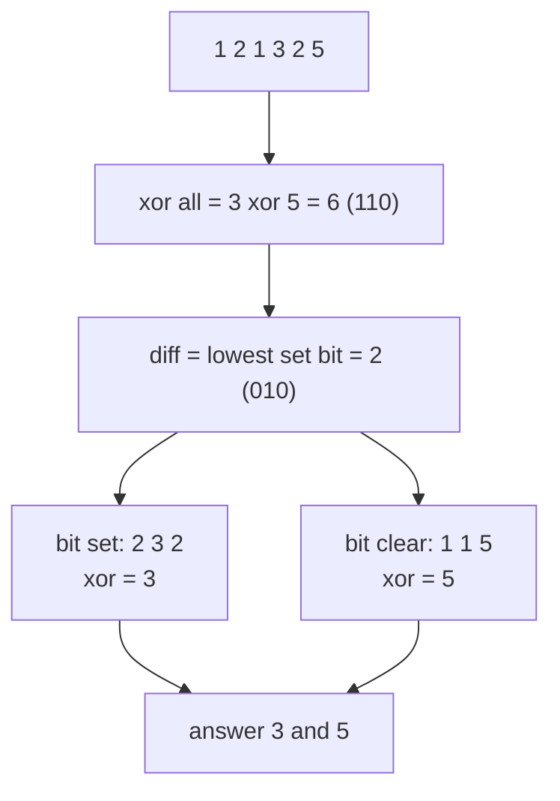

# Bit Manipulation Interview Patterns: Single Number II and III, Max XOR, UTF-8

> The medium-level bit questions that come up most: count bits modulo 3, split by a differing bit, build the best XOR greedily, and decode bit patterns.

#### 1. What Is It?

| Pattern | Problem | Idea |
|---|---|---|
| **Per-bit counting modulo `k`** | Single Number II (others appear 3 times) | count each bit position over all numbers, keep `count % 3` |
| **Split by a differing bit** | Single Number III (two singles) | XOR gives `a xor b`; any 1-bit separates `a` from `b` |
| **Greedy by bit, high to low** | Maximum XOR of Two Numbers | build the answer one bit at a time using prefixes in a set |
| **Prefix XOR** | XOR of a subarray | `prefix[r+1] xor prefix[l]` (note 03) |
| **Decode by masks and shifts** | UTF-8 Validation | read the leading bits of each byte |

**Signals:** "every element appears three times except one", "two numbers appear once", "maximum XOR of any two numbers", "validate an encoding", "32 bits, check each position".

#### 2. How It Works

**Single Number II (others three times).** For bit position `p`, add up bit `p` of all numbers. Numbers that appear 3 times contribute a multiple of 3. So `count % 3` is the bit of the single number.

```text
[2, 2, 3, 2]
bit 0: 0+0+1+0 = 1 → 1 % 3 = 1 → set
bit 1: 1+1+1+1 = 4 → 4 % 3 = 1 → set
answer: 11 = 3
```

An `O(1)` space two-register version tracks bits seen once (`ones`) and twice (`twos`):

```text
ones = (ones xor x) and twos.inv()
twos = (twos xor x) and ones.inv()
```

**Single Number III (two singles `a`, `b`).**

1. XOR everything: the pairs cancel, leaving `a xor b` (non-zero, since `a ≠ b`).
2. Pick any set bit, e.g. the lowest: `diff = x and -x`. `a` and `b` differ at that bit.
3. Split the numbers by that bit; each group contains one single and some pairs. XOR each group.



**Maximum XOR of Two Numbers.** Decide the answer from the highest bit down. At bit `i`, look at the prefixes (the top bits) of all numbers. Try to make this answer bit 1: `candidate = best or (1 shl i)`. If two prefixes `p, q` satisfy `p xor q == candidate`, the candidate is reachable, so keep it. (Check with a set: `candidate xor p` in the set.)

**UTF-8 Validation.** The first byte tells how many bytes follow: `0xxxxxxx` (1 byte), `110xxxxx` (2), `1110xxxx` (3), `11110xxx` (4). Each continuation byte must be `10xxxxxx`. Check with `b shr 7`, `b shr 5`, `b shr 6`.

#### 3. Brute Force vs Optimized

| Problem | Brute force | Bits |
|---|---|---|
| Single Number II | `HashMap` counts `O(n)` time, `O(n)` space | per-bit counts `O(32 n)`, `O(1)` space |
| Single Number III | `HashMap` / `HashSet` | XOR + split `O(n)`, `O(1)` space |
| Max XOR | all pairs `O(n²)` | greedy by bit `O(32 n)` |

```kotlin
// Brute force max XOR: all pairs
fun maxXorBrute(nums: IntArray): Int {
    var best = 0
    for (i in nums.indices) for (j in i + 1 until nums.size) best = maxOf(best, nums[i] xor nums[j])
    return best
}
```

#### 4. Kotlin Code

```kotlin
// Single Number II (LeetCode 137): count each bit modulo 3
fun singleNumberII(nums: IntArray): Int {
    var result = 0
    for (bit in 0 until 32) {
        var sum = 0
        for (x in nums) sum += (x shr bit) and 1
        if (sum % 3 != 0) result = result or (1 shl bit)
    }
    return result
}

// Same problem, two registers (ones / twos)
fun singleNumberIIFast(nums: IntArray): Int {
    var ones = 0
    var twos = 0
    for (x in nums) {
        ones = (ones xor x) and twos.inv()
        twos = (twos xor x) and ones.inv()
    }
    return ones
}

// Single Number III (LeetCode 260)
fun singleNumberIII(nums: IntArray): IntArray {
    var xor = 0
    for (x in nums) xor = xor xor x
    val diff = xor and -xor                          // a bit where the two singles differ
    var a = 0
    var b = 0
    for (x in nums) if ((x and diff) == 0) a = a xor x else b = b xor x
    return intArrayOf(a, b)
}

// Maximum XOR of Two Numbers in an Array (LeetCode 421)
fun findMaximumXOR(nums: IntArray): Int {
    var best = 0
    var mask = 0
    for (i in 30 downTo 0) {
        mask = mask or (1 shl i)
        val prefixes = HashSet<Int>()
        for (x in nums) prefixes.add(x and mask)
        val candidate = best or (1 shl i)            // try to make this bit 1
        for (p in prefixes) {
            if ((candidate xor p) in prefixes) { best = candidate; break }
        }
    }
    return best
}

// UTF-8 Validation (LeetCode 393)
fun validUtf8(data: IntArray): Boolean {
    var remaining = 0
    for (value in data) {
        val b = value and 0xFF
        if (remaining == 0) {
            remaining = when {
                (b shr 7) == 0 -> 0                  // 0xxxxxxx
                (b shr 5) == 0b110 -> 1              // 110xxxxx
                (b shr 4) == 0b1110 -> 2             // 1110xxxx
                (b shr 3) == 0b11110 -> 3            // 11110xxx
                else -> return false
            }
        } else {
            if ((b shr 6) != 0b10) return false     // continuation byte must be 10xxxxxx
            remaining--
        }
    }
    return remaining == 0
}
```

Checks: `singleNumberII(intArrayOf(2, 2, 3, 2))` → `3`; `(intArrayOf(0, 1, 0, 1, 0, 1, 99))` → `99`; `(intArrayOf(-2, -2, 1, 1, 4, 1, 4, 4, -4, -2))` → `-4`. `singleNumberIIFast` returns the same three answers. `singleNumberIII(intArrayOf(1, 2, 1, 3, 2, 5))` → `[5, 3]` (the order may differ; sorted it is `[3, 5]`); `(intArrayOf(-1, 0))` → the two values `-1` and `0` in some order. `findMaximumXOR(intArrayOf(3, 10, 5, 25, 2, 8))` → `28`; `(intArrayOf(0))` → `0`; `(intArrayOf(14, 70, 53, 83, 49, 91, 36, 80, 92, 51, 66, 70))` → `127`. `maxXorBrute(intArrayOf(3, 10, 5, 25, 2, 8))` → `28`. `validUtf8(intArrayOf(197, 130, 1))` → `true`; `(intArrayOf(235, 140, 4))` → `false`; `(intArrayOf(255))` → `false`.

#### 5. Complexity

| | Time | Space |
|---|---|---|
| `singleNumberII` | `O(32 n)` | `O(1)` |
| `singleNumberIIFast` | `O(n)` | `O(1)` |
| `singleNumberIII` | `O(n)` | `O(1)` |
| `findMaximumXOR` | `O(31 n)` | `O(n)` |
| `validUtf8` | `O(n)` | `O(1)` |
| Brute max XOR | `O(n²)` | `O(1)` |

#### 6. Common Mistakes

1. **Loops over only 31 bits** for Single Number II (a negative answer needs bit 31).
2. **Using plain XOR for "three times"** (it only cancels pairs).
3. **`xor and -xor` with `xor == Int.MIN_VALUE`**: it still works (`MIN and MIN == MIN`), but be aware.
4. **Splitting Single Number III on a bit where the singles do not differ** (use a set bit of `a xor b`).
5. **Max XOR: forgetting to restrict prefixes with `mask`** so full numbers are compared.
6. **UTF-8: not masking the input** to 8 bits (`value and 0xFF`).
7. **Order of the output** for Single Number III (LeetCode accepts any order).

#### 7. Say This in the Interview

1. "XOR only cancels pairs. For triples I count each bit position modulo 3, which leaves the bits of the unique number: `O(32 n)` time, `O(1)` space."
2. "With two unique numbers, XOR gives `a xor b`. Any set bit of that separates them, so I split the array on that bit and XOR each half."
3. "For maximum XOR I build the answer greedily from the highest bit, checking with a set of prefixes whether a larger candidate is possible."

#### 8. Quick Check

1. Why not use plain XOR when numbers appear three times?
2. In Single Number III, what does the lowest set bit of `a xor b` tell you?
3. Bit position range to scan for 32-bit `Int` answers?

<details>
<summary>Answers</summary>

1. `x xor x xor x = x`; three equal values do not cancel.
2. A bit where `a` and `b` differ, so it splits them into different groups.
3. 0 to 31 (including the sign bit).

</details>

#### 9. Related LeetCode Questions

| # | Question | Idea |
|---|---|---|
| 136 | [Single Number](https://leetcode.com/problems/single-number/) (Easy) | XOR all |
| 137 | [Single Number II](https://leetcode.com/problems/single-number-ii/) (Medium) | bits modulo 3 |
| 260 | [Single Number III](https://leetcode.com/problems/single-number-iii/) (Medium) | split by a differing bit |
| 421 | [Maximum XOR of Two Numbers in an Array](https://leetcode.com/problems/maximum-xor-of-two-numbers-in-an-array/) (Medium) | greedy by bit |
| 393 | [UTF-8 Validation](https://leetcode.com/problems/utf-8-validation/) (Medium) | leading bit masks |
| 338 | [Counting Bits](https://leetcode.com/problems/counting-bits/) (Easy) | DP on `i shr 1` |
