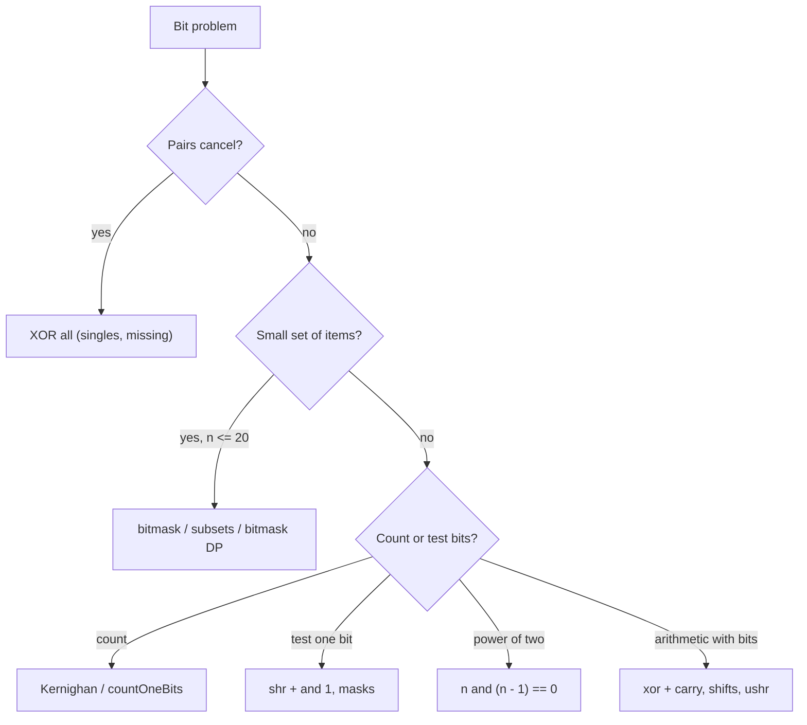

# Bit Manipulation Cheat Sheet

> One-page revision for the night before an interview. The full explanations are in notes 01–10.

#### 1. Key Takeaways

1. A Kotlin `Int` is **32-bit signed** (two's complement). Operators: `and`, `or`, `xor`, `inv()`, `shl`, `shr` (keeps sign), `ushr` (zero fill).
2. **XOR cancels equal values**: `a xor a = 0`, `a xor 0 = a`. Pairs vanish, so "everything twice except one" is one XOR pass.
3. **Bit `i`:** check `((n shr i) and 1) == 1`; set `n or (1 shl i)`; clear `n and (1 shl i).inv()`; toggle `n xor (1 shl i)`.
4. **`n and (n − 1)`** clears the lowest set bit. It counts bits (Kernighan) and tests powers of two. **`n and -n`** isolates the lowest set bit.
5. **Power of two:** `n > 0 && (n and (n − 1)) == 0`. Power of four adds `(n and 0x55555555) != 0`.
6. **Bitmask = set.** `n ≤ 20` → subsets as `0 until (1 shl n)`; the mask is a `dp` index. Submasks: `sub = (sub − 1) and mask`.
7. **Precedence:** infix calls group **left to right**, bind looser than `+ -`, tighter than `==`. Parenthesise everything.
8. **Shifts:** `1 shl 32 == 1` for `Int` (count mod 32). Use `1L shl k` for bits ≥ 31. `shr` floors, `/` truncates.
9. `Int.MIN_VALUE` has no positive twin: `abs`/negate overflow. Check up front.
10. Mention the built-ins: `countOneBits()`, `countTrailingZeroBits()`, `takeHighestOneBit()`, `Integer.toBinaryString`.

#### 2. Complexity Table

| Operation | Time | Space |
|---|---|---|
| Any bit operator | `O(1)` | `O(1)` |
| Count set bits (Kernighan) | `O(k)`, `k ≤ 32` | `O(1)` |
| Counting bits for `0..n` | `O(n)` | `O(n)` |
| Single Number (XOR) | `O(n)` | `O(1)` |
| Single Number II (bit counts) | `O(32 n)` | `O(1)` |
| Reverse bits / add without `+` | `O(32)` | `O(1)` |
| All subsets by mask | `O(2ⁿ)` (`O(n · 2ⁿ)` to materialise) | `O(1)` extra |
| Submasks of all masks | `O(3ⁿ)` | |
| Bitmask DP | `O(2ⁿ · n)` | `O(2ⁿ)` |
| Max XOR of two numbers (greedy) | `O(31 n)` | `O(n)` |

#### 3. Patterns and How to Identify Them

| Signal in the question | Trick | Note |
|---|---|---|
| "all appear twice except one" | XOR all | 03 |
| "missing number in `0..n`" | XOR indexes and values | 03 |
| "all appear three times except one" | bit counts mod 3 | 10 |
| "two numbers appear once" | XOR, split by the lowest set bit | 10 |
| "number of 1 bits", "Hamming" | Kernighan / `countOneBits()` | 04 |
| "power of two / four" | `n and (n − 1) == 0`, mask `0x55555555` | 05 |
| "set of ≤ 20 items", "visited set" | bitmask | 06 |
| "all subsets", "partition into k groups" | mask loop, bitmask DP | 07 |
| "negative numbers and shifts", "hex of negative" | two's complement, `ushr` | 08 |
| "without `+`", "reverse bits", "range AND" | `xor` + carry, shifts, common prefix | 09 |
| "maximum XOR", "validate encoding" | greedy by bit, leading-bit masks | 10 |
| "subarray XOR" | prefix XOR | 03 |



#### 4. Templates to Memorise

**Bit operations**

```kotlin
fun isSet(n: Int, i: Int) = ((n shr i) and 1) == 1
fun setBit(n: Int, i: Int) = n or (1 shl i)
fun clearBit(n: Int, i: Int) = n and (1 shl i).inv()
fun toggleBit(n: Int, i: Int) = n xor (1 shl i)
val lowestSetBit = n and -n
val clearLowest = n and (n - 1)
val lowMask = (1 shl k) - 1
```

**Count set bits (Kernighan)**

```kotlin
var x = n; var count = 0
while (x != 0) { x = x and (x - 1); count++ }
```

**Counting bits `0..n`**

```kotlin
val bits = IntArray(n + 1)
for (i in 1..n) bits[i] = bits[i shr 1] + (i and 1)
```

**Single number / missing number**

```kotlin
var r = 0; for (x in nums) r = r xor x                       // single
var m = nums.size; for (i in nums.indices) m = m xor i xor nums[i]   // missing
```

**Power of two**

```kotlin
fun isPow2(n: Int) = n > 0 && (n and (n - 1)) == 0
```

**All subsets / submasks**

```kotlin
for (mask in 0 until (1 shl n)) {
    for (i in 0 until n) if (((mask shr i) and 1) == 1) { /* item i is in */ }
}
var sub = mask
while (true) { /* use sub */ if (sub == 0) break; sub = (sub - 1) and mask }
```

**Add without `+`**

```kotlin
while (b != 0) { val carry = (a and b) shl 1; a = a xor b; b = carry }
```

**Reverse bits**

```kotlin
var r = 0; var x = n
repeat(32) { r = (r shl 1) or (x and 1); x = x ushr 1 }
```

**Single Number III**

```kotlin
val diff = xorAll and -xorAll
for (x in nums) if ((x and diff) == 0) a = a xor x else b = b xor x
```

#### 5. Brute Force to Optimized

| Problem | Brute force | Bit approach |
|---|---|---|
| Single number | `HashMap` `O(n)` space | XOR `O(1)` space |
| Count 1 bits | loop 32 positions | Kernighan / `countOneBits()` |
| Power of two | divide in a loop `O(log n)` | `n and (n − 1)` `O(1)` |
| Total Hamming distance | all pairs `O(n²)` | per bit `ones × zeros` `O(32 n)` |
| Range AND | AND every number | common prefix |
| Subset sums | recompute each `O(n · 2ⁿ)` | `sum[mask]` from the mask without its lowest bit `O(2ⁿ)` |
| Max XOR | all pairs `O(n²)` | greedy by bit with a prefix set |
| Visited set in a search | `HashSet<Set<Int>>` | `BooleanArray(1 shl n)` |

#### 6. Common Mistakes and Edge Cases

1. **Precedence:** `1 shl i + 1` is `1 shl (i + 1)`; `a or b shl c` is `(a or b) shl c`. Parenthesise.
2. **`shr` instead of `ushr`** for raw-bit work (reverse bits, hex of negatives).
3. **`n % 2 == 1`** fails for negatives; use `(n and 1) == 1`.
4. **Power-of-two test without `n > 0`.**
5. **`1 shl 32`** (equals `1`) and `Int` masks for `n ≥ 31`. Use `Long`.
6. **XOR for "three times"** (it only cancels pairs).
7. **`0xFFFFFFFF` is a `Long`** in Kotlin.
8. **`Int.MIN_VALUE`:** negate, `abs`, divide by `−1`.
9. **Submask loop** that skips `0` or omits `and mask`.
10. **Edge cases:** `0`, negative inputs, `Int.MIN_VALUE` / `MAX_VALUE`, a single element, all bits set.

#### 7. What to Say Out Loud

1. "Every value appears twice except one, so XOR of the whole array leaves the single value: `O(n)` time, `O(1)` space."
2. "`n and (n − 1)` clears the lowest set bit, so the loop runs once per set bit."
3. "A power of two has exactly one bit set: `n > 0 && n and (n − 1) == 0`."
4. "`n` is at most 16, so I'll represent each subset as a bitmask and use it as the DP index."
5. "I'll use `ushr` so the sign bit isn't copied."
6. "For three occurrences I count each bit modulo 3, because XOR only cancels pairs."

#### 8. Practice Order (Easy → Medium)

| Level | Question | Pattern |
|---|---|---|
| Easy | [Single Number](https://leetcode.com/problems/single-number/) | XOR |
| Easy | [Number of 1 Bits](https://leetcode.com/problems/number-of-1-bits/) | Kernighan |
| Easy | [Power of Two](https://leetcode.com/problems/power-of-two/) | one set bit |
| Easy | [Missing Number](https://leetcode.com/problems/missing-number/) | XOR |
| Easy | [Counting Bits](https://leetcode.com/problems/counting-bits/) | DP on `i shr 1` |
| Easy | [Hamming Distance](https://leetcode.com/problems/hamming-distance/) | `xor` + popcount |
| Easy | [Reverse Bits](https://leetcode.com/problems/reverse-bits/) | shift loop |
| Easy | [Number Complement](https://leetcode.com/problems/number-complement/) | mask + `xor` |
| Easy | [Power of Four](https://leetcode.com/problems/power-of-four/) | mask |
| Medium | [Sum of Two Integers](https://leetcode.com/problems/sum-of-two-integers/) | `xor` + carry |
| Medium | [Single Number II](https://leetcode.com/problems/single-number-ii/) | bits mod 3 |
| Medium | [Single Number III](https://leetcode.com/problems/single-number-iii/) | split by a bit |
| Medium | [Bitwise AND of Numbers Range](https://leetcode.com/problems/bitwise-and-of-numbers-range/) | common prefix |
| Medium | [Subsets](https://leetcode.com/problems/subsets/) | bitmask loop |
| Medium | [Maximum Product of Word Lengths](https://leetcode.com/problems/maximum-product-of-word-lengths/) | letter masks |
| Medium | [Maximum XOR of Two Numbers in an Array](https://leetcode.com/problems/maximum-xor-of-two-numbers-in-an-array/) | greedy by bit |
| Medium | [Total Hamming Distance](https://leetcode.com/problems/total-hamming-distance/) | per-bit counting |
| Medium | [Partition to K Equal Sum Subsets](https://leetcode.com/problems/partition-to-k-equal-sum-subsets/) | bitmask DP |
