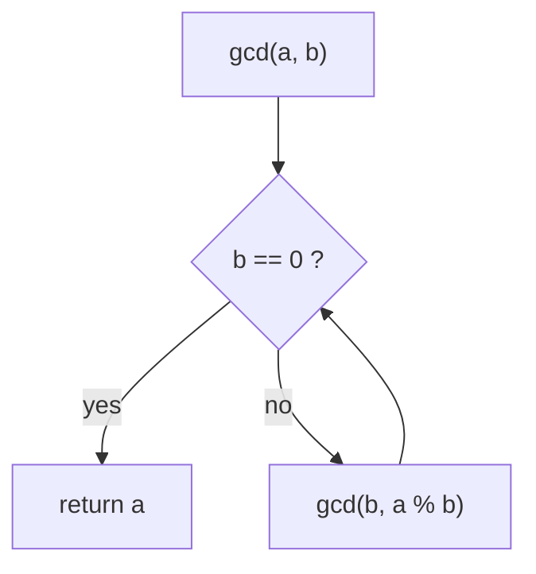

# GCD and LCM: the Euclidean Algorithm

> The greatest common divisor in `O(log n)` using one rule: `gcd(a, b) = gcd(b, a % b)`. The least common multiple follows from it.

#### 1. What Is It?

| Term | Meaning | Example |
|---|---|---|
| **GCD** (greatest common divisor) | the largest number that divides both | `gcd(48, 18) = 6` |
| **LCM** (least common multiple) | the smallest positive number both divide | `lcm(4, 6) = 12` |
| **Coprime** | `gcd(a, b) = 1` | `gcd(8, 15) = 1` |

**Key identity:** `gcd(a, b) × lcm(a, b) = a × b`, so `lcm(a, b) = a / gcd(a, b) × b` (divide first to avoid overflow).

**Signals:** "simplify a fraction", "same-size pieces", "cycles that align", "when will two events coincide again" (LCM), "can you measure exactly this volume", "repeat pattern of strings", slopes between points.

#### 2. How It Works

**Euclid's rule.** Any common divisor of `a` and `b` also divides `a % b`, so the pair `(a, b)` can be replaced by `(b, a % b)`. Repeat until the second number is 0.

```text
gcd(48, 18):  48 % 18 = 12  → gcd(18, 12)
              18 % 12 = 6   → gcd(12, 6)
              12 % 6  = 0   → gcd(6, 0) = 6
```



**Why it is fast.** Every two steps, the numbers at least halve, so it takes `O(log min(a, b))` steps. The worst case is consecutive Fibonacci numbers.

**LCM.** `lcm(4, 6) = 4 / 2 × 6 = 12`.

**GCD of many numbers.** Fold: `gcd(gcd(a, b), c)`. The GCD only shrinks, so it can stop early at 1.

**Common applications**

| Use | Idea |
|---|---|
| Reduce a fraction `a/b` | divide both by `gcd(a, b)` |
| Two timers repeat every `x` and `y` minutes | they meet every `lcm(x, y)` |
| Water and Jug | a target `z` is measurable iff `z ≤ x + y` and `z % gcd(x, y) == 0` |
| GCD of strings | `s1 + s2 == s2 + s1`, then the answer has length `gcd(len1, len2)` |
| Slope as a pair | store `(dy / g, dx / g)` as a key to compare slopes exactly |

#### 3. Brute Force vs Optimized

| Approach | Time |
|---|---|
| Try every number from `min(a, b)` down to 1 | `O(min(a, b))` |
| Subtraction version of Euclid | `O(max / min)` steps (slow for `gcd(10⁹, 1)`) |
| **Euclid with `%`** | **`O(log min(a, b))`** |

```kotlin
// Brute force: test candidates from the top
fun gcdBrute(a: Int, b: Int): Int {
    if (a == 0) return b
    if (b == 0) return a
    for (d in minOf(a, b) downTo 1) if (a % d == 0 && b % d == 0) return d
    return 1
}
```

#### 4. Kotlin Code

```kotlin
tailrec fun gcd(a: Int, b: Int): Int = if (b == 0) a else gcd(b, a % b)

fun lcm(a: Int, b: Int): Long = a.toLong() / gcd(a, b) * b           // divide first, use Long

fun gcdOfArray(nums: IntArray): Int {
    var g = 0
    for (x in nums) { g = gcd(g, x); if (g == 1) break }
    return g
}

// Reduce a fraction
fun simplify(num: Int, den: Int): Pair<Int, Int> {
    val g = gcd(Math.abs(num), Math.abs(den))
    return num / g to den / g
}

// Water and Jug Problem (LeetCode 365)
fun canMeasureWater(x: Int, y: Int, target: Int): Boolean {
    if (target > x + y) return false
    if (target == 0) return true
    return target % gcd(x, y) == 0
}

// Greatest Common Divisor of Strings (LeetCode 1071)
fun gcdOfStrings(s1: String, s2: String): String {
    if (s1 + s2 != s2 + s1) return ""
    return s1.substring(0, gcd(s1.length, s2.length))
}
```

Checks: `gcd(48, 18)` → `6`; `gcd(17, 5)` → `1`; `gcd(0, 7)` → `7`; `gcd(7, 0)` → `7`; `gcd(0, 0)` → `0`. `gcdBrute(48, 18)` → `6`. `lcm(4, 6)` → `12`; `lcm(21, 6)` → `42`; `lcm(1_000_000_000, 999_999_999)` → `999999999000000000` (fits in a `Long`). `gcdOfArray(intArrayOf(12, 18, 24))` → `6`. `simplify(10, 4)` → `(5, 2)`; `simplify(-6, 9)` → `(-2, 3)`. `canMeasureWater(3, 5, 4)` → `true`; `(2, 6, 5)` → `false`; `(1, 2, 3)` → `true`. `gcdOfStrings("ABCABC", "ABC")` → `"ABC"`; `("ABABAB", "ABAB")` → `"AB"`; `("LEET", "CODE")` → `""`.

#### 5. Complexity

| | Time | Space |
|---|---|---|
| `gcd` | `O(log min(a, b))` | `O(1)` with `tailrec` |
| `lcm` | `O(log min(a, b))` | `O(1)` |
| `gcdOfArray` | `O(n + log max)` | `O(1)` |

#### 6. Common Mistakes

1. **`a * b / gcd`** overflows `Int`. Divide first: `a / gcd * b`, in `Long`.
2. **Negative numbers:** take `abs` before `%` logic if you need a positive result.
3. **`gcd(0, 0)`** is `0`; guard any division by it.
4. **Using subtraction Euclid** for large inputs.
5. **LCM of an array** overflowing `Long` (fold carefully, or reduce modulo).
6. **Forgetting `target > x + y`** in the jug problem.
7. **Comparing slopes with floating point** instead of reduced integer pairs.

#### 7. Say This in the Interview

1. "Euclid's algorithm: `gcd(a, b) = gcd(b, a % b)`, which finishes in `O(log min(a, b))` steps."
2. "I compute LCM as `a / gcd * b` to avoid overflow, and use `Long`."
3. "To compare slopes exactly, I divide both differences by their GCD and use the pair as a key."

#### 8. Quick Check

1. `gcd(100, 75)`?
2. `lcm(6, 8)`?
3. Why divide before multiplying in LCM?

<details>
<summary>Answers</summary>

1. `25`.
2. `24`.
3. `a * b` can overflow even when the LCM fits.

</details>

#### 9. Related LeetCode Questions

| # | Question | Idea |
|---|---|---|
| 1979 | [Find Greatest Common Divisor of Array](https://leetcode.com/problems/find-greatest-common-divisor-of-array/) (Easy) | `gcd(min, max)` |
| 1071 | [Greatest Common Divisor of Strings](https://leetcode.com/problems/greatest-common-divisor-of-strings/) (Easy) | gcd of lengths |
| 2413 | [Smallest Even Multiple](https://leetcode.com/problems/smallest-even-multiple/) (Easy) | `lcm(2, n)` |
| 365 | [Water and Jug Problem](https://leetcode.com/problems/water-and-jug-problem/) (Medium) | Bézout / gcd |
| 1447 | [Simplified Fractions](https://leetcode.com/problems/simplified-fractions/) (Medium) | `gcd == 1` |
| 149 | [Max Points on a Line](https://leetcode.com/problems/max-points-on-a-line/) (Hard) | reduced slope key |
