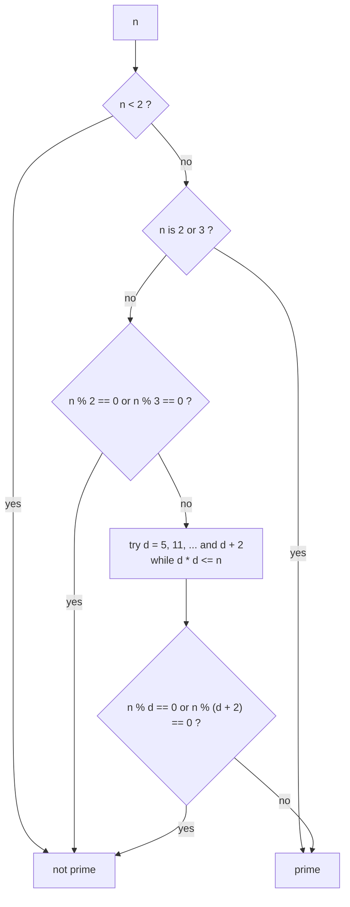

# Prime Checking: Trial Division up to √n

> A number `n` is prime if no number from 2 up to `√n` divides it. If `n` has a divisor larger than `√n`, its partner is smaller than `√n`, so you only need to look that far.

#### 1. What Is It?

A **prime** is an integer `> 1` with exactly two divisors: 1 and itself. The first primes: 2, 3, 5, 7, 11, 13.

| Fact | Why it helps |
|---|---|
| Divisors come in pairs `(d, n / d)` | one of the pair is `≤ √n` |
| So check `d = 2 .. √n` | `O(√n)` instead of `O(n)` |
| 2 is the only even prime | skip all other even numbers |
| Every prime `> 3` has the form `6k ± 1` | check only those: 3× fewer candidates |

**Signals:** "is `n` prime", "count divisors", "prime factorisation", "ugly numbers", "perfect squares", `n` up to `10⁹` (so `O(√n)` is fine, ~31,623 steps).

For *many* queries or "all primes up to `n`", use the sieve (note 03).

#### 2. How It Works

`isPrime(97)`: check divisors up to `√97 ≈ 9.8`.

```text
97 % 2 = 1,  97 % 3 = 1,  97 % 5 = 2,  97 % 7 = 6,  97 % 9 = 7  → no divisor → prime
isPrime(91): 91 % 7 = 0 → 91 = 7 × 13 → not prime
```



**Safe loop bound.** Write `d <= n / d` (or use `Long`) instead of `d * d <= n`, because `d * d` can overflow `Int` for `n` near 2³¹.

**Prime factorisation.** Divide out each factor `d` while it divides `n`. Whatever remains above 1 is a prime itself.

```text
84 → ÷2 = 42 → ÷2 = 21 → ÷3 = 7 → 7 is prime left over
84 = 2 × 2 × 3 × 7
```

**Counting divisors from the factorisation.** If `n = p₁^a × p₂^b × ...`, the number of divisors is `(a + 1)(b + 1)...`. For `36 = 2² × 3²`: `3 × 3 = 9`.

#### 3. Brute Force vs Optimized

| Approach | Time for `n = 10⁹` |
|---|---|
| Test every `d` from 2 to `n − 1` | `10⁹` steps: too slow |
| Test `d` up to `n / 2` | `5 × 10⁸` |
| **Test `d` up to `√n`** | about 31,623 |
| Test only `2`, `3`, and `6k ± 1` up to `√n` | about 10,500 |

```kotlin
// Brute force: check every smaller number (O(n))
fun isPrimeBrute(n: Int): Boolean {
    if (n < 2) return false
    for (d in 2 until n) if (n % d == 0) return false
    return true
}
```

#### 4. Kotlin Code

```kotlin
fun isPrime(n: Int): Boolean {
    if (n < 2) return false
    if (n < 4) return true                          // 2 and 3
    if (n % 2 == 0 || n % 3 == 0) return false
    var d = 5
    while (d <= n / d) {                            // d * d <= n without overflow
        if (n % d == 0 || n % (d + 2) == 0) return false
        d += 6
    }
    return true
}

// Prime factors with repetition
fun factorize(n0: Int): List<Int> {
    var n = n0
    val factors = ArrayList<Int>()
    var d = 2
    while (d <= n / d) {
        while (n % d == 0) { factors.add(d); n /= d }
        d++
    }
    if (n > 1) factors.add(n)                        // the leftover is prime
    return factors
}

fun countDivisors(n0: Int): Int {
    var n = n0
    var result = 1
    var d = 2
    while (d <= n / d) {
        var exp = 0
        while (n % d == 0) { exp++; n /= d }
        result *= (exp + 1)
        d++
    }
    if (n > 1) result *= 2
    return result
}

// Ugly Number (LeetCode 263): only prime factors 2, 3, 5
fun isUgly(n0: Int): Boolean {
    if (n0 <= 0) return false
    var n = n0
    for (p in intArrayOf(2, 3, 5)) while (n % p == 0) n /= p
    return n == 1
}

// Valid perfect square without floating point
fun isPerfectSquare(n: Int): Boolean {
    if (n < 0) return false
    var d = 0L
    while (d * d < n) d++
    return d * d == n.toLong()
}
```

Checks: `isPrime(2)` → `true`; `(1)` → `false`; `(0)` → `false`; `(-7)` → `false`; `(97)` → `true`; `(91)` → `false`; `(100)` → `false`; `(2147483647)` → `true`. `isPrimeBrute(97)` → `true`. `factorize(84)` → `[2, 2, 3, 7]`; `(97)` → `[97]`; `(1)` → `[]`; `(2147483647)` → `[2147483647]`. `countDivisors(36)` → `9`; `(1)` → `1`; `(97)` → `2`; `(60)` → `12`. `isUgly(6)` → `true`; `(14)` → `false`; `(1)` → `true`; `(0)` → `false`. `isPerfectSquare(16)` → `true`; `(14)` → `false`.

#### 5. Complexity

| | Time | Space |
|---|---|---|
| `isPrime` | `O(√n)` | `O(1)` |
| `factorize` | `O(√n)` | `O(log n)` for the factors |
| `isPrimeBrute` | `O(n)` | `O(1)` |

Miller-Rabin (a probabilistic primality test for very large numbers) is name-only; interviews expect trial division.

#### 6. Common Mistakes

1. **Treating 1 (or 0, negatives) as prime.**
2. **`d * d <= n` overflow** for large `n`.
3. **Looping to `n`** instead of `√n`.
4. **Forgetting 2 and 3** in a `6k ± 1` loop.
5. **Computing `sqrt(n)` with doubles** and rounding errors; prefer `d <= n / d`.
6. **`factorize` forgetting the leftover prime** above `√n`.
7. **Testing many numbers one by one** when a sieve is `O(n log log n)`.

#### 7. Say This in the Interview

1. "If `n` has a divisor greater than `√n`, its pair is smaller than `√n`, so I only test up to `√n`: `O(√n)`."
2. "I'll skip evens and test `6k ± 1`, and write the bound as `d <= n / d` to avoid overflow."
3. "For all primes up to `n`, or many queries, I'd use a sieve instead."

#### 8. Quick Check

1. Largest divisor to test for `n = 1000`?
2. Is 1 prime?
3. Divisors of `2³ × 5`?

<details>
<summary>Answers</summary>

1. 31 (`√1000 ≈ 31.6`).
2. No. A prime has exactly two divisors.
3. `(3 + 1)(1 + 1) = 8`.

</details>

#### 9. Related LeetCode Questions

| # | Question | Idea |
|---|---|---|
| 204 | [Count Primes](https://leetcode.com/problems/count-primes/) (Medium) | sieve (note 03) |
| 263 | [Ugly Number](https://leetcode.com/problems/ugly-number/) (Easy) | divide out 2, 3, 5 |
| 1952 | [Three Divisors](https://leetcode.com/problems/three-divisors/) (Easy) | count divisors |
| 1175 | [Prime Arrangements](https://leetcode.com/problems/prime-arrangements/) (Easy) | count primes + factorials |
| 2521 | [Distinct Prime Factors of Product of Array](https://leetcode.com/problems/distinct-prime-factors-of-product-of-array/) (Medium) | factorise each |
| 1201 | [Ugly Number III](https://leetcode.com/problems/ugly-number-iii/) (Medium) | binary search + LCM |
