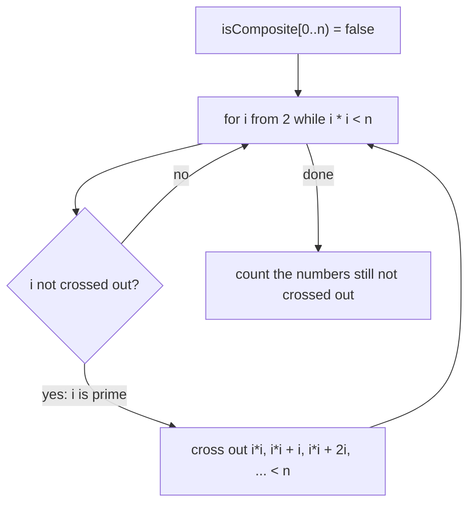

# Sieve of Eratosthenes: All Primes up to n at Once

> Instead of testing each number, cross out the multiples of each prime. What is left is prime. `O(n log log n)` time.

#### 1. What Is It?

Make a table of numbers `2..n`. Take the smallest number not crossed out (a prime), cross out its multiples, repeat.

| | Value |
|---|---|
| Time | `O(n log log n)` (almost linear) |
| Space | `O(n)` (a `BooleanArray`) |
| Gives | every prime `≤ n`, and `isPrime(k)` in `O(1)` |
| Variant | **smallest prime factor (SPF) sieve** for fast factorisation |

| Need | Use |
|---|---|
| Is one number prime | trial division `O(√n)` (note 02) |
| Count / list primes up to `n` | **sieve** |
| Factorise many numbers | SPF sieve |
| Primes in `[L, R]` with huge `R` | segmented sieve (name only) |

**Signals:** "count primes less than `n`", "primes in a range", `n` up to `10⁶–10⁷`, "for every number, its prime factors", "prime arrangements".

#### 2. How It Works

Primes up to 30:

```text
start:        2 3 4 5 6 7 8 9 10 11 12 13 14 15 16 17 18 19 20 21 22 23 24 25 26 27 28 29 30
p = 2: cross  4 6 8 10 12 14 16 18 20 22 24 26 28 30
p = 3: cross  9 15 21 27       (6, 12, 18, 24, 30 are already gone)
p = 5: cross  25               (10, 15, 20, 30 already gone)
p = 7: 49 > 30 → stop
primes: 2 3 5 7 11 13 17 19 23 29   (10 primes)
```



**Why start at `i * i`.** Smaller multiples `i × k` with `k < i` were already crossed out by the smaller prime factor of `k`.

**Why stop at `√n`.** Any composite `≤ n` has a prime factor `≤ √n`, so everything composite is crossed out by then.

**SPF sieve.** Store, for each number, its smallest prime factor. Then factorising `m` takes `O(log m)`: repeatedly divide by `spf[m]`.

```text
spf[84] = 2 → 42 → spf 2 → 21 → spf 3 → 7 → spf 7 → 1     factors 2, 2, 3, 7
```

#### 3. Brute Force vs Optimized

| Approach | Time to count primes below `n` |
|---|---|
| `isPrime` on every number (trial division) | `O(n √n)` |
| Sieve | `O(n log log n)` |
| Sieve with odd numbers only | half the memory and time |
| Linear sieve | `O(n)` exactly (name only) |

```kotlin
// Brute force: trial division for each number (O(n √n))
fun countPrimesBrute(n: Int): Int {
    var count = 0
    for (k in 2 until n) {
        var prime = true
        var d = 2
        while (d.toLong() * d <= k) { if (k % d == 0) { prime = false; break }; d++ }
        if (prime) count++
    }
    return count
}
```

#### 4. Kotlin Code

```kotlin
// Count Primes (LeetCode 204): primes strictly less than n
fun countPrimes(n: Int): Int {
    if (n < 3) return 0
    val composite = BooleanArray(n)
    var i = 2
    while (i.toLong() * i < n) {
        if (!composite[i]) {
            var j = i * i
            while (j < n) { composite[j] = true; j += i }
        }
        i++
    }
    var count = 0
    for (k in 2 until n) if (!composite[k]) count++
    return count
}

// List of primes up to and including n
fun primesUpTo(n: Int): List<Int> {
    if (n < 2) return emptyList()
    val composite = BooleanArray(n + 1)
    val primes = ArrayList<Int>()
    for (i in 2..n) {
        if (!composite[i]) {
            primes.add(i)
            var j = i.toLong() * i
            while (j <= n) { composite[j.toInt()] = true; j += i }
        }
    }
    return primes
}

// Smallest prime factor table up to n
fun spfTable(n: Int): IntArray {
    val spf = IntArray(n + 1) { it }
    var i = 2
    while (i.toLong() * i <= n) {
        if (spf[i] == i) {                          // i is prime
            var j = i * i
            while (j <= n) { if (spf[j] == j) spf[j] = i; j += i }
        }
        i++
    }
    return spf
}

fun factorizeWithSpf(x: Int, spf: IntArray): List<Int> {
    var m = x
    val factors = ArrayList<Int>()
    while (m > 1) { factors.add(spf[m]); m /= spf[m] }
    return factors
}

// Prime Arrangements (LeetCode 1175): primes at prime positions, others elsewhere
fun numPrimeArrangements(n: Int): Int {
    val mod = 1_000_000_007L
    val primes = primesUpTo(n).size
    fun fact(k: Int): Long { var r = 1L; for (i in 2..k) r = r * i % mod; return r }
    return (fact(primes) * fact(n - primes) % mod).toInt()
}
```

Checks: `countPrimes(10)` → `4` (2, 3, 5, 7); `(0)` → `0`; `(1)` → `0`; `(2)` → `0`; `(3)` → `1`; `(1_000_000)` → `78498`. `countPrimesBrute(10)` → `4`. `primesUpTo(30)` → `[2, 3, 5, 7, 11, 13, 17, 19, 23, 29]`; `primesUpTo(1)` → `[]`. `factorizeWithSpf(84, spfTable(100))` → `[2, 2, 3, 7]`; `factorizeWithSpf(97, spfTable(100))` → `[97]`. `numPrimeArrangements(5)` → `12`; `(100)` → `682289015`.

#### 5. Complexity

| | Time | Space |
|---|---|---|
| Sieve | `O(n log log n)` | `O(n)` |
| SPF table | `O(n log log n)` | `O(n)` ints |
| Factorise one number with SPF | `O(log n)` | |

#### 6. Common Mistakes

1. **Counting primes `≤ n` when the question says `< n`.**
2. **Starting the inner loop at `2i`** (correct but slower) or **at `i` itself** (marks the prime composite).
3. **`i * i` overflow** for `n` near 2³¹ (use `Long`).
4. **Array size `n` vs `n + 1`.**
5. **Using a sieve for `n = 10⁹`** (memory: 1 GB). Use segmented sieve or trial division per query.
6. **Treating 0 and 1 as prime.**
7. **`Boolean` array of objects** (`Array<Boolean>`) instead of `BooleanArray`.

#### 7. Say This in the Interview

1. "Rather than testing each number, I cross out multiples of each prime up to `√n`. Starting each inner loop at `p²`, the total is `O(n log log n)`."
2. "That needs `O(n)` memory, which is fine for `n ≤ 10⁷`."
3. "If I must factorise many numbers I'd store the smallest prime factor for each, so factorisation takes `O(log n)`."

#### 8. Quick Check

1. Primes below 20?
2. Why start crossing at `p²`?
3. Time complexity?

<details>
<summary>Answers</summary>

1. 8 (2, 3, 5, 7, 11, 13, 17, 19).
2. Smaller multiples have a smaller prime factor and were already crossed out.
3. `O(n log log n)`.

</details>

#### 9. Related LeetCode Questions

| # | Question | Idea |
|---|---|---|
| 204 | [Count Primes](https://leetcode.com/problems/count-primes/) (Medium) | sieve |
| 762 | [Prime Number of Set Bits in Binary Representation](https://leetcode.com/problems/prime-number-of-set-bits-in-binary-representation/) (Easy) | small primes table |
| 1175 | [Prime Arrangements](https://leetcode.com/problems/prime-arrangements/) (Easy) | sieve + factorials |
| 866 | [Prime Palindrome](https://leetcode.com/problems/prime-palindrome/) (Medium) | prime test on palindromes |
| 2523 | [Closest Prime Numbers in Range](https://leetcode.com/problems/closest-prime-numbers-in-range/) (Medium) | sieve + scan |
| 2584 | [Split the Array to Make Coprime Products](https://leetcode.com/problems/split-the-array-to-make-coprime-products/) (Hard) | factorise with SPF |
