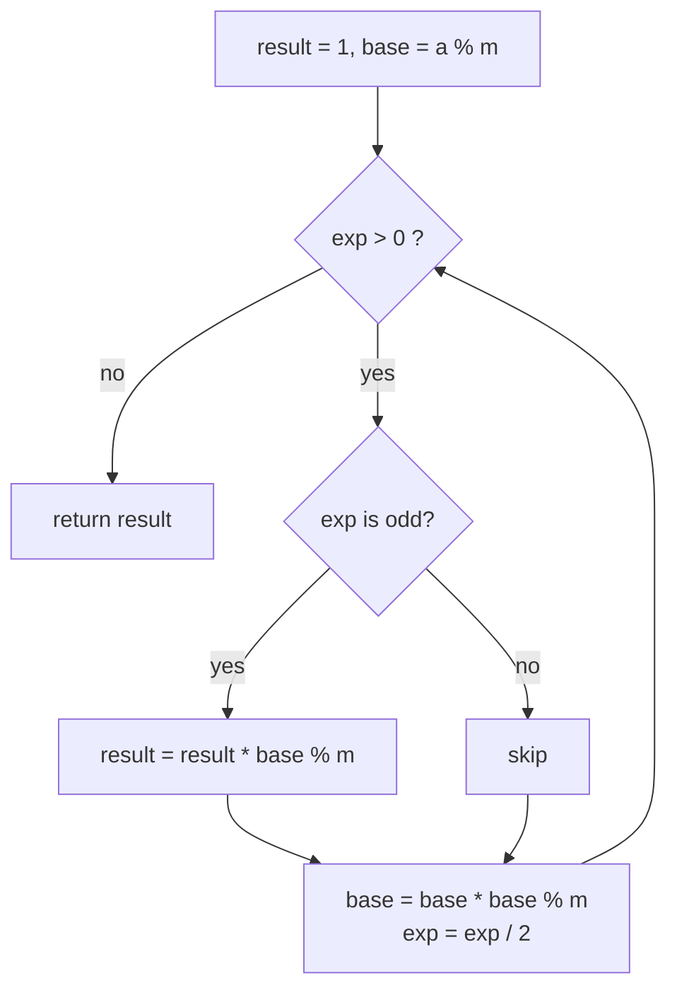

# Fast (Modular) Exponentiation: Repeated Squaring

> Compute `a^b mod m` in `O(log b)` multiplications by squaring: `a^b = (a^(b/2))²`, with one extra `a` when `b` is odd.

#### 1. What Is It?

Multiplying `b` times is `O(b)`. Squaring halves the exponent each step, so it takes about `log₂ b` steps.

```text
a^13 = a^(1101 in binary) = a^8 · a^4 · a^1
```

| Version | Idea |
|---|---|
| Recursive | `power(a, b) = power(a, b/2)²` (× `a` if `b` is odd) |
| **Iterative (binary)** | walk the bits of `b` from low to high; keep squaring `a`; multiply into the result when the bit is 1 |
| Modular | reduce `% m` after every multiplication, so numbers stay small |

**Why modulo?** Answers like `2^1000000` have hundreds of thousands of digits. Problems ask for the result `mod 1_000_000_007` (a prime), and `(x · y) mod m = ((x mod m) · (y mod m)) mod m`.

**Signals:** "return the answer modulo `10⁹ + 7`", "`x^n`", huge exponents, "count arrangements" with powers, modular inverse (`a^(m−2)` when `m` is prime), matrix powers (note 08).

The real-number `Pow(x, n)` version is in `3` Recursion note 09.

#### 2. How It Works

`3^13 mod 1000`, exponent `13 = 1101₂`:

```text
bit (from the low end):  1     0     1     1
base:                    3     9     81    6561 → 561 (mod 1000)
result:   start 1
          bit 1 → result = 1 · 3        = 3
          bit 0 → skip
          bit 1 → result = 3 · 81       = 243
          bit 1 → result = 243 · 561    = 136323 → 323
3^13 = 1594323 → mod 1000 = 323 ✓
```



**Overflow rule.** With `m ≈ 10⁹`, a product of two values below `m` is below `10¹⁸`, which fits in a `Long` (max ≈ `9.2 × 10¹⁸`). Reduce after every multiplication.

**Modular inverse.** If `m` is prime, `a⁻¹ ≡ a^(m−2) (mod m)` (Fermat's little theorem). Then division becomes `(a / b) mod m = a · b^(m−2) mod m`.

#### 3. Brute Force vs Optimized

| Approach | Time for `b = 10⁹` |
|---|---|
| Multiply `b` times | `10⁹` steps: too slow |
| **Repeated squaring** | about 30 steps |
| Without `% m` | overflows after a few steps |

```kotlin
// Brute force: O(b) multiplications
fun modPowSlow(a: Long, b: Long, m: Long): Long {
    var result = 1L % m
    repeat(b.toInt()) { result = result * (a % m) % m }
    return result
}
```

#### 4. Kotlin Code

```kotlin
const val MOD = 1_000_000_007L

fun modPow(a: Long, b: Long, m: Long = MOD): Long {
    var result = 1L % m
    var base = a % m
    if (base < 0) base += m
    var exp = b
    while (exp > 0) {
        if ((exp and 1L) == 1L) result = result * base % m
        base = base * base % m
        exp = exp shr 1
    }
    return result
}

// Modular inverse for a prime modulus (Fermat)
fun modInverse(a: Long, m: Long = MOD): Long = modPow(a, m - 2, m)

// Super Pow (LeetCode 372): a^b where b is given as digits, modulo 1337
fun superPow(a: Int, b: IntArray): Int {
    val m = 1337L
    var result = 1L
    for (digit in b) {
        // result^10 * a^digit  (shifting the exponent by one decimal digit)
        result = modPow(result, 10, m) * modPow(a.toLong(), digit.toLong(), m) % m
    }
    return result.toInt()
}

// Count Good Numbers (LeetCode 1922): even positions have 5 choices, odd positions have 4
fun countGoodNumbers(n: Long): Int {
    val evenPositions = (n + 1) / 2
    val oddPositions = n / 2
    return (modPow(5, evenPositions) * modPow(4, oddPositions) % MOD).toInt()
}
```

Checks: `modPow(3, 13, 1000)` → `323`; `modPow(2, 10, 1000)` → `24`; `modPow(3, 200, 13)` → `9`; `modPow(2, 30)` → `73741817` (`2³⁰ = 1073741824`, minus `1000000007`); `modPow(5, 0)` → `1`; `modPow(0, 0)` → `1` (by convention); `modPow(7, 3, 1)` → `0`. `modPowSlow(3, 13, 1000)` → `323`. `modInverse(3)` → `333333336` (`3 × 333333336 = 1000000008 ≡ 1`). `superPow(2, [3])` → `8`; `(2, [1, 0])` → `1024`; `(1, [4,3,3,8,5,2])` → `1`; `(2147483647, [2, 0, 0])` → `1198`. `countGoodNumbers(1)` → `5`; `(4)` → `400`; `(50)` → `564908303`.

#### 5. Complexity

| | Time | Space |
|---|---|---|
| `modPow` | `O(log b)` | `O(1)` |
| `modInverse` (prime modulus) | `O(log m)` | `O(1)` |
| `superPow` with `d` digits | `O(d · log 10)` | `O(1)` |

#### 6. Common Mistakes

1. **`Int` overflow:** use `Long` and reduce after each multiplication.
2. **Forgetting to reduce the base first** (`a % m`).
3. **Negative base:** normalise with `+ m`.
4. **Using Fermat's inverse with a non-prime modulus** (use the extended Euclid, note 08).
5. **`x ^ y` in Kotlin is not power**; `xor` is `xor`. Use your function or `Math.pow` (doubles, imprecise).
6. **`exp` as `Int` when it can be `10¹⁸`.**
7. **Reducing the exponent mod `m`** (it must be reduced mod `m − 1` for prime `m`, and only with care).

#### 7. Say This in the Interview

1. "Computing `a^b` by repeated squaring takes `O(log b)` multiplications, and I reduce modulo `m` after every multiplication so that values stay below `m²`, which fits in a `Long`."
2. "For division modulo a prime I multiply by the modular inverse `b^(m−2)`."
3. "The exponent is huge, so I process it in binary instead of looping `b` times."

#### 8. Quick Check

1. Steps for `b = 1024`?
2. Largest product before reduction when `m = 10⁹ + 7`?
3. Inverse of `a` mod a prime `p`?

<details>
<summary>Answers</summary>

1. About 10 squarings (`log₂ 1024`).
2. `(m − 1)² ≈ 10¹⁸`, which fits in a `Long`.
3. `a^(p − 2) mod p`.

</details>

#### 9. Related LeetCode Questions

| # | Question | Idea |
|---|---|---|
| 50 | [Pow(x, n)](https://leetcode.com/problems/powx-n/) (Medium) | real-number fast power |
| 372 | [Super Pow](https://leetcode.com/problems/super-pow/) (Medium) | digits of the exponent |
| 1922 | [Count Good Numbers](https://leetcode.com/problems/count-good-numbers/) (Medium) | `5^a · 4^b mod p` |
| 509 | [Fibonacci Number](https://leetcode.com/problems/fibonacci-number/) (Easy) | matrix power alternative |
| 1137 | [N-th Tribonacci Number](https://leetcode.com/problems/n-th-tribonacci-number/) (Easy) | matrix power alternative |
