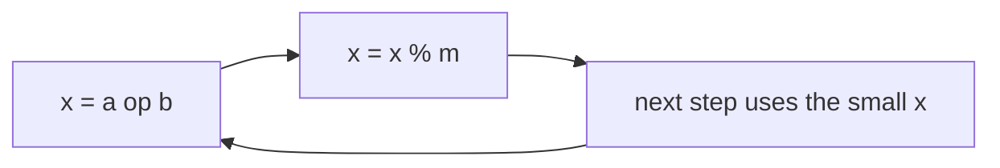

# Modular Arithmetic Basics: Avoiding Overflow

> "Return the answer modulo `10⁹ + 7`" means: keep every number small by taking the remainder after each step. Addition, subtraction and multiplication all work with remainders. Division needs an inverse.

#### 1. What Is It?

`a mod m` is the remainder when `a` is divided by `m`. The rules:

| Operation | Rule |
|---|---|
| Add | `(a + b) mod m = ((a mod m) + (b mod m)) mod m` |
| Subtract | `(a − b) mod m = ((a mod m) − (b mod m) + m) mod m` |
| Multiply | `(a · b) mod m = ((a mod m) · (b mod m)) mod m` |
| Power | square and reduce (note 04) |
| Divide | multiply by the **modular inverse**: `a / b ≡ a · b^(m−2) (mod m)` when `m` is prime and `b mod m ≠ 0` |

**Why `1_000_000_007`?** It is a prime near `10⁹`. Products of two residues are below `10¹⁸`, so a `Long` holds them. Being prime, every non-zero residue has an inverse.

**Negative remainders.** In Kotlin, `-7 % 5 == -2` (the sign follows the dividend). Use `Math.floorMod(-7, 5) == 3`, or `(-7).mod(5) == 3`, or `((x % m) + m) % m`.

**Signals:** "modulo `10⁹ + 7`", "the answer may be large", "number of ways", "subarray sum divisible by `k`", "remainder", cyclic or clock arithmetic.

#### 2. How It Works

**Reduce at every step.** Do not compute a huge number and take `%` at the end.

```text
sum of 1..n squares mod m:   sum = (sum + (i * i) % m) % m
```



**Divisibility via prefix remainders.** If two prefix sums have the same remainder mod `k`, the subarray between them has a sum divisible by `k`.

```text
nums = [4, 5, 0, -2, -3, 1], k = 5
prefix sums:         4, 9, 9, 7, 4, 5
prefix sums mod 5:   4, 4, 4, 2, 4, 0
equal remainders (and the leading empty prefix 0) → subarrays whose sum is divisible by 5
```

Count remainders in a table; for each new prefix with remainder `r`, add `count[r]` to the answer (all earlier prefixes with the same `r` form a valid subarray), then increment `count[r]`. Start with `count[0] = 1` (the empty prefix).

**Modular division.** `(a / b) mod p = a · inverse(b) mod p`, with `inverse(b) = b^(p − 2) mod p` (note 04). You cannot divide the remainder directly: `(6 / 3) mod 5` is not `(6 mod 5) / (3 mod 5)`.

**Order of operations in code.** `result = (result * x) % MOD` with `result: Long`. If `result` is `Int`, the product overflows before `%`.

#### 3. Brute Force vs Optimized

| Task | Brute force | With modular ideas |
|---|---|---|
| Big factorial answer | `BigInteger` (slow, huge) | multiply and reduce each step `O(n)` |
| Count subarrays with sum divisible by `k` | all subarrays `O(n²)` | prefix remainders `O(n)` |
| Divide under a modulus | not possible by `%` | multiply by the inverse |

```kotlin
// Brute force: check every subarray
fun subarraysDivByKBrute(nums: IntArray, k: Int): Int {
    var count = 0
    for (i in nums.indices) {
        var sum = 0
        for (j in i until nums.size) { sum += nums[j]; if (sum % k == 0) count++ }
    }
    return count
}
```

#### 4. Kotlin Code

```kotlin
const val MOD = 1_000_000_007L

fun addMod(a: Long, b: Long): Long = (a % MOD + b % MOD) % MOD
fun subMod(a: Long, b: Long): Long = ((a % MOD - b % MOD) % MOD + MOD) % MOD
fun mulMod(a: Long, b: Long): Long = (a % MOD) * (b % MOD) % MOD

// Always-non-negative remainder
fun posMod(x: Int, m: Int): Int = ((x % m) + m) % m

// Factorial modulo MOD
fun factorialMod(n: Int): Long {
    var r = 1L
    for (i in 2..n) r = r * i % MOD
    return r
}

// Subarray Sums Divisible by K (LeetCode 974)
fun subarraysDivByK(nums: IntArray, k: Int): Int {
    val count = IntArray(k)
    count[0] = 1
    var prefix = 0
    var answer = 0
    for (x in nums) {
        prefix = posMod(prefix + x, k)
        answer += count[prefix]
        count[prefix]++
    }
    return answer
}

// Continuous Subarray Sum (LeetCode 523): a subarray of length >= 2 whose sum is a multiple of k
fun checkSubarraySum(nums: IntArray, k: Int): Boolean {
    val firstIndex = HashMap<Int, Int>()
    firstIndex[0] = -1
    var prefix = 0
    for (i in nums.indices) {
        prefix = posMod(prefix + nums[i], k)
        val seen = firstIndex[prefix]
        if (seen != null) { if (i - seen >= 2) return true } else firstIndex[prefix] = i
    }
    return false
}
```

Checks: `mulMod(1_000_000_006, 1_000_000_006)` → `1` (`(−1)² ≡ 1`); `addMod(1_000_000_006, 5)` → `4`; `subMod(3, 5)` → `1_000_000_005`. `posMod(-7, 5)` → `3`; `-7 % 5` → `-2`; `Math.floorMod(-7, 5)` → `3`. `factorialMod(5)` → `120`; `factorialMod(20)` → `146326063` (`20! = 2432902008176640000`, reduced mod `10⁹ + 7`). `subarraysDivByK(intArrayOf(4, 5, 0, -2, -3, 1), 5)` → `7`; `(intArrayOf(5), 9)` → `0`; `subarraysDivByKBrute(intArrayOf(4, 5, 0, -2, -3, 1), 5)` → `7`. `checkSubarraySum(intArrayOf(23, 2, 4, 6, 7), 6)` → `true`; `(intArrayOf(23, 2, 6, 4, 7), 13)` → `false`; `(intArrayOf(5, 0, 0, 0), 3)` → `true`.

#### 5. Complexity

| | Time | Space |
|---|---|---|
| `addMod`, `mulMod`, `posMod` | `O(1)` | `O(1)` |
| `factorialMod(n)` | `O(n)` | `O(1)` |
| Prefix remainder counting | `O(n)` | `O(k)` |

#### 6. Common Mistakes

1. **Overflow before `%`:** `a * b % MOD` with `Int` operands overflows. Use `Long`.
2. **Negative remainders** (`-3 % 5 == -3`). Normalise.
3. **Subtraction not adding `m`** back.
4. **Dividing remainders directly** instead of using the inverse.
5. **Taking `%` only at the end** (overflow in between).
6. **Forgetting `count[0] = 1`** for subarrays starting at index 0.
7. **Using a non-prime modulus** with Fermat's inverse.
8. **Comparing a reduced value with an unreduced one.**

#### 7. Say This in the Interview

1. "The answer can be huge, so I reduce modulo `10⁹ + 7` after every operation, using `Long` so the product of two residues doesn't overflow."
2. "Kotlin's `%` can return negatives, so I normalise with `((x % m) + m) % m`."
3. "Two equal prefix remainders mean the subarray between them is divisible by `k`, so I count remainders in a table: `O(n)`."

#### 8. Quick Check

1. `(7 · 8) mod 5`?
2. Why must `count[0] = 1` start?
3. How do you compute `a / b mod p`?

<details>
<summary>Answers</summary>

1. `56 mod 5 = 1`.
2. A prefix whose remainder is 0 is itself a valid subarray from the start.
3. `a · b^(p − 2) mod p`.

</details>

#### 9. Related LeetCode Questions

| # | Question | Idea |
|---|---|---|
| 974 | [Subarray Sums Divisible by K](https://leetcode.com/problems/subarray-sums-divisible-by-k/) (Medium) | prefix remainders |
| 523 | [Continuous Subarray Sum](https://leetcode.com/problems/continuous-subarray-sum/) (Medium) | first index of each remainder |
| 1590 | [Make Sum Divisible by P](https://leetcode.com/problems/make-sum-divisible-by-p/) (Medium) | remainder map |
| 1015 | [Smallest Integer Divisible by K](https://leetcode.com/problems/smallest-integer-divisible-by-k/) (Medium) | remainders repeat |
| 1175 | [Prime Arrangements](https://leetcode.com/problems/prime-arrangements/) (Easy) | factorials mod |
| 62 | [Unique Paths](https://leetcode.com/problems/unique-paths/) (Medium) | counting with mod in variants |
