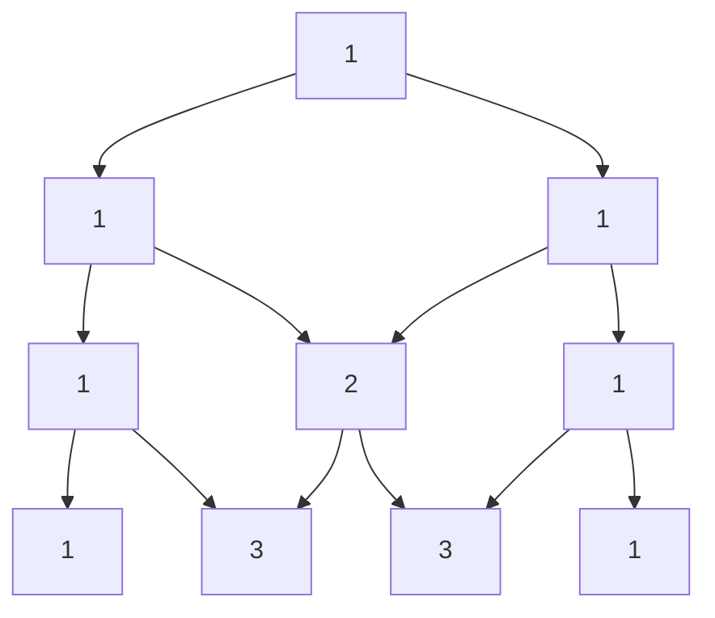

# Combinatorics: Factorials and nCr

> Count arrangements and selections without listing them: `n!` orderings, `nCr` ways to choose `r` of `n`. Pascal's triangle builds `nCr` with additions only.

#### 1. What Is It?

| Formula | Meaning | Example |
|---|---|---|
| `n!` | orderings (permutations) of `n` items | `4! = 24` |
| `nPr = n! / (n − r)!` | ordered selections of `r` from `n` | `5P2 = 20` |
| `nCr = n! / (r! (n − r)!)` | unordered selections | `5C2 = 10` |
| `nCr = (n−1)C(r−1) + (n−1)Cr` | Pascal's rule | builds the triangle |
| `nCr = nC(n−r)` | symmetry | use the smaller `r` |
| Catalan `Cₙ = (2n)C(n) / (n + 1)` | balanced parentheses, unique BSTs, grid paths below the diagonal | `C₅ = 42` |

**Signals:** "number of ways", "how many paths in a grid", "choose k of n", "arrangements", "unique binary search trees", "valid parentheses count", answer "modulo `10⁹ + 7`".

**Grid paths.** Moving only right/down in an `m × n` grid takes `m − 1` downs and `n − 1` rights, in any order: `C(m + n − 2, m − 1)`. (Unique Paths.)

#### 2. How It Works

**Pascal's triangle.** Each entry is the sum of the two above it. Row `n`, position `r` is `nCr`.



Rows: `1` / `1 1` / `1 2 1` / `1 3 3 1` / `1 4 6 4 1`. So `4C2 = 6`.

**Three ways to compute `nCr`**

| Method | Time | Notes |
|---|---|---|
| Pascal's triangle DP | `O(n · r)`, `O(r)` memory with one row | exact; with a modulus when huge |
| Multiplicative: `res = res · (n − r + i) / i` for `i = 1..r` | `O(r)` | exact in `Long` (each step divides evenly) |
| Factorials and inverse factorials mod prime `p` | `O(n)` precompute, `O(1)` per query | many queries |

**Why the multiplicative loop divides exactly.** After step `i`, `res = (n − r + i)C(i)`, always an integer.

**Trailing zeros of `n!`.** A zero comes from a factor 10 = 2 × 5, and there are more 2s than 5s, so count the 5s: `⌊n/5⌋ + ⌊n/25⌋ + ⌊n/125⌋ + ...`.

**Catalan counts.** Unique BSTs with `n` nodes, valid parentheses pairs, and many more: `C₀ = 1, C₁ = 1, C₂ = 2, C₃ = 5, C₄ = 14, C₅ = 42`.

#### 3. Brute Force vs Optimized

| Task | Brute force | Better |
|---|---|---|
| Unique Paths | recursion `O(2^(m+n))` | DP `O(mn)`, or formula `C(m+n−2, m−1)` in `O(min(m, n))` |
| `nCr` with big `n` | compute `n!` (overflow) | multiplicative loop, or Pascal with mod |
| Many `nCr mod p` queries | recompute each | factorials + inverse factorials |
| Trailing zeros of `n!` | compute `n!` | count factors of 5 `O(log n)` |

```kotlin
// Brute force: nCr by the recursive definition (exponential)
fun nCrRec(n: Int, r: Int): Long =
    if (r == 0 || r == n) 1L else nCrRec(n - 1, r - 1) + nCrRec(n - 1, r)
```

#### 4. Kotlin Code

```kotlin
// nCr, exact, multiplicative form (fits in Long for moderate n)
fun nCr(n: Int, r0: Int): Long {
    val r = minOf(r0, n - r0)                          // symmetry
    if (r < 0) return 0
    var result = 1L
    for (i in 1..r) result = result * (n - r + i) / i  // stays an integer at every step
    return result
}

// Pascal's Triangle (LeetCode 118)
fun generate(numRows: Int): List<List<Int>> {
    val rows = ArrayList<List<Int>>()
    for (i in 0 until numRows) {
        val row = MutableList(i + 1) { 1 }
        for (j in 1 until i) row[j] = rows[i - 1][j - 1] + rows[i - 1][j]
        rows.add(row)
    }
    return rows
}

// Many queries modulo a prime: factorials + inverse factorials
class Combinatorics(maxN: Int, private val mod: Long = 1_000_000_007L) {
    private val fact = LongArray(maxN + 1)
    private val invFact = LongArray(maxN + 1)

    init {
        fact[0] = 1
        for (i in 1..maxN) fact[i] = fact[i - 1] * i % mod
        invFact[maxN] = pow(fact[maxN], mod - 2)
        for (i in maxN downTo 1) invFact[i - 1] = invFact[i] * i % mod
    }

    private fun pow(a: Long, b: Long): Long {
        var r = 1L; var base = a % mod; var e = b
        while (e > 0) { if ((e and 1L) == 1L) r = r * base % mod; base = base * base % mod; e = e shr 1 }
        return r
    }

    fun nCr(n: Int, r: Int): Long =
        if (r < 0 || r > n) 0 else fact[n] * invFact[r] % mod * invFact[n - r] % mod
}

// Unique Paths (LeetCode 62): choose which of the m + n - 2 moves go down
fun uniquePaths(m: Int, n: Int): Int = nCr(m + n - 2, m - 1).toInt()

// Unique Binary Search Trees (LeetCode 96): Catalan number
fun numTrees(n: Int): Int = (nCr(2 * n, n) / (n + 1)).toInt()

// Factorial Trailing Zeroes (LeetCode 172)
fun trailingZeroes(n0: Int): Int {
    var n = n0
    var count = 0
    while (n > 0) { n /= 5; count += n }
    return count
}
```

Checks: `nCr(5, 2)` → `10`; `nCr(10, 0)` → `1`; `nCr(52, 5)` → `2598960`; `nCr(5, 7)` → `0`; `nCrRec(5, 2)` → `10`. `generate(5)` → `[[1], [1,1], [1,2,1], [1,3,3,1], [1,4,6,4,1]]`. `Combinatorics(1000).nCr(10, 3)` → `120`; `.nCr(5, 2)` → `10`; `.nCr(5, 9)` → `0`. `uniquePaths(3, 7)` → `28`; `(3, 2)` → `3`; `(1, 1)` → `1`. `numTrees(3)` → `5`; `(1)` → `1`; `(5)` → `42`. `trailingZeroes(5)` → `1`; `(25)` → `6`; `(100)` → `24`; `(0)` → `0`.

#### 5. Complexity

| | Time | Space |
|---|---|---|
| `nCr` multiplicative | `O(min(r, n − r))` | `O(1)` |
| Pascal's triangle to row `n` | `O(n²)` | `O(n²)` (or `O(n)` for one row) |
| Factorial tables | `O(n)` once, then `O(1)` per query | `O(n)` |
| `trailingZeroes` | `O(log n)` | `O(1)` |

#### 6. Common Mistakes

1. **Computing `n!` then dividing** (overflows even for `n = 21`).
2. **Dividing before multiplying** in the multiplicative loop (inexact). Multiply first, then divide.
3. **Not using symmetry** (`r` large wastes time).
4. **Modulus with division:** you need modular inverses, not plain `/`.
5. **Off-by-one in grid paths:** it is `m + n − 2`, not `m + n`.
6. **Counting permutations when order doesn't matter** (or the reverse).
7. **Duplicates:** `n! / (a! b! ...)` for repeated items.
8. **`Int` overflow** in `result * (n − r + i)` (use `Long`).

#### 7. Say This in the Interview

1. "Order doesn't matter, so this is a combination: `C(n, r)`. I'll compute it with the multiplicative loop to avoid huge factorials."
2. "Each path is a sequence of `m − 1` downs and `n − 1` rights, so the answer is `C(m + n − 2, m − 1)`."
3. "With many queries mod `p` I'd precompute factorials and inverse factorials."

#### 8. Quick Check

1. `6C2`?
2. Paths in a 4 × 4 grid (right/down)?
3. Trailing zeros of `30!`?

<details>
<summary>Answers</summary>

1. `15`.
2. `C(6, 3) = 20`.
3. `6 + 1 = 7`.

</details>

#### 9. Related LeetCode Questions

| # | Question | Idea |
|---|---|---|
| 118 | [Pascal's Triangle](https://leetcode.com/problems/pascals-triangle/) (Easy) | build rows |
| 119 | [Pascal's Triangle II](https://leetcode.com/problems/pascals-triangle-ii/) (Easy) | one row, `O(k)` space |
| 62 | [Unique Paths](https://leetcode.com/problems/unique-paths/) (Medium) | `C(m + n − 2, m − 1)` |
| 96 | [Unique Binary Search Trees](https://leetcode.com/problems/unique-binary-search-trees/) (Medium) | Catalan |
| 172 | [Factorial Trailing Zeroes](https://leetcode.com/problems/factorial-trailing-zeroes/) (Medium) | count factors of 5 |
| 1359 | [Count All Valid Pickup and Delivery Options](https://leetcode.com/problems/count-all-valid-pickup-and-delivery-options/) (Hard) | `n! · (2n − 1)!!` |
