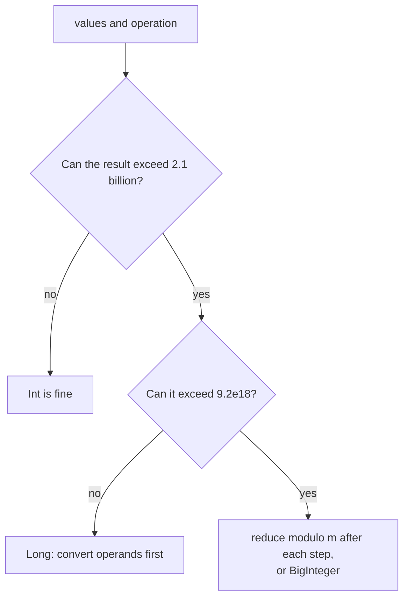

# Overflow Awareness in Kotlin: Long vs Int Limits

> Kotlin never warns you when an `Int` overflows: it silently wraps around. Read the constraints, pick the right type, and convert **before** the arithmetic.

#### 1. What Is It?

| Type | Size | Range |
|---|---|---|
| `Int` | 32 bits | `−2,147,483,648` to `2,147,483,647` (about `±2.1 × 10⁹`) |
| `Long` | 64 bits | `−9.2 × 10¹⁸` to `9.2 × 10¹⁸` |
| `Double` | 64 bits | about 15–16 significant digits (not exact for big integers) |

**Overflow wraps around:** `Int.MAX_VALUE + 1 == Int.MIN_VALUE`. No exception, no warning.

**Reading the constraints**

| Constraint | Safe type |
|---|---|
| values and answer up to `10⁹` | `Int` (but sums and products need care) |
| `n ≤ 10⁵` values each up to `10⁹` → sum up to `10¹⁴` | `Long` |
| product of two values up to `10⁹` (≤ `10¹⁸`) | `Long` |
| factorials, powers, "modulo `10⁹ + 7`" | `Long` with `%` after each multiply |
| answer > `9 × 10¹⁸` | `BigInteger`, or reduce modulo |

**Signals:** "return the answer modulo", "`Int` range", "may overflow", "32-bit signed integer", sums of large arrays, products, `n²` pairs, midpoints `(lo + hi) / 2`.

#### 2. How It Works

**Convert before you compute.**

```text
100000 * 100000          Int arithmetic → 1410065408   (wrong: wrapped)
100000L * 100000         Long arithmetic → 10000000000 (right)
(100000 * 100000).toLong()  still wrong: the multiply happened in Int first
```



**Detecting overflow**

| Method | How |
|---|---|
| Throwing helpers | `Math.addExact`, `Math.multiplyExact` (throw `ArithmeticException`) |
| Compare in `Long` | compute in `Long`, check `result in Int.MIN_VALUE..Int.MAX_VALUE` |
| Check before | `a > Int.MAX_VALUE - b` for `a + b` with positives |
| Sign trick for add | overflow iff `((a xor r) and (b xor r)) < 0`, where `r = a + b` |

**Classic traps**

| Trap | Fix |
|---|---|
| `(lo + hi) / 2` | `lo + (hi - lo) / 2` |
| `abs(Int.MIN_VALUE)` is still negative | use `Long` |
| `-Int.MIN_VALUE` | same |
| `Int.MIN_VALUE / -1` overflows | special-case it |
| `sum += a[i] * a[j]` with `Int` operands | `sum += a[i].toLong() * a[j]` |
| `Double` for exact big integers | use `Long` (doubles lose precision above `2⁵³`) |
| `10.0.pow(18).toLong()` rounding | use `Long` literals / loops |
| Reversing an integer, digit by digit | check `result > Int.MAX_VALUE / 10` before multiplying |

**Division and sqrt.** `Int / 0` throws `ArithmeticException`; `Double / 0` gives `Infinity`. `Math.sqrt(x.toDouble()).toInt()` can be off by one for large `x`; fix by checking neighbours or using binary search.

#### 3. Brute Force vs Optimized

| Situation | Risky | Safe |
|---|---|---|
| Sum of an array | `Int` accumulator | `Long` accumulator |
| Midpoint of indexes | `(lo + hi) / 2` | `lo + (hi - lo) / 2` |
| Product of two values | `a * b` as `Int` | `a.toLong() * b` |
| Parse a number from text | accumulate in `Int` | accumulate in `Long` and clamp |
| Need exact huge result | `Long` overflow | `BigInteger` or modulo |

```kotlin
// Risky: Int accumulator can wrap
fun sumInt(nums: IntArray): Int { var s = 0; for (x in nums) s += x; return s }
```

#### 4. Kotlin Code

```kotlin
fun sumLong(nums: IntArray): Long { var s = 0L; for (x in nums) s += x; return s }

fun willAddOverflow(a: Int, b: Int): Boolean {
    val r = a + b
    return ((a xor r) and (b xor r)) < 0
}

fun safeMultiply(a: Int, b: Int): Int? =
    try { Math.multiplyExact(a, b) } catch (e: ArithmeticException) { null }

fun safeMultiplyLong(a: Int, b: Int): Int? {
    val r = a.toLong() * b
    return if (r in Int.MIN_VALUE.toLong()..Int.MAX_VALUE.toLong()) r.toInt() else null
}

// String to Integer (atoi) (LeetCode 8): accumulate in Long and clamp early
fun myAtoi(s: String): Int {
    var i = 0
    val n = s.length
    while (i < n && s[i] == ' ') i++
    var sign = 1
    if (i < n && (s[i] == '+' || s[i] == '-')) { if (s[i] == '-') sign = -1; i++ }
    var result = 0L
    while (i < n && s[i].isDigit()) {
        result = result * 10 + (s[i] - '0')
        if (sign * result > Int.MAX_VALUE) return Int.MAX_VALUE
        if (sign * result < Int.MIN_VALUE) return Int.MIN_VALUE
        i++
    }
    return (sign * result).toInt()
}

// Sqrt(x) (LeetCode 69) with binary search in Long
fun mySqrt(x: Int): Int {
    var lo = 0L
    var hi = x.toLong()
    while (lo < hi) {
        val mid = lo + (hi - lo + 1) / 2
        if (mid * mid <= x) lo = mid else hi = mid - 1
    }
    return lo.toInt()
}
```

Checks: `Int.MAX_VALUE + 1` → `-2147483648`. `100000 * 100000` → `1410065408`; `100000L * 100000` → `10000000000`. `sumInt(intArrayOf(2000000000, 2000000000))` → `-294967296` (wrapped); `sumLong(...)` → `4000000000`. `willAddOverflow(Int.MAX_VALUE, 1)` → `true`; `(1, 2)` → `false`; `(Int.MIN_VALUE, -1)` → `true`. `safeMultiply(100000, 100000)` → `null`; `(1000, 1000)` → `1000000`. `safeMultiplyLong(50000, 50000)` → `null`; `(46340, 46340)` → `2147395600`. `Math.abs(Int.MIN_VALUE)` → `-2147483648`. `myAtoi("42")` → `42`; `("   -042")` → `-42`; `("1337c0d3")` → `1337`; `("0-1")` → `0`; `("words and 987")` → `0`; `("-91283472332")` → `-2147483648`; `("91283472332")` → `2147483647`. `mySqrt(8)` → `2`; `(4)` → `2`; `(0)` → `0`; `(2147395599)` → `46339`; `(2147483647)` → `46340`.

#### 5. Complexity

| | Time | Space |
|---|---|---|
| Type conversion and overflow checks | `O(1)` | `O(1)` |
| `myAtoi` | `O(n)` | `O(1)` |
| `mySqrt` | `O(log x)` | `O(1)` |

#### 6. Common Mistakes

1. **`(a * b).toLong()`**: the multiplication already overflowed. Write `a.toLong() * b`.
2. **Accumulating a sum in `Int`.**
3. **`(lo + hi) / 2`** with large indexes.
4. **Forgetting `Int.MIN_VALUE`'s special cases** (`abs`, negate, `/ -1`).
5. **Using `Double` for exact integer math.**
6. **Reading only the value limits and ignoring `n`** (`n × maxValue`).
7. **Checking overflow after it happened** (the wrapped value looks valid).
8. **Mixed `Int`/`Long` comparisons** (`result * 10 > Int.MAX_VALUE` where `result` is `Int`).

#### 7. Say This in the Interview

1. "The values go up to `10⁹` and `n` up to `10⁵`, so a sum can reach `10¹⁴`. I'll use `Long`."
2. "I convert one operand to `Long` before multiplying, otherwise the `Int` product wraps first."
3. "I compute the midpoint as `lo + (hi − lo) / 2` to avoid overflow."
4. "I'll check for overflow before the multiply, comparing against `Int.MAX_VALUE / 10`."

#### 8. Quick Check

1. `Int.MAX_VALUE + 1`?
2. Why is `(a * b).toLong()` wrong?
3. When is `Long` not enough?

<details>
<summary>Answers</summary>

1. `Int.MIN_VALUE` (−2147483648).
2. The product is computed in `Int` and overflows before the conversion.
3. When results exceed about `9.2 × 10¹⁸` (e.g. big factorials or powers): reduce modulo, or use `BigInteger`.

</details>

#### 9. Related LeetCode Questions

| # | Question | Idea |
|---|---|---|
| 7 | [Reverse Integer](https://leetcode.com/problems/reverse-integer/) (Medium) | check before multiplying by 10 |
| 8 | [String to Integer (atoi)](https://leetcode.com/problems/string-to-integer-atoi/) (Medium) | clamp in `Long` |
| 69 | [Sqrt(x)](https://leetcode.com/problems/sqrtx/) (Easy) | `mid * mid` in `Long` |
| 29 | [Divide Two Integers](https://leetcode.com/problems/divide-two-integers/) (Medium) | `MIN_VALUE / −1` |
| 415 | [Add Strings](https://leetcode.com/problems/add-strings/) (Easy) | avoid integer conversion |
| 43 | [Multiply Strings](https://leetcode.com/problems/multiply-strings/) (Medium) | digit arrays instead of numbers |
