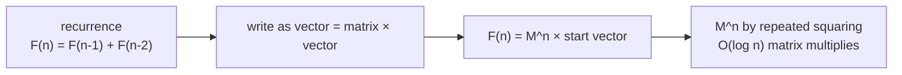

# Matrix Exponentiation and Extended Euclidean: Name Only

> Two advanced tools to recognise. **Matrix exponentiation** computes linear recurrences (like Fibonacci) in `O(log n)`. **Extended Euclid** finds modular inverses when the modulus is not prime.

#### 1. What Is It?

| Tool | Solves | Time |
|---|---|---|
| **Matrix exponentiation** | `F(n)` for a linear recurrence, `n` up to `10¹⁸` | `O(k³ log n)` for a `k × k` matrix |
| **Extended Euclidean algorithm** | find `x, y` with `a·x + b·y = gcd(a, b)`; gives modular inverse | `O(log min(a, b))` |
| Chinese Remainder Theorem (name) | solve several congruences `x ≡ aᵢ (mod mᵢ)` | |
| Euler's totient `φ(n)` (name) | count of numbers `≤ n` coprime to `n`; `a^φ(m) ≡ 1 (mod m)` | |
| Miller-Rabin, Pollard's rho (name) | primality and factoring of huge numbers | |

**Signals:** "`n` up to `10¹⁸`" with a recurrence (Fibonacci-like), "number of walks of length `n` in a small graph", "modular inverse when the modulus is not prime".

These rarely appear in LeetCode-style interviews. Recognising the idea is enough.

#### 2. How It Works

**Matrix exponentiation.** A recurrence like `F(n) = F(n−1) + F(n−2)` is a matrix multiplication:

```text
| F(n+1) |   | 1 1 |   | F(n)   |
| F(n)   | = | 1 0 | · | F(n−1) |

so  | F(n+1) F(n)   |   | 1 1 |ⁿ
    | F(n)   F(n−1) | = | 1 0 |
```

Compute the matrix power with repeated squaring (note 04): `O(log n)` matrix multiplications of a 2 × 2 matrix. For a recurrence of order `k` (like Tribonacci, `k = 3`), use a `k × k` matrix.



The same trick counts walks: the `(i, j)` entry of `Aⁿ` (A = adjacency matrix) is the number of walks of length `n` from `i` to `j`.

**Extended Euclid.** Run Euclid, then work backwards to express the gcd as a combination of `a` and `b`:

```text
extGcd(30, 18) = (6, -1, 2)      because 30·(−1) + 18·2 = 6
```

If `gcd(a, m) = 1`, the equation `a·x + m·y = 1` gives `a·x ≡ 1 (mod m)`, so `x` (made positive) is the **modular inverse** of `a`. Fermat's `a^(m−2)` only works for prime `m`; extended Euclid works for any `m` coprime to `a`.

#### 3. Brute Force vs Optimized

| Problem | Brute force | Better |
|---|---|---|
| `F(10¹⁸) mod p` | loop `10¹⁸` times | matrix power `O(log n)` |
| Modular inverse (non-prime `m`) | try `x = 1..m − 1` until `a·x mod m = 1` `O(m)` | extended Euclid `O(log m)` |
| Modular inverse (prime `m`) | brute force | Fermat `a^(m−2)` |

```kotlin
// Brute force inverse: try every candidate
fun modInverseBrute(a: Int, m: Int): Int? {
    for (x in 1 until m) if ((a.toLong() * x) % m == 1L) return x
    return null
}
```

#### 4. Kotlin Code

```kotlin
typealias Matrix = Array<LongArray>

fun multiply(a: Matrix, b: Matrix, mod: Long): Matrix {
    val n = a.size
    val c = Array(n) { LongArray(n) }
    for (i in 0 until n) for (k in 0 until n) {
        if (a[i][k] == 0L) continue
        for (j in 0 until n) c[i][j] = (c[i][j] + a[i][k] * b[k][j]) % mod
    }
    return c
}

fun matrixPower(m: Matrix, p: Long, mod: Long): Matrix {
    val n = m.size
    var result = Array(n) { i -> LongArray(n) { j -> if (i == j) 1L else 0L } }      // identity
    var base = m
    var e = p
    while (e > 0) {
        if ((e and 1L) == 1L) result = multiply(result, base, mod)
        base = multiply(base, base, mod)
        e = e shr 1
    }
    return result
}

// Fibonacci in O(log n): F(n) mod `mod`
fun fibMatrix(n: Long, mod: Long = 1_000_000_007L): Long {
    if (n == 0L) return 0
    val m = arrayOf(longArrayOf(1, 1), longArrayOf(1, 0))
    return matrixPower(m, n - 1, mod)[0][0]            // [[F(n), F(n-1)], [F(n-1), F(n-2)]]
}

// N-th Tribonacci Number (LeetCode 1137): T0 = 0, T1 = 1, T2 = 1, Tn = Tn-1 + Tn-2 + Tn-3
fun tribonacci(n: Int): Int {
    if (n == 0) return 0
    if (n <= 2) return 1
    val m = arrayOf(longArrayOf(1, 1, 1), longArrayOf(1, 0, 0), longArrayOf(0, 1, 0))
    val p = matrixPower(m, (n - 2).toLong(), Long.MAX_VALUE / 4)      // no modulus needed for small n
    // state vector (T2, T1, T0) = (1, 1, 0); T(n) is the first component of M^(n-2) · (T2, T1, T0)
    return (p[0][0] * 1 + p[0][1] * 1 + p[0][2] * 0).toInt()
}

// Extended Euclid: returns (g, x, y) with a·x + b·y = g = gcd(a, b)
fun extendedGcd(a: Long, b: Long): Triple<Long, Long, Long> {
    if (b == 0L) return Triple(a, 1L, 0L)
    val (g, x1, y1) = extendedGcd(b, a % b)
    return Triple(g, y1, x1 - (a / b) * y1)
}

// Modular inverse for any modulus coprime to a; null if it does not exist
fun modInverse(a: Long, m: Long): Long? {
    val (g, x, _) = extendedGcd(((a % m) + m) % m, m)
    return if (g != 1L) null else ((x % m) + m) % m
}
```

Checks: `fibMatrix(10)` → `55`; `fibMatrix(1)` → `1`; `fibMatrix(0)` → `0`; `fibMatrix(50)` → `586268941` (`F(50) = 12586269025`, minus `12 × (10⁹ + 7)`); `fibMatrix(90)` → `210345902`. `tribonacci(4)` → `4`; `tribonacci(25)` → `1389537`; `tribonacci(0)` → `0`. `extendedGcd(30, 18)` → `(6, -1, 2)`. `modInverse(3, 11)` → `4`; `(10, 17)` → `12`; `(6, 9)` → `null`; `(3, 10)` → `7` (a non-prime modulus). `modInverseBrute(3, 11)` → `4`.

#### 5. Complexity

| | Time | Space |
|---|---|---|
| `matrixPower` for `k × k` | `O(k³ log p)` | `O(k²)` |
| `fibMatrix(n)` | `O(log n)` (k = 2) | `O(1)` |
| `extendedGcd` | `O(log min(a, b))` | `O(log min(a, b))` stack |

#### 6. Common Mistakes

1. **Using matrix power when `n` is small** (a loop is simpler and fast).
2. **Mixing up the start vector and indexes** (`F(n)` vs `F(n−1)` off by one).
3. **No modulus** with large `n` (numbers overflow).
4. **Using Fermat's inverse with a non-prime modulus.**
5. **Returning a negative inverse** from extended Euclid. Normalise with `((x % m) + m) % m`.
6. **Assuming an inverse always exists** (needs `gcd(a, m) = 1`).
7. **Spending interview time on these** before the common tools are solid.

#### 7. Say This in the Interview

1. "This is a linear recurrence with `n` up to `10¹⁸`, so I can write it as a matrix and use fast exponentiation: `O(k³ log n)`."
2. "The modulus isn't prime, so I can't use Fermat's inverse. The extended Euclidean algorithm gives it, as long as the gcd is 1."
3. "I'd mention these for completeness, but for this problem a simple DP is enough."

#### 8. Quick Check

1. Matrix for the Fibonacci recurrence?
2. When does `a` have an inverse mod `m`?
3. Cost of `F(n)` by matrix power?

<details>
<summary>Answers</summary>

1. `[[1, 1], [1, 0]]`.
2. When `gcd(a, m) = 1`.
3. `O(log n)` for a 2 × 2 matrix.

</details>

#### 9. Related LeetCode Questions

| # | Question | Idea |
|---|---|---|
| 509 | [Fibonacci Number](https://leetcode.com/problems/fibonacci-number/) (Easy) | loop, or matrix power for huge `n` |
| 1137 | [N-th Tribonacci Number](https://leetcode.com/problems/n-th-tribonacci-number/) (Easy) | 3 × 3 matrix |
| 70 | [Climbing Stairs](https://leetcode.com/problems/climbing-stairs/) (Easy) | Fibonacci shape |
| 1220 | [Count Vowels Permutation](https://leetcode.com/problems/count-vowels-permutation/) (Hard) | walks in a 5-node graph |
| 790 | [Domino and Tromino Tiling](https://leetcode.com/problems/domino-and-tromino-tiling/) (Medium) | linear recurrence |
| 372 | [Super Pow](https://leetcode.com/problems/super-pow/) (Medium) | modular fast power |
