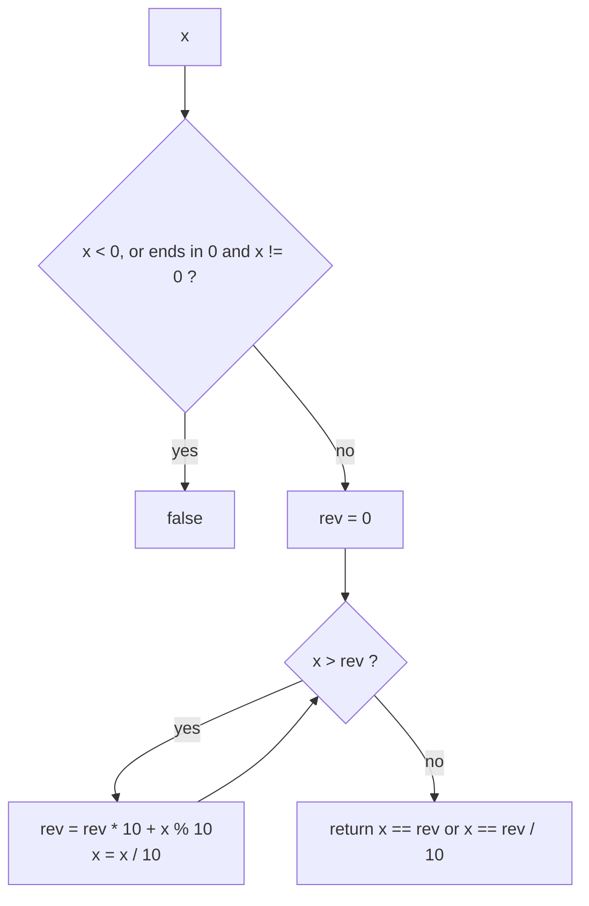

# Digit and Number Manipulation: Palindrome, Happy Number, Big Number Strings

> Most "easy math" interview questions are about digits: peel them with `% 10` and `/ 10`, or process two numbers stored as strings from the right with a carry.

#### 1. What Is It?

| Task | Tool |
|---|---|
| Last digit / remove last digit | `n % 10`, `n / 10` |
| Reverse or compare digits | build a number digit by digit |
| Sum of digits, digital root | loop, or the formula `1 + (n − 1) % 9` |
| Numbers too big for `Long` | keep them as strings or digit arrays; add/multiply with a carry |
| Letter-number systems (Excel columns) | base-26 conversion |
| A process that repeats until 1 or loops | cycle detection (slow/fast pointers or a set) |

**Signals:** "palindrome number", "sum of digits of digits", "add / multiply two numbers given as strings", "plus one", "column title", "happy number", "without converting to a string".

#### 2. How It Works

**Palindrome number without a string.** Reverse only the **second half** of the digits and compare it with the first half. This also avoids overflow.

```text
1221:  n=1221 rev=0
       n=122  rev=1
       n=12   rev=12      n <= rev → stop
n == rev → palindrome
12321: stops at n=12, rev=123 → n == rev / 10 (drop the middle digit) → palindrome
```



**Happy Number.** Replace the number by the sum of the squares of its digits, repeat. It either reaches 1 (happy) or enters a cycle. Detect the cycle with slow/fast pointers (Floyd) in `O(1)` space.

```text
19 → 1² + 9² = 82 → 68 → 100 → 1       happy
2  → 4 → 16 → 37 → 58 → 89 → 145 → 42 → 20 → 4 ...   cycle, not happy
```

**Add numbers as strings.** Walk both strings from the right, add digits plus `carry`, append `sum % 10`, carry `sum / 10`, reverse at the end.

**Multiply numbers as strings.** Digit `i` of `a` times digit `j` of `b` lands at position `i + j + 1` of the result (with the carry to `i + j`).

```text
"123" × "456" → positions fill like a school multiplication → "56088"
```

**Base 26 (Excel columns).** `A = 1 ... Z = 26, AA = 27`. This is base 26 with digits 1 to 26, so subtract 1 before taking `% 26`.

**Digital root.** Repeatedly summing digits until one digit remains gives `1 + (n − 1) % 9` for `n > 0` (and 0 for 0).

#### 3. Brute Force vs Optimized

| Task | Brute force | Better |
|---|---|---|
| Palindrome number | convert to a string and compare `O(d)` space | reverse half `O(1)` space |
| Add Digits | loop until one digit | formula `O(1)` |
| Happy number | `HashSet` of seen values `O(k)` space | Floyd cycle detection `O(1)` space |
| Big-number add/multiply | `BigInteger` (often not allowed) | digit arrays with a carry |

```kotlin
// Brute force palindrome: via a string
fun isPalindromeString(x: Int): Boolean {
    val s = x.toString()
    return s == s.reversed()
}
```

#### 4. Kotlin Code

```kotlin
// Palindrome Number (LeetCode 9)
fun isPalindrome(x: Int): Boolean {
    if (x < 0 || (x % 10 == 0 && x != 0)) return false
    var n = x
    var rev = 0
    while (n > rev) {
        rev = rev * 10 + n % 10
        n /= 10
    }
    return n == rev || n == rev / 10
}

// Happy Number (LeetCode 202)
fun isHappy(n: Int): Boolean {
    fun next(x: Int): Int { var s = 0; var v = x; while (v > 0) { val d = v % 10; s += d * d; v /= 10 }; return s }
    var slow = n
    var fast = next(n)
    while (fast != 1 && slow != fast) {
        slow = next(slow)
        fast = next(next(fast))
    }
    return fast == 1
}

// Plus One (LeetCode 66)
fun plusOne(digits: IntArray): IntArray {
    for (i in digits.indices.reversed()) {
        if (digits[i] < 9) { digits[i]++; return digits }
        digits[i] = 0
    }
    return IntArray(digits.size + 1).also { it[0] = 1 }        // all nines: 999 → 1000
}

// Add Strings (LeetCode 415)
fun addStrings(num1: String, num2: String): String {
    val sb = StringBuilder()
    var i = num1.length - 1
    var j = num2.length - 1
    var carry = 0
    while (i >= 0 || j >= 0 || carry > 0) {
        var sum = carry
        if (i >= 0) sum += num1[i--] - '0'
        if (j >= 0) sum += num2[j--] - '0'
        sb.append(sum % 10)
        carry = sum / 10
    }
    return sb.reverse().toString()
}

// Multiply Strings (LeetCode 43)
fun multiplyStrings(num1: String, num2: String): String {
    if (num1 == "0" || num2 == "0") return "0"
    val res = IntArray(num1.length + num2.length)
    for (i in num1.indices.reversed()) {
        for (j in num2.indices.reversed()) {
            val mul = (num1[i] - '0') * (num2[j] - '0') + res[i + j + 1]
            res[i + j + 1] = mul % 10
            res[i + j] += mul / 10
        }
    }
    return res.joinToString("").trimStart('0')
}

// Excel Sheet Column Number (LeetCode 171) and Title (LeetCode 168)
fun titleToNumber(title: String): Int {
    var result = 0
    for (c in title) result = result * 26 + (c - 'A' + 1)
    return result
}

fun convertToTitle(columnNumber: Int): String {
    var n = columnNumber
    val sb = StringBuilder()
    while (n > 0) {
        n--                                          // shift to 0..25
        sb.append('A' + n % 26)
        n /= 26
    }
    return sb.reverse().toString()
}

// Add Digits (LeetCode 258): digital root
fun addDigits(num: Int): Int = if (num == 0) 0 else 1 + (num - 1) % 9
```

Checks: `isPalindrome(121)` → `true`; `(-121)` → `false`; `(10)` → `false`; `(1221)` → `true`; `(12321)` → `true`; `(0)` → `true`; `isPalindromeString(121)` → `true`. `isHappy(19)` → `true`; `(2)` → `false`; `(1)` → `true`. `plusOne(intArrayOf(1, 2, 3))` → `[1, 2, 4]`; `(intArrayOf(9, 9))` → `[1, 0, 0]`; `(intArrayOf(0))` → `[1]`. `addStrings("11", "123")` → `"134"`; `("456", "77")` → `"533"`; `("0", "0")` → `"0"`; `("999", "1")` → `"1000"`. `multiplyStrings("2", "3")` → `"6"`; `("123", "456")` → `"56088"`; `("0", "52")` → `"0"`; `("99", "99")` → `"9801"`. `titleToNumber("AB")` → `28`; `("ZY")` → `701`; `("A")` → `1`. `convertToTitle(28)` → `"AB"`; `(701)` → `"ZY"`; `(1)` → `"A"`; `(52)` → `"AZ"`. `addDigits(38)` → `2`; `(0)` → `0`; `(9)` → `9`.

#### 5. Complexity

| | Time | Space |
|---|---|---|
| `isPalindrome` | `O(log₁₀ x)` | `O(1)` |
| `isHappy` | `O(log n)` per step, short cycles | `O(1)` |
| `plusOne`, `addStrings` | `O(d)` | `O(1)` / `O(d)` |
| `multiplyStrings` | `O(m · n)` | `O(m + n)` |
| `addDigits` | `O(1)` | `O(1)` |

#### 6. Common Mistakes

1. **Reversing the whole number** (it can overflow `Int`).
2. **Palindrome: not rejecting numbers that end in 0** (except 0 itself).
3. **Leading zeros** in string multiplication results (`trimStart('0')`).
4. **Forgetting the final carry** (`999 + 1`).
5. **`digit - '0'` forgotten**, adding character codes.
6. **Excel title off-by-one:** subtract 1 before `% 26`.
7. **Happy number without cycle detection** (infinite loop).
8. **Mutating the input array in `plusOne`** when the caller needs the original.

#### 7. Say This in the Interview

1. "I'll reverse only half of the digits and compare, which avoids overflow and extra space."
2. "The sequence either hits 1 or cycles, so I detect the cycle with slow and fast pointers: `O(1)` space."
3. "The numbers are strings, so I add from the right with a carry, and append `sum % 10` to a `StringBuilder`."
4. "Excel columns are base 26 with digits 1–26, so I decrement before taking the remainder."

#### 8. Quick Check

1. Why reverse only half of the digits?
2. `addDigits(99)`?
3. Where does digit `i` times digit `j` go in `multiplyStrings`?

<details>
<summary>Answers</summary>

1. To avoid overflow, and it can stop when the halves meet.
2. `1 + 98 % 9 = 1 + 8 = 9`.
3. Position `i + j + 1` (carry into `i + j`).

</details>

#### 9. Related LeetCode Questions

| # | Question | Idea |
|---|---|---|
| 9 | [Palindrome Number](https://leetcode.com/problems/palindrome-number/) (Easy) | reverse half |
| 202 | [Happy Number](https://leetcode.com/problems/happy-number/) (Easy) | cycle detection |
| 66 | [Plus One](https://leetcode.com/problems/plus-one/) (Easy) | carry from the right |
| 415 | [Add Strings](https://leetcode.com/problems/add-strings/) (Easy) | digit-by-digit add |
| 171 | [Excel Sheet Column Number](https://leetcode.com/problems/excel-sheet-column-number/) (Easy) | base 26 |
| 258 | [Add Digits](https://leetcode.com/problems/add-digits/) (Easy) | digital root formula |
| 43 | [Multiply Strings](https://leetcode.com/problems/multiply-strings/) (Medium) | positions `i + j` |
| 168 | [Excel Sheet Column Title](https://leetcode.com/problems/excel-sheet-column-title/) (Easy) | base 26 with shift |
