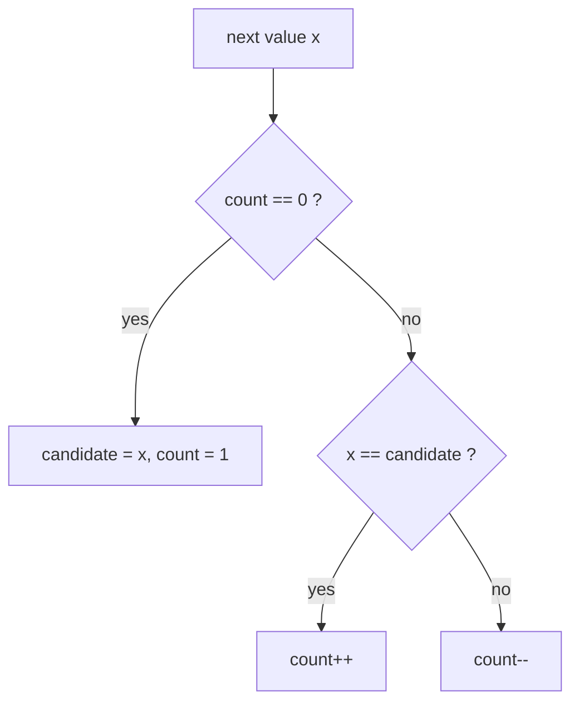

# Math Tricks Worth Knowing: Integer Sqrt, Majority Vote, Random Sampling

> Small tools that appear as stand-alone interview questions: square root without floating point, the element that appears more than half the time in `O(1)` space, and shuffling or sampling fairly.

#### 1. What Is It?

| Tool | Solves | Time / space |
|---|---|---|
| **Integer square root** (binary search or Newton) | `⌊√x⌋`, perfect-square test | `O(log x)` |
| **Boyer-Moore majority vote** | element appearing `> n/2` (or `> n/3` with two candidates) | `O(n)`, `O(1)` |
| **Gauss sum** `n(n + 1)/2` | missing number, sum of a range | `O(1)` |
| **Fisher-Yates shuffle** | uniform random permutation | `O(n)` |
| **Reservoir sampling** | uniform random item from a stream of unknown length | `O(n)`, `O(1)` |
| **Rejection sampling** | build `rand10()` from `rand7()` | expected `O(1)` |

**Signals:** "square root without `sqrt`", "majority element", "more than ⌊n/3⌋ times", "shuffle an array", "random pick from a linked list / stream", "implement `rand10` using `rand7`".

#### 2. How It Works

**Integer square root.** The answer is the largest `r` with `r² ≤ x`. Binary search over `r` (use `Long` for `r * r`). Newton's iteration `r = (r + x / r) / 2` converges in a few steps.

**Boyer-Moore majority vote.** Keep a `candidate` and a `count`. Same value as the candidate → `count++`; different → `count--`; at zero, take a new candidate. Each decrement cancels one majority element against one other element; a true majority (more than half) cannot be fully cancelled.

```text
[2, 2, 1, 1, 1, 2, 2]
2 → cand 2 cnt 1;  2 → cnt 2;  1 → cnt 1;  1 → cnt 0;  1 → cand 1 cnt 1;  2 → cnt 0;  2 → cand 2 cnt 1
candidate = 2 (verify if a majority is not guaranteed)
```



For elements appearing more than `n/3` times, keep **two** candidates and two counts, then verify both.

**Fisher-Yates shuffle.** For `i` from `n − 1` down to 1, swap `a[i]` with a random `a[j]`, `0 ≤ j ≤ i`. Every one of the `n!` permutations is equally likely. A naive "swap each element with any random position" is biased.

**Reservoir sampling (pick 1).** Keep the first item. For the `i`-th item (1-based), replace the kept one with probability `1/i`. At the end every item has the same chance `1/n`.

```text
chance that item k is the final pick = (1/k) · (k/(k+1)) · ((k+1)/(k+2)) ··· ((n−1)/n) = 1/n
```

**Rejection sampling.** `rand7()` gives 1..7. `(rand7() − 1) · 7 + rand7()` is uniform on 1..49. Keep values 1..40 (a multiple of 10) and discard 41..49; then `1 + (v − 1) % 10` is uniform on 1..10.

#### 3. Brute Force vs Optimized

| Problem | Brute force | Better |
|---|---|---|
| `⌊√x⌋` | try `r = 0, 1, 2...` `O(√x)` | binary search / Newton `O(log x)` |
| Majority element | `HashMap` counts `O(n)` space; or sort `O(n log n)` | Boyer-Moore `O(n)`, `O(1)` |
| Shuffle | repeatedly pick random unused items from a list `O(n²)` | Fisher-Yates `O(n)` |
| Random node from a linked list | copy to an array `O(n)` space | reservoir sampling `O(1)` space |

```kotlin
// Brute force majority element: count with a map
fun majorityMap(nums: IntArray): Int {
    val count = HashMap<Int, Int>()
    for (x in nums) count[x] = (count[x] ?: 0) + 1
    return count.entries.first { it.value > nums.size / 2 }.key
}
```

#### 4. Kotlin Code

```kotlin
import kotlin.random.Random

// Sqrt(x) with Newton's method
fun mySqrtNewton(x: Int): Int {
    if (x < 2) return x
    var r = x.toLong()
    while (r * r > x) r = (r + x / r) / 2
    return r.toInt()
}

// Valid Perfect Square (LeetCode 367)
fun isPerfectSquare(num: Int): Boolean {
    var lo = 1L
    var hi = num.toLong()
    while (lo <= hi) {
        val mid = lo + (hi - lo) / 2
        val sq = mid * mid
        when {
            sq == num.toLong() -> return true
            sq < num -> lo = mid + 1
            else -> hi = mid - 1
        }
    }
    return false
}

// Majority Element (LeetCode 169): Boyer-Moore
fun majorityElement(nums: IntArray): Int {
    var candidate = 0
    var count = 0
    for (x in nums) {
        if (count == 0) candidate = x
        count += if (x == candidate) 1 else -1
    }
    return candidate
}

// Majority Element II (LeetCode 229): more than n/3 times, two candidates
fun majorityElementII(nums: IntArray): List<Int> {
    var c1 = 0; var c2 = 1; var n1 = 0; var n2 = 0
    for (x in nums) {
        when {
            x == c1 -> n1++
            x == c2 -> n2++
            n1 == 0 -> { c1 = x; n1 = 1 }
            n2 == 0 -> { c2 = x; n2 = 1 }
            else -> { n1--; n2-- }
        }
    }
    return listOf(c1, c2).distinct().filter { c -> nums.count { it == c } > nums.size / 3 }.sorted()   // verify the candidates
}

// Fisher-Yates shuffle (LeetCode 384)
fun shuffle(nums: IntArray, random: Random = Random.Default): IntArray {
    val a = nums.copyOf()
    for (i in a.size - 1 downTo 1) {
        val j = random.nextInt(i + 1)               // 0..i inclusive
        val t = a[i]; a[i] = a[j]; a[j] = t
    }
    return a
}

// Reservoir sampling of one item from a stream (LeetCode 382 for a linked list)
class ReservoirSampler(private val random: Random = Random.Default) {
    private var seen = 0
    private var chosen = 0
    fun offer(value: Int) {
        seen++
        if (random.nextInt(seen) == 0) chosen = value      // probability 1 / seen
    }
    fun result(): Int = chosen
}

// Implement Rand10() Using Rand7() (LeetCode 470): rejection sampling
fun rand10(rand7: () -> Int): Int {
    while (true) {
        val v = (rand7() - 1) * 7 + rand7()          // uniform 1..49
        if (v <= 40) return 1 + (v - 1) % 10
    }
}
```

Checks: `mySqrtNewton(8)` → `2`; `(4)` → `2`; `(0)` → `0`; `(1)` → `1`; `(2147395599)` → `46339`; `(2147483647)` → `46340`. `isPerfectSquare(16)` → `true`; `(14)` → `false`; `(1)` → `true`; `(2147395600)` → `true`. `majorityElement(intArrayOf(3, 2, 3))` → `3`; `(intArrayOf(2, 2, 1, 1, 1, 2, 2))` → `2`. `majorityMap(intArrayOf(3, 2, 3))` → `3`. `majorityElementII(intArrayOf(3, 2, 3))` → `[3]`; `(intArrayOf(1))` → `[1]`; `(intArrayOf(1, 2))` → `[1, 2]`; `(intArrayOf(1, 1, 1, 3, 3, 2, 2, 2))` → `[1, 2]`. `shuffle(intArrayOf(1, 2, 3, 4)).sorted()` → `[1, 2, 3, 4]` (a permutation of the input, in random order). A `ReservoirSampler` fed `1..5` returns one of them, each with probability `1/5`. `rand10 { Random.nextInt(1, 8) }` always returns a value in `1..10`.

#### 5. Complexity

| | Time | Space |
|---|---|---|
| Integer sqrt | `O(log x)` | `O(1)` |
| Boyer-Moore | `O(n)` (plus `O(n)` to verify) | `O(1)` |
| Fisher-Yates | `O(n)` | `O(n)` for the copy |
| Reservoir sampling | `O(n)` for a stream of `n` | `O(1)` |
| `rand10` | expected about 2.45 calls to `rand7` | `O(1)` |

#### 6. Common Mistakes

1. **`mid * mid` overflow** in `Int`. Use `Long`.
2. **Boyer-Moore without verification** when a majority is not guaranteed.
3. **Biased shuffle:** swapping with an index from the full range `0..n−1` every time gives non-uniform results.
4. **Off-by-one in the random range** (`nextInt(i + 1)` is inclusive of `i`).
5. **Reservoir probability `1/seen`** with a wrong counter (must count the current item).
6. **Rejection sampling with a non-multiple of 10** (e.g. keep 1..45 → bias).
7. **Using `Math.sqrt` and casting** for exact integer problems.
8. **For `n/3`:** forgetting that two candidates need a second pass to verify counts.

#### 7. Say This in the Interview

1. "I'll binary search the integer square root: the largest `r` with `r * r ≤ x`, using `Long` to avoid overflow."
2. "Boyer-Moore pairs off each majority element with a different element; the majority can't be fully cancelled, so the survivor is the answer. `O(n)` time, `O(1)` space."
3. "Fisher-Yates swaps each position with a random earlier-or-equal position, giving every permutation equal probability."
4. "For a stream of unknown length I replace the current pick with probability `1/i`, so every item ends with chance `1/n`."

#### 8. Quick Check

1. Why does Boyer-Moore work for a strict majority?
2. Reservoir sampling probability to replace at the 4th item?
3. Why keep only 1..40 in `rand10`?

<details>
<summary>Answers</summary>

1. Cancelling pairs of different elements removes at most one majority element per other element, and the majority has more than half.
2. `1/4`.
3. 40 is a multiple of 10, so each result 1..10 is equally likely; keeping 41–49 would bias some outputs.

</details>

#### 9. Related LeetCode Questions

| # | Question | Idea |
|---|---|---|
| 69 | [Sqrt(x)](https://leetcode.com/problems/sqrtx/) (Easy) | binary search / Newton |
| 367 | [Valid Perfect Square](https://leetcode.com/problems/valid-perfect-square/) (Easy) | binary search |
| 169 | [Majority Element](https://leetcode.com/problems/majority-element/) (Easy) | Boyer-Moore |
| 229 | [Majority Element II](https://leetcode.com/problems/majority-element-ii/) (Medium) | two candidates |
| 384 | [Shuffle an Array](https://leetcode.com/problems/shuffle-an-array/) (Medium) | Fisher-Yates |
| 382 | [Linked List Random Node](https://leetcode.com/problems/linked-list-random-node/) (Medium) | reservoir sampling |
| 470 | [Implement Rand10() Using Rand7()](https://leetcode.com/problems/implement-rand10-using-rand7/) (Medium) | rejection sampling |
