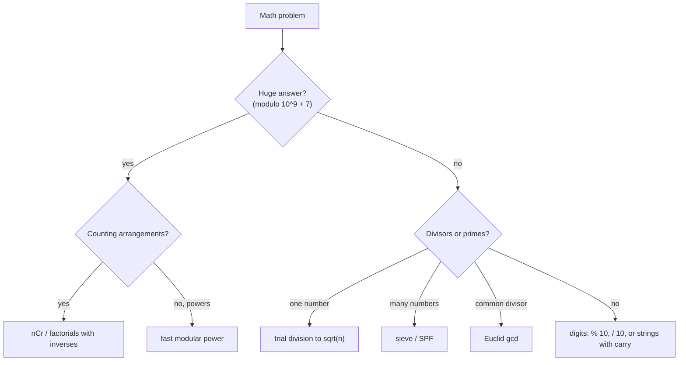

# Math & Number Theory Cheat Sheet

> One-page revision for the night before an interview. The full explanations are in notes 01–10.

#### 1. Key Takeaways

1. **GCD:** `gcd(a, b) = gcd(b, a % b)`, `O(log n)`. **LCM** = `a / gcd * b` (divide first, use `Long`).
2. **Prime test:** try divisors up to `√n` (`d <= n / d`), skip evens, `O(√n)`. 0 and 1 are not prime.
3. **Many primes:** **sieve** of Eratosthenes, start crossing at `p²`, `O(n log log n)`. SPF table for fast factorisation.
4. **Fast power:** square the base, halve the exponent, reduce `% m` every step: `O(log b)`. Inverse mod a prime: `a^(p−2)`.
5. **Modulo `10⁹ + 7`:** use `Long`; reduce after every `+ - *`; fix negatives with `((x % m) + m) % m`; divide with an inverse.
6. **`nCr`:** multiplicative loop `res * (n − r + i) / i`, or Pascal's triangle, or factorials with inverse factorials. Grid paths `C(m + n − 2, m − 1)`.
7. **Overflow:** Kotlin `Int` wraps silently. Convert **before** multiplying (`a.toLong() * b`). `abs(Int.MIN_VALUE)` stays negative. Midpoint `lo + (hi − lo) / 2`.
8. **Digits:** `% 10` and `/ 10`. Palindrome number: reverse half. Big numbers: strings + carry. Excel columns: base 26 with a `−1` shift.
9. **Majority vote (Boyer-Moore):** `O(1)` space. **Fisher-Yates** for a fair shuffle. **Reservoir** `1/i` for a stream.
10. Name only: matrix exponentiation (`O(log n)` recurrences), extended Euclid (inverse for non-prime modulus), CRT, Euler's totient, Miller-Rabin.

#### 2. Complexity Table

| Operation | Time | Space |
|---|---|---|
| `gcd(a, b)` | `O(log min(a, b))` | `O(1)` |
| `isPrime(n)` | `O(√n)` | `O(1)` |
| Factorise `n` (trial division) | `O(√n)` | `O(log n)` |
| Sieve up to `n` | `O(n log log n)` | `O(n)` |
| `modPow(a, b, m)` | `O(log b)` | `O(1)` |
| `nCr` (multiplicative) | `O(r)` | `O(1)` |
| Pascal's triangle row `n` | `O(n²)` / `O(n)` memory for one row | |
| Factorial tables + `nCr` query | `O(n)` once, `O(1)` per query | `O(n)` |
| Integer sqrt | `O(log x)` | `O(1)` |
| Boyer-Moore majority | `O(n)` | `O(1)` |
| Matrix power (`k × k`) | `O(k³ log n)` | `O(k²)` |
| Extended Euclid | `O(log min(a, b))` | `O(log)` stack |

| Type | Limit |
|---|---|
| `Int` | `±2.147 × 10⁹` |
| `Long` | `±9.22 × 10¹⁸` |
| Product of two values below `10⁹ + 7` | `< 10¹⁸` fits in `Long` |
| `Double` | exact integers only up to `2⁵³ ≈ 9 × 10¹⁵` |

#### 3. Patterns and How to Identify Them

| Signal in the question | Tool | Note |
|---|---|---|
| "simplify", "same-size pieces", "meet again after" | GCD / LCM | 01 |
| "is prime", "count divisors", "ugly number" | trial division | 02 |
| "count primes below `n`", `n ≤ 10⁷` | sieve | 03 |
| "`x^n`", "modulo `10⁹ + 7`", huge exponent | fast modular power | 04 |
| "sum divisible by `k`", "remainder" | prefix remainders | 05 |
| "number of ways", "choose `k`", "paths in a grid" | `nCr`, Catalan | 06 |
| "32-bit", "may overflow", "clamp" | `Long`, check before | 07 |
| "`n` up to `10¹⁸`" with a recurrence | matrix power | 08 |
| "palindrome number", "add / multiply strings", "happy number" | digit loops | 09 |
| "sqrt without `sqrt`", "majority", "shuffle", "random pick" | math tricks | 10 |



#### 4. Templates to Memorise

**GCD / LCM**

```kotlin
tailrec fun gcd(a: Int, b: Int): Int = if (b == 0) a else gcd(b, a % b)
fun lcm(a: Int, b: Int): Long = a.toLong() / gcd(a, b) * b
```

**Prime test**

```kotlin
fun isPrime(n: Int): Boolean {
    if (n < 2) return false
    if (n < 4) return true
    if (n % 2 == 0 || n % 3 == 0) return false
    var d = 5
    while (d <= n / d) { if (n % d == 0 || n % (d + 2) == 0) return false; d += 6 }
    return true
}
```

**Sieve**

```kotlin
val composite = BooleanArray(n)
var i = 2
while (i.toLong() * i < n) {
    if (!composite[i]) { var j = i * i; while (j < n) { composite[j] = true; j += i } }
    i++
}
```

**Fast power mod**

```kotlin
fun modPow(a: Long, b: Long, m: Long): Long {
    var r = 1L % m; var base = a % m; var e = b
    while (e > 0) { if ((e and 1L) == 1L) r = r * base % m; base = base * base % m; e = e shr 1 }
    return r
}
```

**Modular helpers**

```kotlin
fun posMod(x: Int, m: Int) = ((x % m) + m) % m
fun inverse(a: Long, p: Long) = modPow(a, p - 2, p)          // p prime
```

**nCr**

```kotlin
fun nCr(n: Int, r0: Int): Long {
    val r = minOf(r0, n - r0); var res = 1L
    for (i in 1..r) res = res * (n - r + i) / i
    return res
}
```

**Prefix remainders**

```kotlin
val count = IntArray(k); count[0] = 1; var prefix = 0
for (x in nums) { prefix = posMod(prefix + x, k); answer += count[prefix]; count[prefix]++ }
```

**Digit loop and half-reverse palindrome**

```kotlin
while (n > rev) { rev = rev * 10 + n % 10; n /= 10 }
return n == rev || n == rev / 10
```

**Add strings**

```kotlin
while (i >= 0 || j >= 0 || carry > 0) {
    var s = carry
    if (i >= 0) s += a[i--] - '0'
    if (j >= 0) s += b[j--] - '0'
    sb.append(s % 10); carry = s / 10
}
```

**Boyer-Moore**

```kotlin
for (x in nums) { if (count == 0) cand = x; count += if (x == cand) 1 else -1 }
```

#### 5. Brute Force to Optimized

| Problem | Brute force | Better |
|---|---|---|
| GCD | test all divisors `O(min)` | Euclid `O(log)` |
| Prime test | test `2..n−1` `O(n)` | to `√n` `O(√n)` |
| Count primes `< n` | test each `O(n√n)` | sieve `O(n log log n)` |
| `x^n mod m` | multiply `n` times `O(n)` | squaring `O(log n)` |
| Subarrays divisible by `k` | all subarrays `O(n²)` | prefix remainders `O(n)` |
| `nCr` | `n!` (overflows) | multiplicative `O(r)` |
| `F(10¹⁸) mod p` | loop | matrix power `O(log n)` |
| Majority element | `HashMap` `O(n)` space | Boyer-Moore `O(1)` |
| Palindrome number | string reverse | reverse half |
| `⌊√x⌋` | try `r = 1, 2, ...` | binary search / Newton |

#### 6. Common Mistakes and Edge Cases

1. **Multiplying in `Int`** and converting after. Convert first.
2. **Forgetting `% m`** after each step; overflow in between.
3. **Negative remainders** (`-7 % 5 == -2`).
4. **LCM as `a * b / gcd`** (overflow).
5. **`d * d <= n` overflow**; write `d <= n / d`.
6. **Treating 1 as prime;** sieve `< n` vs `<= n`.
7. **Fermat's inverse with a non-prime modulus.**
8. **`abs(Int.MIN_VALUE)`, `Int.MIN_VALUE / -1`.**
9. **Biased shuffle;** unverified Boyer-Moore result.
10. **Edge cases:** `0`, `1`, negatives, `Int.MAX_VALUE`, `n = 0` in `nCr`, empty strings, all nines (`999 + 1`).

#### 7. What to Say Out Loud

1. "Euclid's algorithm gives the GCD in `O(log n)`, and I'll compute LCM as `a / gcd * b` to avoid overflow."
2. "A divisor above `√n` has a partner below it, so I only test up to `√n`."
3. "The answer is modulo `10⁹ + 7`, so I'll use `Long` and reduce after every multiplication."
4. "`n` is large, so I'll use fast exponentiation: `O(log n)` multiplications."
5. "Values go to `10⁹` and `n` to `10⁵`, so the sum can reach `10¹⁴`; I'll use `Long`."
6. "Equal prefix remainders mean the subarray between them is divisible by `k`."

#### 8. Practice Order (Easy → Medium)

| Level | Question | Pattern |
|---|---|---|
| Easy | [Palindrome Number](https://leetcode.com/problems/palindrome-number/) | reverse half |
| Easy | [Happy Number](https://leetcode.com/problems/happy-number/) | cycle detection |
| Easy | [Plus One](https://leetcode.com/problems/plus-one/) | carry |
| Easy | [Add Strings](https://leetcode.com/problems/add-strings/) | carry on strings |
| Easy | [Sqrt(x)](https://leetcode.com/problems/sqrtx/) | binary search, `Long` |
| Easy | [Ugly Number](https://leetcode.com/problems/ugly-number/) | divide out factors |
| Easy | [Greatest Common Divisor of Strings](https://leetcode.com/problems/greatest-common-divisor-of-strings/) | gcd of lengths |
| Easy | [Majority Element](https://leetcode.com/problems/majority-element/) | Boyer-Moore |
| Easy | [Excel Sheet Column Number](https://leetcode.com/problems/excel-sheet-column-number/) | base 26 |
| Easy | [Pascal's Triangle](https://leetcode.com/problems/pascals-triangle/) | `nCr` rows |
| Medium | [Count Primes](https://leetcode.com/problems/count-primes/) | sieve |
| Medium | [Pow(x, n)](https://leetcode.com/problems/powx-n/) | fast power |
| Medium | [Unique Paths](https://leetcode.com/problems/unique-paths/) | `C(m + n − 2, m − 1)` |
| Medium | [Factorial Trailing Zeroes](https://leetcode.com/problems/factorial-trailing-zeroes/) | count factors of 5 |
| Medium | [Subarray Sums Divisible by K](https://leetcode.com/problems/subarray-sums-divisible-by-k/) | prefix remainders |
| Medium | [Count Good Numbers](https://leetcode.com/problems/count-good-numbers/) | modular power |
| Medium | [Multiply Strings](https://leetcode.com/problems/multiply-strings/) | digit positions |
| Medium | [String to Integer (atoi)](https://leetcode.com/problems/string-to-integer-atoi/) | overflow clamp |
| Medium | [Shuffle an Array](https://leetcode.com/problems/shuffle-an-array/) | Fisher-Yates |
| Medium | [Water and Jug Problem](https://leetcode.com/problems/water-and-jug-problem/) | gcd |
