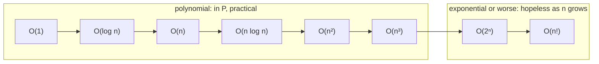

# P: Solvable in Polynomial Time

> **P** is the set of problems that have an algorithm running in `O(nᵏ)` time for some fixed `k`. In practice, "in P" means "has a fast, reliable algorithm". Almost everything you code in interviews is in P.

#### 1. What Is It?

A problem is in **P** if some algorithm solves it in **polynomial time** in the input size `n`: `O(n)`, `O(n log n)`, `O(n²)`, `O(n³)`, ... any fixed power.

| Growth | Class | `n = 50` operations | Time at 10⁹ ops/sec |
|---|---|---|---|
| `n` | polynomial | 50 | instant |
| `n²` | polynomial | 2,500 | instant |
| `n³` | polynomial | 125,000 | instant |
| `2ⁿ` | exponential | 1.1 × 10¹⁵ | about 13 days |
| `n!` | factorial | 3 × 10⁶⁴ | longer than the age of the universe |

**Why polynomial is the dividing line.** Doubling the input multiplies a polynomial running time by a constant (`n² → 4×`), but squares an exponential one. Hardware speed-ups help polynomial algorithms a lot, and exponential ones hardly at all.

**Problems in P that you know**

| Problem | Algorithm | Time |
|---|---|---|
| Sorting | merge sort | `O(n log n)` |
| Shortest path | Dijkstra | `O((V + E) log V)` |
| Minimum spanning tree | Kruskal / Prim | `O(E log E)` |
| Edit distance, LCS | DP | `O(mn)` |
| Maximum flow, bipartite matching | Edmonds-Karp | `O(V E²)` |
| Primality testing | AKS (and trial division for small `n`) | polynomial in the number of digits |
| 2-colouring (bipartite check) | BFS | `O(V + E)` |

**Pseudo-polynomial: a trap.** The 0/1 knapsack DP runs in `O(n · W)`, where `W` is the capacity as a *number*. The input only needs `log W` bits, so `W` can be exponential in the input size. It is fast when `W` is small (≤ 10⁵) and useless when `W` has 20 digits. So knapsack is **not known to be in P**, even though the DP looks polynomial.

**Signals:** "can this be solved fast?", "what is the complexity class of ...", "is there a polynomial algorithm", interviewer asks you to justify why you stopped at brute force.

#### 2. How It Works



**Proving a problem is in P** means giving an algorithm and showing its running time is a polynomial. That is all most interview analysis does.

**Hints from constraints** (a common competitive-programming habit that also works in interviews):

| `n` up to | Intended complexity |
|---|---|
| 10 | `O(n!)` brute force / permutations |
| 20 | `O(2ⁿ · n)` subsets, bitmask DP |
| 100 | `O(n⁴)` |
| 500 | `O(n³)` (Floyd-Warshall, interval DP) |
| 5,000 | `O(n²)` |
| 10⁵ | `O(n log n)` |
| 10⁶–10⁷ | `O(n)` |
| 10⁹+ | `O(log n)` or `O(1)` |

If the constraints say `n ≤ 20`, the problem setter probably knows the problem is hard and allows exponential time.

#### 3. Brute Force vs Optimized

Many problems *look* exponential but are in P once you see the structure:

| Problem | Brute force | Polynomial algorithm |
|---|---|---|
| Fibonacci | `O(2ⁿ)` recursion | `O(n)` loop / memo |
| Longest Common Subsequence | all subsequences `O(2ⁿ)` | DP `O(mn)` |
| Edit distance | try all edit sequences | DP `O(mn)` |
| Shortest path | all paths | Dijkstra |
| Maximum subarray | all subarrays `O(n²)` | Kadane `O(n)` |

```kotlin
// Looks exponential, is polynomial: naive recursion vs memoized DP
fun fibNaive(n: Int): Long = if (n < 2) n.toLong() else fibNaive(n - 1) + fibNaive(n - 2)

fun fibLinear(n: Int): Long {
    var a = 0L; var b = 1L
    repeat(n) { val t = a + b; a = b; b = t }
    return a
}
```

#### 4. Kotlin Code

```kotlin
// How fast do common growth rates blow up?
fun growthTable(sizes: List<Int>): List<String> = sizes.map { n ->
    var fact = 1.0
    for (i in 2..n) fact *= i
    "n=$n  n²=${n.toLong() * n}  n³=${n.toLong() * n * n}  " +
        "2ⁿ=${"%.3e".format(Math.pow(2.0, n.toDouble()))}  n!=${"%.3e".format(fact)}"
}

// Seconds needed for `ops` operations at 10^9 operations per second
fun secondsAt1e9(ops: Double): Double = ops / 1e9

// 0/1 knapsack: pseudo-polynomial O(n · W)
fun knapsack(weights: IntArray, values: IntArray, capacity: Int): Int {
    val dp = IntArray(capacity + 1)
    for (i in weights.indices) {
        for (w in capacity downTo weights[i]) dp[w] = maxOf(dp[w], dp[w - weights[i]] + values[i])
    }
    return dp[capacity]
}
```

Checks: `growthTable(listOf(10))` → `["n=10  n²=100  n³=1000  2ⁿ=1.024e+03  n!=3.629e+06"]`; for `n = 20`: `n²=400  n³=8000  2ⁿ=1.049e+06  n!=2.433e+18`; for `n = 30`: `n²=900  n³=27000  2ⁿ=1.074e+09  n!=2.653e+32`. `secondsAt1e9(Math.pow(2.0, 50.0)) / 86400` → about `13.03` days. `fibLinear(50)` → `12586269025`; `fibNaive(30)` → `832040` (about 2.7 million calls); `fibLinear(30)` → `832040`. `knapsack(intArrayOf(1, 3, 4, 5), intArrayOf(1, 4, 5, 7), 7)` → `9`.

#### 5. Complexity

| Class | Typical running time | Practical? |
|---|---|---|
| Logarithmic | `O(log n)` | yes |
| Linear / near-linear | `O(n)`, `O(n log n)` | yes, up to ~10⁷ |
| Quadratic / cubic | `O(n²)`, `O(n³)` | up to ~10⁴ / ~500 |
| Exponential | `O(2ⁿ)` | up to ~25 |
| Factorial | `O(n!)` | up to ~10 |

#### 6. Common Mistakes

1. **Calling a knapsack DP "polynomial".** It is pseudo-polynomial (polynomial in the *value* of `W`, not its bit length).
2. **Saying "polynomial means fast".** `n¹⁰⁰` is polynomial and useless; it is a theoretical dividing line.
3. **Confusing "NP" with "not polynomial"** (note 02).
4. **Assuming exponential brute force is the only way** before looking for DP or greedy structure.
5. **Ignoring input size.** For graphs, `n` is `V + E`; for numbers, it is the number of digits.
6. **Quoting `O(2ⁿ)` for 2ⁿ outputs** (the output itself is exponential; that is not a hardness claim).

#### 7. Say This in the Interview

1. "Brute force is `O(2ⁿ)`, but the subproblems overlap, so a DP solves it in polynomial time: `O(n · W)` here."
2. "That DP is pseudo-polynomial: it's fast because `W` is bounded by 10⁵ in the constraints."
3. "The constraint `n ≤ 20` suggests the intended solution is exponential, like bitmask DP."

#### 8. Quick Check

1. Is `O(n¹⁰)` in P?
2. Is the knapsack DP `O(nW)` truly polynomial?
3. Time for `2⁴⁰` operations at 10⁹ per second?

<details>
<summary>Answers</summary>

1. Yes. Any fixed power is polynomial.
2. No, it is pseudo-polynomial: polynomial in the *value* of `W` but exponential in its bit length.
3. About 1,100 seconds (`1.1 × 10¹²` ops), roughly 18 minutes.

</details>

#### 9. Related LeetCode Questions

| # | Question | Idea |
|---|---|---|
| 1 | [Two Sum](https://leetcode.com/problems/two-sum/) (Easy) | `O(n²)` brute force → `O(n)` |
| 56 | [Merge Intervals](https://leetcode.com/problems/merge-intervals/) (Medium) | sort, `O(n log n)` |
| 743 | [Network Delay Time](https://leetcode.com/problems/network-delay-time/) (Medium) | shortest path in P |
| 1143 | [Longest Common Subsequence](https://leetcode.com/problems/longest-common-subsequence/) (Medium) | exponential → `O(mn)` DP |
| 72 | [Edit Distance](https://leetcode.com/problems/edit-distance/) (Medium) | DP `O(mn)` |
| 322 | [Coin Change](https://leetcode.com/problems/coin-change/) (Medium) | pseudo-polynomial DP |
