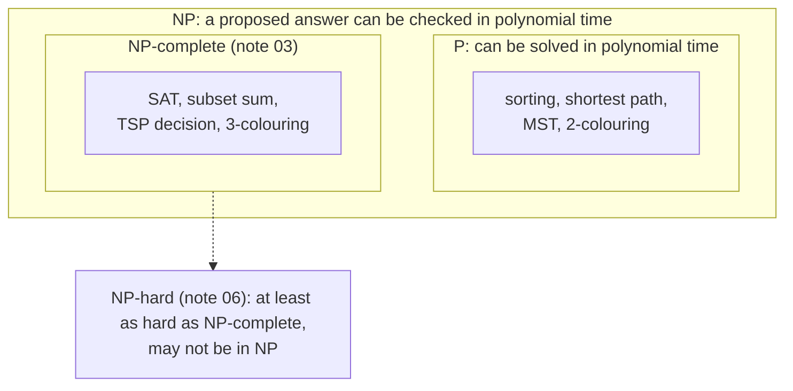

# NP: Checkable in Polynomial Time

> **NP** is the set of problems where, if someone hands you a proposed answer, you can **check** it quickly. Finding the answer may be very hard. NP does not mean "not polynomial".

#### 1. What Is It?

A decision problem (yes/no) is in **NP** if there is a **certificate** (a proposed solution) that can be **verified** in polynomial time.

| Problem | Certificate | Check | Time to check |
|---|---|---|---|
| Subset Sum: is there a subset adding to `T`? | the chosen items | add them up | `O(n)` |
| Graph colouring: can it be coloured with `k` colours? | a colour for each node | look at every edge | `O(E)` |
| Hamiltonian path: is there a path through every node once? | the order of nodes | check each step is an edge | `O(V)` |
| Sudoku (valid solution?) | a filled board | check rows, columns, boxes | `O(n²)` |

**The name.** NP = "Nondeterministic Polynomial": a magical machine that *guesses* the right certificate could solve it in polynomial time. Equivalent view: verification is polynomial.

**P ⊆ NP.** If you can solve a problem fast, you can also check an answer fast (just solve it again). The big open question: is NP *bigger* than P? (note 07)

**Search vs verify**

| | Search (find a solution) | Verify (check a solution) |
|---|---|---|
| Subset Sum | try `2ⁿ` subsets | add `n` numbers |
| Sudoku | explore a huge tree | check 27 groups |
| Factoring | try divisors up to `√N` | multiply two numbers |

**Signals:** "can you check it faster than you can find it?", "NP", "certificate", "verify in polynomial time", "guess and check".

#### 2. How It Works



**A verifier is an ordinary fast algorithm** that takes the input *and* the certificate and answers yes/no. The hard part of an NP problem is only the *finding*.

**Why "no" answers are not required to be checkable.** NP asks for a short proof of a *yes* answer. A short proof of "no subset adds up to `T`" is not known; that is the class **co-NP**.

**Optimisation problems** ("find the shortest tour") are rephrased as decision problems ("is there a tour of length ≤ `L`?") so they fit the framework (note 06).

#### 3. Brute Force vs Optimized

| Step | Cost for Subset Sum (`n` numbers) |
|---|---|
| Find a subset by trying all `2ⁿ` | `O(2ⁿ · n)` |
| Check a given subset | `O(n)` |
| DP (if the target is small) | `O(n · T)`, pseudo-polynomial |

```kotlin
// Search: try every subset (exponential)
fun findSubsetSumBrute(nums: IntArray, target: Int): List<Int>? {
    val n = nums.size
    for (mask in 0 until (1 shl n)) {
        var sum = 0
        for (i in 0 until n) if (((mask shr i) and 1) == 1) sum += nums[i]
        if (sum == target) return (0 until n).filter { ((mask shr it) and 1) == 1 }
    }
    return null
}
```

#### 4. Kotlin Code

```kotlin
// Verify: polynomial time, given a certificate
fun verifySubsetSum(nums: IntArray, target: Int, chosen: List<Int>): Boolean {
    if (chosen.toSet().size != chosen.size) return false              // no index twice
    if (chosen.any { it !in nums.indices }) return false              // valid indexes only
    return chosen.sumOf { nums[it] } == target
}

// Verify a graph colouring: no edge joins two nodes of the same colour
fun verifyColoring(edges: Array<IntArray>, colors: IntArray, k: Int): Boolean {
    if (colors.any { it !in 0 until k }) return false
    return edges.all { (u, v) -> colors[u] != colors[v] }
}

// Verify a Hamiltonian path: visits every node exactly once, consecutive nodes are adjacent
fun verifyHamiltonianPath(n: Int, adj: Array<BooleanArray>, path: List<Int>): Boolean {
    if (path.size != n || path.toSet().size != n) return false
    for (i in 0 until n - 1) if (!adj[path[i]][path[i + 1]]) return false
    return true
}
```

Checks: with `nums = [3, 34, 4, 12, 5, 2]`, `target = 9`: `findSubsetSumBrute(nums, 9)` → `[2, 4]` (`4 + 5`). `verifySubsetSum(nums, 9, listOf(2, 4))` → `true`; `(nums, 9, listOf(0, 1))` → `false`; `(nums, 9, listOf(2, 2, 4))` → `false` (repeated index). `findSubsetSumBrute(intArrayOf(1, 2), 10)` → `null`. A triangle `edges = [[0,1],[1,2],[0,2]]`: `verifyColoring(edges, intArrayOf(0, 1, 2), 3)` → `true`; `intArrayOf(0, 1, 1)` → `false`. A path graph `0-1-2-3`: `verifyHamiltonianPath(4, adj, listOf(0, 1, 2, 3))` → `true`; `listOf(0, 2, 1, 3)` → `false`.

#### 5. Complexity

| | Time |
|---|---|
| Verify subset sum / colouring / Hamiltonian path | `O(n)` / `O(E)` / `O(V)` |
| Find by brute force | `O(2ⁿ · n)` / `O(kⁿ · E)` / `O(n!)` |

#### 6. Common Mistakes

1. **Reading NP as "Not Polynomial".** It stands for Nondeterministic Polynomial; every problem in P is also in NP.
2. **Forgetting the certificate must be short** (polynomial size).
3. **Thinking verification must also find the answer.**
4. **Mixing decision and optimisation versions.** NP is about yes/no questions.
5. **Assuming every hard-looking problem is in NP.** Some problems are not even checkable (e.g. "is this the *best* chess move").
6. **Verifying only part of the constraints** (e.g. skipping the "each node exactly once" condition).

#### 7. Say This in the Interview

1. "Given a candidate solution I can verify it in `O(n)`, so the decision version is in NP. Finding one seems to need exponential search."
2. "NP means checkable in polynomial time, not 'harder than polynomial'. P is inside NP."
3. "I'll write the verifier first: it is simple, and it doubles as my test oracle for the brute force."

#### 8. Quick Check

1. Is every problem in P also in NP?
2. What is a certificate?
3. Why is "find the shortest tour" not directly in NP?

<details>
<summary>Answers</summary>

1. Yes: solving it fast also lets you check a solution fast.
2. A proposed solution (proof of a yes answer) that a verifier can check quickly.
3. NP contains decision problems. The decision form is "is there a tour of length ≤ `L`?".

</details>

#### 9. Related LeetCode Questions

| # | Question | Idea |
|---|---|---|
| 36 | [Valid Sudoku](https://leetcode.com/problems/valid-sudoku/) (Medium) | **verify** a (partial) board |
| 37 | [Sudoku Solver](https://leetcode.com/problems/sudoku-solver/) (Hard) | **search** with backtracking |
| 416 | [Partition Equal Subset Sum](https://leetcode.com/problems/partition-equal-subset-sum/) (Medium) | subset sum, pseudo-polynomial DP |
| 698 | [Partition to K Equal Sum Subsets](https://leetcode.com/problems/partition-to-k-equal-sum-subsets/) (Medium) | NP-hard family, `n ≤ 16` |
| 51 | [N-Queens](https://leetcode.com/problems/n-queens/) (Hard) | search vs verify |
| 785 | [Is Graph Bipartite?](https://leetcode.com/problems/is-graph-bipartite/) (Medium) | 2-colouring is in P |
