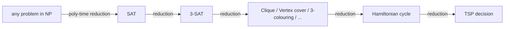

# NP-Complete: the Hardest Problems in NP

> An **NP-complete** problem is in NP and is at least as hard as every other problem in NP. Solve one in polynomial time and you have solved them all. Nobody has done it.

#### 1. What Is It?

A problem is **NP-complete** if:

1. it is **in NP** (a solution can be verified in polynomial time), and
2. **every** problem in NP can be **reduced** to it in polynomial time (note 08).

| Statement | Meaning |
|---|---|
| NP-complete problems are the "hardest" in NP | any fast algorithm for one would give a fast algorithm for all of NP |
| No fast algorithm is known for any of them | decades of effort by many researchers |
| First one: **SAT** (Cook-Levin theorem, 1971) | all others are proven by reducing a known NP-complete problem to the new one |

**Classic NP-complete problems** (decision versions)

| Problem | Question |
|---|---|
| **SAT / 3-SAT** | can a boolean formula be made true? |
| **Subset Sum** (large numbers) | does some subset add up to `T`? |
| **Partition** | can the numbers be split into two equal-sum halves? |
| **0/1 Knapsack** | value at least `V` within capacity `W`? |
| **TSP** | is there a tour visiting every city once with length ≤ `L`? |
| **Hamiltonian path / cycle** | is there a path through every node exactly once? |
| **Graph colouring** (`k ≥ 3`) | can nodes be coloured with `k` colours, adjacent nodes different? |
| **Vertex cover, Clique, Independent set** | is there a set of size `k` with the property? |
| **Bin packing, Set cover** | fit in `k` bins / cover the universe with `k` sets? |

**Signals:** the problem is "choose a subset / order / colouring from exponentially many options with hard constraints", and the statement (or constraints like `n ≤ 20`) hints that no clever polynomial trick exists.

#### 2. How It Works



**How a new problem is proven NP-complete** (a standard two-step proof):

1. Show it is in NP (give a polynomial-time verifier).
2. Show a *known* NP-complete problem reduces to it in polynomial time (so the new problem is at least as hard).

**Why it matters in practice.** If you recognise your problem as NP-complete, you can stop looking for a clever polynomial algorithm. You switch to: exact exponential search for small inputs, pseudo-polynomial DP when numbers are small, approximation, or heuristics (note 05).

**Exponential, but smarter than brute force**

| Problem | Brute force | Best exact approach |
|---|---|---|
| TSP | `O(n!)` | Held-Karp bitmask DP `O(2ⁿ n²)` |
| Subset Sum | `O(2ⁿ · n)` | meet in the middle `O(2^(n/2) · n)`; DP `O(nT)` for small `T` |
| Graph colouring | `O(kⁿ)` | `O(2ⁿ · n)` style algorithms |
| SAT | `O(2ⁿ · m)` | DPLL / CDCL solvers (fast on many real inputs) |

#### 3. Brute Force vs Optimized

```kotlin
// Brute-force SAT: try every assignment. Literal k > 0 means variable k; k < 0 means NOT variable |k|.
fun isSatisfied(clauses: List<IntArray>, assignment: BooleanArray): Boolean =
    clauses.all { clause -> clause.any { lit -> if (lit > 0) assignment[lit - 1] else !assignment[-lit - 1] } }

fun solveSat(clauses: List<IntArray>, variables: Int): BooleanArray? {
    for (mask in 0 until (1 shl variables)) {
        val a = BooleanArray(variables) { ((mask shr it) and 1) == 1 }
        if (isSatisfied(clauses, a)) return a
    }
    return null
}
```

Checking one assignment (`isSatisfied`) is polynomial. Trying all `2ⁿ` of them is not. That gap is the heart of NP-completeness.

#### 4. Kotlin Code

```kotlin
// Meet in the middle for Subset Sum: O(2^(n/2) · n) instead of O(2^n · n)
fun subsetSumMeetInMiddle(nums: IntArray, target: Int): Boolean {
    fun allSums(part: List<Int>): List<Int> {
        val sums = ArrayList<Int>()
        for (mask in 0 until (1 shl part.size)) {
            var s = 0
            for (i in part.indices) if (((mask shr i) and 1) == 1) s += part[i]
            sums.add(s)
        }
        return sums
    }
    val mid = nums.size / 2
    val left = allSums(nums.take(mid))
    val right = allSums(nums.drop(mid)).toHashSet()
    return left.any { (target - it) in right }                   // pair a left sum with a right sum
}
```

Checks: `solveSat(listOf(intArrayOf(1, -2), intArrayOf(-1, 2), intArrayOf(1, 2)), 2)` → `[true, true]`. `solveSat(listOf(intArrayOf(1), intArrayOf(-1)), 1)` → `null` (unsatisfiable). A 3-SAT formula `(x1 ∨ x2 ∨ x3) ∧ (¬x1 ∨ ¬x2 ∨ x3) ∧ (x1 ∨ ¬x2 ∨ ¬x3)` with 3 variables: `solveSat(listOf(intArrayOf(1, 2, 3), intArrayOf(-1, -2, 3), intArrayOf(1, -2, -3)), 3)` → `[true, false, false]`. `subsetSumMeetInMiddle(intArrayOf(3, 34, 4, 12, 5, 2), 9)` → `true`; `(…, 100)` → `false`; `(intArrayOf(), 0)` → `true` (empty subset).

#### 5. Complexity

| | Time |
|---|---|
| Verify a solution | polynomial |
| Best known exact algorithms | exponential (e.g. `2ⁿ`, `1.3ⁿ`) |
| Brute-force SAT, `n` variables, `m` clauses | `O(2ⁿ · m)` |
| `n = 30` variables | about 10⁹ assignments |

#### 6. Common Mistakes

1. **Calling a problem NP-complete without a reduction.** "It sounds hard" is not a proof.
2. **Confusing NP-complete with "impossible".** Small inputs, special structure and approximations all work.
3. **Mixing up the decision and optimisation versions** (note 06).
4. **Trusting a "polynomial" DP** that is only pseudo-polynomial.
5. **Reducing in the wrong direction.** To show `X` is hard, reduce a *known hard* problem **to** `X`.
6. **Assuming exponential means `2ⁿ`.** Factorial and `kⁿ` are worse.
7. **Giving up on exact search for `n ≤ 20`.** It is feasible.

#### 7. Say This in the Interview

1. "This is the decision version of TSP, which is NP-complete, so I don't expect a polynomial exact algorithm."
2. "With `n ≤ 15` I can do Held-Karp bitmask DP in `O(2ⁿ n²)`. For larger `n` I'd use a heuristic or approximation and state its guarantee."
3. "Verifying a solution is easy; finding one is the hard part."

#### 8. Quick Check

1. Two requirements for NP-complete?
2. Which problem was the first proven NP-complete?
3. If Subset Sum were solvable in polynomial time, what would follow?

<details>
<summary>Answers</summary>

1. In NP, and every problem in NP reduces to it.
2. SAT (Cook-Levin theorem).
3. Every problem in NP would be solvable in polynomial time, so P = NP.

</details>

#### 9. Related LeetCode Questions

| # | Question | Idea |
|---|---|---|
| 416 | [Partition Equal Subset Sum](https://leetcode.com/problems/partition-equal-subset-sum/) (Medium) | Partition: pseudo-polynomial DP |
| 698 | [Partition to K Equal Sum Subsets](https://leetcode.com/problems/partition-to-k-equal-sum-subsets/) (Medium) | NP-hard in general, `n ≤ 16` |
| 473 | [Matchsticks to Square](https://leetcode.com/problems/matchsticks-to-square/) (Medium) | partition into 4 groups |
| 847 | [Shortest Path Visiting All Nodes](https://leetcode.com/problems/shortest-path-visiting-all-nodes/) (Hard) | Hamiltonian-path flavour, bitmask BFS |
| 943 | [Find the Shortest Superstring](https://leetcode.com/problems/find-the-shortest-superstring/) (Hard) | TSP-like bitmask DP |
| 1723 | [Find Minimum Time to Finish All Jobs](https://leetcode.com/problems/find-minimum-time-to-finish-all-jobs/) (Hard) | bin-packing flavour |
