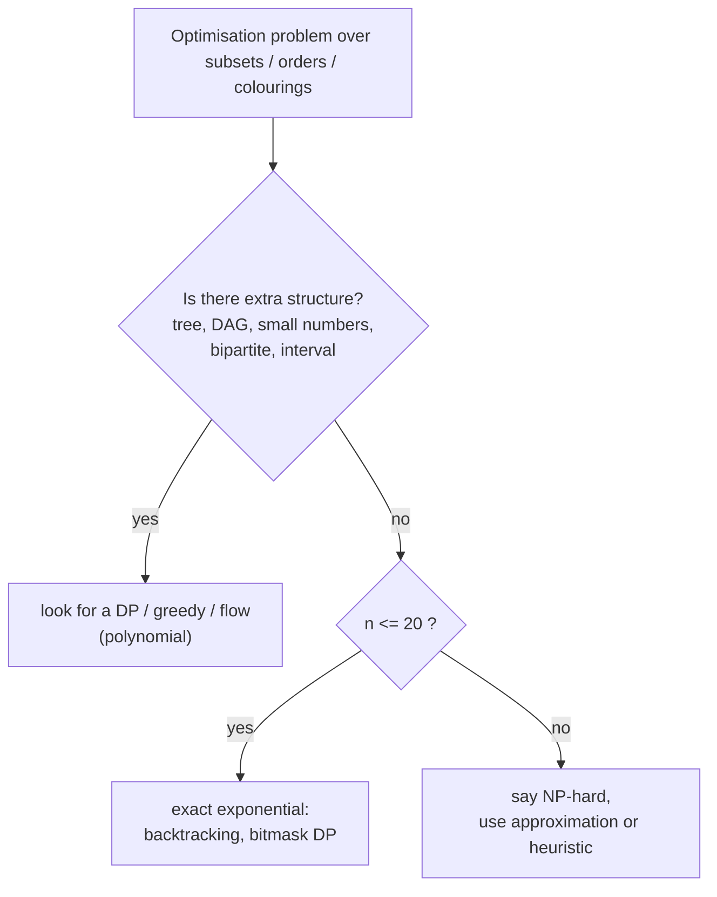

# Recognising an NP-Complete Shape in an Interview (TSP, Subset Sum at Scale, Graph Colouring)

> Learn the few problem shapes that are NP-hard, and the look-alikes that are easy. Spotting the difference early saves you from hunting for an impossible polynomial algorithm, or from missing an easy one.

#### 1. What Is It?

**Hard shapes (NP-hard / NP-complete)**

| Shape in the question | Problem | Practical scale |
|---|---|---|
| "visit every city exactly once, minimum total distance" | **TSP** | exact up to `n ≈ 20` (bitmask DP) |
| "visit every node exactly once" (any path) | **Hamiltonian path** | `n ≤ 20` |
| "choose a subset with exact sum `T`" with **huge** numbers | **Subset Sum** | DP only if `T` is small |
| "split into `k` groups with equal sum" | **Partition / bin packing** | `n ≤ 16` backtracking |
| "colour nodes with `k ≥ 3` colours, no adjacent equal" | **Graph colouring** | small graphs |
| "largest group where everyone is connected" | **Max clique** | small graphs |
| "smallest set of nodes touching every edge" | **Vertex cover** | small / approximation |
| "fewest sets that cover everything" | **Set cover** | greedy approximation |
| "satisfy all these boolean constraints" (3 per clause) | **3-SAT** | SAT solvers |

**Easy look-alikes (in P)**

| Hard version | Easy version that looks similar |
|---|---|
| Hamiltonian path (every **node** once) | **Euler** path (every **edge** once): check degrees, `O(V + E)` |
| 3-colouring | **2-colouring** (bipartite): BFS, `O(V + E)` |
| 3-SAT | **2-SAT**: implication graph, `O(V + E)` |
| Longest **simple** path | Shortest path (Dijkstra) |
| Subset Sum with huge numbers | Subset Sum with small target (DP `O(nT)`) |
| Steiner tree | Minimum spanning tree |
| Max cut | **Min cut** (max flow) |
| 3-dimensional matching | Bipartite matching (flow) |
| Vertex cover in general graphs | Vertex cover in **bipartite** graphs / trees (polynomial) |

**Signals:** exponentially many candidates (subsets, orders, colourings), "exactly once", "all", "minimum number of ... such that every ...", and constraints like `n ≤ 15` or `n ≤ 20`.

#### 2. How It Works



**Constraint check.** An interviewer who gives `n ≤ 15` is telling you exponential time is intended. If instead the limit is `n ≤ 10⁵` with a "choose a subset" flavour, there must be a greedy, DP or sorting structure.

**Three quick tests before you declare "NP-hard"**

1. Can the problem be solved greedily or with DP because of ordering, intervals or a tree? (Interval scheduling: greedy. Knapsack with small weights: DP.)
2. Does a polynomial look-alike apply (Euler vs Hamiltonian)?
3. Are the numbers small (pseudo-polynomial DP)?

If all three fail, the problem is probably NP-hard and you should say so, then pick an approach from note 05.

#### 3. Brute Force vs Optimized

| Problem | Brute force | Better exact | Easy cousin |
|---|---|---|---|
| Hamiltonian path | `O(n!)` | bitmask DP `O(2ⁿ n²)` | Euler path `O(V + E)` |
| 3-colouring | `O(3ⁿ)` | backtracking with pruning | 2-colouring `O(V + E)` |
| TSP | `O(n!)` | Held-Karp `O(2ⁿ n²)` | shortest path `O(E log V)` |

```kotlin
// Brute force Hamiltonian path: DFS over all simple paths
fun hasHamiltonianPath(n: Int, edges: Array<IntArray>): Boolean {
    val adj = List(n) { mutableListOf<Int>() }
    for ((u, v) in edges) { adj[u].add(v); adj[v].add(u) }
    val used = BooleanArray(n)
    fun dfs(u: Int, count: Int): Boolean {
        if (count == n) return true
        used[u] = true
        var found = false
        for (v in adj[u]) if (!used[v] && dfs(v, count + 1)) { found = true; break }
        used[u] = false
        return found
    }
    return (0 until n).any { dfs(it, 1) }
}
```

#### 4. Kotlin Code

```kotlin
// EASY (in P): is the graph 2-colourable (bipartite)? BFS colouring
fun isBipartite(n: Int, edges: Array<IntArray>): Boolean {
    val adj = List(n) { mutableListOf<Int>() }
    for ((u, v) in edges) { adj[u].add(v); adj[v].add(u) }
    val color = IntArray(n) { -1 }
    for (start in 0 until n) {
        if (color[start] != -1) continue
        color[start] = 0
        val queue = ArrayDeque<Int>()
        queue.addLast(start)
        while (queue.isNotEmpty()) {
            val u = queue.removeFirst()
            for (v in adj[u]) {
                if (color[v] == -1) { color[v] = 1 - color[u]; queue.addLast(v) }
                else if (color[v] == color[u]) return false
            }
        }
    }
    return true
}

// HARD (NP-complete for k >= 3): can the graph be coloured with k colours? Backtracking
fun canColor(n: Int, edges: Array<IntArray>, k: Int): Boolean {
    val adj = List(n) { mutableListOf<Int>() }
    for ((u, v) in edges) { adj[u].add(v); adj[v].add(u) }
    val color = IntArray(n) { -1 }
    fun go(node: Int): Boolean {
        if (node == n) return true
        for (c in 0 until k) {
            if (adj[node].any { color[it] == c }) continue        // a neighbour already uses c
            color[node] = c
            if (go(node + 1)) return true
            color[node] = -1
        }
        return false
    }
    return go(0)
}

// EASY: Euler circuit exists iff every degree is even and all edges are in one connected piece
fun hasEulerCircuit(n: Int, edges: Array<IntArray>): Boolean {
    val deg = IntArray(n)
    val adj = List(n) { mutableListOf<Int>() }
    for ((u, v) in edges) { deg[u]++; deg[v]++; adj[u].add(v); adj[v].add(u) }
    if (deg.any { it % 2 != 0 }) return false
    val start = deg.indexOfFirst { it > 0 }
    if (start == -1) return true
    val seen = BooleanArray(n)
    val stack = ArrayDeque<Int>()
    stack.addLast(start); seen[start] = true
    while (stack.isNotEmpty()) {
        val u = stack.removeLast()
        for (v in adj[u]) if (!seen[v]) { seen[v] = true; stack.addLast(v) }
    }
    return (0 until n).all { deg[it] == 0 || seen[it] }
}
```

Checks (graphs as edge lists): a 4-cycle `[[0,1],[1,2],[2,3],[3,0]]`: `isBipartite(4, …)` → `true`; `canColor(4, …, 2)` → `true`; `hasEulerCircuit(4, …)` → `true`; `hasHamiltonianPath(4, …)` → `true`. A triangle `[[0,1],[1,2],[0,2]]`: `isBipartite(3, …)` → `false`; `canColor(3, …, 2)` → `false`; `canColor(3, …, 3)` → `true`; `hasEulerCircuit(3, …)` → `true`. The complete graph K4 (all 6 pairs): `canColor(4, …, 3)` → `false`; `canColor(4, …, 4)` → `true`. A path `[[0,1],[1,2]]`: `hasEulerCircuit(3, …)` → `false` (two odd degrees). A star `[[0,1],[0,2],[0,3]]`: `hasHamiltonianPath(4, …)` → `false`. Two separate triangles `[[0,1],[1,2],[0,2],[3,4],[4,5],[3,5]]`: `hasEulerCircuit(6, …)` → `false` (disconnected).

#### 5. Complexity

| | Time |
|---|---|
| `isBipartite`, `hasEulerCircuit` | `O(V + E)` |
| `canColor` (k colours) | `O(kⁿ)` worst case |
| `hasHamiltonianPath` | `O(n!)` worst case |
| Bitmask DP for Hamiltonian path / TSP | `O(2ⁿ · n²)` |

#### 6. Common Mistakes

1. **Declaring a problem NP-hard because it feels hard** without checking structure (trees, DAGs, intervals, bipartite).
2. **Confusing Euler (edges) and Hamiltonian (nodes).**
3. **Missing 2-colouring and 2-SAT** as polynomial cases.
4. **Ignoring small numbers**, where a pseudo-polynomial DP solves "Subset Sum".
5. **Ignoring `n`:** exponential algorithms are fine for `n ≤ 20`.
6. **Overclaiming:** "NP-hard" means no known polynomial algorithm, not a proof of impossibility.
7. **Forgetting to give an alternative** once you say "NP-hard".

#### 7. Say This in the Interview

1. "Visit every node exactly once is Hamiltonian path, which is NP-complete, unlike Euler paths, which only need a degree check."
2. "The constraints say `n ≤ 16`, so an exponential `O(2ⁿ n²)` bitmask DP is intended."
3. "Two colours is just a bipartite check by BFS. From three colours onward it's NP-complete, so I'd backtrack with pruning."
4. "If `n` were large I'd say the exact problem is NP-hard and propose an approximation."

#### 8. Quick Check

1. Euler path or Hamiltonian path: which is easy?
2. 2-colouring or 3-colouring: which is easy?
3. `n ≤ 20` and "visit all": what is intended?

<details>
<summary>Answers</summary>

1. Euler (edges once): degree check in `O(V + E)`.
2. 2-colouring (bipartite check).
3. Exponential: bitmask DP or backtracking.

</details>

#### 9. Related LeetCode Questions

| # | Question | Idea |
|---|---|---|
| 785 | [Is Graph Bipartite?](https://leetcode.com/problems/is-graph-bipartite/) (Medium) | 2-colouring, in P |
| 332 | [Reconstruct Itinerary](https://leetcode.com/problems/reconstruct-itinerary/) (Hard) | Euler path (easy cousin) |
| 847 | [Shortest Path Visiting All Nodes](https://leetcode.com/problems/shortest-path-visiting-all-nodes/) (Hard) | Hamiltonian-path flavour |
| 943 | [Find the Shortest Superstring](https://leetcode.com/problems/find-the-shortest-superstring/) (Hard) | TSP-like |
| 698 | [Partition to K Equal Sum Subsets](https://leetcode.com/problems/partition-to-k-equal-sum-subsets/) (Medium) | partition, `n ≤ 16` |
| 473 | [Matchsticks to Square](https://leetcode.com/problems/matchsticks-to-square/) (Medium) | 4-way partition |
