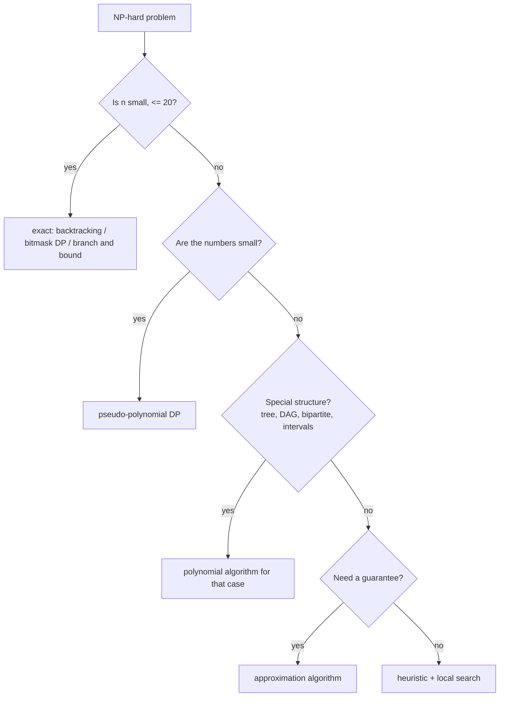

# What to Do Instead: Approximation, Heuristics, Smaller Exact Inputs

> You recognised an NP-hard problem. Now what? Pick the weakest tool that works: exact search for small `n`, pseudo-polynomial DP for small numbers, an approximation with a guarantee, or a heuristic with no guarantee.

#### 1. What Is It?

| Strategy | When | Guarantee |
|---|---|---|
| **Exact exponential search** (backtracking, bitmask DP, branch and bound) | `n ≤ 20` or so | optimal |
| **Pseudo-polynomial DP** | the numbers are small (`T ≤ 10⁵`) | optimal |
| **Exploit special structure** | tree, DAG, bipartite, interval, planar | optimal, often polynomial |
| **Approximation algorithm** | large `n`, need a provable bound | within a known factor of optimal |
| **Heuristic / local search** | large `n`, "good enough" is acceptable | none |
| **SAT / ILP solver** | real systems | optimal, fast on many real inputs |

**Approximation examples**

| Problem | Algorithm | Guarantee |
|---|---|---|
| Vertex cover | take both ends of any uncovered edge | ≤ 2 × optimal |
| Metric TSP | build an MST, walk it (shortcut repeats) | ≤ 2 × optimal (Christofides: 1.5) |
| Set cover | repeatedly take the set covering the most uncovered items | ≤ `ln n` × optimal |
| Bin packing | first-fit decreasing | ≤ 11/9 × optimal + 1 |
| Knapsack | scale values, then DP (FPTAS) | ≤ (1 + ε) × optimal |

**Heuristic examples:** nearest neighbour, 2-opt, simulated annealing, genetic algorithms, greedy choices.

**Signals:** "n is up to 10⁵ but the problem looks like TSP", "good enough", "approximately", "real-world scale", "how would you handle it in production".

#### 2. How It Works



**Vertex cover, 2-approximation.** Take any edge not yet covered, add **both** endpoints, repeat. The chosen edges share no endpoints (a matching), and the optimal cover needs at least one endpoint per matched edge, so the answer is at most twice optimal.

```text
path 0-1-2-3:   take edge (0,1) → cover {0,1}
                edge (1,2) already covered
                take edge (2,3) → cover {0,1,2,3}   size 4
optimal cover {1,2}                                   size 2      ratio 2 ✓
```

**TSP heuristics.**

1. **Nearest neighbour:** from the current city, go to the closest unvisited city. Fast, `O(n²)`, can be much worse than optimal.
2. **2-opt:** remove two edges and reconnect by reversing the part in between if the tour gets shorter. Repeat until no improvement.

Example 5-city matrix (rows are cities 0..4):

```text
     0  1  2  3  4
0:   0  8  1  1  1
1:   8  0  6  5  8
2:   1  6  0  5  6
3:   1  5  5  0  3
4:   1  8  6  3  0
nearest neighbour from 0: 0 → 2 → 3 → 4 → 1 → 0   cost 1+5+3+8+8 = 25
2-opt improves it to:     0 → 4 → 3 → 1 → 2 → 0   cost 1+3+5+6+1 = 16  (optimal)
```

**How to frame it in an interview.** State the hardness, state the scale, pick a strategy, and say what you give up: "optimal for `n ≤ 16`; for bigger inputs a 2-approximation (or a heuristic with no guarantee)."

#### 3. Brute Force vs Optimized

| Approach | TSP, `n` cities | Quality |
|---|---|---|
| Try all tours | `O(n!)` | optimal, `n ≤ 10` |
| Held-Karp bitmask DP | `O(2ⁿ n²)` | optimal, `n ≤ 20` (see `6` Backtracking note 08) |
| Nearest neighbour | `O(n²)` | can be far from optimal |
| Nearest neighbour + 2-opt | `O(n²)` per pass | usually within a few percent |

```kotlin
// Brute force TSP: cost of the best tour over all orders (n <= 9)
fun tspBruteForce(d: Array<IntArray>): Int {
    val n = d.size
    var best = Int.MAX_VALUE
    val used = BooleanArray(n)
    used[0] = true
    fun go(cur: Int, count: Int, cost: Int) {
        if (cost >= best) return                            // prune
        if (count == n) { best = minOf(best, cost + d[cur][0]); return }
        for (next in 1 until n) if (!used[next]) {
            used[next] = true
            go(next, count + 1, cost + d[cur][next])
            used[next] = false
        }
    }
    go(0, 1, 0)
    return best
}
```

#### 4. Kotlin Code

```kotlin
fun tourCost(d: Array<IntArray>, tour: List<Int>): Int {
    var c = 0
    for (i in tour.indices) c += d[tour[i]][tour[(i + 1) % tour.size]]
    return c
}

// Heuristic: nearest neighbour
fun nearestNeighbour(d: Array<IntArray>, start: Int = 0): List<Int> {
    val n = d.size
    val tour = arrayListOf(start)
    val visited = BooleanArray(n)
    visited[start] = true
    var cur = start
    while (tour.size < n) {
        val next = (0 until n).filter { !visited[it] }.minByOrNull { d[cur][it] }!!
        visited[next] = true
        tour.add(next)
        cur = next
    }
    return tour
}

// Heuristic: 2-opt local search (reverse a segment if it shortens the tour)
fun twoOpt(d: Array<IntArray>, start: List<Int>): List<Int> {
    var tour = start
    var improved = true
    while (improved) {
        improved = false
        for (i in 1 until tour.size - 1) for (j in i + 1 until tour.size) {
            val candidate = tour.subList(0, i) + tour.subList(i, j + 1).reversed() + tour.subList(j + 1, tour.size)
            if (tourCost(d, candidate) < tourCost(d, tour)) { tour = candidate; improved = true }
        }
    }
    return tour
}

// Approximation: vertex cover within a factor of 2
fun vertexCoverApprox(edges: Array<IntArray>): Set<Int> {
    val cover = LinkedHashSet<Int>()
    for ((u, v) in edges) if (u !in cover && v !in cover) { cover.add(u); cover.add(v) }
    return cover
}

fun isVertexCover(edges: Array<IntArray>, cover: Set<Int>): Boolean =
    edges.all { (u, v) -> u in cover || v in cover }

// Exact vertex cover for small graphs: smallest subset found by trying all subsets
fun vertexCoverExactSize(n: Int, edges: Array<IntArray>): Int {
    var best = n
    for (mask in 0 until (1 shl n)) {
        val cover = (0 until n).filter { ((mask shr it) and 1) == 1 }.toSet()
        if (cover.size < best && isVertexCover(edges, cover)) best = cover.size
    }
    return best
}

// Pseudo-polynomial DP for Subset Sum: O(n · T)
fun subsetSumDp(nums: IntArray, target: Int): Boolean {
    val dp = BooleanArray(target + 1)
    dp[0] = true
    for (x in nums) for (s in target downTo x) if (dp[s - x]) dp[s] = true
    return dp[target]
}
```

Checks, with the 5-city matrix `D` above: `nearestNeighbour(D)` → `[0, 2, 3, 4, 1]`, `tourCost` → `25`. `twoOpt(D, nearestNeighbour(D))` → `[0, 4, 3, 1, 2]`, cost `16`. `tspBruteForce(D)` → `16`. For the path `edges = [[0,1],[1,2],[2,3]]`: `vertexCoverApprox(edges)` → `{0, 1, 2, 3}` (size 4); `vertexCoverExactSize(4, edges)` → `2`; `isVertexCover(edges, setOf(1, 2))` → `true`; `isVertexCover(edges, setOf(0, 3))` → `false`. `subsetSumDp(intArrayOf(3, 34, 4, 12, 5, 2), 9)` → `true`; `(…, 30)` → `false`.

#### 5. Complexity

| | Time | Quality |
|---|---|---|
| Vertex cover 2-approximation | `O(E)` | ≤ 2 × optimal |
| Nearest neighbour | `O(n²)` | no guarantee |
| 2-opt (per sweep) | `O(n²)` evaluations (each `O(n)` here) | local optimum |
| Subset sum DP | `O(n · T)` | exact, pseudo-polynomial |
| Exact vertex cover (brute) | `O(2ⁿ · E)` | optimal |

#### 6. Common Mistakes

1. **Presenting a heuristic as optimal.**
2. **Claiming an approximation ratio without a reason** (be able to explain the factor).
3. **Skipping the "small `n`" check** and jumping to an approximation when an exact solution is feasible.
4. **Greedy as an exact method** (e.g. greedy for knapsack or coin change with arbitrary coins).
5. **Forgetting pseudo-polynomial DP** when the numbers are small.
6. **Applying metric-TSP guarantees to non-metric distances.**
7. **Not stating what you give up** (optimality, determinism, worst-case time).

#### 7. Say This in the Interview

1. "This is NP-hard, but `n ≤ 16`, so an exact bitmask DP in `O(2ⁿ n²)` is fine."
2. "For large `n` I'd use a 2-approximation: take both ends of any uncovered edge. The result is at most twice the optimum."
3. "The target sum is at most 10⁴, so a pseudo-polynomial DP `O(n · T)` solves it exactly."
4. "A nearest-neighbour tour followed by 2-opt gives a good tour fast, but with no guarantee."

#### 8. Quick Check

1. Ratio of the vertex-cover matching algorithm?
2. When is a pseudo-polynomial DP a good answer?
3. Name a heuristic with no guarantee.

<details>
<summary>Answers</summary>

1. At most 2 × optimal.
2. When the numeric values (like the target sum) are small.
3. Nearest neighbour, 2-opt, simulated annealing, or genetic algorithms.

</details>

#### 9. Related LeetCode Questions

| # | Question | Idea |
|---|---|---|
| 416 | [Partition Equal Subset Sum](https://leetcode.com/problems/partition-equal-subset-sum/) (Medium) | pseudo-polynomial DP |
| 494 | [Target Sum](https://leetcode.com/problems/target-sum/) (Medium) | subset-sum DP |
| 1049 | [Last Stone Weight II](https://leetcode.com/problems/last-stone-weight-ii/) (Medium) | partition into two near-equal groups |
| 698 | [Partition to K Equal Sum Subsets](https://leetcode.com/problems/partition-to-k-equal-sum-subsets/) (Medium) | exact search for small `n` |
| 322 | [Coin Change](https://leetcode.com/problems/coin-change/) (Medium) | DP where greedy fails |
| 1723 | [Find Minimum Time to Finish All Jobs](https://leetcode.com/problems/find-minimum-time-to-finish-all-jobs/) (Hard) | backtracking with pruning |
