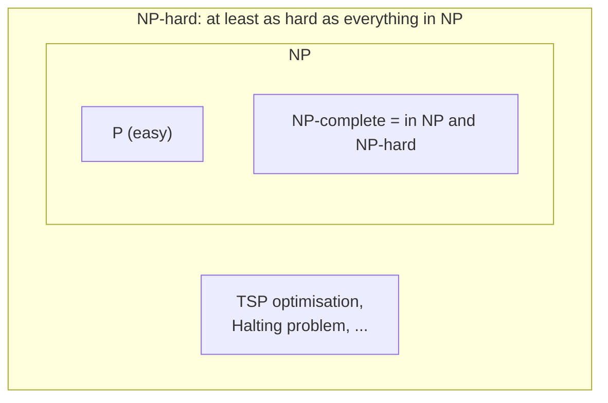

# NP-Hard vs NP-Complete

> **NP-hard** means "at least as hard as every problem in NP". **NP-complete** means NP-hard *and* in NP. An NP-hard problem may be even harder, and may not be a yes/no question at all.

#### 1. What Is It?

| Class | Definition | Must be in NP? |
|---|---|---|
| **NP-hard** | every problem in NP reduces to it | **no** |
| **NP-complete** | NP-hard **and** in NP | yes |

`NP-complete = NP ∩ NP-hard`

| Example | Class | Why |
|---|---|---|
| TSP decision: is there a tour of length ≤ `L`? | NP-complete | a tour can be verified fast |
| TSP optimisation: find the shortest tour | NP-hard | not a yes/no question, so not in NP as stated |
| Subset Sum decision | NP-complete | verify by adding |
| Halting problem | NP-hard (even undecidable) | no algorithm at all, can't be verified |
| Sorting | P (not NP-hard unless P = NP) | easy |

**Decision vs optimisation.** NP classes are defined for yes/no questions. Optimisation versions ("find the minimum") are **NP-hard**. They are no easier than their decision versions, and often no harder: you can solve the optimisation problem by asking the decision question repeatedly with binary search.

**Signals:** "is TSP NP-complete or NP-hard?" (both answers appear in the wild), "what is the difference", "optimisation vs decision".

#### 2. How It Works



**Optimisation from decision (why the two are linked).** Suppose an oracle answers "is there a tour of length at most `L`?". Binary search on `L` finds the shortest tour length using about `log₂(max length)` oracle calls. So if the decision version were in P, the optimisation version would be too.

```text
lengths 0..35, optimum is 16 for the 5-city matrix in note 05
ask L = 17 → yes   (hi = 17)
ask L =  8 → no    (lo = 9)
ask L = 13 → no    (lo = 14)
ask L = 15 → no    (lo = 16)    ask L = 16 → yes → answer 16
```

**Some problems are NP-hard but beyond NP**

- **Undecidable** problems (Halting) are NP-hard.
- Games like generalised chess on an `n × n` board are EXPTIME-complete: harder than NP, so also NP-hard.
- **#P**-style counting problems ("how many Hamiltonian cycles?") are NP-hard in the sense of reductions, but counting is not a decision problem.

**How to use the words correctly**

| You want to say | Use |
|---|---|
| "A solution can be checked quickly, and it's as hard as anything in NP" | NP-complete |
| "It's at least as hard as NP-complete problems; don't claim it's in NP" | NP-hard |
| "Find the best / minimum / maximum ..." | NP-hard (optimisation) |
| "Is there ... with value ≤ `k`?" | NP-complete (decision) |

#### 3. Brute Force vs Optimized

| Question | Slow way | Better |
|---|---|---|
| Shortest tour length | enumerate all tours and take the min `O(n!)` | binary search on the decision version (same oracle cost per call) |
| Decision oracle | try all tours | bitmask DP `O(2ⁿ n²)` for small `n` |

```kotlin
// Decision oracle by brute force: is there a tour of length at most `limit`?
fun existsTourAtMost(d: Array<IntArray>, limit: Int): Boolean {
    val n = d.size
    val used = BooleanArray(n)
    used[0] = true
    fun go(cur: Int, count: Int, cost: Int): Boolean {
        if (cost > limit) return false
        if (count == n) return cost + d[cur][0] <= limit
        for (next in 1 until n) if (!used[next]) {
            used[next] = true
            val ok = go(next, count + 1, cost + d[cur][next])
            used[next] = false
            if (ok) return true
        }
        return false
    }
    return go(0, 1, 0)
}
```

#### 4. Kotlin Code

```kotlin
// Optimisation (NP-hard) built from the decision problem (NP-complete) by binary search
fun minTourLength(d: Array<IntArray>): Int {
    var lo = 0
    var hi = d.sumOf { row -> row.max() }            // any tour costs at most this much
    while (lo < hi) {
        val mid = lo + (hi - lo) / 2
        if (existsTourAtMost(d, mid)) hi = mid else lo = mid + 1
    }
    return lo
}

// Number of oracle calls the binary search needs
fun oracleCalls(maxLength: Int): Int {
    var calls = 0
    var range = maxLength + 1
    while (range > 1) { range = (range + 1) / 2; calls++ }
    return calls
}
```

Checks, with the 5-city matrix from note 05: `existsTourAtMost(D, 16)` → `true`; `existsTourAtMost(D, 15)` → `false`; `minTourLength(D)` → `16`. `oracleCalls(35)` → `6` (the worst case for a range of 36 values; the trace in section 2 needed 5). A 3-city triangle `d = [[0,1,2],[1,0,3],[2,3,0]]`: `minTourLength(d)` → `6` (every tour uses all three edges: 1 + 3 + 2).

#### 5. Complexity

| | Time |
|---|---|
| Decision oracle (brute force) | `O(n!)` |
| Optimisation via binary search | `O(log(maxLength))` oracle calls |
| If the oracle were polynomial | the optimiser would be too |

#### 6. Common Mistakes

1. **Saying "NP-hard means harder than NP-complete".** NP-complete problems are NP-hard; NP-hard is a lower bound.
2. **Calling optimisation problems NP-complete** (strictly, they are NP-hard).
3. **Believing NP-hard problems are always in NP.**
4. **Using "NP-hard" for "very slow".** It is about reductions, not a particular running time.
5. **Mixing up "NP" and "non-polynomial".**
6. **Claiming an NP-hardness proof by reducing in the wrong direction.**

#### 7. Say This in the Interview

1. "The decision version of this problem is NP-complete, and finding the optimum is NP-hard. We can get the optimum from the decision version with binary search."
2. "NP-hard means at least as hard as every NP problem. It doesn't need to be in NP itself."
3. "In practice the label tells me: don't search for a polynomial algorithm."

#### 8. Quick Check

1. NP-complete = ?
2. Is "find the shortest tour" NP-complete or NP-hard?
3. Is the Halting problem NP-complete?

<details>
<summary>Answers</summary>

1. NP ∩ NP-hard.
2. NP-hard (it is an optimisation problem, so it is not in NP as stated).
3. No. It is NP-hard (and undecidable), but not in NP.

</details>

#### 9. Related LeetCode Questions

| # | Question | Idea |
|---|---|---|
| 847 | [Shortest Path Visiting All Nodes](https://leetcode.com/problems/shortest-path-visiting-all-nodes/) (Hard) | optimisation version, small `n` |
| 943 | [Find the Shortest Superstring](https://leetcode.com/problems/find-the-shortest-superstring/) (Hard) | NP-hard optimisation, bitmask DP |
| 698 | [Partition to K Equal Sum Subsets](https://leetcode.com/problems/partition-to-k-equal-sum-subsets/) (Medium) | decision version |
| 1879 | [Minimum XOR Sum of Two Arrays](https://leetcode.com/problems/minimum-xor-sum-of-two-arrays/) (Hard) | assignment, bitmask DP |
| 1595 | [Minimum Cost to Connect Two Groups of Points](https://leetcode.com/problems/minimum-cost-to-connect-two-groups-of-points/) (Hard) | optimisation, bitmask DP |
| 410 | [Split Array Largest Sum](https://leetcode.com/problems/split-array-largest-sum/) (Hard) | optimisation via decision + binary search |
