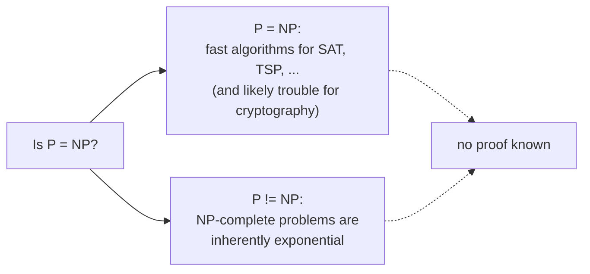

# P vs NP Is an Open Problem

> Nobody knows whether every problem whose solution can be **checked** quickly can also be **solved** quickly. It is one of the seven Millennium Prize Problems. Most experts believe P ≠ NP, but there is no proof.

#### 1. What Is It?

**The question:** is **P = NP**?

| If... | Then... |
|---|---|
| **P = NP** | every NP problem (SAT, TSP, subset sum, ...) has a polynomial-time algorithm. Finding would be as easy as checking. |
| **P ≠ NP** (what most believe) | some problems can be checked fast but not solved fast. NP-complete problems have no polynomial algorithm. |

| Fact | Status |
|---|---|
| Posed formally by Stephen Cook in 1971 (Levin independently) | |
| Clay Mathematics Institute prize | US $1,000,000 |
| Known: P ⊆ NP | yes |
| Known: P ≠ NP or P = NP | **unknown** |
| Practical belief | P ≠ NP, because decades of effort found no fast algorithm for any NP-complete problem |

**Signals:** "what happens if P = NP", "is it proven that ...", "why can't we just find a fast algorithm for TSP", curiosity questions at the end of an interview.

#### 2. How It Works



**Why it's hard to settle.** To prove P = NP you need one polynomial algorithm for *one* NP-complete problem. Decades of attempts have failed. To prove P ≠ NP you need to show *no* algorithm can ever work, which needs lower-bound techniques that no one has found (known barriers: relativization, natural proofs, algebrization).

**What would change if P = NP**

| Area | Effect |
|---|---|
| Optimisation | routing, scheduling and packing solved optimally |
| Cryptography | many schemes that rely on hard problems (public-key systems) would be breakable |
| Mathematics | finding proofs of bounded length becomes feasible |
| Everyday coding | no more "this is NP-hard, use a heuristic" |

**Common misconceptions**

| Misconception | Reality |
|---|---|
| "NP means not polynomial" | NP = nondeterministic polynomial; P is inside NP |
| "NP-hard problems can't be solved" | they can, for small inputs or with approximations |
| "SAT solvers prove P = NP" | they are fast on many real inputs but still exponential in the worst case |
| "Factoring is NP-complete" | not known to be; it is in NP and co-NP and believed hard, but is not proven NP-complete |
| "A 2ⁿ algorithm proves P ≠ NP" | it only shows that one algorithm is slow, not that all algorithms must be |

**Verifying is easy, finding is hard, a feel for the gap.** Multiplying two primes takes one step. Finding them from the product takes about `√N` steps by trial division. Whether a fast factoring algorithm exists is open (and is the basis of RSA).

#### 3. Brute Force vs Optimized

| Task | Check | Find |
|---|---|---|
| Is `p × q = N`? | `O(1)` | |
| Factor `N` | | trial division `O(√N)` (best known classical algorithms are sub-exponential, not polynomial) |
| Is this Sudoku board valid? | `O(n²)` | |
| Solve the Sudoku | | exponential search |

```kotlin
// Finding a factor by trial division: O(√N)
fun findFactor(n: Long): Long? {
    var d = 2L
    while (d * d <= n) { if (n % d == 0L) return d; d++ }
    return null
}
```

#### 4. Kotlin Code

```kotlin
// Verifying a claimed factorisation: one multiplication
fun verifyFactors(n: Long, p: Long, q: Long): Boolean = p > 1 && q > 1 && p * q == n

// Count the work for each side
fun searchSteps(n: Long): Long {
    var d = 2L
    var steps = 0L
    while (d * d <= n) { steps++; if (n % d == 0L) return steps; d++ }
    return steps
}

// Valid Sudoku (LeetCode 36): verifying a board is easy
fun isValidSudoku(board: Array<CharArray>): Boolean {
    val seen = HashSet<String>()
    for (r in 0 until 9) for (c in 0 until 9) {
        val v = board[r][c]
        if (v == '.') continue
        if (!seen.add("row$r$v") || !seen.add("col$c$v") || !seen.add("box${r / 3}${c / 3}$v")) return false
    }
    return true
}
```

Checks: `verifyFactors(100160063, 10007, 10009)` → `true`; `(100160063, 7, 9)` → `false`. `findFactor(100160063)` → `10007`; `findFactor(97)` → `null`; `findFactor(91)` → `7`. `searchSteps(100160063)` → `10006` (trial divisors `2..10007`), against **1** multiplication to verify. For a 40-digit product of two primes, trial division would need about `10²⁰` steps. `isValidSudoku` on the standard LeetCode example board → `true`; changing one cell so that a digit repeats in a row → `false`.

#### 5. Complexity

| | Time |
|---|---|
| Verify a factorisation | `O(1)` multiplication |
| Find a factor (trial division) | `O(√N)` |
| Best classical factoring | sub-exponential (number field sieve) |
| Verify Sudoku | `O(n²)` |
| Solve Sudoku (general `n²` × `n²`) | NP-complete |

#### 6. Common Mistakes

1. **Stating that P ≠ NP is proven.** It is not.
2. **Treating an exponential algorithm as proof of hardness.**
3. **"NP" read as "not polynomial".**
4. **Saying factoring is NP-complete.**
5. **Predicting that quantum computers solve NP-complete problems** (they do not, as far as known; Shor's algorithm targets factoring).
6. **Claiming "heuristics solve it in practice, so it's easy".** Worst-case hardness still matters.
7. **Making claims about the prize or the history without being sure.**

#### 7. Say This in the Interview

1. "It's an open problem whether every quickly checkable problem is also quickly solvable. Most researchers believe P ≠ NP, but it isn't proven."
2. "Since this problem is NP-complete, I won't look for a polynomial algorithm. If P = NP were shown, that would change."
3. "Checking a solution takes linear time; finding one seems to need exponential search."

#### 8. Quick Check

1. What does P = NP mean?
2. Do we know P ⊆ NP?
3. Is factoring known to be NP-complete?

<details>
<summary>Answers</summary>

1. Every problem whose solution can be verified in polynomial time can also be solved in polynomial time.
2. Yes: every problem in P is in NP.
3. No. It is in NP (and co-NP) but is not proven NP-complete.

</details>

#### 9. Related LeetCode Questions

Pairs where **checking is easy and finding is hard** illustrate the gap.

| # | Question | Idea |
|---|---|---|
| 36 | [Valid Sudoku](https://leetcode.com/problems/valid-sudoku/) (Medium) | verify a board |
| 37 | [Sudoku Solver](https://leetcode.com/problems/sudoku-solver/) (Hard) | search for a solution |
| 51 | [N-Queens](https://leetcode.com/problems/n-queens/) (Hard) | search with pruning |
| 39 | [Combination Sum](https://leetcode.com/problems/combination-sum/) (Medium) | subset-sum flavour, backtracking |
| 698 | [Partition to K Equal Sum Subsets](https://leetcode.com/problems/partition-to-k-equal-sum-subsets/) (Medium) | verify easily, find by search |
| 1 | [Two Sum](https://leetcode.com/problems/two-sum/) (Easy) | in P: both easy |
