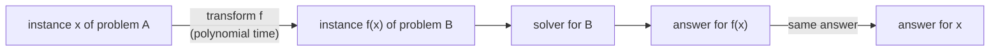

# Reductions: Name Only

> A **reduction** turns instances of problem A into instances of problem B so that a solver for B solves A. It is how hardness is proven, and also how you reuse an algorithm you already have.

#### 1. What Is It?

"A reduces to B" (written `A ≤ B`) means: there is a fast (polynomial-time) transformation `f` that maps any input `x` of A to an input `f(x)` of B, such that

```text
answer of A on x   =   answer of B on f(x)
```

| Direction | What it tells you |
|---|---|
| `A ≤ B` and you can solve B fast | you can solve A fast (use B as a subroutine) |
| `A ≤ B` and A is known to be hard | **B is at least as hard as A** (this is how NP-hardness is proven) |

**To prove a new problem X is NP-hard:** pick a known NP-hard problem `K` and show `K ≤ X`.

**Easy-to-remember reductions**

| From | To | Idea |
|---|---|---|
| Independent Set (size `k`) | Vertex Cover (size `n − k`) | a set is independent iff the *other* nodes form a vertex cover |
| Partition | Subset Sum | target = half of the total |
| Hamiltonian Cycle | TSP | edge → weight 1, non-edge → weight 2; a tour of length `n` exists iff there is a Hamiltonian cycle |
| 3-SAT | Clique / Independent Set | one node per literal in each clause, edges between compatible literals |
| Any NP problem | SAT | Cook-Levin theorem |

**Signals:** "show this is NP-hard", "reduce X to Y", "how are these two problems related", "can you reuse the solver for ... here".

**In everyday coding** reductions are everywhere: "Number of Islands" reduces to connected components; "Partition Equal Subset Sum" reduces to a subset-sum DP; "Cheapest Flights Within K Stops" reduces to shortest path on a layered graph.

#### 2. How It Works



**Example 1: Independent Set ↔ Vertex Cover.** In a graph with nodes `V`, a set `S` is a vertex cover (touches every edge) exactly when `V \ S` is an independent set (no two nodes adjacent). So: "is there an independent set of size `k`?" ⇔ "is there a vertex cover of size `n − k`?".

```text
path 0-1-2-3:  S = {1, 2} covers all edges  ⇒  V \ S = {0, 3} is independent
```

**Example 2: Partition → Subset Sum.** "Can the numbers be split into two equal halves?" asks for a subset with sum `total / 2`. If `total` is odd the answer is no; otherwise run Subset Sum with that target.

**Example 3: Hamiltonian Cycle → TSP.** Build a complete graph. Give each original edge weight 1 and each missing edge weight 2. A tour of total length `≤ n` must use only weight-1 edges, so it is a Hamiltonian cycle of the original graph. Hence TSP is at least as hard as Hamiltonian cycle.

**Why polynomial time matters for the transformation.** If `f` took exponential time, the reduction would hide the hard work inside `f` and prove nothing.

#### 3. Brute Force vs Optimized

| Without reductions | With reductions |
|---|---|
| write a new solver for every problem | reuse one well-tested solver |
| no way to compare hardness | order problems by difficulty |
| "this looks hard" | "Hamiltonian cycle reduces to this, so it is NP-hard" |

```kotlin
// Brute force subset-sum (the solver we reduce Partition to); fine for tiny inputs
fun subsetSumBrute(nums: IntArray, target: Int): Boolean {
    for (mask in 0 until (1 shl nums.size)) {
        var s = 0
        for (i in nums.indices) if (((mask shr i) and 1) == 1) s += nums[i]
        if (s == target) return true
    }
    return false
}
```

#### 4. Kotlin Code

```kotlin
// Reduction 1: Independent Set <-> Vertex Cover (complement)
fun isVertexCover(edges: Array<IntArray>, cover: Set<Int>): Boolean =
    edges.all { (u, v) -> u in cover || v in cover }

fun isIndependentSet(edges: Array<IntArray>, set: Set<Int>): Boolean =
    edges.none { (u, v) -> u in set && v in set }

// Reduction 2: Partition -> Subset Sum (Partition Equal Subset Sum, LeetCode 416)
fun canPartition(nums: IntArray): Boolean {
    val total = nums.sum()
    if (total % 2 != 0) return false
    val target = total / 2                              // the transformation
    val dp = BooleanArray(target + 1)                   // the Subset Sum solver
    dp[0] = true
    for (x in nums) for (s in target downTo x) if (dp[s - x]) dp[s] = true
    return dp[target]
}

// Reduction 3: Hamiltonian Cycle -> TSP decision (edge = 1, non-edge = 2, ask for a tour of length <= n)
fun hamiltonianCycleViaTsp(n: Int, edges: Array<IntArray>): Boolean {
    val d = Array(n) { i -> IntArray(n) { j -> if (i == j) 0 else 2 } }
    for ((u, v) in edges) { d[u][v] = 1; d[v][u] = 1 }
    return existsTourAtMost(d, n)
}

fun existsTourAtMost(d: Array<IntArray>, limit: Int): Boolean {
    val n = d.size
    val used = BooleanArray(n)
    used[0] = true
    fun go(cur: Int, count: Int, cost: Int): Boolean {
        if (cost > limit) return false
        if (count == n) return cost + d[cur][0] <= limit
        for (next in 1 until n) if (!used[next]) {
            used[next] = true
            val ok = go(next, count + 1, cost + d[cur][next])
            used[next] = false
            if (ok) return true
        }
        return false
    }
    return go(0, 1, 0)
}
```

Checks: path `edges = [[0,1],[1,2],[2,3]]`: `isVertexCover(edges, setOf(1, 2))` → `true` and `isIndependentSet(edges, setOf(0, 3))` → `true` (the complement); `isVertexCover(edges, setOf(0, 3))` → `false` and `isIndependentSet(edges, setOf(1, 2))` → `false`. `canPartition(intArrayOf(1, 5, 11, 5))` → `true`; `(intArrayOf(1, 2, 3, 5))` → `false`; `(intArrayOf(2, 2))` → `true`. `subsetSumBrute(intArrayOf(1, 5, 11, 5), 11)` → `true`. `hamiltonianCycleViaTsp(4, [[0,1],[1,2],[2,3],[3,0]])` → `true`; the star `[[0,1],[0,2],[0,3]]` → `false` (the best tour costs 6, more than 4); a triangle `[[0,1],[1,2],[0,2]]` with `n = 3` → `true`.

#### 5. Complexity

| | Time |
|---|---|
| Complement transformation (Independent Set ↔ Vertex Cover) | `O(V)` |
| Partition → Subset Sum | `O(n)` for the transformation, then the DP |
| Hamiltonian cycle → TSP | `O(n²)` to build the matrix |
| Total cost of a reduction | transformation time + solver time |

#### 6. Common Mistakes

1. **Reducing in the wrong direction.** To prove `X` hard, reduce a known hard problem *to* `X`, not `X` to it.
2. **A slow transformation** (exponential `f`) that proves nothing.
3. **Answers that don't correspond** (the reduction must preserve yes/no).
4. **Forgetting the odd-total case** in Partition → Subset Sum.
5. **Mixing up size parameters** (vertex cover of size `n − k`, not `k`).
6. **Treating a reduction as an algorithm for the hard problem.** It only transfers hardness or solvers.

#### 7. Say This in the Interview

1. "This looks like subset sum: if the total is odd it's impossible, otherwise I look for a subset summing to half. That's a reduction to a DP I already know."
2. "Hamiltonian cycle reduces to TSP by giving edges weight 1 and non-edges weight 2, so TSP is at least as hard."
3. "I'll reduce this to shortest path on a layered graph, then reuse Dijkstra."

#### 8. Quick Check

1. What does `A ≤ B` tell you if A is NP-hard?
2. Reduction from Partition to what problem?
3. Independent set of size `k` ⇔ vertex cover of size?

<details>
<summary>Answers</summary>

1. B is also NP-hard (at least as hard as A).
2. Subset Sum, with target `total / 2`.
3. `n − k` (the complement).

</details>

#### 9. Related LeetCode Questions

Everyday reductions to a known tool.

| # | Question | Idea |
|---|---|---|
| 416 | [Partition Equal Subset Sum](https://leetcode.com/problems/partition-equal-subset-sum/) (Medium) | reduce to Subset Sum |
| 494 | [Target Sum](https://leetcode.com/problems/target-sum/) (Medium) | reduce to Subset Sum |
| 200 | [Number of Islands](https://leetcode.com/problems/number-of-islands/) (Medium) | reduce to connected components |
| 785 | [Is Graph Bipartite?](https://leetcode.com/problems/is-graph-bipartite/) (Medium) | reduce to 2-colouring |
| 787 | [Cheapest Flights Within K Stops](https://leetcode.com/problems/cheapest-flights-within-k-stops/) (Medium) | reduce to shortest path with limited edges |
| 1584 | [Min Cost to Connect All Points](https://leetcode.com/problems/min-cost-to-connect-all-points/) (Medium) | reduce to MST |
