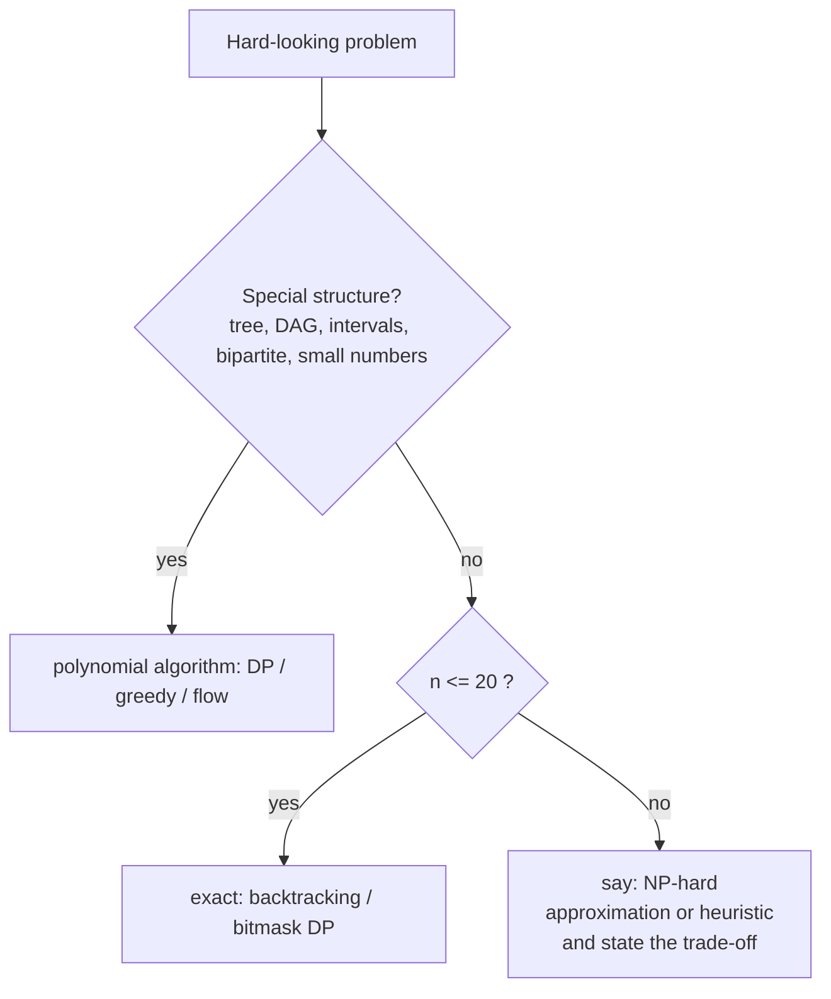
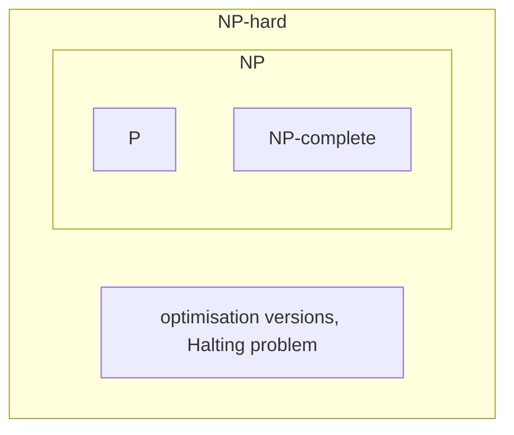

# Complexity Classes Cheat Sheet

> One-page revision for the night before an interview. The full explanations are in notes 01–08. This topic is awareness: recognise a hard problem quickly, say so clearly, and propose a sensible plan.

#### 1. Key Takeaways

1. **P** = solvable in polynomial time. **NP** = a proposed solution can be **checked** in polynomial time. **P ⊆ NP.** NP does **not** mean "not polynomial".
2. **NP-complete** = in NP **and** every NP problem reduces to it. A fast algorithm for one would give one for all. None is known.
3. **NP-hard** = at least as hard as NP-complete; it need not be in NP (optimisation versions, the Halting problem).
4. **P vs NP is open** (Millennium Prize). Most believe P ≠ NP. Never claim it is proven.
5. **Classic NP-complete:** SAT / 3-SAT, Subset Sum (huge numbers), Partition, TSP (decision), Hamiltonian path, graph colouring (k ≥ 3), vertex cover, clique, set cover, bin packing.
6. **Look-alikes in P:** Euler path, 2-colouring, 2-SAT, shortest path, MST, min cut, bipartite matching, subset sum with a small target.
7. **Constraints are a clue:** `n ≤ 20` → exponential is intended; `n ≤ 10⁵` with a "choose a subset" flavour → there is a greedy/DP/sort trick.
8. **Knapsack DP is pseudo-polynomial** (`O(nW)`), not polynomial in the input size.
9. **When stuck with NP-hard:** exact search for small `n`, DP for small numbers, exploit structure, approximation with a guarantee, heuristic otherwise. State what you give up.
10. A **reduction** `A ≤ B` shows B is at least as hard as A. Reduce a known hard problem **to** the new one.

#### 2. Complexity Table

| Growth | `n = 20` | `n = 30` | `n = 50` | Practical limit |
|---|---|---|---|---|
| `n²` | 400 | 900 | 2,500 | `n ≈ 10⁴` |
| `n³` | 8,000 | 27,000 | 125,000 | `n ≈ 500` |
| `2ⁿ` | 10⁶ | 10⁹ | 10¹⁵ | `n ≈ 25` |
| `n!` | 2.4 × 10¹⁸ | 2.7 × 10³² | 3 × 10⁶⁴ | `n ≈ 10` |

| `n` up to | Intended complexity |
|---|---|
| 10 | `O(n!)` |
| 20 | `O(2ⁿ · n)` bitmask / subsets |
| 100 | `O(n⁴)` |
| 500 | `O(n³)` |
| 5,000 | `O(n²)` |
| 10⁵ | `O(n log n)` |
| 10⁶–10⁷ | `O(n)` |
| 10⁹+ | `O(log n)` / `O(1)` |

| Problem | Brute force | Best exact | Approximation / heuristic |
|---|---|---|---|
| TSP | `O(n!)` | Held-Karp `O(2ⁿ n²)` | MST 2-approx, nearest neighbour + 2-opt |
| Subset Sum | `O(2ⁿ n)` | meet in the middle `O(2^(n/2) n)`; DP `O(nT)` | FPTAS for knapsack |
| Vertex cover | `O(2ⁿ E)` | `O(1.27ⁿ)` style algorithms | 2-approximation (matching) |
| Graph colouring | `O(kⁿ)` | backtracking with pruning | greedy colouring |
| SAT | `O(2ⁿ m)` | DPLL / CDCL solvers | local search |

#### 3. Patterns and How to Identify Them

| Signal in the question | Likely class | Plan | Note |
|---|---|---|---|
| "min cost to visit every city once" | TSP, NP-hard | bitmask DP if `n ≤ 20` | 4 |
| "visit every node exactly once" | Hamiltonian path, NP-complete | bitmask DP / backtracking | 4 |
| "visit every edge exactly once" | Euler path, **P** | degree check | 4 |
| "split into `k` equal-sum groups" | partition, NP-hard | backtracking, bitmask DP | 3, 5 |
| "subset with exactly sum `T`" | subset sum | DP if `T` small | 1, 5 |
| "colour with `k` colours" | `k = 2`: **P**; `k ≥ 3`: NP-complete | BFS / backtracking | 4 |
| "choose smallest set covering every edge/element" | vertex / set cover, NP-hard | approximation | 5 |
| "can a boolean formula be satisfied" | SAT, NP-complete | SAT solver | 3 |
| "find the best ... among exponentially many" | NP-hard optimisation | exact if tiny, else heuristic | 6 |





#### 4. Templates to Memorise

**Verifier (the NP idea): fast check of a proposed answer**

```kotlin
fun verifySubsetSum(nums: IntArray, target: Int, chosen: List<Int>): Boolean =
    chosen.toSet().size == chosen.size &&
        chosen.all { it in nums.indices } &&
        chosen.sumOf { nums[it] } == target
```

**Pseudo-polynomial Subset Sum DP**

```kotlin
val dp = BooleanArray(target + 1); dp[0] = true
for (x in nums) for (s in target downTo x) if (dp[s - x]) dp[s] = true
```

**Exact search for small `n`**

```kotlin
for (mask in 0 until (1 shl n)) { /* test the subset described by mask */ }
```

**Vertex cover 2-approximation**

```kotlin
val cover = LinkedHashSet<Int>()
for ((u, v) in edges) if (u !in cover && v !in cover) { cover.add(u); cover.add(v) }
```

**TSP by bitmask DP (Held-Karp)**: see `6` Backtracking note 08.

**Optimisation from a decision oracle**

```kotlin
var lo = 0; var hi = upperBound
while (lo < hi) { val mid = lo + (hi - lo) / 2; if (oracle(mid)) hi = mid else lo = mid + 1 }
```

**Reduction skeleton:** transform the input in polynomial time, call the solver, map the answer back.

#### 5. Brute Force to Optimized

| Problem | Brute force | Better |
|---|---|---|
| Partition Equal Subset Sum | `O(2ⁿ)` | DP `O(n · sum)` |
| Partition into `k` groups | `O(kⁿ)` | backtracking with pruning, bitmask DP `O(2ⁿ n)` |
| Find tour length | all tours | binary search over a decision oracle |
| Euler vs Hamiltonian | try all paths | Euler: degrees `O(V + E)` |
| Vertex cover | all subsets | 2-approximation `O(E)` |
| SAT | all `2ⁿ` assignments | DPLL / CDCL |

#### 6. Common Mistakes and Edge Cases

1. **"NP = not polynomial".** NP is checkable in polynomial time; P ⊆ NP.
2. **Claiming P ≠ NP is proven.**
3. **Calling optimisation problems NP-complete** (they are NP-hard).
4. **Calling knapsack DP polynomial.** It is pseudo-polynomial.
5. **Declaring "NP-hard" without checking structure** (trees, DAGs, intervals, small numbers, bipartite).
6. **Reducing in the wrong direction** when proving hardness.
7. **Offering a heuristic without saying it has no guarantee.**
8. **Forgetting to give a plan** after naming the hardness.
9. **Edge cases:** very small `n`, numbers that are tiny (DP works), graphs that are trees or bipartite, `k = 2` colourings.

#### 7. What to Say Out Loud

1. "Checking a solution is easy, but I don't know a polynomial way to find one. This looks like Subset Sum, which is NP-complete."
2. "The decision version is NP-complete and the optimisation version is NP-hard."
3. "`n ≤ 16`, so an `O(2ⁿ n²)` bitmask DP is intended."
4. "The numbers are small, so the pseudo-polynomial DP in `O(n · T)` is fine."
5. "For large inputs I'd use a 2-approximation, or a heuristic like 2-opt, and tell you it has no optimality guarantee."
6. "P vs NP is open; I'm not aware of a polynomial algorithm for any NP-complete problem."

#### 8. Practice Order (Easy → Medium)

| Level | Question | Link to this topic |
|---|---|---|
| Easy | [Two Sum](https://leetcode.com/problems/two-sum/) | in P: brute force vs hash |
| Medium | [Valid Sudoku](https://leetcode.com/problems/valid-sudoku/) | verify is easy |
| Medium | [Is Graph Bipartite?](https://leetcode.com/problems/is-graph-bipartite/) | 2-colouring in P |
| Medium | [Partition Equal Subset Sum](https://leetcode.com/problems/partition-equal-subset-sum/) | subset sum DP |
| Medium | [Target Sum](https://leetcode.com/problems/target-sum/) | reduces to subset sum |
| Medium | [Last Stone Weight II](https://leetcode.com/problems/last-stone-weight-ii/) | partition-like |
| Medium | [Coin Change](https://leetcode.com/problems/coin-change/) | pseudo-polynomial DP |
| Medium | [Partition to K Equal Sum Subsets](https://leetcode.com/problems/partition-to-k-equal-sum-subsets/) | NP-hard, `n ≤ 16` |
| Medium | [Matchsticks to Square](https://leetcode.com/problems/matchsticks-to-square/) | 4-way partition |
| Hard | [Sudoku Solver](https://leetcode.com/problems/sudoku-solver/) | search vs verify |
| Hard | [Shortest Path Visiting All Nodes](https://leetcode.com/problems/shortest-path-visiting-all-nodes/) | Hamiltonian-path flavour |
| Hard | [Find the Shortest Superstring](https://leetcode.com/problems/find-the-shortest-superstring/) | TSP-like bitmask DP |
| Hard | [Find Minimum Time to Finish All Jobs](https://leetcode.com/problems/find-minimum-time-to-finish-all-jobs/) | bin-packing flavour |
