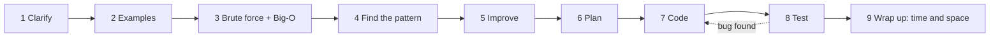

# How to Solve a Coding Problem

> A fixed routine you can repeat under stress. Interviewers score your **process** as much as your code.

**Go deeper:** `ALG 11.1` (how fast different growth rates blow up) and `ALG 11.5` (what to say when a problem looks NP-hard).

#### 1. What Is It?

A 9-step routine for any coding question. Say each step out loud.

| Step | What to do | You produce |
|---|---|---|
| 1. Clarify | Restate the problem. Ask about size, ranges, duplicates, negatives, empty input, return type | A list of assumptions |
| 2. Examples | Work one normal and one edge example by hand | Two examples with answers |
| 3. Brute force | Say the simplest solution and its Big-O, even if slow | Brute force + complexity |
| 4. Find the pattern | Match the signals and the constraints (see the Cheat Sheet) | A named pattern |
| 5. Improve | Say what is repeated or wasted, and which data structure removes it | Better approach + complexity |
| 6. Plan | Describe the steps in plain words. Get a nod from the interviewer | 3 to 5 line plan |
| 7. Code | Clean Kotlin, clear names, small helpers | Working code |
| 8. Test | Dry-run the normal example, then the edge cases | Traced results, bugs fixed |
| 9. Wrap up | State time and space, and one possible improvement | Final complexity |

**If time is short, protect steps 1, 4 and 8.** Most failed rounds solve the wrong problem, miss the pattern, or never test the code.

**Time plan for 45 minutes**

| Phase | Minutes |
|---|---|
| Understand + examples | 5 |
| Brute force + pattern + plan | 5 |
| Code | 20 |
| Test + fix | 10 |
| Wrap up + follow-ups | 5 |

#### 2. How It Works

Example: **Two Sum.** Given `nums` and `target`, return the indexes of two numbers that add up to `target`.

1. **Clarify.** "Exactly one answer? Can I use the same element twice? Can numbers be negative?" (Answers: one answer, no reuse, yes negatives.)
2. **Examples.** `[2,7,11,15], 9 → [0,1]`. Edge: `[3,3], 6 → [0,1]`.
3. **Brute force.** "Try every pair. `O(n²)` time, `O(1)` space."
4. **Pattern.** "I need to ask *have I seen `target − x`?* That is a lookup, so a hash map."
5. **Improve.** "The inner loop only searches for one value. A map answers that in `O(1)`, so total `O(n)`."
6. **Plan.** "One pass. For each number, check the map for its complement. If found, return. Else store this number's index."
7. **Code.** See below.
8. **Test.** Dry run `[2,7,11,15]`: at `2` map is empty, store `2→0`. At `7` complement is `2`, found → `[0,1]`. Edge `[3,3]`: store `3→0`, then second `3` finds complement `3` → `[0,1]`.
9. **Wrap up.** "`O(n)` time, `O(n)` space. If the array were sorted I could use two pointers with `O(1)` space."

**When you are stuck**

| Try | Example |
|---|---|
| Shrink the input | Solve for 2 or 3 elements, then generalise |
| Draw it | Draw the array, tree or grid and move through it by hand |
| Solve a simpler version | Sorted input? One query? No duplicates? |
| Ask what is repeated | Repeated work usually means a map, prefix sum, or DP |
| Ask for a hint | Say what you tried first. Use the hint and say what you learned |

**Edge cases to check every time:** empty, one element, all equal, duplicates, negatives, zero, very large values, already sorted, and sorted in reverse.

**Picture:** The nine steps in order. Steps 1, 4 and 8 are the ones to protect.



#### 3. Brute Force vs Optimized

Always say the brute force first. It shows you understand the problem, and it is your fallback if you run out of time.

| | Brute force | Optimized |
|---|---|---|
| Idea | try every pair | store what you have seen in a map |
| Time | `O(n²)` | `O(n)` |
| Space | `O(1)` | `O(n)` |

#### 4. Kotlin Code

```kotlin
// Brute force: every pair
fun twoSumBrute(nums: IntArray, target: Int): IntArray {
    for (i in nums.indices) {
        for (j in i + 1 until nums.size) {
            if (nums[i] + nums[j] == target) return intArrayOf(i, j)
        }
    }
    return intArrayOf()
}

// Optimized: one pass with a map (LeetCode 1)
fun twoSum(nums: IntArray, target: Int): IntArray {
    val seen = HashMap<Int, Int>()                      // value -> index
    for (i in nums.indices) {
        val need = target - nums[i]
        val j = seen[need]
        if (j != null) return intArrayOf(j, i)
        seen[nums[i]] = i
    }
    return intArrayOf()
}
```

Checks: `twoSum([2,7,11,15], 9)` → `[0, 1]`. `twoSum([3,2,4], 6)` → `[1, 2]`. `twoSum([3,3], 6)` → `[0, 1]`.

Note the order: **check first, then store.** Storing first would let `[3], 6` use the same element twice.

#### 5. Complexity

| | Time | Space |
|---|---|---|
| Brute force | `O(n²)` | `O(1)` |
| Hash map | `O(n)` | `O(n)` |

Rule: write down the Big-O of the brute force **before** you improve it. The gap between the two is your story.

#### 6. Common Mistakes

1. **Coding in the first two minutes.** Clarify and plan first.
2. **Going silent.** The interviewer cannot score thinking they cannot hear.
3. **Skipping the brute force.** You lose the baseline and the comparison.
4. **Never testing.** Always trace one example through your own code.
5. **Testing only the happy path.** Try empty, one element, and duplicates.
6. **Panicking at a bug.** Stop, re-read the line, trace the failing input, fix one thing.
7. **Memorising solutions.** You can't adapt them when the question changes slightly.

#### 7. Say This in the Interview

1. "Let me restate the problem to be sure I understand it. Can I assume ...?"
2. "The brute force is ..., which is `O(n²)`. I think we can do better because ..."
3. "This looks like a ... problem because ..."
4. "Before I code, here is my plan. Does that sound right?"
5. "Let me trace this example through the code."

#### 8. Quick Check

1. Which three steps do you protect when time is short?
2. In `twoSum`, why check the map **before** storing the current number?

<details>
<summary>Answers</summary>

1. Clarify (1), find the pattern (4), test (8).
2. So an element cannot pair with itself. Example `[3], 6` would wrongly succeed otherwise.

</details>

#### 9. Related LeetCode Questions

Warm-ups to practise the routine itself (not a pattern yet):

| # | Question | Idea |
|---|---|---|
| 1 | [Two Sum](https://leetcode.com/problems/two-sum/) (Easy) | hash map |
| 217 | [Contains Duplicate](https://leetcode.com/problems/contains-duplicate/) (Easy) | hash set |
| 242 | [Valid Anagram](https://leetcode.com/problems/valid-anagram/) (Easy) | counting |
| 20 | [Valid Parentheses](https://leetcode.com/problems/valid-parentheses/) (Easy) | stack |
| 21 | [Merge Two Sorted Lists](https://leetcode.com/problems/merge-two-sorted-lists/) (Easy) | dummy node |
| 49 | [Group Anagrams](https://leetcode.com/problems/group-anagrams/) (Medium) | map with a key |
| 56 | [Merge Intervals](https://leetcode.com/problems/merge-intervals/) (Medium) | sort, then scan |
